<!-- LTeX: language=ru-RU -->
<!-- 3.1.1 Краткое описание по работе с таблицей проекта -->


# инструкция Краткое описание по работе с таблицей проекта

## Назначение.

Основная цель таблицы проекта это, обеспечить единое рабочее пространство для работы с содержанием проекта (тендер).


###### Таблица проекта нужна, чтобы:

1. Определить основные условия проекта (условий закупки и проекта договора).
2. Определить товары и их кол-во которые необходимо поставить в рамках этого проекта
3. Разделить товары по группам для рассылки поставщикам (например если мы закупаем ботинки и гвозди, то запросы на ботинки надо отправлять тем кто занимается обувью, а запросы на гвозди тем кто занимается гвоздями)
4. Собрать емейлы потенциальных поставщиков на товар определенной группы
5. Разослать всем поставщикам письма с запросом на поставку товара (рассылка происходит автоматизированно)
6. Собрать все предложения с ценами и сроками в одну таблицу
7. Автоматически отсортировать по возрастанию цены
8. Провести техническую экспертизу предложений
9. Выбрать наиболее подходящих поставщиков 
10. Фиксировать и мониторить вопросы и проблемы по проекту

---

## Описание листов
В проекте разделён на несколько листов, переключение между листами происходит в нижней части таблицы.


---

## Лист “**0-Паспорт проекта**” 

###### **Внешний вид**:
* 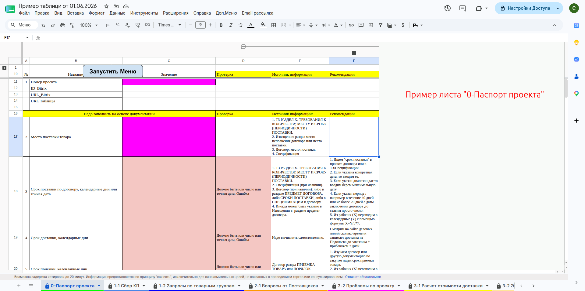

###### **Основные пользователи**: 
* `менеджер`.

###### **Назначение**:
* Данный лист используется для фиксации основной информации по проекту, которая изложена в документации. 
* Лист заполняет менеджер проекта при изучении документации и при переходе проекта в стадию контрактации (примечание лист может быть заполнен автоматический из Битрикс).
* Лист снабжен инструкцией/рекомендациями где искать в документации интересующие основные сведения, такие как срок поставки, срок приемки, срок оплаты, место поставки, наличие обеспечений и .т.д.
* Заполнение данными из Битрикс происходит автоматический, но можно обнавить в ручную. Для этого выполните два пункта меню.
    * Доп.Меню -> 10 Битрикс -> Найти Расчет в Битрикс
    * Доп.Меню -> 10 Битрикс -> Получить из Битрикс
    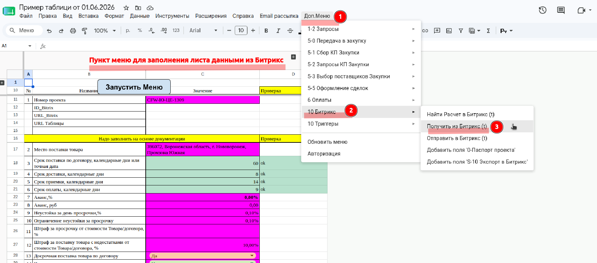
---

## Лист “**1-1 Сбор КП**”

###### **Внешний вид**:
* 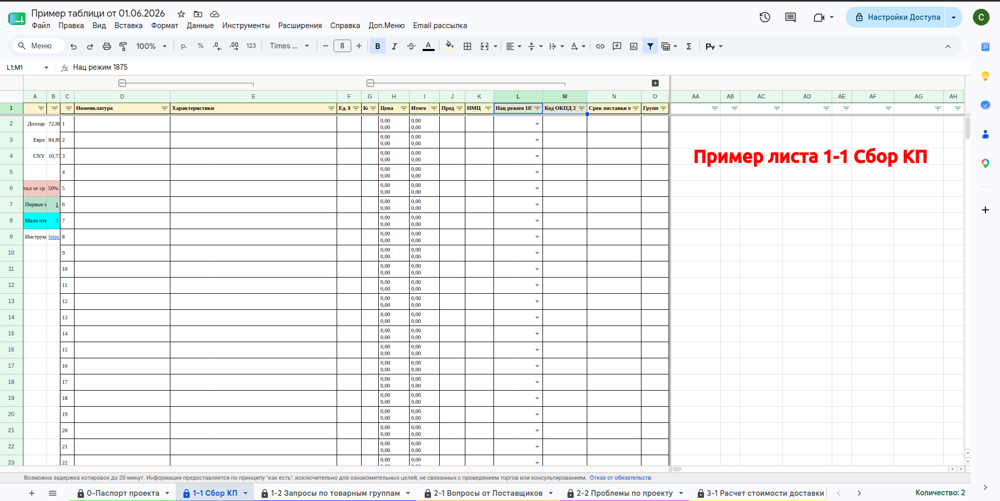

###### **Основные пользователи**: 
* `Специалист по расчету тендера`.

###### **Назначение**:
* Указания списка товаров и их кол-во которые необходимо поставить в рамках этого проекта
* Отображения минимальной цены за товар (как на оригинал, так и на аналог)
* Отображения краткой сводки по сбору КП (достаточно ли предложений по этому товару, есть ли аналоги)
* Отображение НМЦ за товар
* Общие требования по Государственному оборонному заказу "Нац режим 1875" "Код ОКПД 2"
* 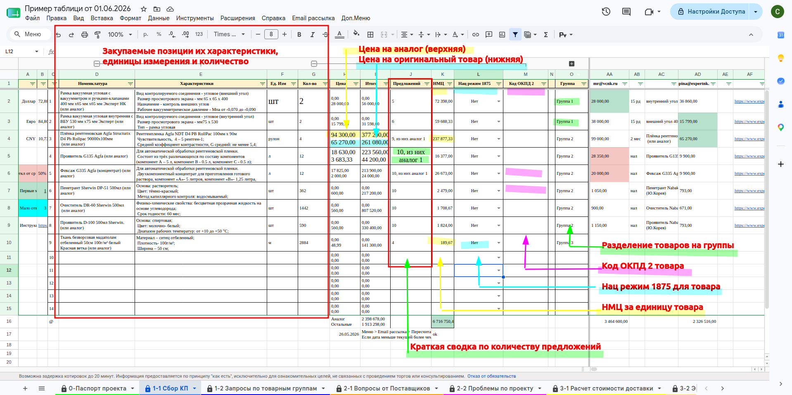

* Отображения предложения поставщиков.
* На одного поставщика выделяются 3 столбца, которые чередуются.
    * Цена за единицу
    * Срок поставки
    * Модель предлагаемого товара
* 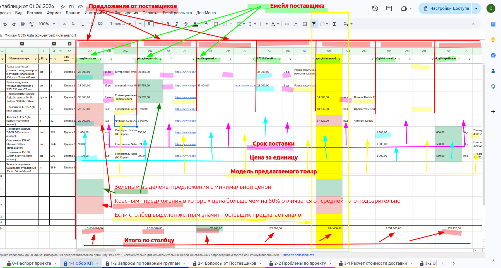
* Зеленым выделены предложения с минимальной ценой
* Красным выделены подозрительные предложения в которых цена больше чем на 50% отличается от средней
* Если столбец поставщика закрашенный желтым значит, что поставщик предлагает аналог.


<- * ~~Требуется ли сбор дополнительных данных по товару (Сертификат, паспорт поверка и прочее)~~ ->
<- * ~~Выбор трех поставщиков с наименьшими ценами~~ ->
 
###### **Описание основных элементов листа**

<- * ~~Если проскролить лист в право, то можно увидеть выбор поставщиков с минимальной ценой~~ ->
* В ячейках В2, B3, В4 задаются курсы валют (они подтягиваются через формулы, надо следить чтобы они были актуальными)
* 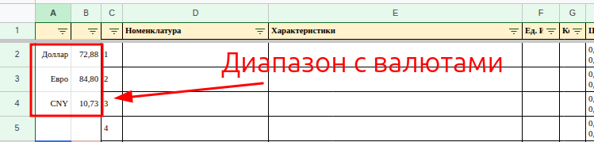 


###### **В настройках таблицы указывается:**

* `откл от ср` - Сколько процентов считать отклонением от средней цены и подсвечивать красным (по умолчанию 50%)
* `Первые мин знач` - сколько мест в ценовом ранжировании подсвечивать зеленым (по умолчанию 1. Только поставщики с минимальной ценой подсвечиваются зеленым (их может быть несколько с одинаковой ценой))
* `Мало ответов` - число ответов которое считается недостаточным, данные товары выделяются голубым (по умолчанию 3 и менее ответов)
* 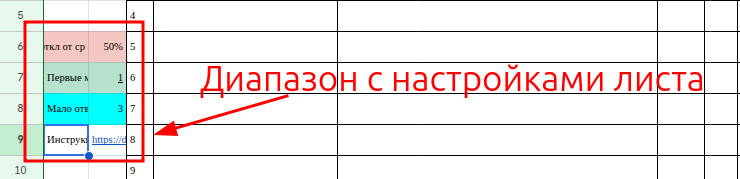


###### **Все цены на товары указаны в рублях с НДС** 
* Если поставщик нам прислал счет или кп в котором цены за единицу указаны без НДС (цены с НДС за каждую позицию не указаны) то вводим цену формулой **`= Цена товара*1,2`**. Например, товар стоит 100 рублей без НДС, тогда в ячейке с ценой пишем **`=100*1,2`**
* Если поставщик в принципе работает без НДС то делаем аналогично предыдущему пункту
* Если цена у поставщика указана за упаковку товара, а у нас в таблице за единицу товара то вводим цену формулой =Цена за упаковку / кол-во штук в упаковке.


* Если цена за одну позицию у поставщика разная, например из 10 штук поставщик может поставить 5 штук за рубль а 5 штук за 2 рубля (например по причине разных партий) То суммируем итоговую цену и делим на общее кол-во, все записываем формулой = (итоговая цена партии 1 +  итоговая цена партии 2) / общее кол-во

* (другой пример.)
* Если цена за одну позицию у поставщика разная (например по причине разных партий) , например из 7 штук поставщик может поставить 4 штук за 100 рублей за штуку, а 3 штук за 170 рубля за штуку, то пишем средневзвешенную цену `Средняя_цена = Вся_потраченная_сумма / Все_купленные_штуки`, то итоговые суммы делим на общее кол-во, все записываем формулой = (итоговая цена партии 1 +  итоговая цена партии 2) / общее кол-во, получится 130 рублей

```text
    Итоговая цена партии 1: 4 шт. × 100 руб. = 400 руб.
    Итоговая цена партии 2: 3 шт. × 170 руб. = 510 руб.
    Общая сумма: 400 + 510 = 910 руб.
    Общее кол-во: 4 + 3 = 7 шт.
    Делим: 910 / 7 = 130 рублей
```


* Если цена у поставщика указана в долларах или евро или еще какой-то валюте отличной от рубля, то задаем ее тоже через формулу 
    * `= Цена товара * B2` - для долларов,  
    * `= Цена товара * B3` - для Евро
    * `= Цена товара * B4` - для CHF или другой валюты
    * При этом в ячейках **B2**, **B3** и **B4** указаны курсы валют

* Если цена у поставщика указана в долларах или евро или еще какой-то валюте отличной от рубля и БЕЗ НДС, то задаем ее тоже через формулу
    * `= Цена товара * B2 * 1,2` - для USD Долларов,  
    * `= Цена товара * B3 * 1,2` - для EUR Евро
    * `= Цена товара * B4 * 1,2` - для CNY Китайский юань
    * При этом в ячейках **B2**, **B3** и **B4** указаны курсы валют
* Если мы запрашивали стоимость составного товара (товар стоит из нескольких частей) а поставщик нам прислал цену за каждую часть отдельно, то в ячейке с ценой пишем формулой сложение всех цен. 
* Если в счете есть доставка, то размазываем ее в цену товара

###### **Сроки поставок и список сокращений**

* От поставщиков сроки поставок могут быть указанных в разных форматах. При внесении сроков в таблицу строго по формату ниже. Эти данные автоматически используются системой для пересчета дат и планирования закупок. Любой лишний текст или неверный формат ломают формулы.


| Для срока                 | Что пишем в ячейку | Коэффициент пересчета | Пример заполнения |
| :--- | :--- | :--- | :--- |
| В наличии | нал | `0` | `нал` |
| В календарных днях | Только число | `1` | `10` |
| В рабочих днях | Число рд | `1,4` | `10 рд` |
| В неделях | Число н | `7` | `2 н` |
| В рабочих неделях | Число недель умножаем на 5 рабочих дня в неделе <br>и записываем в рабочих днях рд| `1,4` | `15 рд` |
| В месяцах | Число м | `30` | `1 м` |
| В диапазоне | Число дефис число | `По максимальному или среднему` | `10-30 рд или 2-4 н` |


###### **Важно:**

* Важно, при работе с электронной почтой, специалист по расчету обрабатывает только непрочитанные письма. Соответственно если Вы выбрали изначально не прочитанное письмо, и в нем есть информация которую надо внести в таблицу, то надо либо внести ее самостоятельно, либо пометить письмо непрочитанным.

---

## **Лист “1-2 Запросы по товарным группам”**

###### **Внешний вид**:
* 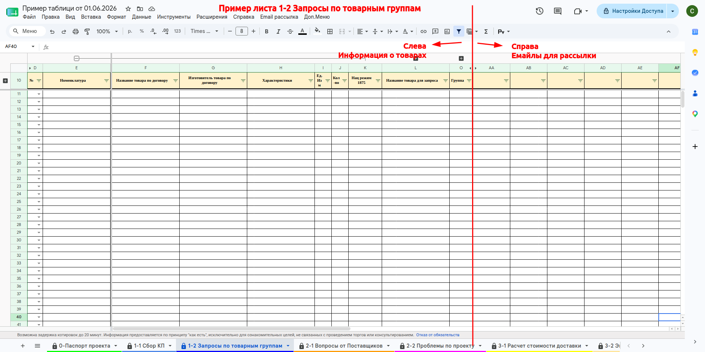

###### **Основные пользователи**: 
* `Специалист по расчету тендера`
* `Специалист по подбору оборудования`

###### **Назначение**:

* Разделения товаров на однотипные группы.
* Составления списка рассылки. Указания емейлов поставщиков для направления запроса.

###### **Заполнение**:
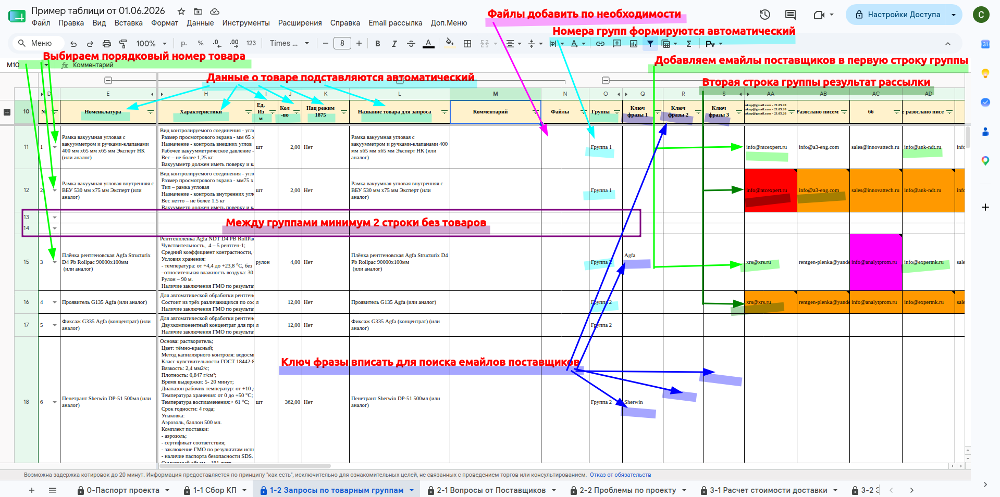


* Выберете порядковый номер товара в столбце **№**.
* Столбцы: **Номенклатура, Название товара по договору, Изготовитель товара по договору, Характеристики, Ед. Изм, Кол-во, Нац режим 1875, Название товара для запроса** заполнятся автоматический.
* Чтобы разделить группы, между товарами оставьте минимум 2 строки пустыми.
* Номера групп формируются автоматический.
* Столбец "Название товара для запроса" при необходимости можно изменить
* Файлы добавить по необходимости


###### **Файлы**
Если дополнительно с товаром мы хотим отправить файл (например чертеж изделия или фото изделия, или еще что-то), то необходимо:

* Создать в папке "Почтовые вложение" подпапку с номером проекта и названием проекта (таким же как и у таблицы) https://drive.google.com/drive/folders/1LZ9dF6iXZrH8YC-Z6xX5T2zAABhUGTGr 

* 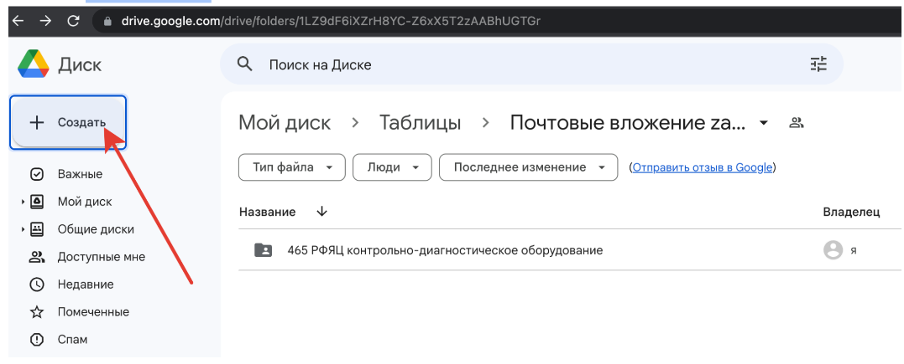

* Загрузить туда нужные файлы
* 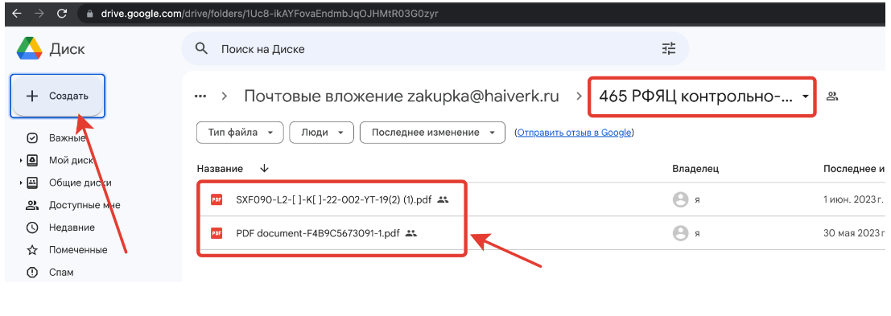


* ДЛЯ КАЖДОГО ДОКУМЕНТА В ОТДЕЛЬНОСТИ
* Нажимаем кнопку открыть доступ
* 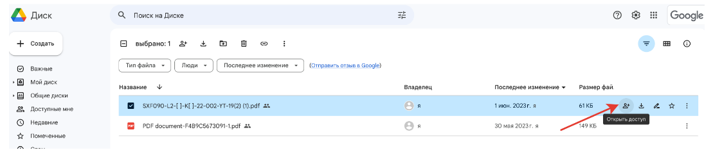


* Убеждаемся что у всех есть доступ на чтение
* 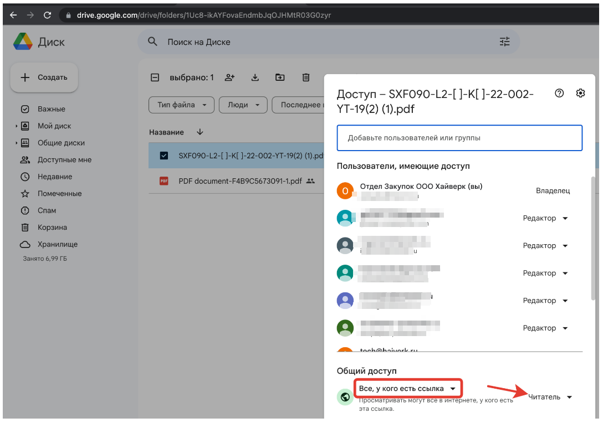


* Копируем ссылку на документ
* 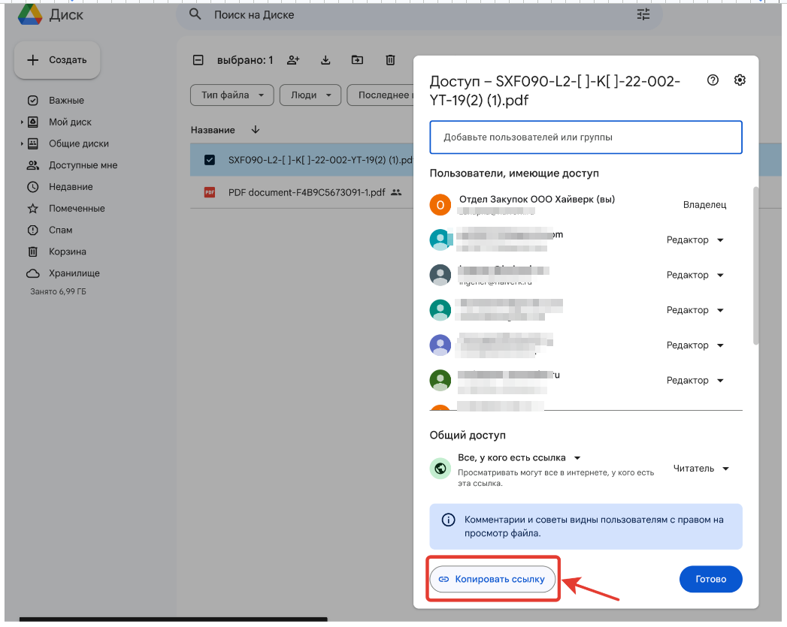


* Вставляем ссылку на файл в таблицу в столбец "Файлы" в первый товар группы в которой он находится

* Если файлов несколько, то вставляем в одну ячейку несколько ссылок, каждую с новой строки
* 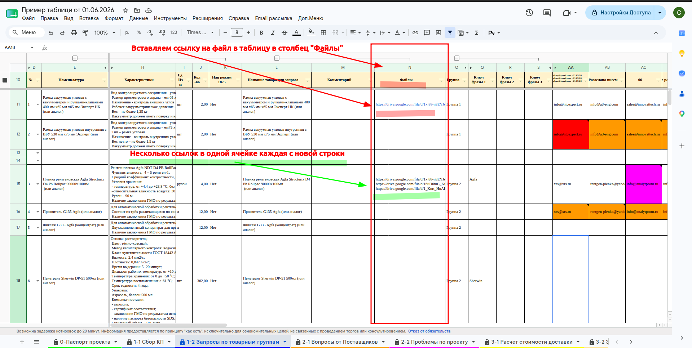


###### **Ключ фразы**

Если в названии товара не указан изготовитель, то ищем его в интернете и указываем правее от названия группы. Если у товара может быть несколько производителей (например выключатель), то указываем название товарной группы вместо изготовителя, если есть вопросы как определить группы ищем подсказку в интернете
* 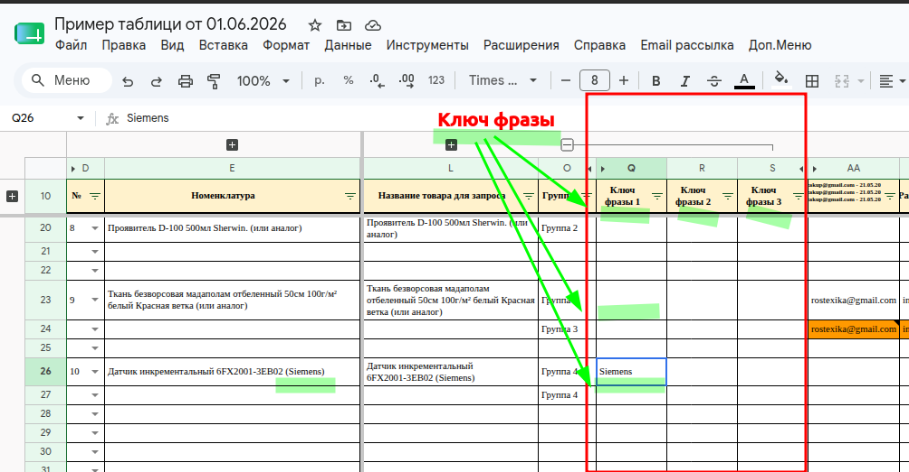


###### **Основные правила внесения емейлов** 
* 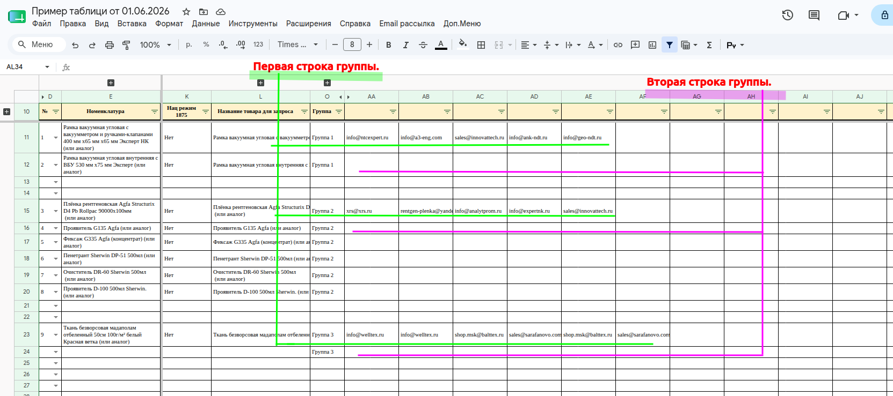
* Емейлы вносятся в первую строку каждой группы
* Емейлы вносятся начиная со столбца AA

* Во вторая строка заполняется автоматически с уникальными емейлами из первой строки, например если в первую строку были введены два одинаковых емейла, то во второй строке он будет один.
* 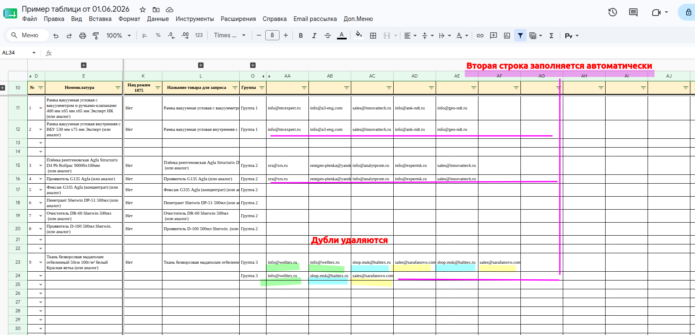


###### **Меню листа “1-2 Запросы по товарным группам”** 
* 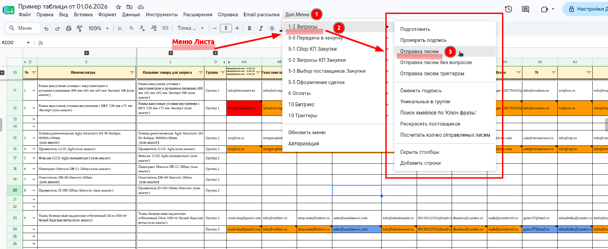
* `Подготовить` - устанавливает подпись и в зависимости от аккаунта (емайла)отправителя. Выполняет пункты меню "Уникальные в группе", "Поиск емейлов по 'Ключ фразы'", 
* `Проверить подпись` - Показывает подпись, емаил с которого будут отправлены письма, и лимит писем.
* `Отправка писем` - Перед отправкой писем, просит проверить емаил отправителя и его подпись. Выполняет пункты меню "Уникальные в группе"
* `Отправка писем без вопросов` - Только отправка писем. Перед выполнением этого пункта меню рекомендую хотя бы раз выполнить "Отправка писем"
* `Отправка писем триггером` - создает триггер который раз в 10 менут в течение 6 часов будет отправлять письма. Перед выполнением этого пункта меню рекомендую хотя бы раз выполнить "Отправка писем".

* `Сменить подпись` - Изменить подпись в ручную, если значение пустое то подпись будет определена автоматический.
* `Уникальные в группе` - Заполнит вторую строку группы.
* `Поиск емейлов по 'Ключ фразы'` - Найдет емаилы поставщиков по ключевому слову. 

* `Раскрасить постовщиков` - Раскрашивает поставщиков согласно их оценки по предыдущему опыту взаимодействия и наличие ответа на нашу рассылку на листе "1-1 Сбор КП". Условные обозначение цветов есть на листе "3-3 Выбор поставщиков"
* 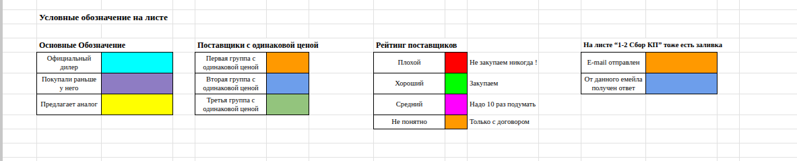

* `Посчитать кол-во отправленных писем` - посчитает количество уникальных емайлов по которым: Разослано писем, Не разослано писем, Ошибок, Всего.
* 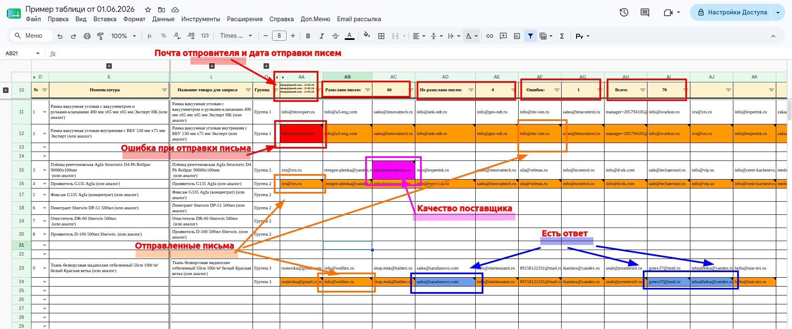


Лист_2_1_Вопросы_от_поставщиков

---

## Лист “**2-1 Вопросы от поставщиков**” 

###### **Внешний вид**:

* 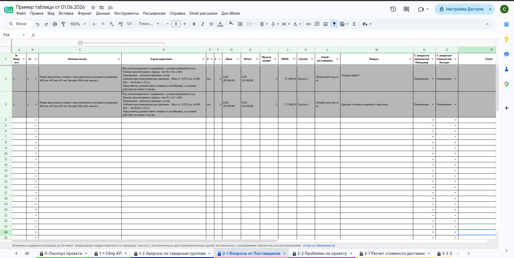
* 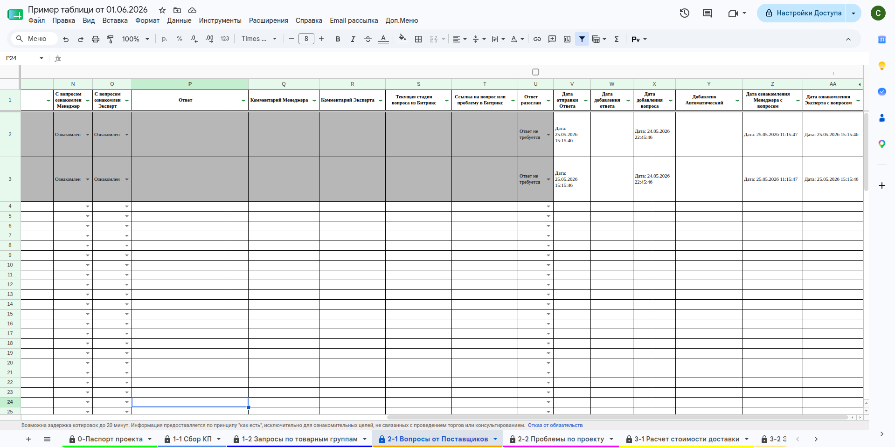


###### **Основные пользователи**: 

* `менеджер`
* `Специалист по расчету тендера`, 
* `Cпециалист по подбору оборудования`

###### **Назначение**:
* Фиксирования вопросов, которые задают поставщики письменно или по телефону. 
* Принятия решения по ответу;
* Разработки ответа.

* Подразумевается, что эти вопросы имеют значение для нас, это например технические вопросы: если в ТЗ не раскрыта вся информация необходимая для заказа товара или вопросы относительно конечного заказчика. 
* Если ответ на технический вопрос не известен, то лицо, получившее вопрос, вносит его в таблицу.

* С вопросом должен быть ознакомлен менеджер, и эксперт (специалист по подбору оборудования, или лицо, которое проводит техническую экспертизу по проекту).
* На технический вопрос подготавливается ответ экспертом. 
* Подготовленные ответы рассылает лицо, получившее вопрос, как правило, это специалист по расчету тендера.


---


## Лист “**2-2 Проблемы по проекту**” 

###### **Внешний вид**:

* 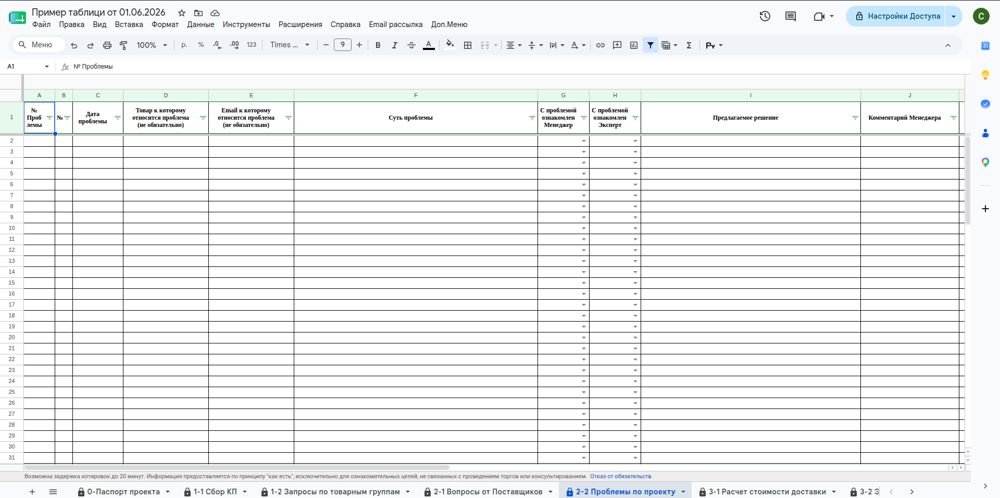
* 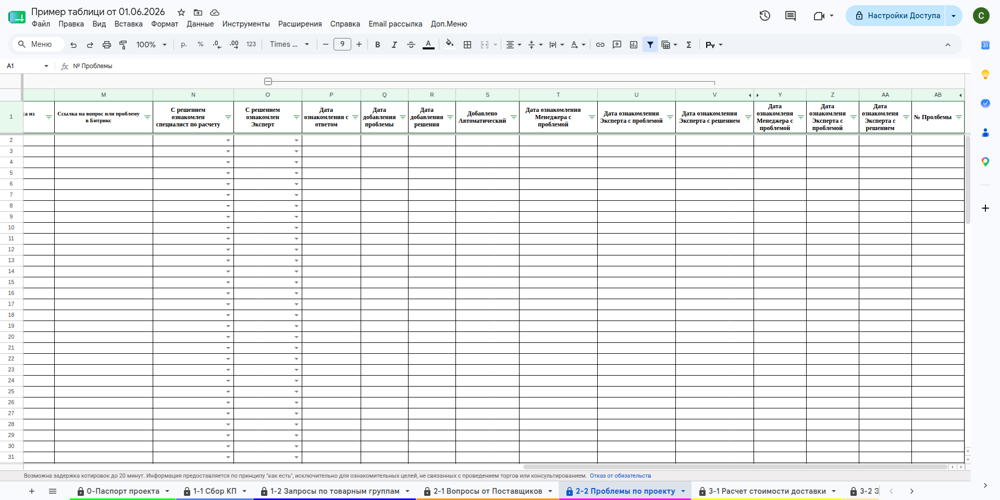

###### **Основные пользователи**: 
* `менеджер`
* `Специалист по расчету тендера`
* `Специалист по подбору оборудования`

###### **Назначение**:
* Фиксации проблем по проекту в случаях:
    * Отсутствуют или недостаточно КП по позиции;
    * Выявлены ошибки в ТЗ;
    * Не найдены соответствующие товары;

---


## Лист “**3-1 Расчет стоимости доставки**” 

###### **Внешний вид**:
* 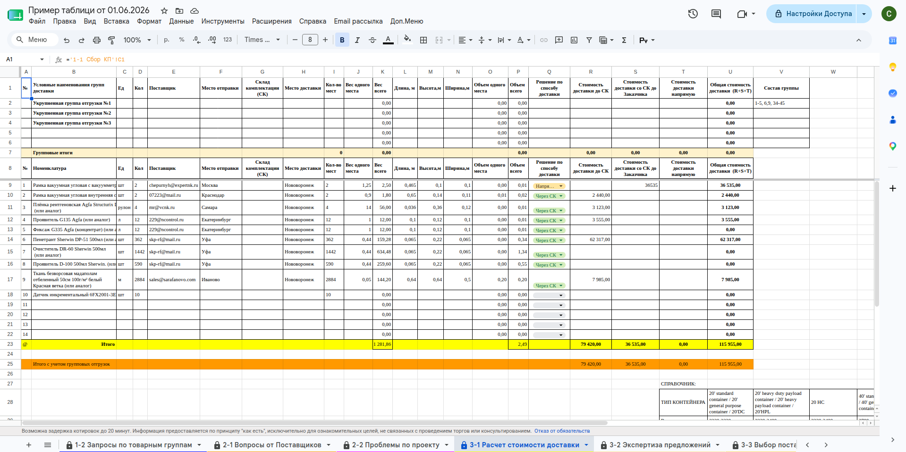

###### **Основные пользователи**: 
* `менеджер`
* `Специалист по расчету тендера`


###### **Назначение**:
* На данном листе фиксируется информация необходимая для расчета стоимости доставки (маршрут, габариты и вес груза, количество мест) и ценовая информация собранная в ходе расчета доставки.

---


## Лист “**3-2 Экспертиза предложений**” 

###### **Внешний вид**:
* 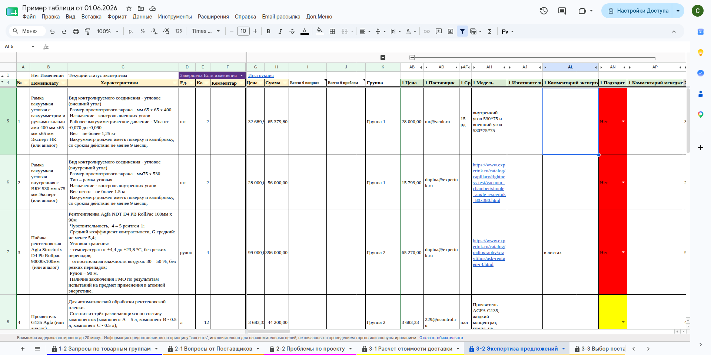
* 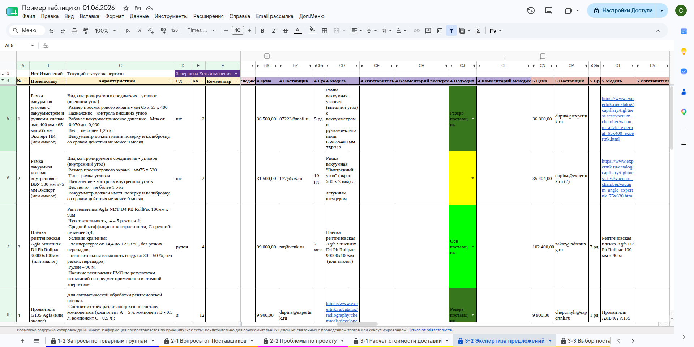

###### **Основные пользователи**: 
* `менеджер`
* `Специалист по подбору оборудования`

###### **Назначение**:
* На данном листе фиксируются результаты работы по оценке соответствия предложений от поставщиков техническому заданию заказчика

---


## Лист “**3-3 Выбор поставщиков**” 

###### **Внешний вид**:
* 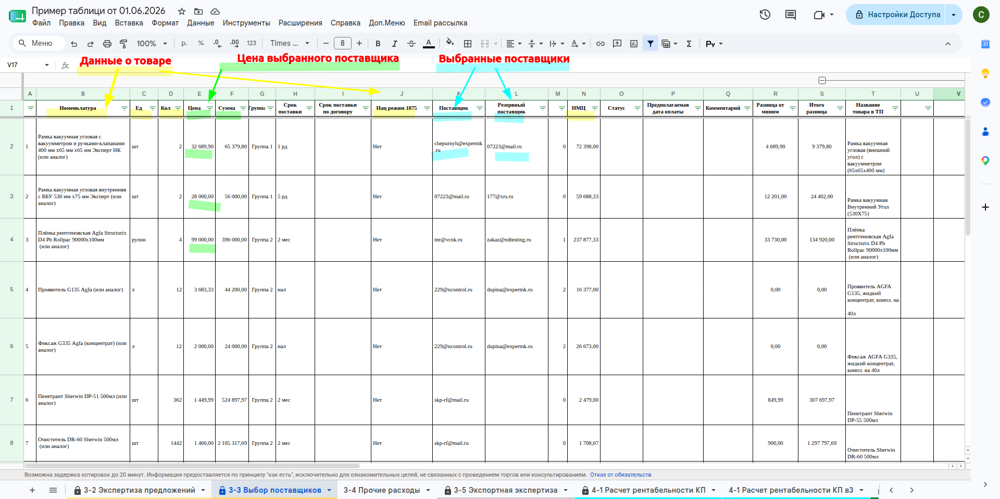
* 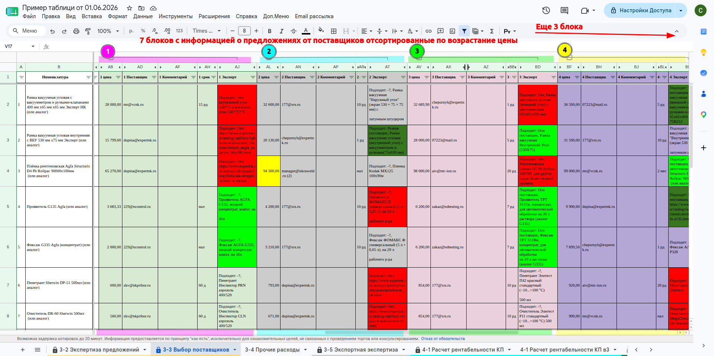

* 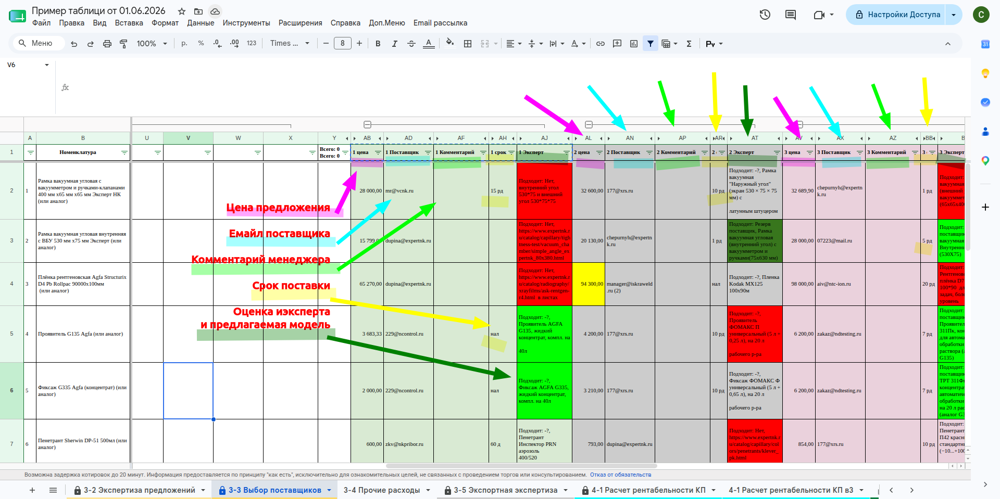

* На листе есть: 
    * Данные о товаре
    * Выбранные поставщики основной и резервный.  
    * Цена основной поставщика для этого товара.
    * 7 блоков с информацией о предложениях от поставщиков отсортированные по возрастание цены, каждый блок содержит 
        * Цена предложения
        * Емайл поставщика
        * Комментарий менеджера	
        * Срок поставки
        * Оценка и комментарий эксперта и предлагаемая модель


###### **Основные пользователи**: 
* `Менеджер`
* `Специалист по расчету тендера`


###### **Назначение**:
* Анализа предложений поставщика
* Внесения комментариев по поставщику
* Выбор итоговых поставщиков
* Поставщики отсортированы по возрастанию цены у каждого поставщика есть срок поставки + к каждому поставщику можем написать комментарий

* Наша задача выбрать самого дешевого поставщика подходящего под ТЗ. ОЧЕНЬ ВАЖНО УБЕДИТЬСЯ ЧТО ТО ЧТО ПРЕДЛАГАЕТ ПОСТАВЩИК ПОДХОДИТ ПОД ТЗ. Для этого копируем емейл поставщика, заходим на почту вставляем в поиск скопированный емейл открываем его предложение и анализируем подходит оно или нет. Если есть вопросы пишем поставщику. 
* Для написания писем поставщику можем использовать стандартные шаблоны.  
* Например шаблон: “`Кто изготовитель`” Посылает вот такое письмо 

```txt
Добрый день 
1. Кто изготовитель предлагаемого Вами оборудования?
2. Какой год выпуска?  
К сожалению без этих данных не может оценить подходит ли Ваше предложение.

```  

* Эта информация является важной так как например один, и тот же выключатель могут выпускать разные изготовители. А в тз иногда четко указан изготовитель и чаще всего написано “Оборудование не ранее 2021 года выпуска”, соответственно все старое не подходит.

* Начинаем просматривать поставщика от самого дешевого к более дорогому. К каждому просмотренному поставщику пишем комментарий понятный другому человеку (желательно краткий, но понятный) либо почему не подошел, либо пишем что подошел.
* Емейл подходящего поставщика вставляем в графу **"Поставщик"** столбец  **"K"**, и возможно резервного поставщика в графу **"Резервный поставщик"** столбец **"L"**. 
* При выборе поставщиков необходим творческий подход, возможно выгоднее купить на 10 рублей дороже, но у одного поставщика, чем у десятерых. Также надо учитывать что на каждого отдельного поставщика приходится сумма доставки + человеческие ресурсы по отслеживанию забору и хранению этого груза.
* Некоторые поставщики автоматически подсвечиваются цветом далее приведена расшифровка каждого цвета:
* Основное обозначение поставщика (цвет ячейки с емайлом).

    * 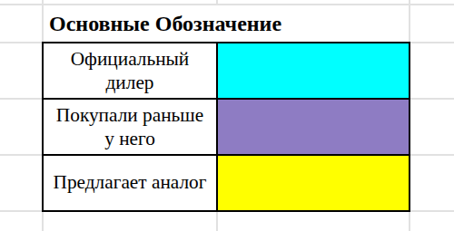
* Поставщики с одинаковой ценой
    * 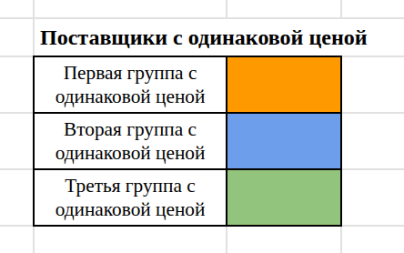
* Рейтинг поставщиков
    * У поставщиков с рейтингом плохой никогда ничего не покупаем и не ориентируемся на их цены.
    * 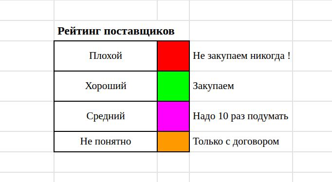

* Раскраска отправленных писем.
    * 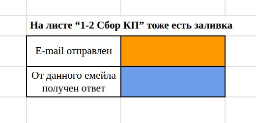


* В системе отображается по какому количеству товаров, выбранный поставщик, входит в топ 7 лучших цен.
* 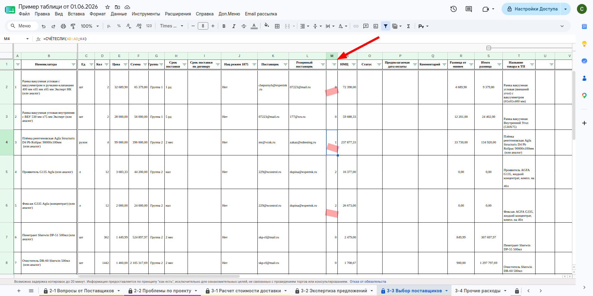

* При выборе поставщика не с самой минимальной ценой мы видим итоговую разницу насколько у выбранного поставщика дороже минимальной цены в системе (при этом не факт что самое дешевое нам подходит)
* 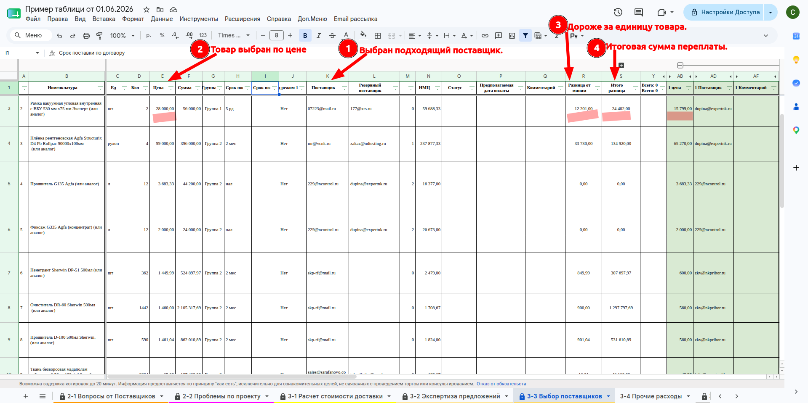

* Если мы видим, что запрашиваемый товар снят с производства и все поставщики предлагают аналог или предлагаемый аналог полностью подходит под ТЗ и нам выгоднее поставить именно его, тогда помечаем эту строку желтым цветом и в комментарии пишем, что предлагаем аналог. 
* 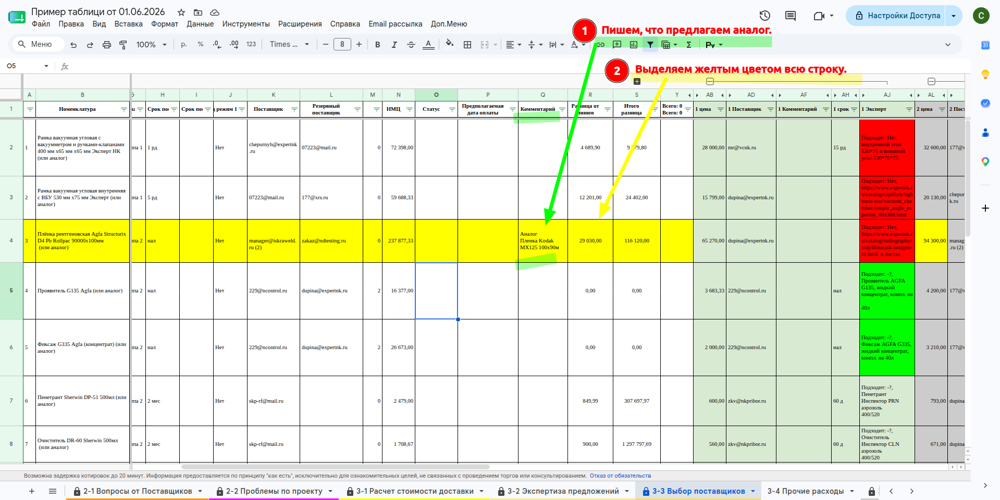

* Получаем итоговую сумму итого
* 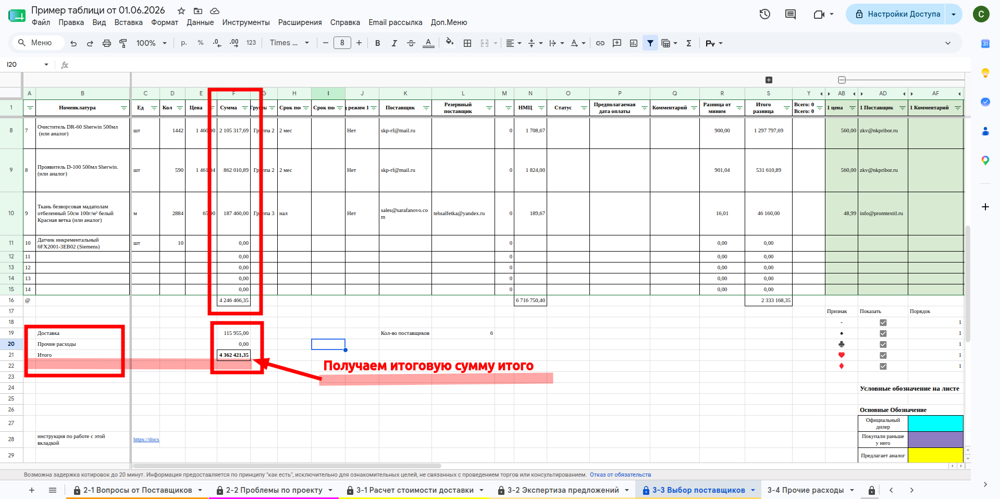


---
---

## Лист “**Лист “4-1 Расчет рентабельности”**” “**Лист “4-1 Расчет рентабельности КП в3”**”
###### **Внешний вид**:
* 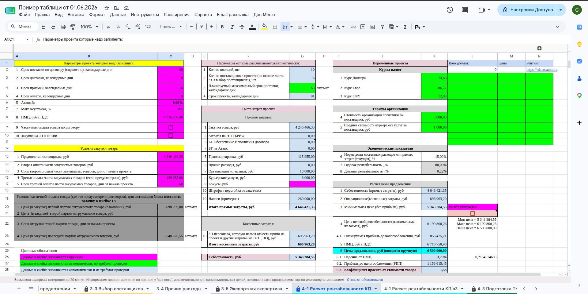
* 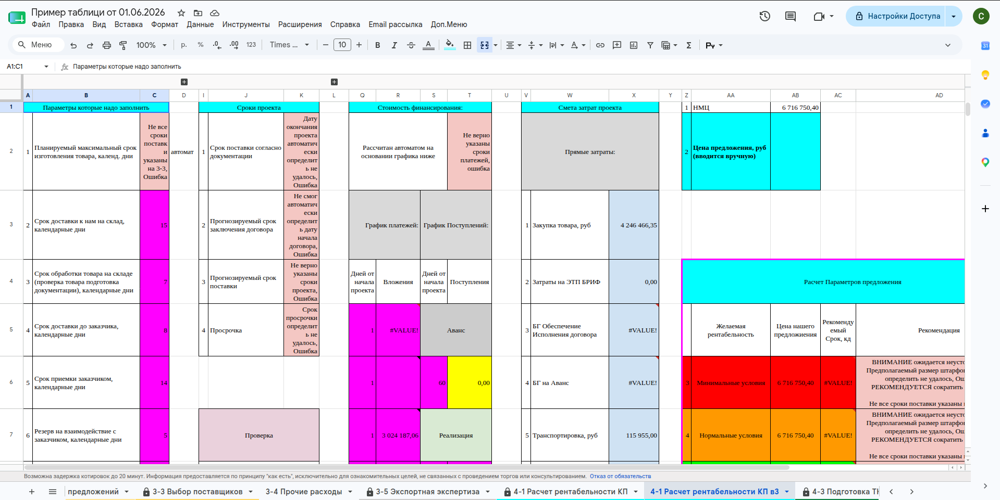

###### **Основные пользователи**: 
* `менеджер`


###### **Назначение**:
*  Данный лист используется для формирования сметы затрат, расчета прогнозной прибыли и определения ценообразования по проекту (цены нашего КП). 

---
---


## Лист “**4-2 подготовка КП**” 

###### **Внешний вид**:
* 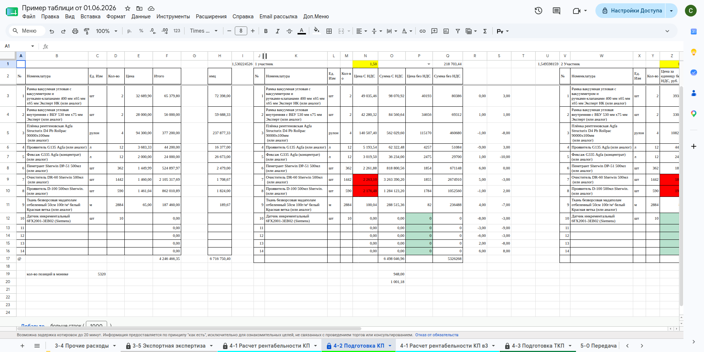

###### **Основные пользователи**: 
* `менеджер`


###### **Назначение**:
* Используется при необходимости подготовить более 1 КП по данному проекту. 

---

---


## Лист “**4-3 Подготовка ТКП**” 

###### **Внешний вид**:
* 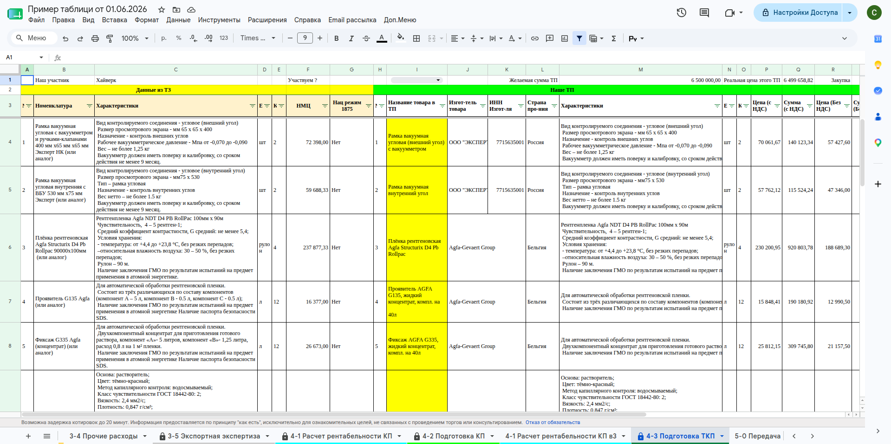

###### **Основные пользователи**: 
* `менеджер`

###### **Назначение**:
* Используется для формирования технико-коммерческого предложения, на основе которого формируется Заявка на участие в закупке или КП для заказчика.

---
---


## Лист “**Группы листов 5, 6, 7**” 

###### **Внешний вид**:
* 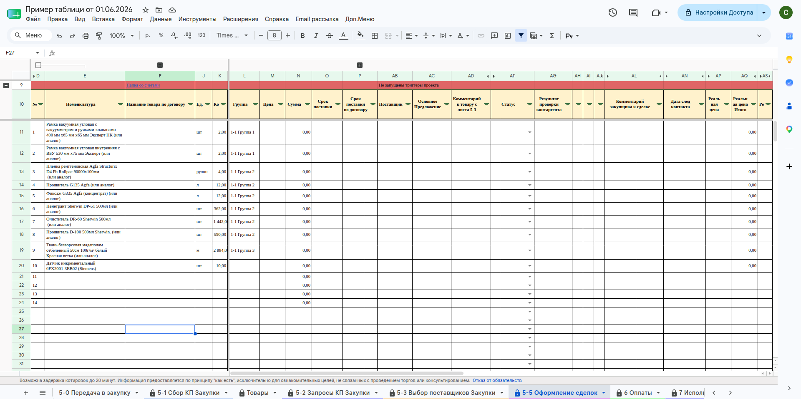

###### **Основные пользователи**: 
* `менеджер`


###### **Назначение**:
* Данные листы используются на этапе Исполнения контракта.

---
 
 
 
