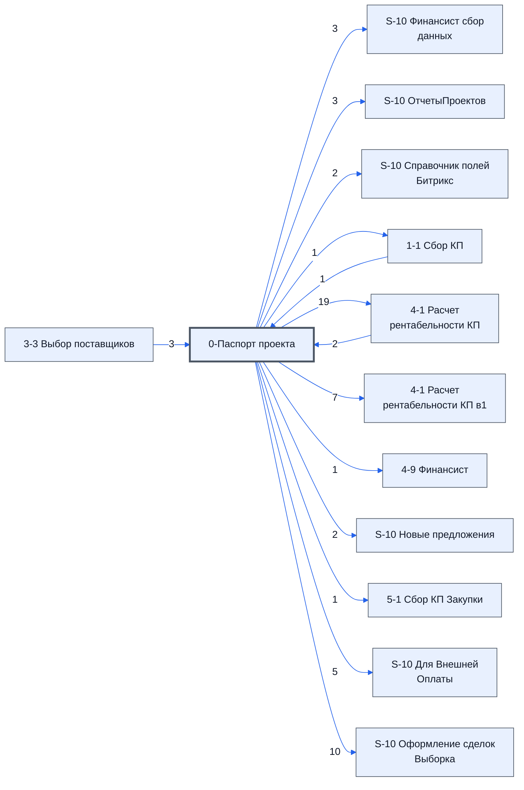

# Лист «0-Паспорт проекта»

Таблица: таблица проекта · контур 0.

**Зачем** (со слов): основные настройки, приходят из Битрикс24.

Устройство листа — заголовки, вид столбцов, списки, формулы, связи с другими листами — собрано из таблицы ниже. Строка заголовков на этом листе угадана по закреплённой области — проверить.

## Зачем лист — подробно

*Заполнить:* что на листе происходит, откуда приходят данные и куда уходят.

## Как заполнять

*Заполнить:* какие столбцы вводят руками, какие считаются сами. Что значит каждый столбец — в `stolbtsy.yaml` рядом (поля `chto` и `kak`).

## Что нельзя трогать

*Заполнить.*

## Инструкции и умения

*Заполнить:* какие инструкции и умения относятся к листу.

## Осталось сделать

- Заполнить разделы выше и `stolbtsy.yaml`.

## Устройство (из таблицы)

- **Таблица:** таблица проекта, лист «0-Паспорт проекта»; контур 0
- **Размер:** `A1:K112`, закреплено до `A11`
- **Каркас:** свой, не общий; строка заголовков — 10, угадана по закреплённой области — проверить
- **Формул:** 44; заполненных ячеек без формул в данных: 299; списков: 11; условного форматирования: 2; объединённых ячеек: 4

## Связи с другими листами

- **Берёт данные с листов:** [3-3 Выбор поставщиков](../k1-3-3-vybor-postavshchikov/index.md) (3), [4-1 Расчет рентабельности КП](../k1-4-1-raschet-rentabelnosti-kp/index.md) (2), [1-1 Сбор КП](../k1-1-1-sbor-kp/index.md) (1)
- **Его данные используют:** [S-10 Финансист сбор данных](../k0-s-10-finansist-sbor-dannykh/index.md) (3), [S-10 ОтчетыПроектов](../k0-s-10-otchetyproektov/index.md) (3), [S-10 Справочник полей Битрикс](../k0-s-10-spravochnik-poley-bitriks/index.md) (2), [1-1 Сбор КП](../k1-1-1-sbor-kp/index.md) (1), [4-1 Расчет рентабельности КП](../k1-4-1-raschet-rentabelnosti-kp/index.md) (19), [4-1 Расчет рентабельности КП в1](../k1-4-1-raschet-rentabelnosti-kp-v1/index.md) (7), [4-9 Финансист](../k1-4-9-finansist/index.md) (1), [S-10 Новые предложения](../k1-s-10-novye-predlozheniya/index.md) (2), [5-1 Сбор КП Закупки](../k2-5-1-sbor-kp/index.md) (1), [S-10 Для Внешней Оплаты](../k2-s-10-dlya-vneshney-oplaty/index.md) (5), [S-10 Оформление сделок Выборка](../k2-s-10-oformlenie-sdelok-vyborka/index.md) (10)

В скобках и на стрелках — сколько формул ссылаются.

## Кто здесь работает (по процессам)

Обязанности, у которых место работы — этот лист (из разбора регламента); должность — в карточке обязанности.

[Ведущий раздел «Контрактация» паспорта](../../reg/oby/pasport-kontraktatsiya.md), [Ведущий договор с заказчиком](../../reg/oby/dogovor-s-zakazchikom.md), [Заполняющий паспорт расчёта](../../reg/oby/pasport-rascheta.md)

## Столбцы

Устройство — из таблицы; «Что это» и «Как заполняют» — из `stolbtsy.yaml` (заполняем руками).

| Столбец | Заголовок | Служебное имя | Вид | Заполняется | Список | Что это | Как заполняют |
|---|---|---|---|---|---|---|---|
| A | № |  |  | формула |  |  |  |
| B | Название |  |  | руками? |  |  |  |
| C | Значение |  |  | формула | "Нет,Мы экспортируем,Заказчик экспортирует" |  |  |
| D | Проверка |  |  | формула |  |  |  |
| E | Источник информации |  |  | руками? |  |  |  |
| F | Рекомендации |  |  | руками? |  |  |  |
| G | Индификатор поля |  |  | руками? |  |  |  |
| H | HeaderLast |  |  | руками? |  |  |  |
| I |  |  |  | руками, из списка | "Нет,Да" |  |  |
| K |  |  |  | руками, из списка | '0-Паспорт проекта'!$K$3:$K$9 |  |  |

Формулы столбцов (3)

| Столбец | Строка | Формула |
|---|---|---|
| A | 50 | <code>=A47+1</code> |
| C | 58 | <code>='4-1 Расчет рентабельности КП'!B36</code> |
| D | 18 | <code>=IF(IFERROR(C18/1,0)=0,"Должно быть или число или точная дата, Ошибка","ok")</code> |

