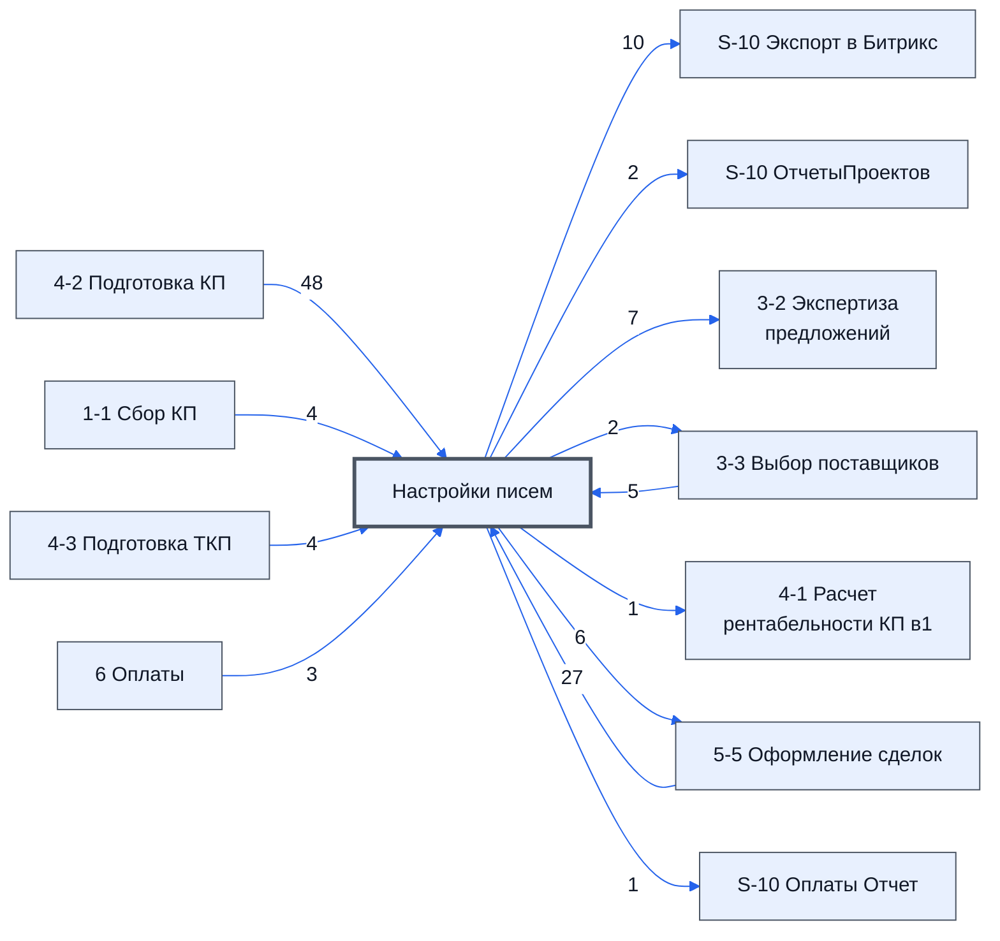

# Лист «Настройки писем»

Таблица: таблица проекта · контур 0.

**Зачем** (со слов директора): настройки писем.

Устройство листа — заголовки, вид столбцов, списки, формулы, связи с другими листами — собрано из таблицы ниже. Строка заголовков на этом листе угадана по закреплённой области — проверить.

## Зачем лист — подробно

*Заполнить:* что на листе происходит, откуда приходят данные и куда уходят.

## Как заполнять

*Заполнить:* какие столбцы вводят руками, какие считаются сами. Что значит каждый столбец — в `stolbtsy.yaml` рядом (поля `chto` и `kak`).

## Что нельзя трогать

*Заполнить.*

## Инструкции и умения

*Заполнить:* какие инструкции и умения относятся к листу.

## Осталось сделать

- Заполнить разделы выше и `stolbtsy.yaml`.

## Устройство (из таблицы)

- **Таблица:** таблица проекта, лист «Настройки писем»; контур 0
- **Размер:** `A1:BQ100`
- **Каркас:** свой, не общий; строка заголовков — 1, угадана по закреплённой области — проверить
- **Формул:** 84; заполненных ячеек без формул в данных: 240; списков: 0; условного форматирования: 0; объединённых ячеек: 1

## Связи с другими листами

- **Берёт данные с листов:** [4-2 Подготовка КП](../k1-4-2-podgotovka-kp/index.md) (48), [5-5 Оформление сделок](../k2-5-5-sdelki/index.md) (27), [3-3 Выбор поставщиков](../k1-3-3-vybor-postavshchikov/index.md) (5), [1-1 Сбор КП](../k1-1-1-sbor-kp/index.md) (4), [4-3 Подготовка ТКП](../k1-4-3-podgotovka-tkp/index.md) (4), [6 Оплаты](../k3-6-oplaty/index.md) (3), «Экспорт в битрикс» *(листа нет в реестре)* (1)
- **Его данные используют:** [S-10 Экспорт в Битрикс](../k0-s-10-eksport-v-bitriks/index.md) (10), [S-10 ОтчетыПроектов](../k0-s-10-otchetyproektov/index.md) (2), [3-2 Экспертиза предложений](../k1-3-2-ekspertiza-predlozheniy/index.md) (7), [3-3 Выбор поставщиков](../k1-3-3-vybor-postavshchikov/index.md) (2), [4-1 Расчет рентабельности КП в1](../k1-4-1-raschet-rentabelnosti-kp-v1/index.md) (1), [5-5 Оформление сделок](../k2-5-5-sdelki/index.md) (6), [S-10 Оплаты Отчет](../k3-vo-s-10-oplaty-otchet/index.md) (1)

В скобках и на стрелках — сколько формул ссылаются.

## Столбцы

Устройство — из таблицы; «Что это» и «Как заполняют» — из `stolbtsy.yaml` (заполняем руками).

| Столбец | Заголовок | Служебное имя | Вид | Заполняется | Список | Что это | Как заполняют |
|---|---|---|---|---|---|---|---|
| A | (♠) |  |  | руками? |  |  |  |
| C | 46314.65486 |  |  | формула |  |  |  |
| D | 45834.383051122684 |  |  | руками? |  |  |  |
| H | \n |  |  | руками? |  |  |  |
| I |   |  |  | руками? |  |  |  |
| J | Лимит рассылки |  |  | руками? |  |  |  |
| K | 100.0 |  |  | руками? |  |  |  |
| O | № |  |  | руками? |  |  |  |
| P | Название |  |  | руками? |  |  |  |
| Q | Коэффициент |  |  | руками? |  |  |  |
| R | Полное название |  |  | руками? |  |  |  |
| V | Статус |  |  | руками? |  |  |  |
| W | Исключить из рассылки |  |  | руками? |  |  |  |
| X | Название листа |  |  | руками? |  |  |  |
| Y | Столбец для поиска пустых строк |  |  | руками? |  |  |  |
| Z | @ Столбец с @ |  |  | руками? |  |  |  |
| AA | Оставить на листе строки с первой по [значение] включительно |  |  | руками? |  |  |  |
| AC | служебные вычисления |  |  | формула |  |  |  |
| AD | Запросили счет |  |  | руками? |  |  |  |
| AE | Цена на момент расчета |  |  | руками? |  |  |  |
| AF | 0,00 0,00 |  |  | формула |  |  |  |
| AG | Цена участника 1 |  |  | формула |  |  |  |
| AH |  |  |  | формула |  |  |  |
| AI |  |  |  | формула |  |  |  |
| AJ | Исключить строки из таблицы логиста |  |  | руками? |  |  |  |
| AL | Статусы запроса |  |  | руками? |  |  |  |
| AM | Нужна экспертиза |  |  | руками? |  |  |  |
| AN | Решение эксперта |  |  | руками? |  |  |  |
| AO | Нац режим 1875 |  |  | руками? |  |  |  |
| AU | Лист 5-5 Условия оплаты |  |  | руками? |  |  |  |
| AV | Лист 5-5 Куда доставить груз (промежуточное место комплектации) |  |  | руками? |  |  |  |
| AW | Лист 5-5 Обязательства поставщика по доставке |  |  | руками? |  |  |  |
| AX | Статус закупщика |  |  | руками? |  |  |  |
| AY | Реальная цена |  |  | формула |  |  |  |
| AZ | Реальный срок |  |  | формула |  |  |  |
| BA | Статусы Условия получены |  |  | формула |  |  |  |
| BB | Статусы звонков |  |  | руками? |  |  |  |
| BC | Статусы проекта |  |  | руками? |  |  |  |
| BD | Правила приемки |  |  | руками? |  |  |  |
| BE | Статусы Экспертизы |  |  | руками? |  |  |  |
| BF | Аналог |  |  | руками? |  |  |  |
| BG | ндс |  |  | руками? |  |  |  |
| BH | Проверка обязательно заполненных столбцов "5-5 Оформление сделок" |  |  | руками? |  |  |  |
| BI |  |  |  | формула |  |  |  |
| BJ |  |  |  | формула |  |  |  |
| BK |  |  |  | формула |  |  |  |
| BL |  |  |  | формула |  |  |  |
| BM | Col1 |  |  | формула |  |  |  |
| BP | Скрывать Листы |  |  | руками? |  |  |  |
| BQ | Вид оплаты |  |  | руками? |  |  |  |

Формулы столбцов (14)

| Столбец | Строка | Формула |
|---|---|---|
| C | 1 | <code>=NOW()</code> |
| AC | 2 | <code>=MATCH("@",'3-3 Выбор поставщиков'!A:A,0)-1</code> |
| AF | 1 | <code>=IF(SUM(IF(LEN('6 Оплаты'!AM11:AM310)&gt;0,ROUND('6 Оплаты'!S11:S310-IFERROR(VALUE(SUBSTITUTE('6 Оплаты'!AM11:AM310," ","",)),0),2),))=0,IFERROR(IF('3-3 Выбор поставщиков'!F302&gt;0,'3-3 Выбор поставщиков'!F302,'1-1 Сбор КП'!I302),'1-1 Сбор КП'!I302),"Не верно учтена себестоиомсть")</code> |
| AG | 7 | <code>=Textjoin(CHAR(10),TRUE,IF(LEN(IFERROR(AE2,-1))=-1,"В таблице ОШИБКА Статуса написать [сотрудник]",),IF(ISBLANK(AE3),"Статус проекта не известен",))</code> |
| AH | 1 | <code>=IF('4-2 Подготовка КП'!$O$1=$AC6,'4-2 Подготовка КП'!O$303,IF('4-2 Подготовка КП'!$AA$1=$AC6,'4-2 Подготовка КП'!AC$303,IF('4-2 Подготовка КП'!$AM$1=$AC6,'4-2 Подготовка КП'!AM$305,IF('4-3 Подготовка ТКП'!I1="Да",'4-3 Подготовка ТКП'!Q1,))))</code> |
| AI | 1 | <code>=IF('4-2 Подготовка КП'!$O$1=$AC6,PROPER('4-2 Подготовка КП'!$J$1),IF('4-2 Подготовка КП'!$AA$1=$AC6,PROPER('4-2 Подготовка КП'!$V$1),IF('4-2 Подготовка КП'!$AM$1=$AC6,PROPER('4-2 Подготовка КП'!$AH$1),IF('4-3 Подготовка ТКП'!I1="Да",PROPER('4-3 Подготовка ТКП'!C1),))))</code> |
| AY | 2 | <code>=TEXTJOIN("; ",True,$AX$3:$AX$20)</code> |
| AZ | 2 | <code>=TEXTJOIN("; ",True,$AX$6:$AX$20)</code> |
| BA | 2 | <code>=TEXTJOIN("; ",True,$AX$7:$AX$20)</code> |
| BI | 3 | <code>='5-5 Оформление сделок'!$AP$10</code> |
| BJ | 3 | <code>='Настройки писем'!$AY$2</code> |
| BK | 3 | <code>=LAMBDA(doMake,theSep,theStr,doMake(theSep,theStr))( LAMBDA(theSep,theStr, TEXTJOIN(CHAR(10),TRUE,Split(theStr,theSep,FALSE,TRUE))), "; ",'Настройки писем'!$AY$2 )</code> |
| BL | 3 | <code>="'"&amp;'Настройки писем'!$BI3&amp;"' обязательна для статуса: "</code> |
| BM | 3 | <code>='5-5 Оформление сделок'!$AF$10</code> |

