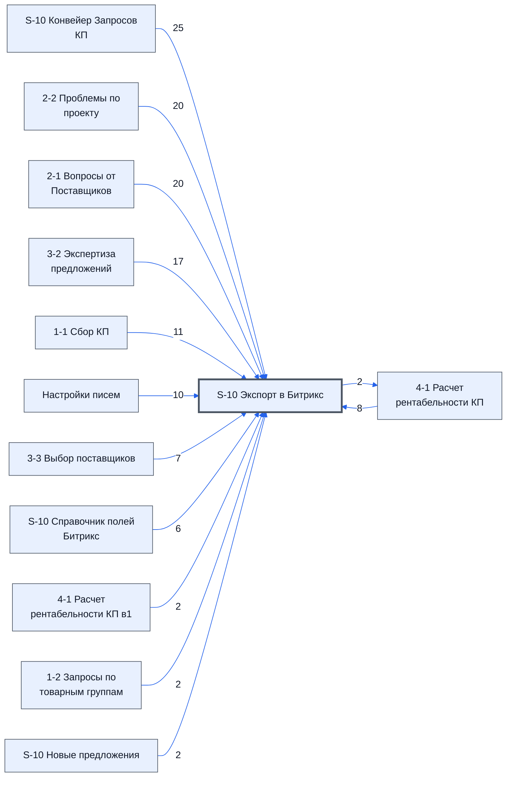

# Лист «S-10 Экспорт в Битрикс»

Таблица: таблица проекта · контур 0.

**Зачем** (со слов директора): собирает данные для выгрузки в Битрикс24.

Устройство листа — заголовки, вид столбцов, списки, формулы, связи с другими листами — собрано из таблицы ниже.

## Зачем лист — подробно

*Заполнить:* что на листе происходит, откуда приходят данные и куда уходят.

## Как заполнять

*Заполнить:* какие столбцы вводят руками, какие считаются сами. Что значит каждый столбец — в `stolbtsy.yaml` рядом (поля `chto` и `kak`).

## Что нельзя трогать

*Заполнить.*

## Инструкции и умения

*Заполнить:* какие инструкции и умения относятся к листу.

## Осталось сделать

- Заполнить разделы выше и `stolbtsy.yaml`.

## Устройство (из таблицы)

- **Таблица:** таблица проекта, лист «S-10 Экспорт в Битрикс»; контур 0
- **Размер:** `A1:J60`, закреплено до `A11`
- **Каркас:** общий — служебные строки, заголовки в строке 10 ([что значат служебные строки](../../zna/lis-sluzhebnye-stroki/index.md))
- **Формул:** 48; заполненных ячеек без формул в данных: 75; списков: 1; условного форматирования: 0; объединённых ячеек: 0

## Связи с другими листами

- **Берёт данные с листов:** [S-10 Конвейер Запросов КП](../k1-s-10-konveyer-zaprosov-kp/index.md) (25), [2-2 Проблемы по проекту](../k1-2-2-problemy-po-proektu/index.md) (20), [2-1 Вопросы от Поставщиков](../k1-2-1-voprosy-ot-postavshchikov/index.md) (20), [3-2 Экспертиза предложений](../k1-3-2-ekspertiza-predlozheniy/index.md) (17), [1-1 Сбор КП](../k1-1-1-sbor-kp/index.md) (11), [Настройки писем](../k0-nastroyki-pisem/index.md) (10), [4-1 Расчет рентабельности КП](../k1-4-1-raschet-rentabelnosti-kp/index.md) (8), [3-3 Выбор поставщиков](../k1-3-3-vybor-postavshchikov/index.md) (7), [S-10 Справочник полей Битрикс](../k0-s-10-spravochnik-poley-bitriks/index.md) (6), [4-1 Расчет рентабельности КП в1](../k1-4-1-raschet-rentabelnosti-kp-v1/index.md) (2), [1-2 Запросы по товарным группам](../k1-1-2-zaprosy-po-tovarnym-gruppam/index.md) (2), [S-10 Новые предложения](../k1-s-10-novye-predlozheniya/index.md) (2)
- **Его данные используют:** [4-1 Расчет рентабельности КП](../k1-4-1-raschet-rentabelnosti-kp/index.md) (2)

В скобках и на стрелках — сколько формул ссылаются.

## Столбцы

Устройство — из таблицы; «Что это» и «Как заполняют» — из `stolbtsy.yaml` (заполняем руками).

| Столбец | Заголовок | Служебное имя | Вид | Заполняется | Список | Что это | Как заполняют |
|---|---|---|---|---|---|---|---|
| A *(скрыт)* |  |  |  | руками? |  |  |  |
| B *(скрыт)* |  |  |  | руками? |  |  |  |
| C | Индификатор поля |  | formulaCell | формула |  |  |  |
| D | Экспортировать | needToSend |  | руками, из списка | "Нет,Да" |  |  |
| E | Номер | Номер |  | формула |  |  |  |
| F | Название | Название |  | руками? |  |  |  |
| G | Значение | Значение | formulaCell | формула |  |  |  |
| H |  |  |  | формула |  |  |  |

Формулы столбцов (3)

| Столбец | Строка | Формула |
|---|---|---|
| E | 11 | <code>=ROW()-10</code> |
| G | 11 | <code>=TEXTJOIN(CHAR(10),TRUE, IF('Настройки писем'!AF7&gt;0,"у "&amp;'Настройки писем'!AF7&amp;" из "&amp;'Настройки писем'!AF6&amp;" тов. нет цен",), IF('Настройки писем'!AF8&gt;0,"у "&amp;'Настройки писем'!AF8&amp;" из "&amp;'Настройки писем'!AF6&amp;" тов &lt; "&amp;'1-1 Сбор КП'!$B$8&amp;" предложен",), IF('Настройки писем'!AF7+'Настройки писем'!AF8=0,"У всех товаров достаточно предложений",), 'S-10 Экспорт в Битрикс'!G32,'S-10 Экспорт в Битрикс' …</code> |
| H | 24 | <code>= IFERROR(VLOOKUP(G24,{'S-10 Справочник полей Битрикс'!G:G,'S-10 Справочник полей Битрикс'!H:H},2,false), )</code> |

