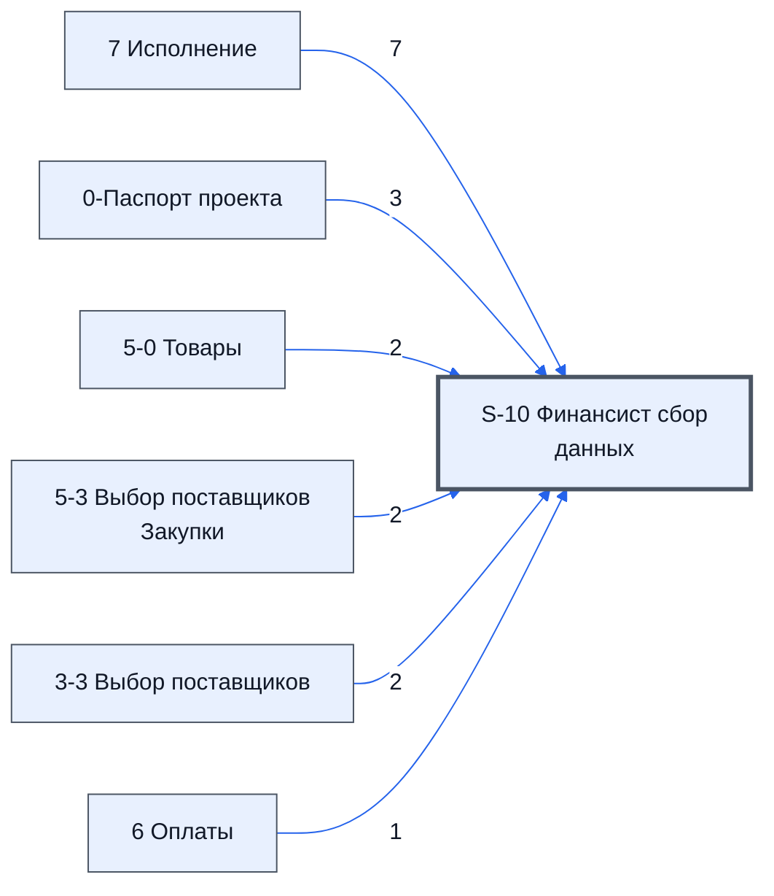

# Лист «S-10 Финансист сбор данных»

Таблица: таблица проекта · контур 0.

**Зачем** (со слов): готовит данные для листа 4-9.

Устройство листа — заголовки, вид столбцов, списки, формулы, связи с другими листами — собрано из таблицы ниже. Строка заголовков на этом листе угадана по закреплённой области — проверить.

## Зачем лист — подробно

*Заполнить:* что на листе происходит, откуда приходят данные и куда уходят.

## Как заполнять

*Заполнить:* какие столбцы вводят руками, какие считаются сами. Что значит каждый столбец — в `stolbtsy.yaml` рядом (поля `chto` и `kak`).

## Что нельзя трогать

*Заполнить.*

## Инструкции и умения

*Заполнить:* какие инструкции и умения относятся к листу.

## Осталось сделать

- Заполнить разделы выше и `stolbtsy.yaml`.

## Устройство (из таблицы)

- **Таблица:** таблица проекта, лист «S-10 Финансист сбор данных»; контур 0
- **Размер:** `A1:EA1000`, закреплено до `M1`
- **Каркас:** свой, не общий; строка заголовков — 1, угадана по закреплённой области — проверить
- **Формул:** 464; заполненных ячеек без формул в данных: 205; списков: 0; условного форматирования: 0; объединённых ячеек: 0

## Связи с другими листами

- **Берёт данные с листов:** [7 Исполнение](../k3-7-ispolnenie/index.md) (7), [0-Паспорт проекта](../k0-0-pasport-proekta/index.md) (3), [5-0 Товары](../k2-5-0-tovary/index.md) (2), [5-3 Выбор поставщиков Закупки](../k2-5-3-vybor-postavshchikov/index.md) (2), [3-3 Выбор поставщиков](../k1-3-3-vybor-postavshchikov/index.md) (2), [6 Оплаты](../k3-6-oplaty/index.md) (1)

В скобках и на стрелках — сколько формул ссылаются.

## Столбцы

Устройство — из таблицы; «Что это» и «Как заполняют» — из `stolbtsy.yaml` (заполняем руками).

| Столбец | Заголовок | Служебное имя | Вид | Заполняется | Список | Что это | Как заполняют |
|---|---|---|---|---|---|---|---|
| A | 0-Паспорт проекта - Номер проекта |  |  | формула |  |  |  |
| B |  |  |  | формула |  |  |  |
| C |  |  |  | формула |  |  |  |
| D |  |  |  | формула |  |  |  |
| E |  |  |  | формула |  |  |  |
| F |  |  |  | формула |  |  |  |
| H | Есть ошибки в датах |  |  | формула |  |  |  |
| I | 1 |  |  | формула |  |  |  |
| AA |  |  |  | формула |  |  |  |
| AB |  |  |  | формула |  |  |  |
| AC |  |  |  | формула |  |  |  |
| AD |  |  |  | формула |  |  |  |
| AF |  |  |  | формула |  |  |  |
| AG |  |  |  | формула |  |  |  |
| AH |  |  |  | формула |  |  |  |
| AI |  |  |  | формула |  |  |  |
| AK |  |  |  | формула |  |  |  |
| AL |  |  |  | формула |  |  |  |
| AM |  |  |  | формула |  |  |  |
| AN |  |  |  | формула |  |  |  |
| AP |  |  |  | формула |  |  |  |
| AQ |  |  |  | формула |  |  |  |
| AR |  |  |  | формула |  |  |  |
| AS |  |  |  | формула |  |  |  |
| AU |  |  |  | формула |  |  |  |
| AV |  |  |  | формула |  |  |  |
| AW |  |  |  | формула |  |  |  |
| AY |  |  |  | формула |  |  |  |
| AZ |  |  |  | формула |  |  |  |
| BA |  |  |  | формула |  |  |  |
| BC | кд |  |  | формула |  |  |  |
| BD | 1.0 |  |  | формула |  |  |  |
| BE |  |  |  | формула |  |  |  |
| BG |  |  |  | формула |  |  |  |
| BH |  |  |  | формула |  |  |  |
| BI |  |  |  | формула |  |  |  |
| BK | кд |  |  | формула |  |  |  |
| BL | 1.0 |  |  | формула |  |  |  |
| BM |  |  |  | формула |  |  |  |
| BN |  |  |  | формула |  |  |  |
| BO |  |  |  | формула |  |  |  |
| BP |  |  |  | формула |  |  |  |
| BQ |  |  |  | формула |  |  |  |
| BR | 0 |  |  | формула |  |  |  |
| BS |  |  |  | формула |  |  |  |
| BT |  |  |  | формула |  |  |  |
| BU |  |  |  | формула |  |  |  |
| BV |  |  |  | формула |  |  |  |
| CA | Нет |  |  | формула |  |  |  |
| CB | Нет |  |  | формула |  |  |  |
| CC | Да |  |  | формула |  |  |  |
| CD | Да |  |  | формула |  |  |  |
| CE | Нет |  |  | формула |  |  |  |
| CF | Нет |  |  | руками? |  |  |  |
| CG |  |  |  | формула |  |  |  |
| CH |  |  |  | формула |  |  |  |
| CI |  |  |  | формула |  |  |  |
| CJ |  |  |  | формула |  |  |  |
| CK |  |  |  | формула |  |  |  |
| CL |  |  |  | формула |  |  |  |
| CM |  |  |  | формула |  |  |  |
| CN |  |  |  | формула |  |  |  |
| CO |  |  |  | формула |  |  |  |
| CP |  |  |  | формула |  |  |  |
| CQ |  |  |  | формула |  |  |  |
| CR |  |  |  | формула |  |  |  |
| CS |  |  |  | формула |  |  |  |
| CT |  |  |  | формула |  |  |  |
| CU | Нет |  |  | формула |  |  |  |
| CV | Нет |  |  | формула |  |  |  |
| CW | Да |  |  | формула |  |  |  |
| CX | Да |  |  | формула |  |  |  |
| CY | Нет |  |  | формула |  |  |  |
| CZ | Нет |  |  | руками? |  |  |  |
| DA | Нет |  |  | формула |  |  |  |
| DB | Нет |  |  | формула |  |  |  |
| DC | Да |  |  | формула |  |  |  |
| DD | Да |  |  | формула |  |  |  |
| DE | Нет |  |  | формула |  |  |  |
| DF | Нет |  |  | руками? |  |  |  |
| DG |  |  |  | формула |  |  |  |
| DH |  |  |  | формула |  |  |  |
| DI |  |  |  | формула |  |  |  |
| DJ |  |  |  | формула |  |  |  |
| DK |  |  |  | формула |  |  |  |
| DL |  |  |  | формула |  |  |  |
| DM |  |  |  | формула |  |  |  |
| DN |  |  |  | формула |  |  |  |
| DO |  |  |  | формула |  |  |  |
| DP |  |  |  | формула |  |  |  |
| DQ |  |  |  | формула |  |  |  |
| DR |  |  |  | формула |  |  |  |

Формулы столбцов (89)

| Столбец | Строка | Формула |
|---|---|---|
| A | 1 | <code>={"0-Паспорт проекта - Номер проекта",LAMBDA(theName,theRange,IFERROR(VLOOKUP(theName,theRange,2,FALSE),))("Номер проекта",'0-Паспорт проекта'!$B:$C)}</code> |
| B | 9 | <code>="Проект"</code> |
| C | 9 | <code>="Отчет"</code> |
| D | 9 | <code>="Статья"</code> |
| E | 8 | <code>="date"</code> |
| F | 9 | <code>="Сумма"</code> |
| H | 1 | <code>="Есть ошибки в датах"</code> |
| I | 1 | <code>=LAMBDA(theMin,theList, NOT(ISERROR(FILTER(theList,ARRAYFORMULA(theList&lt;theMin)))) )(I2, sort(Unique(E11:E42)))</code> |
| AA | 11 | <code>=LAMBDA(doDolya,theTovarS, thePriceS, doDolya( ByRow( IFERROR( QUERY( {theTovarS,thePriceS} ,"Select Col1, Sum(Col2) Where Col1 is not null group by Col1 label Sum(Col2) '' ",0) , {"",""} ),LAMBDA(tr,{INDEX(tr,,1),"7 Исполнение - Итого для Заказчик,"")</code> |
| AB | 11 | <code>="COMPUTED_VALUE"</code> |
| AC | 11 | <code>="COMPUTED_VALUE"</code> |
| AD | 11 | <code>="COMPUTED_VALUE"</code> |
| AF | 11 | <code>=LAMBDA(doDolya, theTovarS, thePriceS, doDolya( ByRow( IFERROR( QUERY( {theTovarS,thePriceS} ,"Select Col1, Sum(Col2) Where Col1 is not null group by Col1 label Sum(Col2) '' ",0) , {"",""} ),LAMBDA(tr,{INDEX(tr,,1),"5-5 Оформление сделок - Реальная,"")</code> |
| AG | 11 | <code>="COMPUTED_VALUE"</code> |
| AH | 11 | <code>="COMPUTED_VALUE"</code> |
| AI | 11 | <code>="COMPUTED_VALUE"</code> |
| AK | 11 | <code>=LAMBDA(doDolya,theTovarS, thePriceS,theNumS , doDolya( ByRow( IFERROR( QUERY( {theTovarS,thePriceS,theNumS} ,"Select Col1, Sum(Col2) Where Col1 is not null and Col3 is not null group by Col1 label Sum(Col2) '' ",0) , {"",""} ),LAMBDA(tr,{INDEX(tr,,"")</code> |
| AL | 11 | <code>="COMPUTED_VALUE"</code> |
| AM | 11 | <code>="COMPUTED_VALUE"</code> |
| AN | 11 | <code>="COMPUTED_VALUE"</code> |
| AP | 11 | <code>=LAMBDA(doDolya,theTovarS, thePriceS, thePayS, doDolya( ByRow( IFERROR( QUERY( {{theTovarS,thePriceS};{theTovarS,thePayS} } ,"Select Col1, Sum(Col2) Where Col1 is not null group by Col1 label Sum(Col2) '' ",0) , {"",""} ),LAMBDA(tr,{INDEX(tr,,1),"6,"")</code> |
| AQ | 11 | <code>="COMPUTED_VALUE"</code> |
| AR | 11 | <code>="COMPUTED_VALUE"</code> |
| AS | 11 | <code>="COMPUTED_VALUE"</code> |
| AU | 11 | <code>=if( AV11:AV1000&lt;&gt;"",AV11:AV1000,)</code> |
| AV | 10 | <code>={{"",""} ;{"7 Исполнение - Договор Ориентировочная сумма договора в рублях" , LAMBDA(theData,theName,IFERROR( INDEX(theData,1, MATCH(theName,theData,0)+1),))('7 Исполнение'!A1:EA1,"Ориентировочная сумма договора в рублях") } ;{"4-1 Расчет рент,"")</code> |
| AW | 10 | <code>="COMPUTED_VALUE"</code> |
| AY | 11 | <code>= QUERY( { AU11:AX1000 },"Select * where Col1 is not null",0 )</code> |
| AZ | 11 | <code>="COMPUTED_VALUE"</code> |
| BA | 13 | <code>="COMPUTED_VALUE"</code> |
| BC | 1 | <code>={ {"кд" , 1} ;{"д" , 1} ;{"рд" , 1.4} ;{"н" , 7} ;{"нед" , 7} ;{"м" , 30} ;{"мес" , 30} ;{"нал" , 0} }</code> |
| BD | 10 | <code>="Дата"</code> |
| BE | 10 | <code>="Tип"</code> |
| BG | 10 | <code>="Справочник Дат"</code> |
| BH | 10 | <code>="Дата"</code> |
| BI | 10 | <code>="Тип"</code> |
| BK | 1 | <code>={ {"кд" , 1} ;{"д" , 1} ;{"рд" , 1.4} ;{"н" , 7} ;{"нед" , 7} ;{"м" , 30} ;{"мес" , 30} ;{"нал" , 0} }</code> |
| BL | 11 | <code>="COMPUTED_VALUE"</code> |
| BM | 10 | <code>=sum(BM11:BM1000)</code> |
| BN | 4 | <code>="7 Исполнение - Ожидаемая дата готовности"</code> |
| BO | 4 | <code>="5-3 Выбор поставщиков Закупки - Срок поставки"</code> |
| BP | 4 | <code>="3-3 Выбор поставщиков - Срок поставки"</code> |
| BQ | 4 | <code>="Срок поставки"</code> |
| BR | 1 | <code>=BR10=1</code> |
| BS | 3 | <code>=IF(LAMBDA(theData,theStr, IFERROR(VLOOKUP(theStr,theData,2,FALSE) ,0))($BG$11:$BH1000,"Договор Дата")&lt;&gt;0,LAMBDA(theData,theStr, IFERROR(VLOOKUP(theStr,theData,2,FALSE) ,0))($BG$11:$BH1000,"Договор Дата"),LAMBDA(theData,theStr, IFERROR(VLOOKUP(theStr,theData,2,FALSE) ,0))($BG$11:$BH1000,"0-Паспорт проекта - Плановая дата заключения договора (расчетная)") )</code> |
| BT | 4 | <code>="5-3 Выбор поставщиков Закупки - Основной Поставщик"</code> |
| BU | 4 | <code>="3-3 Выбор поставщиков - Поставщик"</code> |
| BV | 11 | <code>=if(BL11:BL1000&lt;&gt;"",if(BT11:BT1000&lt;&gt;"",BT11:BT1000,BU11:BU1000),)</code> |
| CA | 1 | <code>="Нет"</code> |
| CB | 3 | <code>="Сумма"</code> |
| CC | 1 | <code>="Да"</code> |
| CD | 3 | <code>="Сумма"</code> |
| CE | 1 | <code>=IF($BR$1,CC1:CD1000,CA1:CB1000)</code> |
| CG | 2 | <code>="ЗП коммерческого персонала СДЕЛЬНАЯ"</code> |
| CH | 3 | <code>="Сумма"</code> |
| CI | 2 | <code>="ЗП производственного персонала СДЕЛЬНАЯ"</code> |
| CJ | 3 | <code>="Сумма"</code> |
| CK | 2 | <code>="Себестоимость оборудования"</code> |
| CL | 3 | <code>="Сумма"</code> |
| CM | 2 | <code>="Транспортные услуги"</code> |
| CN | 3 | <code>="Сумма"</code> |
| CO | 2 | <code>="Комиссия за конвертацию наличных денег"</code> |
| CP | 3 | <code>="Сумма"</code> |
| CQ | 2 | <code>="Административные подрядчики"</code> |
| CR | 3 | <code>="Сумма"</code> |
| CS | 2 | <code>="Затраты на ЭТП"</code> |
| CT | 3 | <code>="Сумма"</code> |
| CU | 1 | <code>="Нет"</code> |
| CV | 3 | <code>="Сумма"</code> |
| CW | 1 | <code>="Да"</code> |
| CX | 3 | <code>="Сумма"</code> |
| CY | 1 | <code>=IF($BR$1,CW1:CX1000,CU1:CV1000)</code> |
| DA | 1 | <code>="Нет"</code> |
| DB | 3 | <code>="Сумма"</code> |
| DC | 1 | <code>="Да"</code> |
| DD | 3 | <code>="Сумма"</code> |
| DE | 1 | <code>=IF($BR$1,DC1:DD1000,DA1:DB1000)</code> |
| DG | 2 | <code>="Транспортные услуги"</code> |
| DH | 3 | <code>="Сумма"</code> |
| DI | 2 | <code>="ЗП коммерческого персонала СДЕЛЬНАЯ"</code> |
| DJ | 3 | <code>="Сумма"</code> |
| DK | 2 | <code>="ЗП производственного персонала СДЕЛЬНАЯ"</code> |
| DL | 3 | <code>="Сумма"</code> |
| DM | 2 | <code>="Комиссия за конвертацию наличных денег"</code> |
| DN | 3 | <code>="Сумма"</code> |
| DO | 2 | <code>="Административные подрядчики"</code> |
| DP | 3 | <code>="Сумма"</code> |
| DQ | 2 | <code>="Затраты на ЭТП"</code> |
| DR | 3 | <code>="Сумма"</code> |

