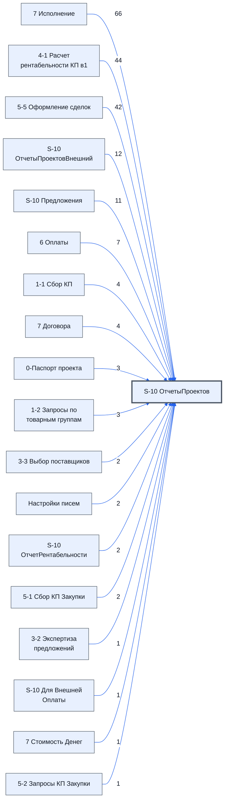

# Лист «S-10 ОтчетыПроектов»

Таблица: таблица проекта · контур 0.

**Зачем** (со слов директора): собирает отчётные данные для контура 0.

Устройство листа — заголовки, вид столбцов, списки, формулы, связи с другими листами — собрано из таблицы ниже. Строка заголовков на этом листе угадана по закреплённой области — проверить.

## Зачем лист — подробно

*Заполнить:* что на листе происходит, откуда приходят данные и куда уходят.

## Как заполнять

*Заполнить:* какие столбцы вводят руками, какие считаются сами. Что значит каждый столбец — в `stolbtsy.yaml` рядом (поля `chto` и `kak`).

## Что нельзя трогать

*Заполнить.*

## Инструкции и умения

*Заполнить:* какие инструкции и умения относятся к листу.

## Осталось сделать

- Заполнить разделы выше и `stolbtsy.yaml`.

## Устройство (из таблицы)

- **Таблица:** таблица проекта, лист «S-10 ОтчетыПроектов»; контур 0
- **Размер:** `A1:KE15`
- **Каркас:** свой, не общий; строка заголовков — 1, угадана по закреплённой области — проверить
- **Формул:** 656; заполненных ячеек без формул в данных: 220; списков: 0; условного форматирования: 0; объединённых ячеек: 0

## Связи с другими листами

- **Берёт данные с листов:** [7 Исполнение](../k3-7-ispolnenie/index.md) (66), [4-1 Расчет рентабельности КП в1](../k1-4-1-raschet-rentabelnosti-kp-v1/index.md) (44), [5-5 Оформление сделок](../k2-5-5-sdelki/index.md) (42), [S-10 ОтчетыПроектовВнешний](../k0-s-10-otchetyproektovvneshniy/index.md) (12), [S-10 Предложения](../k2-s-10-predlozheniya/index.md) (11), [6 Оплаты](../k3-6-oplaty/index.md) (7), [1-1 Сбор КП](../k1-1-1-sbor-kp/index.md) (4), [7 Договора](../k3-7-dogovora/index.md) (4), [0-Паспорт проекта](../k0-0-pasport-proekta/index.md) (3), [1-2 Запросы по товарным группам](../k1-1-2-zaprosy-po-tovarnym-gruppam/index.md) (3), [3-3 Выбор поставщиков](../k1-3-3-vybor-postavshchikov/index.md) (2), [Настройки писем](../k0-nastroyki-pisem/index.md) (2), [S-10 ОтчетРентабельности](../k1-s-10-otchetrentabelnosti/index.md) (2), [5-1 Сбор КП Закупки](../k2-5-1-sbor-kp/index.md) (2), [3-2 Экспертиза предложений](../k1-3-2-ekspertiza-predlozheniy/index.md) (1), [S-10 Для Внешней Оплаты](../k2-s-10-dlya-vneshney-oplaty/index.md) (1), [7 Стоимость Денег](../k3-7-stoimost-deneg/index.md) (1), «Экспорт в битрикс» *(листа нет в реестре)* (1), [5-2 Запросы КП Закупки](../k2-5-2-zaprosy-kp/index.md) (1)

В скобках и на стрелках — сколько формул ссылаются.

## Столбцы

Устройство — из таблицы; «Что это» и «Как заполняют» — из `stolbtsy.yaml` (заполняем руками).

| Столбец | Заголовок | Служебное имя | Вид | Заполняется | Список | Что это | Как заполняют |
|---|---|---|---|---|---|---|---|
| A | Актуально вер:002 |  |  | формула |  |  |  |
| B | 19.10.2026 15:43:00 |  |  | формула |  |  |  |
| C | Лист 4-1 |  |  | формула |  |  |  |
| D |  |  |  | формула |  |  |  |
| E |  |  |  | формула |  |  |  |
| F |  |  |  | формула |  |  |  |
| G |  |  |  | формула |  |  |  |
| H |  |  |  | формула |  |  |  |
| I |  |  |  | формула |  |  |  |
| J |  |  |  | формула |  |  |  |
| K |  |  |  | формула |  |  |  |
| L |  |  |  | формула |  |  |  |
| M |  |  |  | формула |  |  |  |
| N |  |  |  | формула |  |  |  |
| O |  |  |  | формула |  |  |  |
| P |  |  |  | формула |  |  |  |
| Q |  |  |  | формула |  |  |  |
| R |  |  |  | формула |  |  |  |
| S |  |  |  | формула |  |  |  |
| T |  |  |  | формула |  |  |  |
| U |  |  |  | формула |  |  |  |
| V |  |  |  | формула |  |  |  |
| W |  |  |  | формула |  |  |  |
| X |  |  |  | формула |  |  |  |
| Y |  |  |  | формула |  |  |  |
| AB | 1-1 Сбор КП |  |  | формула |  |  |  |
| AC | 3-2 Экспертиза предложений |  |  | формула |  |  |  |
| AD | 5-5 Оформление сделок |  |  | формула |  |  |  |
| AE |  |  |  | формула |  |  |  |
| AF |  |  |  | формула |  |  |  |
| AG |  |  |  | формула |  |  |  |
| AH |  |  |  | формула |  |  |  |
| AI |  |  |  | формула |  |  |  |
| AJ |  |  |  | формула |  |  |  |
| AK |  |  |  | формула |  |  |  |
| AL |  |  |  | формула |  |  |  |
| AM | 6 Оплаты |  |  | формула |  |  |  |
| AN | 7 Исполнение П |  |  | формула |  |  |  |
| AO |  |  |  | формула |  |  |  |
| AP |  |  |  | формула |  |  |  |
| AQ |  |  |  | формула |  |  |  |
| AR |  |  |  | формула |  |  |  |
| AS |  |  |  | формула |  |  |  |
| AT |  |  |  | формула |  |  |  |
| AU |  |  |  | формула |  |  |  |
| AV |  |  |  | формула |  |  |  |
| AW |  |  |  | формула |  |  |  |
| AX |  |  |  | формула |  |  |  |
| AY |  |  |  | формула |  |  |  |
| AZ |  |  |  | формула |  |  |  |
| BA |  |  |  | формула |  |  |  |
| BB |  |  |  | формула |  |  |  |
| BC |  |  |  | формула |  |  |  |
| BD |  |  |  | формула |  |  |  |
| BE | 7 Исполнение З |  |  | формула |  |  |  |
| BF |  |  |  | формула |  |  |  |
| BG |  |  |  | формула |  |  |  |
| BH |  |  |  | формула |  |  |  |
| BI |  |  |  | формула |  |  |  |
| BJ |  |  |  | формула |  |  |  |
| BK |  |  |  | формула |  |  |  |
| BL |  |  |  | формула |  |  |  |
| BM |  |  |  | формула |  |  |  |
| BN |  |  |  | формула |  |  |  |
| BO |  |  |  | формула |  |  |  |
| BP |  |  |  | формула |  |  |  |
| BQ |  |  |  | формула |  |  |  |
| BR |  |  |  | формула |  |  |  |
| BS |  |  |  | формула |  |  |  |
| BT |  |  |  | формула |  |  |  |
| BU |  |  |  | формула |  |  |  |
| BV |  |  |  | формула |  |  |  |
| BW | 7 Исполнение |  |  | формула |  |  |  |
| BX | 6 Оплаты |  |  | формула |  |  |  |
| BY | 7 Стоимость Денег |  |  | формула |  |  |  |
| BZ | Настройки писем |  |  | формула |  |  |  |
| CA |  |  |  | формула |  |  |  |
| CB | Экспорт в битрикс |  |  | формула |  |  |  |
| CC | 0-Паспорт проекта |  |  | формула |  |  |  |
| CD |  |  |  | формула |  |  |  |
| CE |  |  |  | формула |  |  |  |
| CF |  |  |  | формула |  |  |  |
| CG |  |  |  | формула |  |  |  |
| CH |  |  |  | формула |  |  |  |
| CI |  |  |  | формула |  |  |  |
| CJ |  |  |  | формула |  |  |  |
| CK |  |  |  | формула |  |  |  |
| CL |  |  |  | формула |  |  |  |
| CM |  |  |  | формула |  |  |  |
| CN |  |  |  | формула |  |  |  |
| CO |  |  |  | формула |  |  |  |
| CP |  |  |  | формула |  |  |  |
| CQ |  |  |  | формула |  |  |  |
| CR |  |  |  | формула |  |  |  |
| CS |  |  |  | формула |  |  |  |
| CT |  |  |  | формула |  |  |  |
| CU |  |  |  | формула |  |  |  |
| CV |  |  |  | формула |  |  |  |
| CW |  |  |  | формула |  |  |  |
| CX |  |  |  | формула |  |  |  |
| CY |  |  |  | формула |  |  |  |
| CZ |  |  |  | формула |  |  |  |
| DA |  |  |  | формула |  |  |  |
| DB |  |  |  | формула |  |  |  |
| DC |  |  |  | формула |  |  |  |
| DD |  |  |  | формула |  |  |  |
| DE |  |  |  | формула |  |  |  |
| DF |  |  |  | формула |  |  |  |
| DG |  |  |  | формула |  |  |  |
| DH |  |  |  | формула |  |  |  |
| DI |  |  |  | формула |  |  |  |
| DJ |  |  |  | формула |  |  |  |
| DK |  |  |  | формула |  |  |  |
| DL |  |  |  | формула |  |  |  |
| DM |  |  |  | формула |  |  |  |
| DN |  |  |  | формула |  |  |  |
| DO |  |  |  | формула |  |  |  |
| DP |  |  |  | формула |  |  |  |
| DQ |  |  |  | формула |  |  |  |
| DR |  |  |  | формула |  |  |  |
| DS |  |  |  | формула |  |  |  |
| DT |  |  |  | формула |  |  |  |
| DU |  |  |  | формула |  |  |  |
| DV |  |  |  | формула |  |  |  |
| DW |  |  |  | формула |  |  |  |
| DX |  |  |  | формула |  |  |  |
| DY |  |  |  | формула |  |  |  |
| DZ |  |  |  | формула |  |  |  |
| EA |  |  |  | формула |  |  |  |
| EB |  |  |  | формула |  |  |  |
| EC |  |  |  | формула |  |  |  |
| ED |  |  |  | формула |  |  |  |
| EE |  |  |  | формула |  |  |  |
| EF |  |  |  | формула |  |  |  |
| EG |  |  |  | формула |  |  |  |
| EH |  |  |  | формула |  |  |  |
| EI |  |  |  | формула |  |  |  |
| EJ |  |  |  | формула |  |  |  |
| EK |  |  |  | формула |  |  |  |
| EL |  |  |  | формула |  |  |  |
| EM |  |  |  | формула |  |  |  |
| EN |  |  |  | формула |  |  |  |
| ES | 6 Оплаты |  |  | формула |  |  |  |
| GI |  |  |  | формула |  |  |  |
| GJ | 4-1 Расчет рентабельности |  |  | формула |  |  |  |
| GK |  |  |  | формула |  |  |  |
| GL |  |  |  | формула |  |  |  |
| GM |  |  |  | формула |  |  |  |
| GN |  |  |  | формула |  |  |  |
| GO |  |  |  | формула |  |  |  |
| GP |  |  |  | формула |  |  |  |
| GQ |  |  |  | формула |  |  |  |
| GR |  |  |  | формула |  |  |  |
| GS |  |  |  | формула |  |  |  |
| GT |  |  |  | формула |  |  |  |
| GU |  |  |  | формула |  |  |  |
| GV |  |  |  | формула |  |  |  |
| GW |  |  |  | формула |  |  |  |
| GX |  |  |  | формула |  |  |  |
| GY |  |  |  | формула |  |  |  |
| GZ |  |  |  | формула |  |  |  |
| HA |  |  |  | формула |  |  |  |
| HB |  |  |  | формула |  |  |  |
| HC |  |  |  | формула |  |  |  |
| HD |  |  |  | формула |  |  |  |
| HE |  |  |  | формула |  |  |  |
| HF |  |  |  | формула |  |  |  |
| HG |  |  |  | формула |  |  |  |
| IM | Рабочий Лист |  |  | формула |  |  |  |
| IN |  |  |  | формула |  |  |  |
| IO |  |  |  | формула |  |  |  |
| IP |  |  |  | формула |  |  |  |
| IQ |  |  |  | формула |  |  |  |
| IR |  |  |  | формула |  |  |  |
| IU | Ошибки |  |  | формула |  |  |  |
| IV |  |  |  | формула |  |  |  |
| IZ | Запросы и предложения Сбор |  |  | формула |  |  |  |
| JA |  |  |  | формула |  |  |  |
| JB |  |  |  | формула |  |  |  |
| JD |  |  |  | формула |  |  |  |
| JE |  |  |  | формула |  |  |  |
| JF |  |  |  | формула |  |  |  |
| JG |  |  |  | формула |  |  |  |
| JH |  |  |  | формула |  |  |  |
| JJ |  |  |  | формула |  |  |  |
| JK |  |  |  | формула |  |  |  |
| JM | Запросы и предложения Закупка |  |  | формула |  |  |  |
| JN |  |  |  | формула |  |  |  |
| JO |  |  |  | формула |  |  |  |
| JQ |  |  |  | формула |  |  |  |
| JR |  |  |  | формула |  |  |  |
| JS |  |  |  | формула |  |  |  |
| JT |  |  |  | формула |  |  |  |
| JU |  |  |  | формула |  |  |  |

Формулы столбцов (194)

| Столбец | Строка | Формула |
|---|---|---|
| A | 1 | <code>={"Актуально вер:002",TEXT( NOW(),"DD.MM.YYYY HH:mm:ss")}</code> |
| B | 2 | <code>="Актуально Проект"</code> |
| C | 1 | <code>="Лист 4-1"</code> |
| D | 2 | <code>="Годовая рентабельность , %"</code> |
| E | 2 | <code>="Дневная рентабельность (с учетом аванса) , %"</code> |
| F | 2 | <code>="Закупка товара, руб"</code> |
| G | 2 | <code>="Затраты на ЭТП БРИФ"</code> |
| H | 2 | <code>="БГ Обеспечение Исполнения договора"</code> |
| I | 2 | <code>="БГ на Аванс"</code> |
| J | 2 | <code>="Транспортировка, руб"</code> |
| K | 2 | <code>="Прочие расходы, руб"</code> |
| L | 2 | <code>="Организация логистики, руб"</code> |
| M | 2 | <code>="Курьерские услуги, руб"</code> |
| N | 2 | <code>="Бонусы, руб"</code> |
| O | 2 | <code>="Итого прямые затраты, руб"</code> |
| P | 2 | <code>="Итого косвенные затраты, руб"</code> |
| Q | 2 | <code>="Себестоимость, руб"</code> |
| R | 2 | <code>="Минимальная цена (без прибыли) с резервом на риски, руб"</code> |
| S | 2 | <code>="Цена целевой рентабельности(максимальная желаемая), руб"</code> |
| T | 2 | <code>="Цена предложения, руб (вводится вручную)"</code> |
| U | 2 | <code>="Планируемая чистая прибыль до налогообложения, руб"</code> |
| V | 2 | <code>="НМЦ, руб с НДС"</code> |
| W | 2 | <code>="Штрафы / неустойка от заказчика"</code> |
| X | 2 | <code>="Падение от НМЦ"</code> |
| Y | 2 | <code>="Прибыль до налогообложения (РПП)"</code> |
| AB | 1 | <code>="1-1 Сбор КП"</code> |
| AC | 1 | <code>="3-2 Экспертиза предложений"</code> |
| AD | 1 | <code>="5-5 Оформление сделок"</code> |
| AE | 2 | <code>="Итого с НДС"</code> |
| AF | 2 | <code>="Итого без НДС"</code> |
| AG | 2 | <code>="Итого наличными"</code> |
| AH | 2 | <code>="НДС"</code> |
| AI | 2 | <code>="Прочие Расходы"</code> |
| AJ | 2 | <code>="Всего"</code> |
| AK | 2 | <code>="Сумма оплат"</code> |
| AL | 2 | <code>="Проверка ошибок"</code> |
| AM | 1 | <code>="6 Оплаты"</code> |
| AN | 1 | <code>="7 Исполнение П"</code> |
| AO | 2 | <code>="От"</code> |
| AP | 2 | <code>="Исполнитель"</code> |
| AQ | 2 | <code>="Заказчик"</code> |
| AR | 2 | <code>="НДС Договора"</code> |
| AS | 2 | <code>="Сумма"</code> |
| AT | 2 | <code>="Валюта договора"</code> |
| AU | 2 | <code>="Ориентировочная сумма договора в рублях"</code> |
| AV | 2 | <code>="Вид подписания договора"</code> |
| AW | 2 | <code>="Частичная оплата за товар"</code> |
| AX | 2 | <code>="Частичная поставка товара"</code> |
| AY | 2 | <code>="Дата подписи исполнителем"</code> |
| AZ | 2 | <code>="Дата подписи заказчиком"</code> |
| BA | 2 | <code>="Проверка обязательного заполнения полей"</code> |
| BB | 2 | <code>="Договора"</code> |
| BC | 2 | <code>="Сводка Договора"</code> |
| BD | 2 | <code>="Оплаты Документа"</code> |
| BE | 1 | <code>="7 Исполнение З"</code> |
| BF | 2 | <code>="От"</code> |
| BG | 2 | <code>="Исполнитель"</code> |
| BH | 2 | <code>="Заказчик"</code> |
| BI | 2 | <code>="НДС Договора"</code> |
| BJ | 2 | <code>="Сумма"</code> |
| BK | 2 | <code>="Валюта договора"</code> |
| BL | 2 | <code>="Ориентировочная сумма договора в рублях"</code> |
| BM | 2 | <code>="Вид подписания договора"</code> |
| BN | 2 | <code>="Частичная оплата за товар"</code> |
| BO | 2 | <code>="Частичная поставка товара"</code> |
| BP | 2 | <code>="Дата подписи исполнителем"</code> |
| BQ | 2 | <code>="Дата подписи заказчиком"</code> |
| BR | 2 | <code>="Проверка обязательного заполнения полей"</code> |
| BS | 2 | <code>="Договора"</code> |
| BT | 2 | <code>="Сводка Договора"</code> |
| BU | 2 | <code>="Оплаты Документа"</code> |
| BV | 2 | <code>="Цена договора с партнером"</code> |
| BW | 1 | <code>="7 Исполнение"</code> |
| BX | 1 | <code>="6 Оплаты"</code> |
| BY | 1 | <code>="7 Стоимость Денег"</code> |
| BZ | 1 | <code>="Настройки писем"</code> |
| CA | 2 | <code>="Наши Цены"</code> |
| CB | 1 | <code>="Экспорт в битрикс"</code> |
| CC | 1 | <code>="0-Паспорт проекта"</code> |
| CD | 2 | <code>="COMPUTED_VALUE"</code> |
| CE | 2 | <code>="COMPUTED_VALUE"</code> |
| CF | 2 | <code>="COMPUTED_VALUE"</code> |
| CG | 2 | <code>="COMPUTED_VALUE"</code> |
| CH | 2 | <code>="COMPUTED_VALUE"</code> |
| CI | 2 | <code>="COMPUTED_VALUE"</code> |
| CJ | 2 | <code>="COMPUTED_VALUE"</code> |
| CK | 2 | <code>="COMPUTED_VALUE"</code> |
| CL | 2 | <code>="COMPUTED_VALUE"</code> |
| CM | 2 | <code>="COMPUTED_VALUE"</code> |
| CN | 2 | <code>="COMPUTED_VALUE"</code> |
| CO | 2 | <code>="COMPUTED_VALUE"</code> |
| CP | 2 | <code>="COMPUTED_VALUE"</code> |
| CQ | 2 | <code>="COMPUTED_VALUE"</code> |
| CR | 2 | <code>="COMPUTED_VALUE"</code> |
| CS | 2 | <code>="COMPUTED_VALUE"</code> |
| CT | 2 | <code>="COMPUTED_VALUE"</code> |
| CU | 2 | <code>="COMPUTED_VALUE"</code> |
| CV | 2 | <code>="COMPUTED_VALUE"</code> |
| CW | 2 | <code>="COMPUTED_VALUE"</code> |
| CX | 2 | <code>="COMPUTED_VALUE"</code> |
| CY | 2 | <code>="COMPUTED_VALUE"</code> |
| CZ | 2 | <code>="COMPUTED_VALUE"</code> |
| DA | 2 | <code>="COMPUTED_VALUE"</code> |
| DB | 2 | <code>="COMPUTED_VALUE"</code> |
| DC | 2 | <code>="COMPUTED_VALUE"</code> |
| DD | 2 | <code>="COMPUTED_VALUE"</code> |
| DE | 2 | <code>="COMPUTED_VALUE"</code> |
| DF | 2 | <code>="COMPUTED_VALUE"</code> |
| DG | 2 | <code>="COMPUTED_VALUE"</code> |
| DH | 2 | <code>="COMPUTED_VALUE"</code> |
| DI | 2 | <code>="COMPUTED_VALUE"</code> |
| DJ | 2 | <code>="COMPUTED_VALUE"</code> |
| DK | 2 | <code>="COMPUTED_VALUE"</code> |
| DL | 2 | <code>="COMPUTED_VALUE"</code> |
| DM | 2 | <code>="COMPUTED_VALUE"</code> |
| DN | 2 | <code>="COMPUTED_VALUE"</code> |
| DO | 2 | <code>="COMPUTED_VALUE"</code> |
| DP | 2 | <code>="COMPUTED_VALUE"</code> |
| DQ | 2 | <code>="COMPUTED_VALUE"</code> |
| DR | 2 | <code>="COMPUTED_VALUE"</code> |
| DS | 2 | <code>="COMPUTED_VALUE"</code> |
| DT | 2 | <code>="COMPUTED_VALUE"</code> |
| DU | 2 | <code>="COMPUTED_VALUE"</code> |
| DV | 2 | <code>="COMPUTED_VALUE"</code> |
| DW | 2 | <code>="COMPUTED_VALUE"</code> |
| DX | 2 | <code>="COMPUTED_VALUE"</code> |
| DY | 2 | <code>="COMPUTED_VALUE"</code> |
| DZ | 2 | <code>="COMPUTED_VALUE"</code> |
| EA | 2 | <code>="COMPUTED_VALUE"</code> |
| EB | 2 | <code>="COMPUTED_VALUE"</code> |
| EC | 2 | <code>="COMPUTED_VALUE"</code> |
| ED | 2 | <code>="COMPUTED_VALUE"</code> |
| EE | 2 | <code>="COMPUTED_VALUE"</code> |
| EF | 2 | <code>="COMPUTED_VALUE"</code> |
| EG | 2 | <code>="COMPUTED_VALUE"</code> |
| EH | 2 | <code>="COMPUTED_VALUE"</code> |
| EI | 2 | <code>="COMPUTED_VALUE"</code> |
| EJ | 2 | <code>="COMPUTED_VALUE"</code> |
| EK | 2 | <code>="COMPUTED_VALUE"</code> |
| EL | 2 | <code>="COMPUTED_VALUE"</code> |
| EM | 2 | <code>="COMPUTED_VALUE"</code> |
| EN | 2 | <code>="COMPUTED_VALUE"</code> |
| ES | 1 | <code>="6 Оплаты"</code> |
| GI | 2 | <code>="K10"</code> |
| GJ | 1 | <code>="4-1 Расчет рентабельности"</code> |
| GK | 2 | <code>="COMPUTED_VALUE"</code> |
| GL | 2 | <code>="COMPUTED_VALUE"</code> |
| GM | 2 | <code>="COMPUTED_VALUE"</code> |
| GN | 2 | <code>="COMPUTED_VALUE"</code> |
| GO | 2 | <code>="COMPUTED_VALUE"</code> |
| GP | 2 | <code>="COMPUTED_VALUE"</code> |
| GQ | 2 | <code>="COMPUTED_VALUE"</code> |
| GR | 2 | <code>="COMPUTED_VALUE"</code> |
| GS | 2 | <code>="COMPUTED_VALUE"</code> |
| GT | 2 | <code>="COMPUTED_VALUE"</code> |
| GU | 2 | <code>="COMPUTED_VALUE"</code> |
| GV | 2 | <code>="COMPUTED_VALUE"</code> |
| GW | 2 | <code>="COMPUTED_VALUE"</code> |
| GX | 2 | <code>="COMPUTED_VALUE"</code> |
| GY | 2 | <code>="COMPUTED_VALUE"</code> |
| GZ | 2 | <code>="COMPUTED_VALUE"</code> |
| HA | 2 | <code>="COMPUTED_VALUE"</code> |
| HB | 2 | <code>="COMPUTED_VALUE"</code> |
| HC | 2 | <code>="COMPUTED_VALUE"</code> |
| HD | 2 | <code>="COMPUTED_VALUE"</code> |
| HE | 2 | <code>="COMPUTED_VALUE"</code> |
| HF | 2 | <code>="COMPUTED_VALUE"</code> |
| HG | 2 | <code>="COMPUTED_VALUE"</code> |
| IM | 1 | <code>="Рабочий Лист"</code> |
| IN | 2 | <code>="Ожидаемая дата готовности последнего товара"</code> |
| IO | 2 | <code>="Даты доставок товара заказчику"</code> |
| IP | 2 | <code>="Сводка по доставке Товаров"</code> |
| IQ | 2 | <code>="Дата доставки Заказчику последнего товара"</code> |
| IR | 2 | <code>="Дата поступления к нам на склад последнего товара"</code> |
| IU | 1 | <code>="Ошибки"</code> |
| IV | 2 | <code>="Исполнения"</code> |
| IZ | 1 | <code>="Запросы и предложения Сбор"</code> |
| JA | 2 | <code>="Поставщики: Предложений"</code> |
| JB | 2 | <code>="Поставщики: Доля"</code> |
| JD | 2 | <code>="Товары: Всего"</code> |
| JE | 2 | <code>="Товары: Хотябы один"</code> |
| JF | 2 | <code>="Товары: Доля Хотябы один"</code> |
| JG | 2 | <code>="Товары: Более 3"</code> |
| JH | 2 | <code>="Товары: Доля Более 3"</code> |
| JJ | 2 | <code>="Товары Итого: Доля ответов"</code> |
| JK | 2 | <code>="Товары Итого: Списком"</code> |
| JM | 1 | <code>="Запросы и предложения Закупка"</code> |
| JN | 2 | <code>="Поставщики: Предложений"</code> |
| JO | 2 | <code>="Поставщики: Доля"</code> |
| JQ | 2 | <code>="Товары: Всего"</code> |
| JR | 2 | <code>="Товары: Хотябы один"</code> |
| JS | 2 | <code>="Товары: Доля Хотябы один"</code> |
| JT | 2 | <code>="Товары: Более 3"</code> |
| JU | 2 | <code>="Товары: Доля Более 3"</code> |

