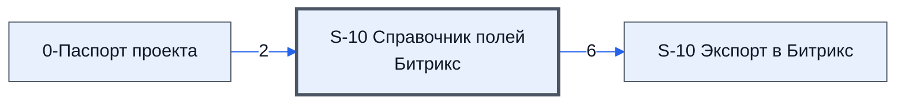

# Лист «S-10 Справочник полей Битрикс»

Таблица: таблица проекта · контур 0.

**Зачем** (со слов): сопоставление полей с кодами Битрикс24.

Устройство листа — заголовки, вид столбцов, списки, формулы, связи с другими листами — собрано из таблицы ниже.

## Зачем лист — подробно

*Заполнить:* что на листе происходит, откуда приходят данные и куда уходят.

## Как заполнять

*Заполнить:* какие столбцы вводят руками, какие считаются сами. Что значит каждый столбец — в `stolbtsy.yaml` рядом (поля `chto` и `kak`).

## Что нельзя трогать

*Заполнить.*

## Инструкции и умения

*Заполнить:* какие инструкции и умения относятся к листу.

## Осталось сделать

- Заполнить разделы выше и `stolbtsy.yaml`.

## Устройство (из таблицы)

- **Таблица:** таблица проекта, лист «S-10 Справочник полей Битрикс»; контур 0
- **Размер:** `A1:J141`, закреплено до `A11`
- **Каркас:** общий — служебные строки, заголовки в строке 10 ([что значат служебные строки](../../zna/lis-sluzhebnye-stroki/index.md))
- **Формул:** 2; заполненных ячеек без формул в данных: 552; списков: 3; условного форматирования: 0; объединённых ячеек: 0

## Связи с другими листами

- **Берёт данные с листов:** [0-Паспорт проекта](../k0-0-pasport-proekta/index.md) (2)
- **Его данные используют:** [S-10 Экспорт в Битрикс](../k0-s-10-eksport-v-bitriks/index.md) (6)

В скобках и на стрелках — сколько формул ссылаются.

## Столбцы

Устройство — из таблицы; «Что это» и «Как заполняют» — из `stolbtsy.yaml` (заполняем руками).

| Столбец | Заголовок | Служебное имя | Вид | Заполняется | Список | Что это | Как заполняют |
|---|---|---|---|---|---|---|---|
| C | id_mapping |  | formulaColl | формула |  |  |  |
| D | Тип поля | type | enumeration | руками, из списка | 'S-10 Справочник полей Битрикс'!$D$3:$D$9 |  |  |
| E | Название | fild_name |  | руками, из списка | '0-Паспорт проекта'!$B$11:$B141 |  |  |
| F | Индификатор поля | fild_id |  | формула | '0-Паспорт проекта'!$G$11:$G141 |  |  |
| G | Код Битрикс | valie_id |  | руками? |  |  |  |
| H | Значение | value |  | руками? |  |  |  |

## Переменные листа

Строки 5–6 каркаса (`var_name`, `var_value`): имя переменной и её значения — скорее всего, списки для скриптов и выпадающих списков.

| Ячейка | Имя | Значения |
|---|---|---|
| D | money | datetime |
| E | ufCrm31_1782134329446 |  |
| F | Наличие цен |  |

Формулы столбцов (2)

| Столбец | Строка | Формула |
|---|---|---|
| C | 10 | <code>=Let( head, "id_mapping", domen_v , "mapping", is_ar, MAP(D11:D141,F11:F141,G11:G141,H11:H141, LAMBDA(a,b,c,d, AND(a&lt;&gt;"",b&lt;&gt;"",c&lt;&gt;"",d&lt;&gt;"" ))), txt_ar , Map(#REF!,LAMBDA(txt, LEFT( m_norm(txt),40))), domen_ar, Map(D11:D141,LAMBDA(a,domen_v&amp;"."&amp;a)), enty_id , Map(F11:F141,G11:G141,LAMBDA(a,b,a &amp;"."&amp;b)), met_Insp2, LAMBDA(A_ar, B_ar, fn, MAP(A_ar, B_ar, is_ar, LAMBDA(a_v, b_v, is, IF(is, fn(a_v, b_v …</code> |
| F | 10 | <code>={"Индификатор поля" ;Map(E11:E141,LAMBDA(a,(IF(a&lt;&gt;"",IFERROR(VLOOKUP(a,{'0-Паспорт проекта'!$B$11:$B141,'0-Паспорт проекта'!$G$11:$G141},2,FALSE),),)))) }</code> |

