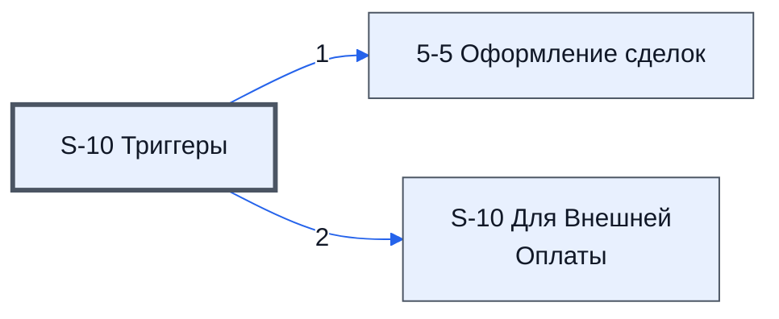

# Лист «S-10 Триггеры»

Таблица: таблица проекта · контур 0.

**Зачем** (со слов): показывает, как выполняются триггеры.

Устройство листа — заголовки, вид столбцов, списки, формулы, связи с другими листами — собрано из таблицы ниже.

## Зачем лист — подробно

*Заполнить:* что на листе происходит, откуда приходят данные и куда уходят.

## Как заполнять

*Заполнить:* какие столбцы вводят руками, какие считаются сами. Что значит каждый столбец — в `stolbtsy.yaml` рядом (поля `chto` и `kak`).

## Что нельзя трогать

*Заполнить.*

## Инструкции и умения

*Заполнить:* какие инструкции и умения относятся к листу.

## Осталось сделать

- Заполнить разделы выше и `stolbtsy.yaml`.

## Устройство (из таблицы)

- **Таблица:** таблица проекта, лист «S-10 Триггеры»; контур 0
- **Размер:** `A1:Z15`, закреплено до `A11`
- **Каркас:** общий — служебные строки, заголовки в строке 10 ([что значат служебные строки](../../zna/lis-sluzhebnye-stroki/index.md))
- **Формул:** 13; заполненных ячеек без формул в данных: 0; списков: 0; условного форматирования: 0; объединённых ячеек: 0

## Связи с другими листами

- **Его данные используют:** [5-5 Оформление сделок](../k2-5-5-sdelki/index.md) (1), [S-10 Для Внешней Оплаты](../k2-s-10-dlya-vneshney-oplaty/index.md) (2)

В скобках и на стрелках — сколько формул ссылаются.

## Столбцы

Устройство — из таблицы; «Что это» и «Как заполняют» — из `stolbtsy.yaml` (заполняем руками).

| Столбец | Заголовок | Служебное имя | Вид | Заполняется | Список | Что это | Как заполняют |
|---|---|---|---|---|---|---|---|
| A *(скрыт)* |  | err1 |  | руками? |  |  |  |
| B *(скрыт)* |  | err2 |  | руками? |  |  |  |
| C | ID |  |  | руками? |  |  |  |
| D | Таблица | url |  | руками? |  |  |  |
| E | Дата | run | date | руками? |  |  |  |
| F | Аккаунт | user |  | руками? |  |  |  |
| G | Функция | func |  | руками? |  |  |  |
| H | ID | id |  | руками? |  |  |  |
| J | Таблица Проекта |  |  | формула |  |  |  |
| K | Назначение тригера | MrLib_top.triggerService | onEdit_trigger | руками? |  |  |  |
| L | Таблица Оплат | Таблица Проекта | Редактирование | руками? |  |  |  |
| M |  | Функции выполняющие сервесные работы в фоне(подсчет, передача данных, и другие) | Делает тоже что и onEdit иимеет возможность выполнятся до 360 секунд | руками? |  |  |  |
| N | Кол-во Триггеров |  |  | формула |  |  |  |
| P | Кол-во Уникальных Триггеров |  |  | формула |  |  |  |
| R | Кол-во Аккаунтов |  |  | формула |  |  |  |
| T | Лишние Триггеры |  |  | формула |  |  |  |
| V | Тригер Остановлен |  |  | формула |  |  |  |

## Переменные листа

Строки 5–6 каркаса (`var_name`, `var_value`): имя переменной и её значения — скорее всего, списки для скриптов и выпадающих списков.

| Ячейка | Имя | Значения |
|---|---|---|
| E | Считать, что тригеры не работают | 46312 |
| F | Таблица Проекта | Триггеры проекта не запущены |
| G | Таблица Оплат | Триггеры оплат не запущены |
| K | triggerMrProjLib | triggerMrProjLibPay |
| L | Таблица Проекта | Таблица Оплат |
| M | Лист 1-2 и листы 5 | Функции таблицы оплат |

Формулы столбцов (8)

| Столбец | Строка | Формула |
|---|---|---|
| J | 10 | <code>={"Таблица Проекта";LAMBDA(doCompare,doSelect,theData,theUrlS,theTrigerS, BYROW(theUrlS,Lambda(theUrl, IF(theUrl&lt;&gt;"",doCompare( doSelect(theData,theUrl), theTrigerS) , ) )) )( LAMBDA(theA,theB, IFERROR(AND(ArrayFormula(theA=theB)),FALSE)), LAMBD,"Таблица Проекта")</code> |
| K | 10 | <code>={"Назначение тригера";(IF(D11:D15&lt;&gt;"",IFERROR(VLOOKUP(G11:G15,K1:L6,2,FALSE),""),) )}</code> |
| L | 10 | <code>={"Таблица Оплат";LAMBDA(doCompare,doSelect,theData,theUrlS,theTrigerS, BYROW(theUrlS,Lambda(theUrl, IF(theUrl&lt;&gt;"",doCompare( doSelect(theData,theUrl), theTrigerS) , ) )) )( LAMBDA(theA,theB, IFERROR(AND(ArrayFormula(theA=theB)),FALSE)), LAMBDA(th,"Таблица Оплат")</code> |
| N | 10 | <code>={"Кол-во Триггеров";LAMBDA(doRez,doFind,doCount,the,doRez(doFind,INDEX(the,,),doCount(the)))( LAMBDA(doFind,theUrls,theData,BYROW(theUrls,LAMBDA(theUrl,doFind(theUrl,theData)))), LAMBDA(theUrl,theData,IF(theUrl&lt;&gt;"",VLOOKUP(theUrl,theData,2,FALSE),)), ,"Кол-во Триггеров")</code> |
| P | 10 | <code>={"Кол-во Уникальных Триггеров";LAMBDA(do, theData, BYROW(theData,LAMBDA(td, IF( td&lt;&gt;"",({COUNTA( UNIQUE( do(INDEX(td,,1),theData) ) ) } ),) ))) (LAMBDA(theUrl,theData,QUERY(theData, "Select Col4 Where Col1='"&amp; theUrl &amp;"' ",0)), {D11:D15,E11:E15,F,"Кол-во Уникальных Триггеров")</code> |
| R | 10 | <code>={"Кол-во Аккаунтов";LAMBDA(do, theData, BYROW(theData,LAMBDA(td, IF( td&lt;&gt;"",({COUNTA( UNIQUE( do(INDEX(td,,1),theData) ) ) } ),) ))) (LAMBDA(theUrl,theData,QUERY(theData, "Select Col3 Where Col1='"&amp; theUrl &amp;"' ",0)), {D11:D15,E11:E15,F11:F15,G11:,"Кол-во Аккаунтов")</code> |
| T | 10 | <code>={"Лишние Триггеры";LAMBDA(do, theData, theCounts, BYROW(theData,LAMBDA(td, IF( td&lt;&gt;"",( IF(IFERROR(do(td,theCounts),0)&gt;1,TRUE,) ),) ))) (LAMBDA(td,theData, SUM(QUERY(theData,"Select Col3 where Col1='"&amp;INDEX(td,,1)&amp;"' and Col2='"&amp;INDEX(td,,4)&amp;","Лишние Триггеры")</code> |
| V | 10 | <code>={"Тригер Остановлен";IF($D$11:$D15&lt;&gt;"",IF($E$11:$E15&lt;$E$6,TRUE,),)}</code> |

