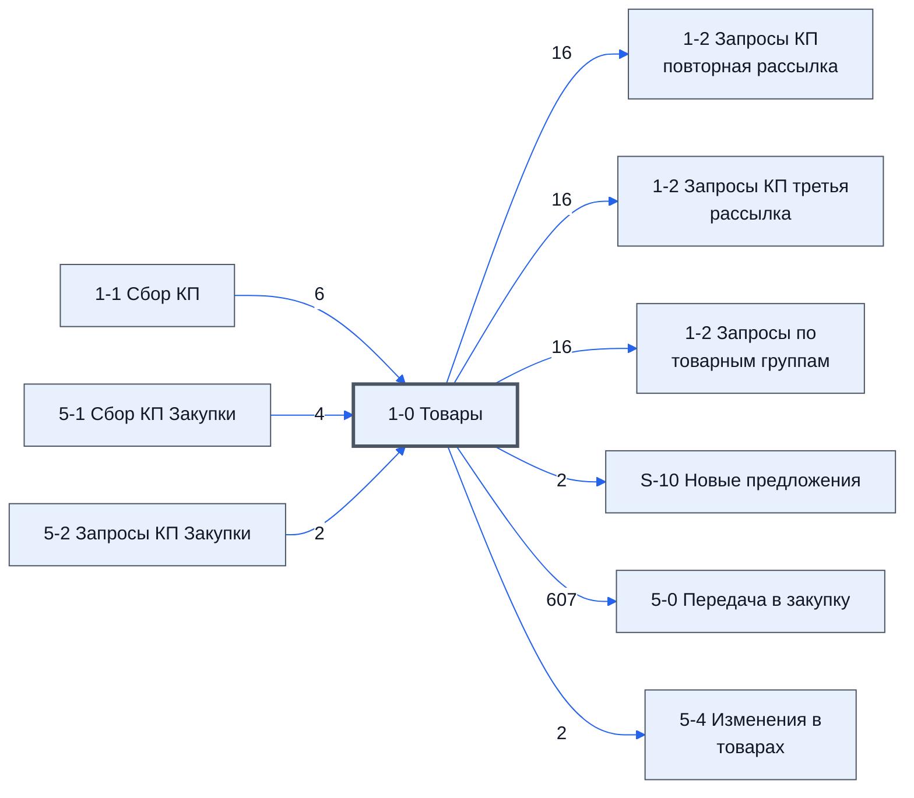

> Черновик: текст не проверен.

# Лист «1-0 Товары»

Таблица: таблица проекта · контур 1.

**Зачем** (со слов): собирает данные по товарам и передаёт их дальше.

Устройство листа — заголовки, вид столбцов, списки, формулы, связи с другими листами — собрано из таблицы ниже.

## Зачем лист — подробно

Автоматический лист контура 1: собирает товары с листа [1-1 Сбор КП](../../lis/k1-1-1-sbor-kp/index.md) (начало и конец списка находит
по словам-меткам, а не по номерам строк и столбцов) и раздаёт их по `ID_Товара` остальным листам: [1-2 Запросы по товарным группам](../../lis/k1-1-2-zaprosy-po-tovarnym-gruppam/index.md),
а в контур 2 — на [5-0 Передача в закупку](../../lis/k2-5-0-peredacha/index.md). Заодно показывает, что о товаре уже известно в контуре 2: название и
изготовитель по договору (лист 5-1), группа повторной рассылки (лист 5-2). Аналог в контуре 2 — [5-0 Товары](../../lis/k2-5-0-tovary/index.md).

## Как заполнять

Руками — ничего: все столбцы считают формулы. Что значит каждый столбец — в `stolbtsy.yaml` (черновик 2026-10-20).

## Что нельзя трогать

Весь лист: на нём держатся другие листы. По аналогии с 5-0 Товары новый столбец — только справа (догадка).

## Инструкции и умения

Отдельных нет.

## Осталось сделать

- Сверить черновик столбцов в `stolbtsy.yaml`.

## Устройство (из таблицы)

- **Таблица:** таблица проекта, лист «1-0 Товары»; контур 1
- **Аналог в другом контуре:** [5-0 Товары](../k2-5-0-tovary/index.md)
- **Размер:** `A1:U313`, закреплено до `A11`
- **Каркас:** общий — служебные строки, заголовки в строке 10 ([что значат служебные строки](../../zna/lis-sluzhebnye-stroki/index.md))
- **Формул:** 614; заполненных ячеек без формул в данных: 4; списков: 0; условного форматирования: 0; объединённых ячеек: 0

## Связи с другими листами

- **Берёт данные с листов:** [1-1 Сбор КП](../k1-1-1-sbor-kp/index.md) (6), [5-1 Сбор КП Закупки](../k2-5-1-sbor-kp/index.md) (4), [5-2 Запросы КП Закупки](../k2-5-2-zaprosy-kp/index.md) (2)
- **Его данные используют:** [1-2 Запросы КП повторная рассылка](../k1-1-2-zaprosy-kp-povtornaya-rassylka/index.md) (16), [1-2 Запросы КП третья рассылка](../k1-1-2-zaprosy-kp-tretya-rassylka/index.md) (16), [1-2 Запросы по товарным группам](../k1-1-2-zaprosy-po-tovarnym-gruppam/index.md) (16), [S-10 Новые предложения](../k1-s-10-novye-predlozheniya/index.md) (2), [5-0 Передача в закупку](../k2-5-0-peredacha/index.md) (607), [5-4 Изменения в товарах](../k2-5-4-izmeneniya/index.md) (2)

В скобках и на стрелках — сколько формул ссылаются.

## Столбцы

Устройство — из таблицы; «Что это» и «Как заполняют» — из `stolbtsy.yaml` (заполняем руками).

| Столбец | Заголовок | Служебное имя | Вид | Заполняется | Список | Что это | Как заполняют |
|---|---|---|---|---|---|---|---|
| A |  | err |  | руками? |  | служебный столбец каркаса (err) — для пометок строки; в чистой таблице пусто |  |
| B |  | err2 |  | руками? |  | служебный столбец каркаса (err2); в чистой таблице пусто |  |
| C | ID_Товара |  | formulaColl | формула |  | ID_Товара — ключ товара (ID_T…): по нему все листы находят один и тот же товар | формула: строки товаров с листа 1-1 (ищет начало и конец списка по словам-меткам, а не по номерам строк) |
| D | № | Номер | formulaColl | формула |  | № позиции по спецификации тендера | формула на пять столбцов D–H: №, номенклатура, характеристики, ед. изм., кол-во — с листа 1-1 (столбцы C–G) |
| E | Номенклатура | Номенклатура | formulaFree | руками, потом формула |  | название товара из спецификации тендера | формула столбца D |
| F | Характеристики | Характеристики | formulaFree | руками, потом формула |  | характеристики товара из спецификации | формула столбца D |
| G | Ед. Изм | ЕдИзм | formulaFree | руками, потом формула |  | единица измерения | формула столбца D |
| H | Кол-во | Количевство | formulaFree | руками, потом формула |  | количество | формула столбца D |
| I | НМЦ | НМЦ | formulaFree | руками, потом формула |  | НМЦ за единицу — начальная (максимальная) цена из тендера | формула: с листа 1-1, столбец K «НМЦ» |
| J | Название товара по договору | НазваниеТовараПоДоговору | formulaColl | формула |  | название товара, как оно записано в договоре с заказчиком | формула: с листа 5-1 (столбец F) по совпадению номенклатуры — появляется, когда договор уже есть |
| K | Изготовитель товара по договору | ИзготовительТовараПоДоговору | formulaColl | формула |  | изготовитель, если его требует договор | формула: с листа 5-1 (столбец G) по совпадению номенклатуры |
| L | Группа | Группа_1_2 | formulaColl | формула |  | группа товаров рассылки контура 1 (листы 1-1 и 1-2) | формула: с листа 1-1, столбец O «Группа» |
| M | Группа | Группа_5_2 | formulaColl | формула |  | группа товаров повторной рассылки контура 2 (лист 5-2) | формула: по ID_Товара с листа 5-2, столбец N |
| N | Срок поставки по договору | СрокПоставкиПоДоговору | formulaColl | формула |  | срок поставки, который требует заказчик | формула: с листа 1-1, столбец N |
| O | Нац режим 1875 |  |  | формула |  | национальный режим по постановлению № 1875 — ограничения на иностранные товары (догадка по названию) | формула: с листа 1-1, столбец L |
| P | Код ОКПД 2 |  |  | формула |  | код товара по классификатору ОКПД 2 | формула: с листа 1-1, столбец M |

Формулы столбцов (14)

| Столбец | Строка | Формула |
|---|---|---|
| C | 10 | <code>={"ID_Товара"; LAMBDA( doFindRow, doFilter, theWordStart, theCStart, theWordEnd, theCEnd, theDataWord, theData, doFilter(doFindRow(theDataWord,theWordStart,theCStart),doFindRow(theDataWord,theWordEnd,theCEnd),theData) )( LAMBDA(theWords,theWord,theC,"ID_Товара")</code> |
| D | 10 | <code>={ {'1-1 Сбор КП'!C1:G1}; {LAMBDA( doFindRow, doFilter, theWordStart, theCStart, theWordEnd, theCEnd, theDataWord, theData, doFilter(doFindRow(theDataWord,theWordStart,theCStart),doFindRow(theDataWord,theWordEnd,theCEnd),theData) )( LAMBDA(theWords,t,"№")</code> |
| E | 10 | <code>="COMPUTED_VALUE"</code> |
| F | 10 | <code>="COMPUTED_VALUE"</code> |
| G | 10 | <code>="COMPUTED_VALUE"</code> |
| H | 10 | <code>="COMPUTED_VALUE"</code> |
| I | 10 | <code>={ {'1-1 Сбор КП'!K1}; {LAMBDA( doFindRow, doFilter, theWordStart, theCStart, theWordEnd, theCEnd, theDataWord, theData, doFilter(doFindRow(theDataWord,theWordStart,theCStart),doFindRow(theDataWord,theWordEnd,theCEnd),theData) )( LAMBDA(theWords,theW,"НМЦ")</code> |
| J | 10 | <code>=IF(E10:E313&lt;&gt;"",IFERROR(VLOOKUP(E10:E313,{'5-1 Сбор КП Закупки'!E10:E313,'5-1 Сбор КП Закупки'!F10:F313},2,FALSE) ,),)</code> |
| K | 10 | <code>=IF(E10:E313&lt;&gt;"",IFERROR(VLOOKUP(E10:E313,{'5-1 Сбор КП Закупки'!E10:E313,'5-1 Сбор КП Закупки'!G10:G313},2,FALSE) ,),)</code> |
| L | 10 | <code>=BYROW({ {'1-1 Сбор КП'!O1}; {LAMBDA( doFindRow, doFilter, theWordStart, theCStart, theWordEnd, theCEnd, theDataWord, theData, doFilter(doFindRow(theDataWord,theWordStart,theCStart),doFindRow(theDataWord,theWordEnd,theCEnd),theData) )( LAMBDA(theWord,"Группа")</code> |
| M | 10 | <code>={"Группа";LAMBDA(doFind,theIds,theData, doFind(theIds,theData) )( LAMBDA(theIds,theData, BYROW(theIds,LAMBDA(ti,IF(ti&lt;&gt;"", IFERROR(VLOOKUP(ti,theData,2,0),),)))), '1-0 Товары'!C11:C313, {'5-2 Запросы КП Закупки'!C11:C313,'5-2 Запросы КП Закупки'!N11:N313} )}</code> |
| N | 10 | <code>={ {'1-1 Сбор КП'!N1}; {LAMBDA( doFindRow, doFilter, theWordStart, theCStart, theWordEnd, theCEnd, theDataWord, theData, doFilter(doFindRow(theDataWord,theWordStart,theCStart),doFindRow(theDataWord,theWordEnd,theCEnd),theData) )( LAMBDA(theWords,theW,"Срок поставки по договору")</code> |
| O | 10 | <code>={ {'1-1 Сбор КП'!L1}; {LAMBDA( doFindRow, doFilter, theWordStart, theCStart, theWordEnd, theCEnd, theDataWord, theData, doFilter(doFindRow(theDataWord,theWordStart,theCStart),doFindRow(theDataWord,theWordEnd,theCEnd),theData) )( LAMBDA(theWords,theW,"Нац режим 1875")</code> |
| P | 10 | <code>={ {'1-1 Сбор КП'!M1}; {LAMBDA( doFindRow, doFilter, theWordStart, theCStart, theWordEnd, theCEnd, theDataWord, theData, doFilter(doFindRow(theDataWord,theWordStart,theCStart),doFindRow(theDataWord,theWordEnd,theCEnd),theData) )( LAMBDA(theWords,theW,"Код ОКПД 2")</code> |

