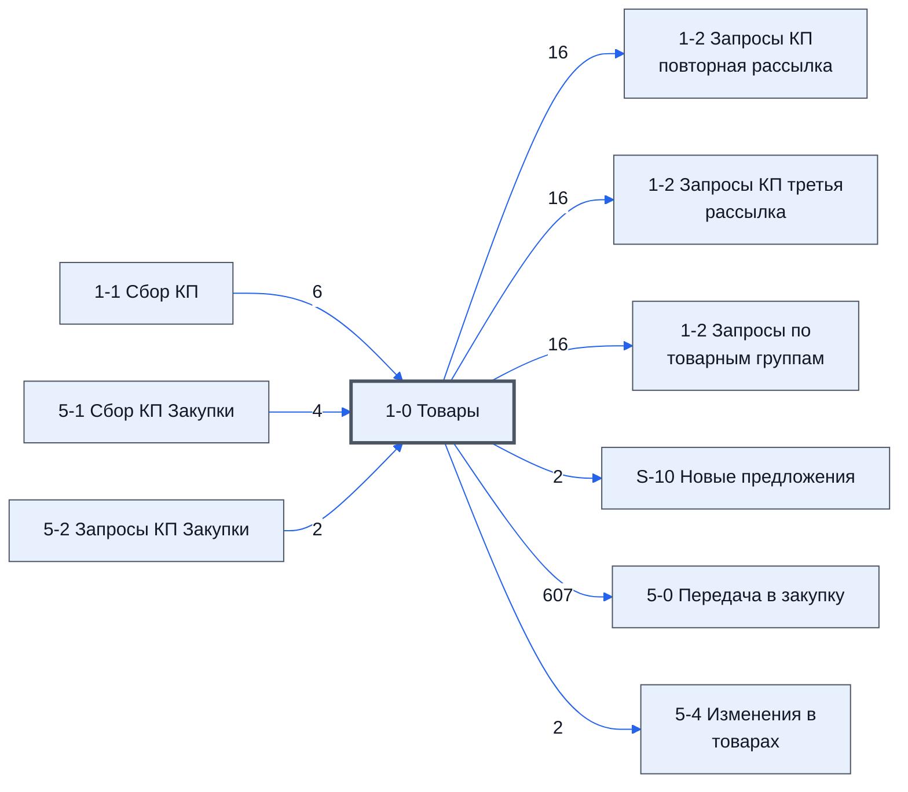

# Лист «1-0 Товары»

Таблица: таблица проекта · контур 1.

**Зачем** (со слов директора): собирает данные по товарам и передаёт их дальше.

Устройство листа — заголовки, вид столбцов, списки, формулы, связи с другими листами — собрано из таблицы ниже.

## Зачем лист — подробно

*Заполнить:* что на листе происходит, откуда приходят данные и куда уходят.

## Как заполнять

*Заполнить:* какие столбцы вводят руками, какие считаются сами. Что значит каждый столбец — в `stolbtsy.yaml` рядом (поля `chto` и `kak`).

## Что нельзя трогать

*Заполнить.*

## Инструкции и умения

*Заполнить:* какие инструкции и умения относятся к листу.

## Осталось сделать

- Заполнить разделы выше и `stolbtsy.yaml`.

## Устройство (из таблицы)

- **Таблица:** таблица проекта, лист «1-0 Товары»; контур 1
- **Аналог в другом контуре:** [5-0 Товары](../k2-5-0-tovary/index.md)
- **Размер:** `A1:U313`, закреплено до `A11`
- **Каркас:** общий — служебные строки, заголовки в строке 10 ([что значат служебные строки](../../zna/lis-sluzhebnye-stroki/index.md))
- **Формул:** 614; заполненных ячеек без формул в данных: 4; списков: 0; условного форматирования: 0; объединённых ячеек: 0

## Связи с другими листами

- **Берёт данные с листов:** [1-1 Сбор КП](../k1-1-1-sbor-kp/index.md) (6), [5-1 Сбор КП Закупки](../k2-5-1-sbor-kp/index.md) (4), [5-2 Запросы КП Закупки](../k2-5-2-zaprosy-kp/index.md) (2)
- **Его данные используют:** [1-2 Запросы КП повторная рассылка](../k1-1-2-zaprosy-kp-povtornaya-rassylka/index.md) (16), [1-2 Запросы КП третья рассылка](../k1-1-2-zaprosy-kp-tretya-rassylka/index.md) (16), [1-2 Запросы по товарным группам](../k1-1-2-zaprosy-po-tovarnym-gruppam/index.md) (16), [S-10 Новые предложения](../k1-s-10-novye-predlozheniya/index.md) (2), [5-0 Передача в закупку](../k2-5-0-peredacha/index.md) (607), [5-4 Изменения в товарах](../k2-5-4-izmeneniya/index.md) (2)

В скобках и на стрелках — сколько формул ссылаются.

## Столбцы

Устройство — из таблицы; «Что это» и «Как заполняют» — из `stolbtsy.yaml` (заполняем руками).

| Столбец | Заголовок | Служебное имя | Вид | Заполняется | Список | Что это | Как заполняют |
|---|---|---|---|---|---|---|---|
| A |  | err |  | руками? |  |  |  |
| B |  | err2 |  | руками? |  |  |  |
| C | ID_Товара |  | formulaColl | формула |  |  |  |
| D | № | Номер | formulaColl | формула |  |  |  |
| E | Номенклатура | Номенклатура | formulaFree | руками, потом формула |  |  |  |
| F | Характеристики | Характеристики | formulaFree | руками, потом формула |  |  |  |
| G | Ед. Изм | ЕдИзм | formulaFree | руками, потом формула |  |  |  |
| H | Кол-во | Количевство | formulaFree | руками, потом формула |  |  |  |
| I | НМЦ | НМЦ | formulaFree | руками, потом формула |  |  |  |
| J | Название товара по договору | НазваниеТовараПоДоговору | formulaColl | формула |  |  |  |
| K | Изготовитель товара по договору | ИзготовительТовараПоДоговору | formulaColl | формула |  |  |  |
| L | Группа | Группа_1_2 | formulaColl | формула |  |  |  |
| M | Группа | Группа_5_2 | formulaColl | формула |  |  |  |
| N | Срок поставки по договору | СрокПоставкиПоДоговору | formulaColl | формула |  |  |  |
| O | Нац режим 1875 |  |  | формула |  |  |  |
| P | Код ОКПД 2 |  |  | формула |  |  |  |

Формулы столбцов (14)

| Столбец | Строка | Формула |
|---|---|---|
| C | 10 | <code>={"ID_Товара"; LAMBDA( doFindRow, doFilter, theWordStart, theCStart, theWordEnd, theCEnd, theDataWord, theData, doFilter(doFindRow(theDataWord,theWordStart,theCStart),doFindRow(theDataWord,theWordEnd,theCEnd),theData) )( LAMBDA(theWords,theWord,theC,"ID_Товара")</code> |
| D | 10 | <code>={ {'1-1 Сбор КП'!C1:G1}; {LAMBDA( doFindRow, doFilter, theWordStart, theCStart, theWordEnd, theCEnd, theDataWord, theData, doFilter(doFindRow(theDataWord,theWordStart,theCStart),doFindRow(theDataWord,theWordEnd,theCEnd),theData) )( LAMBDA(theWords,t,"№")</code> |
| E | 10 | <code>="COMPUTED_VALUE"</code> |
| F | 10 | <code>="COMPUTED_VALUE"</code> |
| G | 10 | <code>="COMPUTED_VALUE"</code> |
| H | 10 | <code>="COMPUTED_VALUE"</code> |
| I | 10 | <code>={ {'1-1 Сбор КП'!K1}; {LAMBDA( doFindRow, doFilter, theWordStart, theCStart, theWordEnd, theCEnd, theDataWord, theData, doFilter(doFindRow(theDataWord,theWordStart,theCStart),doFindRow(theDataWord,theWordEnd,theCEnd),theData) )( LAMBDA(theWords,theW,"НМЦ")</code> |
| J | 10 | <code>=IF(E10:E313&lt;&gt;"",IFERROR(VLOOKUP(E10:E313,{'5-1 Сбор КП Закупки'!E10:E313,'5-1 Сбор КП Закупки'!F10:F313},2,FALSE) ,),)</code> |
| K | 10 | <code>=IF(E10:E313&lt;&gt;"",IFERROR(VLOOKUP(E10:E313,{'5-1 Сбор КП Закупки'!E10:E313,'5-1 Сбор КП Закупки'!G10:G313},2,FALSE) ,),)</code> |
| L | 10 | <code>=BYROW({ {'1-1 Сбор КП'!O1}; {LAMBDA( doFindRow, doFilter, theWordStart, theCStart, theWordEnd, theCEnd, theDataWord, theData, doFilter(doFindRow(theDataWord,theWordStart,theCStart),doFindRow(theDataWord,theWordEnd,theCEnd),theData) )( LAMBDA(theWord,"Группа")</code> |
| M | 10 | <code>={"Группа";LAMBDA(doFind,theIds,theData, doFind(theIds,theData) )( LAMBDA(theIds,theData, BYROW(theIds,LAMBDA(ti,IF(ti&lt;&gt;"", IFERROR(VLOOKUP(ti,theData,2,0),),)))), '1-0 Товары'!C11:C313, {'5-2 Запросы КП Закупки'!C11:C313,'5-2 Запросы КП Закупки'!N11:N313} )}</code> |
| N | 10 | <code>={ {'1-1 Сбор КП'!N1}; {LAMBDA( doFindRow, doFilter, theWordStart, theCStart, theWordEnd, theCEnd, theDataWord, theData, doFilter(doFindRow(theDataWord,theWordStart,theCStart),doFindRow(theDataWord,theWordEnd,theCEnd),theData) )( LAMBDA(theWords,theW,"Срок поставки по договору")</code> |
| O | 10 | <code>={ {'1-1 Сбор КП'!L1}; {LAMBDA( doFindRow, doFilter, theWordStart, theCStart, theWordEnd, theCEnd, theDataWord, theData, doFilter(doFindRow(theDataWord,theWordStart,theCStart),doFindRow(theDataWord,theWordEnd,theCEnd),theData) )( LAMBDA(theWords,theW,"Нац режим 1875")</code> |
| P | 10 | <code>={ {'1-1 Сбор КП'!M1}; {LAMBDA( doFindRow, doFilter, theWordStart, theCStart, theWordEnd, theCEnd, theDataWord, theData, doFilter(doFindRow(theDataWord,theWordStart,theCStart),doFindRow(theDataWord,theWordEnd,theCEnd),theData) )( LAMBDA(theWords,theW,"Код ОКПД 2")</code> |

