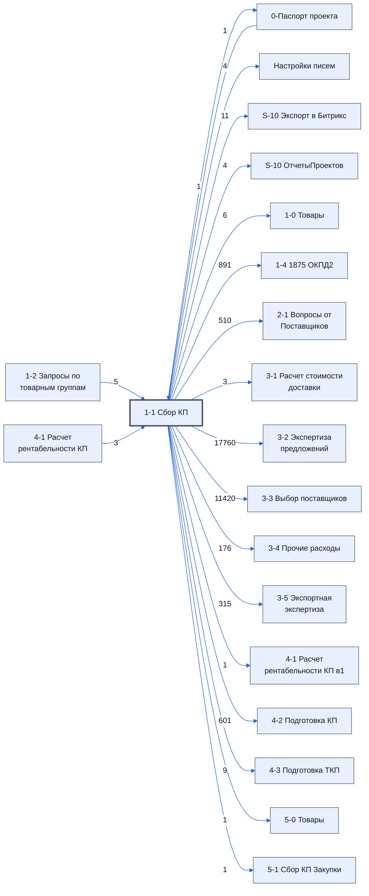

# Лист «1-1 Сбор КП»

Таблица: таблица проекта · контур 1.

**Зачем** (со слов директора): данные о товарах и предложениях поставщиков.

Устройство листа — заголовки, вид столбцов, списки, формулы, связи с другими листами — собрано из таблицы ниже. Строка заголовков на этом листе угадана по закреплённой области — проверить.

## Зачем лист — подробно

*Заполнить:* что на листе происходит, откуда приходят данные и куда уходят.

## Как заполнять

*Заполнить:* какие столбцы вводят руками, какие считаются сами. Что значит каждый столбец — в `stolbtsy.yaml` рядом (поля `chto` и `kak`).

## Что нельзя трогать

*Заполнить.*

## Инструкции и умения

*Заполнить:* какие инструкции и умения относятся к листу.

## Осталось сделать

- Заполнить разделы выше и `stolbtsy.yaml`.

## Устройство (из таблицы)

- **Таблица:** таблица проекта, лист «1-1 Сбор КП»; контур 1
- **Аналог в другом контуре:** [5-1 Сбор КП Закупки](../k2-5-1-sbor-kp/index.md)
- **Размер:** `A1:JI310`, закреплено до `T2`
- **Каркас:** свой, не общий; строка заголовков — 1, угадана по закреплённой области — проверить
- **Формул:** 3012; заполненных ячеек без формул в данных: 1212; списков: 1; условного форматирования: 12; объединённых ячеек: 0

## Связи с другими листами

- **Берёт данные с листов:** [1-2 Запросы по товарным группам](../k1-1-2-zaprosy-po-tovarnym-gruppam/index.md) (5), [4-1 Расчет рентабельности КП](../k1-4-1-raschet-rentabelnosti-kp/index.md) (3), [0-Паспорт проекта](../k0-0-pasport-proekta/index.md) (1)
- **Его данные используют:** [0-Паспорт проекта](../k0-0-pasport-proekta/index.md) (1), [Настройки писем](../k0-nastroyki-pisem/index.md) (4), [S-10 Экспорт в Битрикс](../k0-s-10-eksport-v-bitriks/index.md) (11), [S-10 ОтчетыПроектов](../k0-s-10-otchetyproektov/index.md) (4), [1-0 Товары](../k1-1-0-tovary/index.md) (6), [1-4 1875 ОКПД2](../k1-1-4-1875-okpd2/index.md) (891), [2-1 Вопросы от Поставщиков](../k1-2-1-voprosy-ot-postavshchikov/index.md) (510), [3-1 Расчет стоимости доставки](../k1-3-1-raschet-stoimosti-dostavki/index.md) (3), [3-2 Экспертиза предложений](../k1-3-2-ekspertiza-predlozheniy/index.md) (17760), [3-3 Выбор поставщиков](../k1-3-3-vybor-postavshchikov/index.md) (11420), [3-4 Прочие расходы](../k1-3-4-prochie-raskhody/index.md) (176), [3-5 Экспортная экспертиза](../k1-3-5-eksportnaya-ekspertiza/index.md) (315), [4-1 Расчет рентабельности КП в1](../k1-4-1-raschet-rentabelnosti-kp-v1/index.md) (1), [4-2 Подготовка КП](../k1-4-2-podgotovka-kp/index.md) (601), [4-3 Подготовка ТКП](../k1-4-3-podgotovka-tkp/index.md) (9), [5-0 Товары](../k2-5-0-tovary/index.md) (1), [5-1 Сбор КП Закупки](../k2-5-1-sbor-kp/index.md) (1)

В скобках и на стрелках — сколько формул ссылаются.

## Кто здесь работает (по процессам)

Обязанности, у которых место работы — этот лист (из разбора регламента); должность — в карточке обязанности.

[Заносящий ответы поставщиков](../../reg/oby/zanesenie-otvetov.md)

## Столбцы

Устройство — из таблицы; «Что это» и «Как заполняют» — из `stolbtsy.yaml` (заполняем руками).

| Столбец | Заголовок | Служебное имя | Вид | Заполняется | Список | Что это | Как заполняют |
|---|---|---|---|---|---|---|---|
| B |  |  |  | формула |  |  |  |
| C | № |  |  | руками? |  |  |  |
| D | Номенклатура |  |  | руками? |  |  |  |
| E | Характеристики |  |  | руками? |  |  |  |
| F | Ед. Изм |  |  | руками? |  |  |  |
| G | Кол-во |  |  | руками? |  |  |  |
| H | Цена |  |  | руками? |  |  |  |
| I | Итого |  |  | руками? |  |  |  |
| J | Предложений |  |  | руками? |  |  |  |
| K | НМЦ |  |  | формула |  |  |  |
| L | Нац режим 1875 |  |  | руками, из списка | 'Настройки писем'!$AO$2:$AO$20 |  |  |
| M | Код ОКПД 2 |  |  | руками? |  |  |  |
| N | Срок поставки по договору |  |  | руками? |  |  |  |
| O | Группа |  |  | формула |  |  |  |
| P | Доля ответов |  |  | формула |  |  |  |
| Q | Предложение |  |  | формула |  |  |  |
| R | Писем |  |  | формула |  |  |  |
| S | свободные |  |  | руками? |  |  |  |
| T | свободные |  |  | руками? |  |  |  |
| U | свободные |  |  | руками? |  |  |  |
| V | свободные |  |  | руками? |  |  |  |
| W | свободные |  |  | руками? |  |  |  |
| X | свободные |  |  | руками? |  |  |  |
| Y | свободные |  |  | руками? |  |  |  |
| Z | Цены Начало |  |  | руками? |  |  |  |
| AA |  |  |  | формула |  |  |  |
| HS | Цены Конец |  |  | руками? |  |  |  |
| HT | 1 цена |  |  | формула |  |  |  |
| HU | поставщик |  |  | формула |  |  |  |
| HV | 2 цена |  |  | формула |  |  |  |
| HW | поставщик |  |  | формула |  |  |  |
| HX | 3 цена |  |  | формула |  |  |  |
| HY | поставщик |  |  | формула |  |  |  |
| ID | Комментарий |  |  | формула |  |  |  |
| IE | Лучшие цены |  |  | формула |  |  |  |
| IF | CommentBlokStart |  |  | руками? |  |  |  |
| IL | CommentBlokEnd |  |  | руками? |  |  |  |
| IQ | КомментарийЭксперта |  |  | формула |  |  |  |
| IR | ТопЭксперта |  |  | формула |  |  |  |
| IS | CommentExpertBlokStart |  |  | руками? |  |  |  |
| JF | CommentExpertBlokEnd |  |  | руками? |  |  |  |

Формулы столбцов (17)

| Столбец | Строка | Формула |
|---|---|---|
| B | 2 | <code>='4-1 Расчет рентабельности КП'!AJ43</code> |
| K | 302 | <code>=SUMPRODUCT(G2:G301,K2:K301)</code> |
| O | 1 | <code>={"Группа";LAMBDA(theNames,theData,BYROW(theNames,LAMBDA(tn,IFERROR(VLOOKUP(tn,theData,2,0),))))(C2:C301,{'1-2 Запросы по товарным группам'!D:D,'1-2 Запросы по товарным группам'!O:O})}</code> |
| P | 1 | <code>={{"Доля ответов","Предложение","Писем"};let( _t_em_map , let( _t_gr, '1-2 Запросы по товарным группам'!$O11:$O312, _t_nm, '1-2 Запросы по товарным группам'!$P11:$P312, _t_em, '1-2 Запросы по товарным группам'!$AA11:JI$312, do_sm, LAMBDA,"Доля ответов")</code> |
| Q | 1 | <code>="COMPUTED_VALUE"</code> |
| R | 1 | <code>="COMPUTED_VALUE"</code> |
| AA | 302 | <code>=LAMBDA(vls,pr,fc, BYCOL(vls,LAMBDA(cl, ifs( MOD( COLUMN(cl)-COLUMN(fc),3)=0,IF((COUNTA(cl)-COUNT(IF(cl="",,cl*1) )) =0,LAMBDA(ss,IF(ss&lt;&gt;0,ss,) )(SUMPRODUCT(cl,pr)),"Ошибка: Цена должна быть числом"), MOD( COLUMN(cl)-COLUMN(fc),3)=1,IF(SUM(cl)&gt;0,"Ошибка: Срок должен быть текстом или пусто",), MOD( COLUMN(cl)-COLUMN(fc),3)=2,IF(SUM(cl)&gt;0,"Ошибка: Модель должена быть текстом или пусто",), TRUE, ) )) …</code> |
| HT | 2 | <code>=IFERROR(SMALL($R2:$HS2,VALUE(LEFT(HT$1,1))),"")</code> |
| HU | 2 | <code>=IFERROR(OFFSET($AA$1,0,MATCH(HT2,$AA2:$HS2,0)),"")</code> |
| HV | 2 | <code>=IFERROR(SMALL($AA2:$HS2,VALUE(LEFT(HV$1,1))),"")</code> |
| HW | 2 | <code>=IFERROR(OFFSET($A$1,0,MATCH(HV2,$AA2:$HS2,0)),"")</code> |
| HX | 2 | <code>=IFERROR(SMALL($AA2:$HS2,VALUE(LEFT(HX$1,1))),"")</code> |
| HY | 2 | <code>=IFERROR(OFFSET($AA$1,0,MATCH(HX2,$AA2:$HS2,0)),"")</code> |
| ID | 2 | <code>= IFERROR( TEXTJOIN("&#124;&#124;&#124;",FALSE , ARRAY_CONSTRAIN( SORT( ARRAYFORMULA(Split(TRANSPOSE (Split(TEXTJOIN("&#124;&#124;&#124;",TRUE,'1-1 Сбор КП'!$IF2:$IL2),"&#124;&#124;&#124;",FALSE,FALSE) ),"&#124;",FALSE,FALSE)),3,FALSE ),100,2) ) ,)</code> |
| IE | 2 | <code>=LAMBDA(cc,тело,комент, комЭкс, порядок,показ, BYROW(тело, LAMBDA(r, TEXTJOIN("&#124;&#124;&#124;",FALSE,ARRAY_CONSTRAIN( Query( TRANSPOSE( { {ARRAYFORMULA( FILTER( ADDRESS(ROW(r), COLUMN(r) ), MOD(COLUMN(r)-cc,3)=0))}; {ARRAYFORMULA( FILTER( ADDRESS(1, COLUMN(r) ), MO,"#N/A")</code> |
| IQ | 2 | <code>= IFERROR( TEXTJOIN("&#124;&#124;&#124;",TRUE , BYROW( ARRAY_CONSTRAIN( SORT( ARRAYFORMULA( Split( TRANSPOSE ( Split(TEXTJOIN("&#124;&#124;&#124;", TRUE, '1-1 Сбор КП'!$IS2:$JF2) ,"&#124;&#124;&#124;",FALSE,FALSE) ),"📎",FALSE,FALSE,"")</code> |
| IR | 2 | <code>= LAMBDA(cc,тело,комент,комЭкс,BYROW(тело,LAMBDA(r, TEXTJOIN("&#124;&#124;&#124;",FALSE, ARRAY_CONSTRAIN( Query( TRANSPOSE( { { ARRAYFORMULA( FILTER( ADDRESS(ROW(r), COLUMN(r) ), MOD(COLUMN(r)-cc,3)=0)) }; { ARRAYFORMULA( FILTER( ADDRESS(1, COLUMN(r) ), MOD(COL,"#N/A")</code> |

