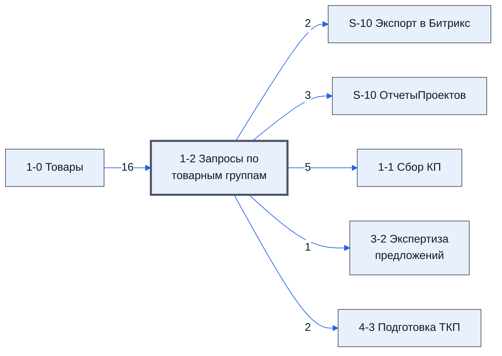

# Лист «1-2 Запросы по товарным группам»

Таблица: таблица проекта · контур 1.

**Зачем** (со слов директора): товарные группы и рассылка писем.

Устройство листа — заголовки, вид столбцов, списки, формулы, связи с другими листами — собрано из таблицы ниже.

## Зачем лист — подробно

*Заполнить:* что на листе происходит, откуда приходят данные и куда уходят.

## Как заполнять

*Заполнить:* какие столбцы вводят руками, какие считаются сами. Что значит каждый столбец — в `stolbtsy.yaml` рядом (поля `chto` и `kak`).

## Что нельзя трогать

*Заполнить.*

## Инструкции и умения

*Заполнить:* какие инструкции и умения относятся к листу.

## Осталось сделать

- Заполнить разделы выше и `stolbtsy.yaml`.

## Устройство (из таблицы)

- **Таблица:** таблица проекта, лист «1-2 Запросы по товарным группам»; контур 1
- **Аналог в другом контуре:** [5-2 Запросы КП Закупки](../k2-5-2-zaprosy-kp/index.md)
- **Размер:** `A1:AZ399`, закреплено до `F11`
- **Каркас:** общий — служебные строки, заголовки в строке 10 ([что значат служебные строки](../../zna/lis-sluzhebnye-stroki/index.md))
- **Формул:** 427; заполненных ячеек без формул в данных: 0; списков: 1; условного форматирования: 0; объединённых ячеек: 0

## Связи с другими листами

- **Берёт данные с листов:** [1-0 Товары](../k1-1-0-tovary/index.md) (16)
- **Его данные используют:** [S-10 Экспорт в Битрикс](../k0-s-10-eksport-v-bitriks/index.md) (2), [S-10 ОтчетыПроектов](../k0-s-10-otchetyproektov/index.md) (3), [1-1 Сбор КП](../k1-1-1-sbor-kp/index.md) (5), [3-2 Экспертиза предложений](../k1-3-2-ekspertiza-predlozheniy/index.md) (1), [4-3 Подготовка ТКП](../k1-4-3-podgotovka-tkp/index.md) (2)

В скобках и на стрелках — сколько формул ссылаются.

## Кто здесь работает (по процессам)

Обязанности, у которых место работы — этот лист (из разбора регламента); должность — в карточке обязанности.

[Рассылающий запросы поставщикам](../../reg/oby/rassylka-zaprosov.md), [Проверяющий поставщиков до рассылки](../../reg/oby/proverka-postavshchikov.md)

## Столбцы

Устройство — из таблицы; «Что это» и «Как заполняют» — из `stolbtsy.yaml` (заполняем руками).

| Столбец | Заголовок | Служебное имя | Вид | Заполняется | Список | Что это | Как заполняют |
|---|---|---|---|---|---|---|---|
| A *(скрыт)* |  | err1 |  | руками? |  |  |  |
| B *(скрыт)* |  | err2 |  | руками? |  |  |  |
| C | ID_Товара |  | formulaColl | формула |  |  |  |
| D | № | Номер |  | руками, из списка | '1-0 Товары'!$D$11:$D399 |  |  |
| E | Номенклатура | Номенклатура | formulaColl | формула |  |  |  |
| F | Название товара по договору | НазваниеТовараПоДоговору | formulaColl | формула |  |  |  |
| G | Изготовитель товара по договору | ИзготовительТовараПоДоговору | formulaColl | формула |  |  |  |
| H | Характеристики | Характеристики | formulaColl | формула |  |  |  |
| I | Ед. Изм | ЕдИзм | formulaColl | формула |  |  |  |
| J | Кол-во | Количевство | formulaColl | формула |  |  |  |
| K | Нац режим 1875 | НацРежим |  | формула |  |  |  |
| L | Название товара для запроса | НазваниеТовраДляЗапроса | formulaCell | формула |  |  |  |
| M | Комментарий | Комментарий |  | руками? |  |  |  |
| N | Файлы | Файлы |  | руками? |  |  |  |
| O | Группа | Группа | formulaColl | формула |  |  |  |
| P | Строка в группе | СтрокаВГруппе | formulaFree | руками, потом формула |  |  |  |
| Q | Ключ фразы 1 | Ключ фразы 1 |  | руками? |  |  |  |
| R | Ключ фразы 2 | Ключ фразы 2 |  | руками? |  |  |  |
| S | Ключ фразы 3 | Ключ фразы 3 |  | руками? |  |  |  |
| T *(скрыт)* |  | Свободно01 |  | руками? |  |  |  |
| U *(скрыт)* |  | Свободно02 |  | руками? |  |  |  |
| V *(скрыт)* |  | Свободно03 |  | руками? |  |  |  |
| W *(скрыт)* |  | Свободно04 |  | руками? |  |  |  |
| X *(скрыт)* |  | Свободно05 |  | руками? |  |  |  |
| Y *(скрыт)* |  | Свободно06 |  | руками? |  |  |  |
| Z *(скрыт)* |  | ПочтыНачало |  | руками? |  |  |  |
| AA |  | Почта.AA |  | руками? |  |  |  |
| AB |  | Почта.AB |  | руками? |  |  |  |
| AC |  | Почта.AC |  | руками? |  |  |  |
| AD |  | Почта.AD |  | руками? |  |  |  |
| AE |  | Почта.AE |  | руками? |  |  |  |
| AF |  | Почта.AF |  | руками? |  |  |  |
| AG |  | Почта.AG |  | руками? |  |  |  |
| AH |  | Почта.AH |  | руками? |  |  |  |
| AI |  | Почта.AI |  | руками? |  |  |  |
| AJ |  | Почта.AJ |  | руками? |  |  |  |
| AK |  | Почта.AK |  | руками? |  |  |  |
| AL |  | Почта.AL |  | руками? |  |  |  |
| AM |  | Почта.AM |  | руками? |  |  |  |
| AN |  | Почта.AN |  | руками? |  |  |  |
| AO |  | Почта.AO |  | руками? |  |  |  |
| AP |  | Почта.AP |  | руками? |  |  |  |
| AQ |  | Почта.AQ |  | руками? |  |  |  |
| AR |  | Почта.AR |  | руками? |  |  |  |
| AS |  | Почта.AS |  | руками? |  |  |  |
| AT |  | Почта.AT |  | руками? |  |  |  |
| AU |  | Почта.AU |  | руками? |  |  |  |
| AV |  | Почта.AV |  | руками? |  |  |  |
| AW |  | Почта.AW |  | руками? |  |  |  |
| AX |  | Почта.AX |  | руками? |  |  |  |
| AY |  | Почта.AY |  | руками? |  |  |  |
| AZ |  | Почта.AZ |  | руками? |  |  |  |

## Переменные листа

Строки 5–6 каркаса (`var_name`, `var_value`): имя переменной и её значения — скорее всего, списки для скриптов и выпадающих списков.

| Ячейка | Имя | Значения |
|---|---|---|
| D | Ответственный | 0 |
| E | ПоУмолчанию | <- ID из битрикс \| По умолчанию \| Текст подписи -> |
| F | Подпись |  [сотрудник]   [телефон] |

Формулы столбцов (11)

| Столбец | Строка | Формула |
|---|---|---|
| C | 10 | <code>=LAMBDA(doFind,theNames,theDatas,BYROW(theNames,LAMBDA(theName,IF(theName&lt;&gt;"",doFind(theName,theDatas),))))( LAMBDA(theName,theDatas,IFERROR( VLOOKUP(theName,theDatas,2,0),)), D10:D399,{'1-0 Товары'!$D$10:$D399,'1-0 Товары'!$C$10:C399} )</code> |
| E | 10 | <code>=LAMBDA(doFind,theNames,theDatas,BYROW(theNames,LAMBDA(theName,IF(theName&lt;&gt;"",doFind(theName,theDatas),))))( LAMBDA(theName,theDatas,IFERROR( VLOOKUP(theName,theDatas,2,0),)), D10:D399,{'1-0 Товары'!$D$10:$D399,'1-0 Товары'!$E$10:E399} )</code> |
| F | 10 | <code>=LAMBDA(doFind,theNames,theDatas,BYROW(theNames,LAMBDA(theName,IF(theName&lt;&gt;"",doFind(theName,theDatas),))))( LAMBDA(theName,theDatas,IFERROR( VLOOKUP(theName,theDatas,2,0),)), D10:D399,{'1-0 Товары'!$D$10:$D399,'1-0 Товары'!$J$10:J399} )</code> |
| G | 10 | <code>=LAMBDA(doFind,theNames,theDatas,BYROW(theNames,LAMBDA(theName,IF(theName&lt;&gt;"",doFind(theName,theDatas),))))( LAMBDA(theName,theDatas,IFERROR( VLOOKUP(theName,theDatas,2,0),)), D10:D399,{'1-0 Товары'!$D$10:$D399,'1-0 Товары'!$K$10:K399} )</code> |
| H | 10 | <code>=LAMBDA(doFind,theNames,theDatas,BYROW(theNames,LAMBDA(theName,IF(theName&lt;&gt;"",doFind(theName,theDatas),))))( LAMBDA(theName,theDatas,IFERROR( VLOOKUP(theName,theDatas,2,0),)), D10:D399,{'1-0 Товары'!$D$10:$D399,'1-0 Товары'!$F$10:F399} )</code> |
| I | 10 | <code>=LAMBDA(doFind,theNames,theDatas,BYROW(theNames,LAMBDA(theName,IF(theName&lt;&gt;"",doFind(theName,theDatas),))))( LAMBDA(theName,theDatas,IFERROR( VLOOKUP(theName,theDatas,2,0),)), D10:D399,{'1-0 Товары'!$D$10:$D399,'1-0 Товары'!$G$10:G399} )</code> |
| J | 10 | <code>=LAMBDA(doFind,theNames,theDatas,BYROW(theNames,LAMBDA(theName,IF(theName&lt;&gt;"",doFind(theName,theDatas),))))( LAMBDA(theName,theDatas,IFERROR( VLOOKUP(theName,theDatas,2,0),)), D10:D399,{'1-0 Товары'!$D$10:$D399,'1-0 Товары'!$H$10:H399} )</code> |
| K | 10 | <code>=LAMBDA(doFind,theNames,theDatas,BYROW(theNames,LAMBDA(theName,IF(theName&lt;&gt;"",doFind(theName,theDatas),))))( LAMBDA(theName,theDatas,IFERROR( VLOOKUP(theName,theDatas,2,0),)), D10:D399,{'1-0 Товары'!$D$10:$D399,'1-0 Товары'!$O$10:O399} )</code> |
| L | 11 | <code>=E11</code> |
| O | 10 | <code>={{"Группа","Строка в группе"}; LAMBDA(doNorm, doGrop, doExtact, doJoin, doScan,doResolveItem, нач,дата, doGrop(doExtact, doScan( doResolveItem , doExtact, doJoin,нач,doNorm(дата) )) )( LAMBDA(dr,BYROW(dr ,LAMBDA(r,NOT( ISBLANK(r))))), LAMBDA(doE,"Группа")</code> |
| P | 10 | <code>="COMPUTED_VALUE"</code> |

