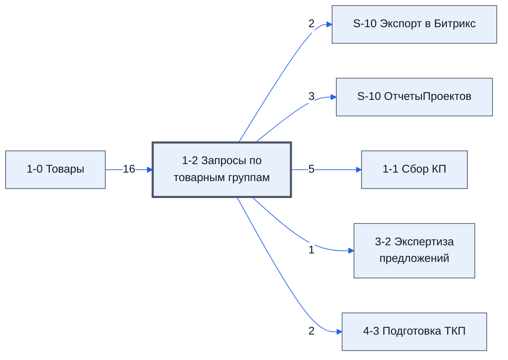

> Черновик: текст не проверен.

# Лист «1-2 Запросы по товарным группам»

Таблица: таблица проекта · контур 1.

**Зачем**  товарные группы и рассылка писем.

Устройство листа — заголовки, вид столбцов, списки, формулы, связи с другими листами — собрано из таблицы ниже.

## Зачем лист — подробно

Рассылка запросов контура 1: товары разбиты на группы, у каждой группы — свои адреса поставщиков, файлы и ключевые
фразы. Отсюда скрипт рассылает письма (`Доп.Меню` → `1-2 Запросы` → `Отправка писем`); поставщик из нескольких групп
получает одно общее письмо, повторы адресов убираются. Сведения о товаре — с листа [1-0 Товары](../../lis/k1-1-0-tovary/index.md) по №.
Аналог в контуре 2 — [5-2 Запросы КП Закупки](../../lis/k2-5-2-zaprosy-kp/index.md).

Источник — старые инструкции 3.1.2–3.1.4 (2026-10-19, `raw/2026-10-19-aj-md`); где таблица с тех пор изменилась — помечено.

## Как заполнять

1. Группы: вставить значениями номера позиций в столбец «№» с 12-й строки; строку 11 не переставлять и выше неё не
   вставлять. Группы разделяют две и более пустые строки ([группировка товаров](../../tio/tov-gruppirovka/index.md)). У каждого товара должна быть группа —
   проверить на листе 1-1.
2. Файлы к товару — ссылками в столбец «Файлы», каждая с новой строки. Файлы с упоминанием конечного заказчика не отправлять.
3. Ключевые фразы 1–3 (скрытые столбцы): изготовитель, товарная группа, название так, как товар ищут в поисковике.
4. Адреса поставщиков — в первую строку группы, с AA вправо; повторы не страшны.
5. Отправлять только после согласования адресов, файлов, аккаунта рассылки и подписи. После отправки:
   `Доп.Меню` → `1-2 Запросы` → `Посчитать кол-во отправленных писем`; отправленные адреса окрашиваются ([цвета раскраски адресов](../../zna/ras-tsveta-adresov/index.md)),
   в заметке — с какого адреса, на какой и когда.

## Что нельзя трогать

Служебные строки каркаса и строку 11; столбцы с формулами (ID, сведения о товаре, «Группа», «Строка в группе»); вторую строку группы — её заполняет формула.

## Инструкции и умения

[инструкция для специалиста по расчёту](../../tio/tab-raschet/index.md) · [группировка товаров](../../tio/tov-gruppirovka/index.md) · [состояние рассылки](../../zna/ras-sostoyanie-rassylki/index.md) · [вставлять только значения](../../um/tab-tolko-znacheniya/index.md)

## Осталось сделать

- Сверить черновик столбцов в `stolbtsy.yaml`.

**Ответ** 
- Сверить черновик столбцов в `stolbtsy.yaml`.
   сравнил и листы по анологии с этим можно в их инструкции ссылатся судаже и не дублировать информвцию 

- с листом работает скрипт и есть пункты в меню  а также есть таблица в которой создается шаблон письма  
- в план на этапе разборки скриптов и меню и в план пересмотреть создание шаблонов и скрипт рассылки писем
   

## Устройство (из таблицы)

- **Таблица:** таблица проекта, лист «1-2 Запросы по товарным группам»; контур 1
- **Аналог в другом контуре:** [5-2 Запросы КП Закупки](../k2-5-2-zaprosy-kp/index.md)
- **Размер:** `A1:AZ399`, закреплено до `F11`
- **Каркас:** общий — служебные строки, заголовки в строке 10 ([что значат служебные строки](../../zna/lis-sluzhebnye-stroki/index.md))
- **Формул:** 427; заполненных ячеек без формул в данных: 0; списков: 1; условного форматирования: 0; объединённых ячеек: 0

## Связи с другими листами

- **Берёт данные с листов:** [1-0 Товары](../k1-1-0-tovary/index.md) (16)
- **Его данные используют:** [S-10 Экспорт в Битрикс](../k0-s-10-eksport-v-bitriks/index.md) (2), [S-10 ОтчетыПроектов](../k0-s-10-otchetyproektov/index.md) (3), [1-1 Сбор КП](../k1-1-1-sbor-kp/index.md) (5), [3-2 Экспертиза предложений](../k1-3-2-ekspertiza-predlozheniy/index.md) (1), [4-3 Подготовка ТКП](../k1-4-3-podgotovka-tkp/index.md) (2)

В скобках и на стрелках — сколько формул ссылаются.

## Кто здесь работает (по процессам)

Обязанности, у которых место работы — этот лист (из разбора регламента); должность — в карточке обязанности.

[Рассылающий запросы поставщикам](../../reg/oby/rassylka-zaprosov.md), [Проверяющий поставщиков до рассылки](../../reg/oby/proverka-postavshchikov.md)

## Столбцы

Устройство — из таблицы; «Что это» и «Как заполняют» — из `stolbtsy.yaml` (заполняем руками).

| Столбец | Заголовок | Служебное имя | Вид | Заполняется | Список | Что это | Как заполняют |
|---|---|---|---|---|---|---|---|
| A *(скрыт)* |  | err1 |  | руками? |  | служебный столбец каркаса |  |
| B *(скрыт)* |  | err2 |  | руками? |  | служебный столбец каркаса |  |
| C | ID_Товара |  | formulaColl | формула |  | ID_Товара | формула: по № с листа 1-0 Товары |
| D | № | Номер |  | руками, из списка | '1-0 Товары'!$D$11:$D399 | № товара в группе рассылки | руками: вставить значениями номера позиций с листа 1-1, с 12-й строки (строку 11 не двигать) или выбрать из списка (3.1.2) |
| E | Номенклатура | Номенклатура | formulaColl | формула |  | название товара | формула: по № с листа 1-0 Товары |
| F | Название товара по договору | НазваниеТовараПоДоговору | formulaColl | формула |  | название товара по договору | формула: по № с листа 1-0 Товары (столбец J) |
| G | Изготовитель товара по договору | ИзготовительТовараПоДоговору | formulaColl | формула |  | изготовитель по договору | формула: по № с листа 1-0 Товары (столбец K) |
| H | Характеристики | Характеристики | formulaColl | формула |  | характеристики | формула: по № с листа 1-0 Товары |
| I | Ед. Изм | ЕдИзм | formulaColl | формула |  | единица измерения | формула: по № с листа 1-0 Товары |
| J | Кол-во | Количевство | formulaColl | формула |  | количество | формула: по № с листа 1-0 Товары |
| K | Нац режим 1875 | НацРежим |  | формула |  | нац. режим 1875 | формула: по № с листа 1-0 Товары |
| L | Название товара для запроса | НазваниеТовраДляЗапроса | formulaCell | формула |  | название товара, как оно уйдёт в письме поставщику | формула в каждой ячейке (= номенклатура); для уточнений можно вписать своё заменив формулу на текст |
| M | Комментарий | Комментарий |  | руками? |  | комментарий к товару для письма | руками |
| N | Файлы | Файлы |  | руками? |  | ссылки на файлы к товару (чертежи, фото) из папки «Почтовые вложения» проекта; каждая ссылка с новой строки. Файлы с упоминанием конечного заказчика не отправлять | руками (3.1.2) |
| O | Группа | Группа | formulaColl | формула |  | номер группы товаров; группы разделяют две и более пустые строки | формула на два столбца: группа и строка в группе |
| P | Строка в группе | СтрокаВГруппе | formulaFree | руками, потом формула |  | номер строки в группе: в первую строку вносят адреса, во второй появляются уникальные адреса без повторов | формула столбца «Группа» |
| Q | Ключ фразы 1 | Ключ фразы 1 |  | руками? |  | ключевые фразы для поиска поставщиков: бренд или изготовитель, вся товарная группа, как товар ищут в поисковике; действует на всю группу товара | руками; столбцы скрыты — раскрыть (3.1.2) |
| R | Ключ фразы 2 | Ключ фразы 2 |  | руками? |  | ключевые фразы для поиска поставщиков: бренд или изготовитель, вся товарная группа, как товар ищут в поисковике; действует на всю группу товара | руками; столбцы скрыты — раскрыть (3.1.2) |
| S | Ключ фразы 3 | Ключ фразы 3 |  | руками? |  | ключевые фразы для поиска поставщиков: бренд или изготовитель, вся товарная группа, как товар ищут в поисковике; действует на всю группу товара | руками; столбцы скрыты — раскрыть (3.1.2) |
| T *(скрыт)* |  | Свободно01 |  | руками? |  | запас под новые столбцы | не заполнять |
| U *(скрыт)* |  | Свободно02 |  | руками? |  | запас под новые столбцы | не заполнять |
| V *(скрыт)* |  | Свободно03 |  | руками? |  | запас под новые столбцы | не заполнять |
| W *(скрыт)* |  | Свободно04 |  | руками? |  | запас под новые столбцы | не заполнять |
| X *(скрыт)* |  | Свободно05 |  | руками? |  | запас под новые столбцы | не заполнять |
| Y *(скрыт)* |  | Свободно06 |  | руками? |  | запас под новые столбцы | не заполнять |
| Z *(скрыт)* |  | ПочтыНачало |  | руками? |  | метка: отсюда вправо — адреса поставщиков | не трогать: по метке формулы и скрипты находят начало или конец блока |
| AA |  | Почта.AA |  | руками? |  | адреса поставщиков группы. После отправки ячейка окрашивается, в заметке — с какого адреса, на какой и когда; цвет показывает и другое: есть ответ, официальный дилер, ненадёжный поставщик (3.1.3) | руками: в первую строку группы, с AA вправо; дубли можно — во второй строке останутся уникальные |
| AB |  | Почта.AB |  | руками? |  | адреса поставщиков группы. После отправки ячейка окрашивается, в заметке — с какого адреса, на какой и когда; цвет показывает и другое: есть ответ, официальный дилер, ненадёжный поставщик (3.1.3) | руками: в первую строку группы, с AA вправо; дубли можно — во второй строке останутся уникальные |
| AC |  | Почта.AC |  | руками? |  | адреса поставщиков группы. После отправки ячейка окрашивается, в заметке — с какого адреса, на какой и когда; цвет показывает и другое: есть ответ, официальный дилер, ненадёжный поставщик (3.1.3) | руками: в первую строку группы, с AA вправо; дубли можно — во второй строке останутся уникальные |
| AD |  | Почта.AD |  | руками? |  | адреса поставщиков группы. После отправки ячейка окрашивается, в заметке — с какого адреса, на какой и когда; цвет показывает и другое: есть ответ, официальный дилер, ненадёжный поставщик (3.1.3) | руками: в первую строку группы, с AA вправо; дубли можно — во второй строке останутся уникальные |
| AE |  | Почта.AE |  | руками? |  | адреса поставщиков группы. После отправки ячейка окрашивается, в заметке — с какого адреса, на какой и когда; цвет показывает и другое: есть ответ, официальный дилер, ненадёжный поставщик (3.1.3) | руками: в первую строку группы, с AA вправо; дубли можно — во второй строке останутся уникальные |
| AF |  | Почта.AF |  | руками? |  | адреса поставщиков группы. После отправки ячейка окрашивается, в заметке — с какого адреса, на какой и когда; цвет показывает и другое: есть ответ, официальный дилер, ненадёжный поставщик (3.1.3) | руками: в первую строку группы, с AA вправо; дубли можно — во второй строке останутся уникальные |
| AG |  | Почта.AG |  | руками? |  | адреса поставщиков группы. После отправки ячейка окрашивается, в заметке — с какого адреса, на какой и когда; цвет показывает и другое: есть ответ, официальный дилер, ненадёжный поставщик (3.1.3) | руками: в первую строку группы, с AA вправо; дубли можно — во второй строке останутся уникальные |
| AH |  | Почта.AH |  | руками? |  | адреса поставщиков группы. После отправки ячейка окрашивается, в заметке — с какого адреса, на какой и когда; цвет показывает и другое: есть ответ, официальный дилер, ненадёжный поставщик (3.1.3) | руками: в первую строку группы, с AA вправо; дубли можно — во второй строке останутся уникальные |
| AI |  | Почта.AI |  | руками? |  | адреса поставщиков группы. После отправки ячейка окрашивается, в заметке — с какого адреса, на какой и когда; цвет показывает и другое: есть ответ, официальный дилер, ненадёжный поставщик (3.1.3) | руками: в первую строку группы, с AA вправо; дубли можно — во второй строке останутся уникальные |
| AJ |  | Почта.AJ |  | руками? |  | адреса поставщиков группы. После отправки ячейка окрашивается, в заметке — с какого адреса, на какой и когда; цвет показывает и другое: есть ответ, официальный дилер, ненадёжный поставщик (3.1.3) | руками: в первую строку группы, с AA вправо; дубли можно — во второй строке останутся уникальные |
| AK |  | Почта.AK |  | руками? |  | адреса поставщиков группы. После отправки ячейка окрашивается, в заметке — с какого адреса, на какой и когда; цвет показывает и другое: есть ответ, официальный дилер, ненадёжный поставщик (3.1.3) | руками: в первую строку группы, с AA вправо; дубли можно — во второй строке останутся уникальные |
| AL |  | Почта.AL |  | руками? |  | адреса поставщиков группы. После отправки ячейка окрашивается, в заметке — с какого адреса, на какой и когда; цвет показывает и другое: есть ответ, официальный дилер, ненадёжный поставщик (3.1.3) | руками: в первую строку группы, с AA вправо; дубли можно — во второй строке останутся уникальные |
| AM |  | Почта.AM |  | руками? |  | адреса поставщиков группы. После отправки ячейка окрашивается, в заметке — с какого адреса, на какой и когда; цвет показывает и другое: есть ответ, официальный дилер, ненадёжный поставщик (3.1.3) | руками: в первую строку группы, с AA вправо; дубли можно — во второй строке останутся уникальные |
| AN |  | Почта.AN |  | руками? |  | адреса поставщиков группы. После отправки ячейка окрашивается, в заметке — с какого адреса, на какой и когда; цвет показывает и другое: есть ответ, официальный дилер, ненадёжный поставщик (3.1.3) | руками: в первую строку группы, с AA вправо; дубли можно — во второй строке останутся уникальные |
| AO |  | Почта.AO |  | руками? |  | адреса поставщиков группы. После отправки ячейка окрашивается, в заметке — с какого адреса, на какой и когда; цвет показывает и другое: есть ответ, официальный дилер, ненадёжный поставщик (3.1.3) | руками: в первую строку группы, с AA вправо; дубли можно — во второй строке останутся уникальные |
| AP |  | Почта.AP |  | руками? |  | адреса поставщиков группы. После отправки ячейка окрашивается, в заметке — с какого адреса, на какой и когда; цвет показывает и другое: есть ответ, официальный дилер, ненадёжный поставщик (3.1.3) | руками: в первую строку группы, с AA вправо; дубли можно — во второй строке останутся уникальные |
| AQ |  | Почта.AQ |  | руками? |  | адреса поставщиков группы. После отправки ячейка окрашивается, в заметке — с какого адреса, на какой и когда; цвет показывает и другое: есть ответ, официальный дилер, ненадёжный поставщик (3.1.3) | руками: в первую строку группы, с AA вправо; дубли можно — во второй строке останутся уникальные |
| AR |  | Почта.AR |  | руками? |  | адреса поставщиков группы. После отправки ячейка окрашивается, в заметке — с какого адреса, на какой и когда; цвет показывает и другое: есть ответ, официальный дилер, ненадёжный поставщик (3.1.3) | руками: в первую строку группы, с AA вправо; дубли можно — во второй строке останутся уникальные |
| AS |  | Почта.AS |  | руками? |  | адреса поставщиков группы. После отправки ячейка окрашивается, в заметке — с какого адреса, на какой и когда; цвет показывает и другое: есть ответ, официальный дилер, ненадёжный поставщик (3.1.3) | руками: в первую строку группы, с AA вправо; дубли можно — во второй строке останутся уникальные |
| AT |  | Почта.AT |  | руками? |  | адреса поставщиков группы. После отправки ячейка окрашивается, в заметке — с какого адреса, на какой и когда; цвет показывает и другое: есть ответ, официальный дилер, ненадёжный поставщик (3.1.3) | руками: в первую строку группы, с AA вправо; дубли можно — во второй строке останутся уникальные |
| AU |  | Почта.AU |  | руками? |  | адреса поставщиков группы. После отправки ячейка окрашивается, в заметке — с какого адреса, на какой и когда; цвет показывает и другое: есть ответ, официальный дилер, ненадёжный поставщик (3.1.3) | руками: в первую строку группы, с AA вправо; дубли можно — во второй строке останутся уникальные |
| AV |  | Почта.AV |  | руками? |  | адреса поставщиков группы. После отправки ячейка окрашивается, в заметке — с какого адреса, на какой и когда; цвет показывает и другое: есть ответ, официальный дилер, ненадёжный поставщик (3.1.3) | руками: в первую строку группы, с AA вправо; дубли можно — во второй строке останутся уникальные |
| AW |  | Почта.AW |  | руками? |  | адреса поставщиков группы. После отправки ячейка окрашивается, в заметке — с какого адреса, на какой и когда; цвет показывает и другое: есть ответ, официальный дилер, ненадёжный поставщик (3.1.3) | руками: в первую строку группы, с AA вправо; дубли можно — во второй строке останутся уникальные |
| AX |  | Почта.AX |  | руками? |  | адреса поставщиков группы. После отправки ячейка окрашивается, в заметке — с какого адреса, на какой и когда; цвет показывает и другое: есть ответ, официальный дилер, ненадёжный поставщик (3.1.3) | руками: в первую строку группы, с AA вправо; дубли можно — во второй строке останутся уникальные |
| AY |  | Почта.AY |  | руками? |  | адреса поставщиков группы. После отправки ячейка окрашивается, в заметке — с какого адреса, на какой и когда; цвет показывает и другое: есть ответ, официальный дилер, ненадёжный поставщик (3.1.3) | руками: в первую строку группы, с AA вправо; дубли можно — во второй строке останутся уникальные |
| AZ |  | Почта.AZ |  | руками? |  | адреса поставщиков группы. После отправки ячейка окрашивается, в заметке — с какого адреса, на какой и когда; цвет показывает и другое: есть ответ, официальный дилер, ненадёжный поставщик (3.1.3) | руками: в первую строку группы, с AA вправо; дубли можно — во второй строке останутся уникальные |

## Переменные листа

Строки 5–6 каркаса (`var_name`, `var_value`): имя переменной и её значения — скорее всего, списки для скриптов и выпадающих списков.

| Ячейка | Имя | Значения |
|---|---|---|
| D | Ответственный | 0 |
| E | ПоУмолчанию | <- ID из битрикс \| По умолчанию \| Текст подписи -> |
| F | Подпись |  [сотрудник]   [телефон] |

Формулы столбцов (11)

| Столбец | Строка | Формула |
|---|---|---|
| C | 10 | <code>=LAMBDA(doFind,theNames,theDatas,BYROW(theNames,LAMBDA(theName,IF(theName&lt;&gt;"",doFind(theName,theDatas),))))( LAMBDA(theName,theDatas,IFERROR( VLOOKUP(theName,theDatas,2,0),)), D10:D399,{'1-0 Товары'!$D$10:$D399,'1-0 Товары'!$C$10:C399} )</code> |
| E | 10 | <code>=LAMBDA(doFind,theNames,theDatas,BYROW(theNames,LAMBDA(theName,IF(theName&lt;&gt;"",doFind(theName,theDatas),))))( LAMBDA(theName,theDatas,IFERROR( VLOOKUP(theName,theDatas,2,0),)), D10:D399,{'1-0 Товары'!$D$10:$D399,'1-0 Товары'!$E$10:E399} )</code> |
| F | 10 | <code>=LAMBDA(doFind,theNames,theDatas,BYROW(theNames,LAMBDA(theName,IF(theName&lt;&gt;"",doFind(theName,theDatas),))))( LAMBDA(theName,theDatas,IFERROR( VLOOKUP(theName,theDatas,2,0),)), D10:D399,{'1-0 Товары'!$D$10:$D399,'1-0 Товары'!$J$10:J399} )</code> |
| G | 10 | <code>=LAMBDA(doFind,theNames,theDatas,BYROW(theNames,LAMBDA(theName,IF(theName&lt;&gt;"",doFind(theName,theDatas),))))( LAMBDA(theName,theDatas,IFERROR( VLOOKUP(theName,theDatas,2,0),)), D10:D399,{'1-0 Товары'!$D$10:$D399,'1-0 Товары'!$K$10:K399} )</code> |
| H | 10 | <code>=LAMBDA(doFind,theNames,theDatas,BYROW(theNames,LAMBDA(theName,IF(theName&lt;&gt;"",doFind(theName,theDatas),))))( LAMBDA(theName,theDatas,IFERROR( VLOOKUP(theName,theDatas,2,0),)), D10:D399,{'1-0 Товары'!$D$10:$D399,'1-0 Товары'!$F$10:F399} )</code> |
| I | 10 | <code>=LAMBDA(doFind,theNames,theDatas,BYROW(theNames,LAMBDA(theName,IF(theName&lt;&gt;"",doFind(theName,theDatas),))))( LAMBDA(theName,theDatas,IFERROR( VLOOKUP(theName,theDatas,2,0),)), D10:D399,{'1-0 Товары'!$D$10:$D399,'1-0 Товары'!$G$10:G399} )</code> |
| J | 10 | <code>=LAMBDA(doFind,theNames,theDatas,BYROW(theNames,LAMBDA(theName,IF(theName&lt;&gt;"",doFind(theName,theDatas),))))( LAMBDA(theName,theDatas,IFERROR( VLOOKUP(theName,theDatas,2,0),)), D10:D399,{'1-0 Товары'!$D$10:$D399,'1-0 Товары'!$H$10:H399} )</code> |
| K | 10 | <code>=LAMBDA(doFind,theNames,theDatas,BYROW(theNames,LAMBDA(theName,IF(theName&lt;&gt;"",doFind(theName,theDatas),))))( LAMBDA(theName,theDatas,IFERROR( VLOOKUP(theName,theDatas,2,0),)), D10:D399,{'1-0 Товары'!$D$10:$D399,'1-0 Товары'!$O$10:O399} )</code> |
| L | 11 | <code>=E11</code> |
| O | 10 | <code>={{"Группа","Строка в группе"}; LAMBDA(doNorm, doGrop, doExtact, doJoin, doScan,doResolveItem, нач,дата, doGrop(doExtact, doScan( doResolveItem , doExtact, doJoin,нач,doNorm(дата) )) )( LAMBDA(dr,BYROW(dr ,LAMBDA(r,NOT( ISBLANK(r))))), LAMBDA(doE,"Группа")</code> |
| P | 10 | <code>="COMPUTED_VALUE"</code> |

