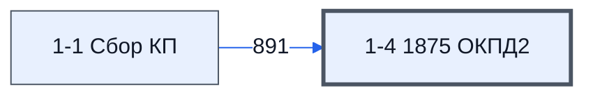

# Лист «1-4 1875 ОКПД2»

Таблица: таблица проекта · контур 1.

**Зачем** (со слов директора): по ОКПД2; назначение неясно.

Устройство листа — заголовки, вид столбцов, списки, формулы, связи с другими листами — собрано из таблицы ниже. Строка заголовков на этом листе угадана по закреплённой области — проверить.

## Зачем лист — подробно

*Заполнить:* что на листе происходит, откуда приходят данные и куда уходят.

## Как заполнять

*Заполнить:* какие столбцы вводят руками, какие считаются сами. Что значит каждый столбец — в `stolbtsy.yaml` рядом (поля `chto` и `kak`).

## Что нельзя трогать

*Заполнить.*

## Инструкции и умения

*Заполнить:* какие инструкции и умения относятся к листу.

## Осталось сделать

- Заполнить разделы выше и `stolbtsy.yaml`.

## Устройство (из таблицы)

- **Таблица:** таблица проекта, лист «1-4 1875 ОКПД2»; контур 1
- **Размер:** `A1:Z310`, закреплено до `D11`
- **Каркас:** свой, не общий; строка заголовков — 10, угадана по закреплённой области — проверить
- **Формул:** 895; заполненных ячеек без формул в данных: 0; списков: 8; условного форматирования: 8; объединённых ячеек: 0

## Связи с другими листами

- **Берёт данные с листов:** [1-1 Сбор КП](../k1-1-1-sbor-kp/index.md) (891)

В скобках и на стрелках — сколько формул ссылаются.

## Столбцы

Устройство — из таблицы; «Что это» и «Как заполняют» — из `stolbtsy.yaml` (заполняем руками).

| Столбец | Заголовок | Служебное имя | Вид | Заполняется | Список | Что это | Как заполняют |
|---|---|---|---|---|---|---|---|
| B | № |  |  | формула |  |  |  |
| C | 1. Заполнить наименование по ТЗ/ спецификации |  |  | формула |  |  |  |
| D | 2.Заполнить ОКПД2 по ТЗ (если есть описание кода, то с описанием) |  |  | формула |  |  |  |
| E | 3. Заполнить запрет, ограничение, преимущество, если об этом написано в Документации ЯВНО (выпадающий список: Запрет, Ограничение, Преимущество либо иное) |  |  | руками, из списка | '1-4 1875 ОКПД2'!$E$2:$E$8 |  |  |
| F | 4. Указать номер пункта и приложения в котором содержится код выбранный заказчиком согласно ПП РФ 1875 (ручной ввод в формате: "пункт 89 Прил 2 ") |  |  | руками? |  |  |  |
| G | 5. Наличие Декларации заказчика об отсутсвии поз. в Реестре (выпадающий список Декларировано Да, нет) |  |  | руками, из списка | '1-4 1875 ОКПД2'!$G$2:$G$8 |  |  |
| H | 6. Нужен ли реестровый номер для подтверждения страны происхождения (если (в позициях 1 - 145 приложения N 1 к настоящему постановлению, позициях 1 - 433 приложения N 2), то требуется, за исключением Декларированием заказчиком отсутствия в Реестре реестрового номера). (выпадающий список "Реестровый Да", "Нет", ) |  |  | руками, из списка | '1-4 1875 ОКПД2'!$H$2:$H$8 |  |  |
| I | 7. Проверить в реестрах наличие продукции, которая указана в ТЗ (для тех позиций на которые действует ограничение или запрет. (указать реестровые номер или нет) |  |  | руками, из списка | '1-4 1875 ОКПД2'!$I$2:$I$8 |  |  |
| J | 8. Заполнить расшифровку ОКПД2.(может сделать алиса или ИИ, но надо проверять, так как часто ошибается) |  |  | руками? |  |  |  |
| K | 9. Проверить корректность выбора ОКПД2 |  |  | руками, из списка | '1-4 1875 ОКПД2'!$K$2:$K$8 |  |  |
| L | 9.1 Дать комментарий по ошибке заказчиком выбора кода |  |  | руками? |  |  |  |
| M | 10. Проверить корректность нацрежима согласно ОКПД2 по ТЗ |  |  | руками, из списка | '1-4 1875 ОКПД2'!$M$2:$M$8 |  |  |
| N | 10.1. Определить корректный нацрежим согласно ОКПД2 из ТЗ |  |  | руками, из списка | '1-4 1875 ОКПД2'!$N$2:$N$8 |  |  |
| O | 11. Определить правильный ОКПД2 , если он был не корректен |  |  | руками? |  |  |  |
| P | 12. Указать расшифровку корректного ОКПД 2 |  |  | руками? |  |  |  |
| Q | 13. Выбрать нацрежим к корректному коду. |  |  | руками, из списка | "Преимущество,Ограничение" |  |  |
| R | 14. Проверить в реестрах наличие продукции, которая указана в ТЗ (для тех позиций на которые действует ограничение или запрет. |  |  | руками? |  |  |  |
| S | 15. Сделать выводы имеющие значения для расчета |  |  | руками? |  |  |  |

Формулы столбцов (3)

| Столбец | Строка | Формула |
|---|---|---|
| B | 11 | <code>='1-1 Сбор КП'!C2</code> |
| C | 11 | <code>='1-1 Сбор КП'!D2</code> |
| D | 20 | <code>='1-1 Сбор КП'!M11</code> |

