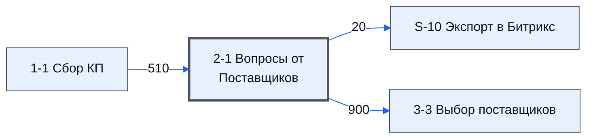

# Лист «2-1 Вопросы от Поставщиков»

Таблица: таблица проекта · контур 1.

**Зачем** (со слов директора): заполняется редко.

Устройство листа — заголовки, вид столбцов, списки, формулы, связи с другими листами — собрано из таблицы ниже. Строка заголовков на этом листе угадана по закреплённой области — проверить.

## Зачем лист — подробно

*Заполнить:* что на листе происходит, откуда приходят данные и куда уходят.

## Как заполнять

*Заполнить:* какие столбцы вводят руками, какие считаются сами. Что значит каждый столбец — в `stolbtsy.yaml` рядом (поля `chto` и `kak`).

## Что нельзя трогать

*Заполнить.*

## Инструкции и умения

*Заполнить:* какие инструкции и умения относятся к листу.

## Осталось сделать

- Заполнить разделы выше и `stolbtsy.yaml`.

## Устройство (из таблицы)

- **Таблица:** таблица проекта, лист «2-1 Вопросы от Поставщиков»; контур 1
- **Размер:** `A1:AC103`, закреплено до `A2`
- **Каркас:** свой, не общий; строка заголовков — 1, угадана по закреплённой области — проверить
- **Формул:** 102; заполненных ячеек без формул в данных: 0; списков: 3; условного форматирования: 4; объединённых ячеек: 0

## Связи с другими листами

- **Берёт данные с листов:** [1-1 Сбор КП](../k1-1-1-sbor-kp/index.md) (510)
- **Его данные используют:** [S-10 Экспорт в Битрикс](../k0-s-10-eksport-v-bitriks/index.md) (20), [3-3 Выбор поставщиков](../k1-3-3-vybor-postavshchikov/index.md) (900)

В скобках и на стрелках — сколько формул ссылаются.

## Столбцы

Устройство — из таблицы; «Что это» и «Как заполняют» — из `stolbtsy.yaml` (заполняем руками).

| Столбец | Заголовок | Служебное имя | Вид | Заполняется | Список | Что это | Как заполняют |
|---|---|---|---|---|---|---|---|
| A | № Вопроса |  |  | руками? |  |  |  |
| B | № |  |  | руками, из списка | '1-1 Сбор КП'!$C$2:$C$301 |  |  |
| C | Номенклатура |  |  | формула |  |  |  |
| D | Характеристики |  |  | руками? |  |  |  |
| E | Ед. Изм |  |  | руками? |  |  |  |
| F | Кол-во |  |  | руками? |  |  |  |
| G | Цена |  |  | руками? |  |  |  |
| H | Итого |  |  | руками? |  |  |  |
| I | Предложений |  |  | руками? |  |  |  |
| J | НМЦ |  |  | руками? |  |  |  |
| K | Группа |  |  | руками? |  |  |  |
| L | Еmail поставщика |  |  | руками? |  |  |  |
| M | Вопрос |  |  | руками? |  |  |  |
| N | С вопросом ознакомлен Менеджер |  |  | руками, из списка | "Ознакомлен" |  |  |
| O | С вопросом ознакомлен Эксперт |  |  | руками, из списка | "Ознакомлен" |  |  |
| P | Ответ |  |  | руками? |  |  |  |
| Q | Комментарий Менеджера |  |  | руками? |  |  |  |
| R | Комментарий Эксперта |  |  | руками? |  |  |  |
| S | Текущая стадия вопроса из Битрикс |  |  | руками? |  |  |  |
| T | Ссылка на вопрос или проблему в Битрикс |  |  | руками? |  |  |  |
| U | Ответ разослан |  |  | руками, из списка | "Да,Ответ не требуется" |  |  |
| V | Дата отправки Ответа |  |  | руками? |  |  |  |
| W | Дата добавления ответа |  |  | руками? |  |  |  |
| X | Дата добавления вопроса |  |  | руками? |  |  |  |
| Y | Добавлено Автоматический |  |  | руками? |  |  |  |
| Z | Дата ознакомления Менеджера с вопросом |  |  | руками? |  |  |  |
| AA | Дата ознакомления Эксперта с вопросом |  |  | руками? |  |  |  |
| AB | key |  |  | руками? |  |  |  |
| AC | last |  |  | руками? |  |  |  |

Формулы столбцов (1)

| Столбец | Строка | Формула |
|---|---|---|
| C | 2 | <code>=IF(ISBLANK(B2),, FILTER({'1-1 Сбор КП'!D$2:D103, '1-1 Сбор КП'!E$2:E103, '1-1 Сбор КП'!F$2:K103,'1-1 Сбор КП'!O$2:O103},{'1-1 Сбор КП'!C$2:C103=B2}))</code> |

