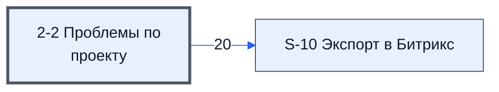

# Лист «2-2 Проблемы по проекту»

Таблица: таблица проекта · контур 1.

**Зачем** (со слов директора): заполняется редко.

Устройство листа — заголовки, вид столбцов, списки, формулы, связи с другими листами — собрано из таблицы ниже. Строка заголовков на этом листе угадана по закреплённой области — проверить.

## Зачем лист — подробно

*Заполнить:* что на листе происходит, откуда приходят данные и куда уходят.

## Как заполнять

*Заполнить:* какие столбцы вводят руками, какие считаются сами. Что значит каждый столбец — в `stolbtsy.yaml` рядом (поля `chto` и `kak`).

## Что нельзя трогать

*Заполнить.*

## Инструкции и умения

*Заполнить:* какие инструкции и умения относятся к листу.

## Осталось сделать

- Заполнить разделы выше и `stolbtsy.yaml`.

## Устройство (из таблицы)

- **Таблица:** таблица проекта, лист «2-2 Проблемы по проекту»; контур 1
- **Размер:** `A1:Y103`, закреплено до `A2`
- **Каркас:** свой, не общий; строка заголовков — 1, угадана по закреплённой области — проверить
- **Формул:** 0; заполненных ячеек без формул в данных: 0; списков: 2; условного форматирования: 3; объединённых ячеек: 0

## Связи с другими листами

- **Его данные используют:** [S-10 Экспорт в Битрикс](../k0-s-10-eksport-v-bitriks/index.md) (20)

В скобках и на стрелках — сколько формул ссылаются.

## Столбцы

Устройство — из таблицы; «Что это» и «Как заполняют» — из `stolbtsy.yaml` (заполняем руками).

| Столбец | Заголовок | Служебное имя | Вид | Заполняется | Список | Что это | Как заполняют |
|---|---|---|---|---|---|---|---|
| A | № Проблемы |  |  | руками? |  |  |  |
| B | № |  |  | руками? |  |  |  |
| C | Дата проблемы |  |  | руками? |  |  |  |
| D | Товар к которому относится проблема (не обязательно) |  |  | руками? |  |  |  |
| E | Еmail к которому относится проблема (не обязательно) |  |  | руками? |  |  |  |
| F | Суть проблемы |  |  | руками? |  |  |  |
| G | С проблемой ознакомлен Менеджер |  |  | руками, из списка | "Ознакомлен" |  |  |
| H | С проблемой ознакомлен Эксперт |  |  | руками, из списка | "Ознакомлен" |  |  |
| I | Предлагаемое решение |  |  | руками? |  |  |  |
| J | Комментарий Менеджера |  |  | руками? |  |  |  |
| K | Комментарий Эксперта |  |  | руками? |  |  |  |
| L | Текущая стадия вопроса из Битрикс |  |  | руками? |  |  |  |
| M | Ссылка на вопрос или проблему в Битрикс |  |  | руками? |  |  |  |
| N | С решением ознакомлен специалист по расчету |  |  | руками, из списка | "Да" |  |  |
| O | С решением ознакомлен Эксперт |  |  | руками, из списка | "Да" |  |  |
| P | Дата ознакомления с ответом |  |  | руками? |  |  |  |
| Q | Дата добавления проблемы |  |  | руками? |  |  |  |
| R | Дата добавления решения |  |  | руками? |  |  |  |
| S | Добавлено Автоматический |  |  | руками? |  |  |  |
| T | Дата ознакомления Менеджера с проблемой |  |  | руками? |  |  |  |
| U | Дата ознакомления Эксперта с проблемой |  |  | руками? |  |  |  |
| V | Дата ознакомления Эксперта с решением |  |  | руками? |  |  |  |
| X | key |  |  | руками? |  |  |  |
| Y | last |  |  | руками? |  |  |  |
