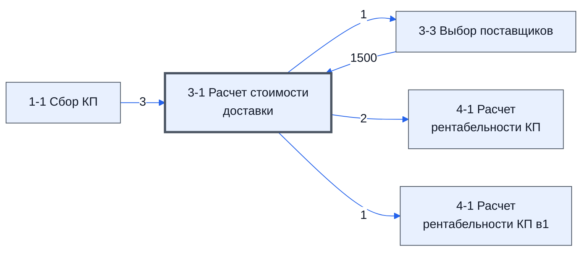

# Лист «3-1 Расчет стоимости доставки»

Таблица: таблица проекта · контур 1.

**Зачем** (со слов): расчёт доставки.

Устройство листа — заголовки, вид столбцов, списки, формулы, связи с другими листами — собрано из таблицы ниже. Строка заголовков на этом листе угадана по закреплённой области — проверить.

## Зачем лист — подробно

*Заполнить:* что на листе происходит, откуда приходят данные и куда уходят.

## Как заполнять

*Заполнить:* какие столбцы вводят руками, какие считаются сами. Что значит каждый столбец — в `stolbtsy.yaml` рядом (поля `chto` и `kak`).

## Что нельзя трогать

*Заполнить.*

## Инструкции и умения

*Заполнить:* какие инструкции и умения относятся к листу.

## Осталось сделать

- Заполнить разделы выше и `stolbtsy.yaml`.

**Ответ**

найти опиисание в raw

## Устройство (из таблицы)

- **Таблица:** таблица проекта, лист «3-1 Расчет стоимости доставки»; контур 1
- **Размер:** `A1:AE329`, закреплено до `A9`
- **Каркас:** свой, не общий; строка заголовков — 8, угадана по закреплённой области — проверить
- **Формул:** 3040; заполненных ячеек без формул в данных: 75; списков: 1; условного форматирования: 1; объединённых ячеек: 3

## Связи с другими листами

- **Берёт данные с листов:** [3-3 Выбор поставщиков](../k1-3-3-vybor-postavshchikov/index.md) (1500), [1-1 Сбор КП](../k1-1-1-sbor-kp/index.md) (3)
- **Его данные используют:** [3-3 Выбор поставщиков](../k1-3-3-vybor-postavshchikov/index.md) (1), [4-1 Расчет рентабельности КП](../k1-4-1-raschet-rentabelnosti-kp/index.md) (2), [4-1 Расчет рентабельности КП в1](../k1-4-1-raschet-rentabelnosti-kp-v1/index.md) (1)

В скобках и на стрелках — сколько формул ссылаются.

## Столбцы

Устройство — из таблицы; «Что это» и «Как заполняют» — из `stolbtsy.yaml` (заполняем руками).

| Столбец | Заголовок | Служебное имя | Вид | Заполняется | Список | Что это | Как заполняют |
|---|---|---|---|---|---|---|---|
| A | № |  |  | формула |  |  |  |
| B | Номенклатура |  |  | формула |  |  |  |
| C | Ед |  |  | формула |  |  |  |
| D | Кол |  |  | формула |  |  |  |
| E | Поставщик |  |  | формула |  |  |  |
| F | Место отправки |  |  | руками? |  |  |  |
| G | Склад комплектации (СК) |  |  | руками? |  |  |  |
| H | Место доставки |  |  | руками? |  |  |  |
| I | Кол-во мест |  |  | формула |  |  |  |
| J | Вес одного места |  |  | руками? |  |  |  |
| K | Вес всего |  |  | формула |  |  |  |
| L | Длина, м |  |  | руками? |  |  |  |
| M | Высота,м |  |  | руками? |  |  |  |
| N | Ширина,м |  |  | руками? |  |  |  |
| O | Объем одного места |  |  | формула |  |  |  |
| P | Объем всего |  |  | формула |  |  |  |
| Q | Решение по способу доставки |  |  | руками, из списка | "Через СК,Напрямую" |  |  |
| R | Стоимость доставки до СК |  |  | формула |  |  |  |
| S | Стоимость доставки со СК до Заказчика |  |  | руками? |  |  |  |
| T | Стоимость доставки напрямую |  |  | руками? |  |  |  |
| U | Общая стоимость доставки (R+S+T) |  |  | формула |  |  |  |

Формулы столбцов (11)

| Столбец | Строка | Формула |
|---|---|---|
| A | 8 | <code>='1-1 Сбор КП'!C1</code> |
| B | 8 | <code>='1-1 Сбор КП'!D1</code> |
| C | 9 | <code>='3-3 Выбор поставщиков'!C2</code> |
| D | 9 | <code>='3-3 Выбор поставщиков'!D2</code> |
| E | 9 | <code>='3-3 Выбор поставщиков'!K2</code> |
| I | 9 | <code>=D9</code> |
| K | 9 | <code>=J9*I9</code> |
| O | 9 | <code>=L9*M9*N9</code> |
| P | 9 | <code>=O9*I9</code> |
| R | 309 | <code>=SUM(R9:R308)</code> |
| U | 9 | <code>=R9+S9+T9</code> |

