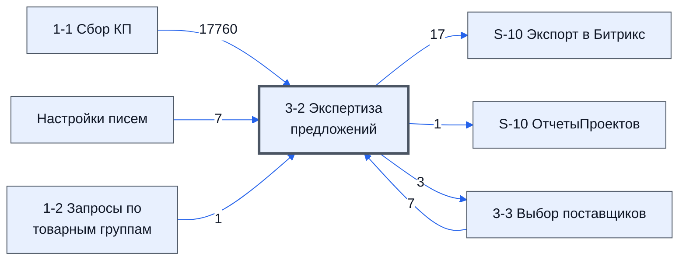

# Лист «3-2 Экспертиза предложений»

Таблица: таблица проекта · контур 1.

**Зачем** (со слов): важный: эксперт оценивает предложения поставщиков и предложенные модели.

Устройство листа — заголовки, вид столбцов, списки, формулы, связи с другими листами — собрано из таблицы ниже. Строка заголовков на этом листе угадана по закреплённой области — проверить.

## Зачем лист — подробно

*Заполнить:* что на листе происходит, откуда приходят данные и куда уходят.

## Как заполнять

*Заполнить:* какие столбцы вводят руками, какие считаются сами. Что значит каждый столбец — в `stolbtsy.yaml` рядом (поля `chto` и `kak`).

## Что нельзя трогать

*Заполнить.*

## Инструкции и умения

*Заполнить:* какие инструкции и умения относятся к листу.

## Осталось сделать

- Заполнить разделы выше и `stolbtsy.yaml`.

**Ответ**

найти опиисание в raw

## Устройство (из таблицы)

- **Таблица:** таблица проекта, лист «3-2 Экспертиза предложений»; контур 1
- **Размер:** `A1:JQ314`, закреплено до `G5`
- **Каркас:** свой, не общий; строка заголовков — 4, угадана по закреплённой области — проверить
- **Формул:** 71057; заполненных ячеек без формул в данных: 301; списков: 2; условного форматирования: 10; объединённых ячеек: 1

## Связи с другими листами

- **Берёт данные с листов:** [1-1 Сбор КП](../k1-1-1-sbor-kp/index.md) (17760), [3-3 Выбор поставщиков](../k1-3-3-vybor-postavshchikov/index.md) (7), [Настройки писем](../k0-nastroyki-pisem/index.md) (7), [1-2 Запросы по товарным группам](../k1-1-2-zaprosy-po-tovarnym-gruppam/index.md) (1)
- **Его данные используют:** [S-10 Экспорт в Битрикс](../k0-s-10-eksport-v-bitriks/index.md) (17), [S-10 ОтчетыПроектов](../k0-s-10-otchetyproektov/index.md) (1), [3-3 Выбор поставщиков](../k1-3-3-vybor-postavshchikov/index.md) (3)

В скобках и на стрелках — сколько формул ссылаются.

## Кто здесь работает (по процессам)

Обязанности, у которых место работы — этот лист (из разбора регламента); должность — в карточке обязанности.

[Проверяющий предложения поставщиков](../../reg/oby/ekspertiza-predlozheniy.md)

## Столбцы

Устройство — из таблицы; «Что это» и «Как заполняют» — из `stolbtsy.yaml` (заполняем руками).

| Столбец | Заголовок | Служебное имя | Вид | Заполняется | Список | Что это | Как заполняют |
|---|---|---|---|---|---|---|---|
| A | № |  |  | формула |  |  |  |
| B | Номенклатура |  |  | формула |  |  |  |
| C | Характеристики |  |  | формула |  |  |  |
| D | Ед. Изм |  |  | формула | 'Настройки писем'!$BE$2:$BE$15 |  |  |
| E | Кол-во |  |  | формула |  |  |  |
| F | Комментарий |  |  | формула |  |  |  |
| G | Цена |  |  | формула |  |  |  |
| H | Сумма |  |  | формула |  |  |  |
| I | Всего: 0 вопросов |  |  | формула |  |  |  |
| J | Всего: 0 проблем |  |  | формула |  |  |  |
| K | Группа |  |  | формула |  |  |  |
| Z | БлокТопНачало |  |  | руками? |  |  |  |
| AA | 1 Формула |  |  | формула |  |  |  |
| AB | 1 Цена |  |  | формула |  |  |  |
| AC | 2 Формула |  |  | формула |  |  |  |
| AD | 1 Поставщик |  |  | формула |  |  |  |
| AE | 3 Формула |  |  | формула |  |  |  |
| AF | 1 Срок |  |  | формула |  |  |  |
| AG | 4 Формула |  |  | формула |  |  |  |
| AH | 1 Модель |  |  | формула |  |  |  |
| AI | 5 Формула |  |  | формула |  |  |  |
| AJ | 1 Изготовитель |  |  | формула |  |  |  |
| AK | 6 Формула |  |  | формула |  |  |  |
| AL | 1 Комментарий эксперта |  |  | формула |  |  |  |
| AM | 7 Формула |  |  | формула |  |  |  |
| AN | 1 Подходит |  |  | формула | 'Настройки писем'!$AN$2:$AN$30 |  |  |
| AO | 8 Формула |  |  | формула |  |  |  |
| AP | 1 Комментарий менеджера |  |  | формула |  |  |  |
| AQ | 9 Формула |  |  | формула |  |  |  |
| AR | 2 Цена |  |  | формула |  |  |  |
| AS | 10 Формула |  |  | формула |  |  |  |
| AT | 2 Поставщик |  |  | формула |  |  |  |
| AU | 11 Формула |  |  | формула |  |  |  |
| AV | 2 Срок |  |  | формула |  |  |  |
| AW | 12 Формула |  |  | формула |  |  |  |
| AX | 2 Модель |  |  | формула |  |  |  |
| AY | 13 Формула |  |  | формула |  |  |  |
| AZ | 2 Изготовитель |  |  | формула |  |  |  |
| BA | 14 Формула |  |  | формула |  |  |  |
| BB | 2 Комментарий эксперта |  |  | формула |  |  |  |
| BC | 15 Формула |  |  | формула |  |  |  |
| BD | 2 Подходит |  |  | формула | 'Настройки писем'!$AN$2:$AN$30 |  |  |
| BE | 16 Формула |  |  | формула |  |  |  |
| BF | 2 Комментарий менеджера |  |  | формула |  |  |  |
| BG | 17 Формула |  |  | формула |  |  |  |
| BH | 3 Цена |  |  | формула |  |  |  |
| BI | 18 Формула |  |  | формула |  |  |  |
| BJ | 3 Поставщик |  |  | формула |  |  |  |
| BK | 19 Формула |  |  | формула |  |  |  |
| BL | 3 Срок |  |  | формула |  |  |  |
| BM | 20 Формула |  |  | формула |  |  |  |
| BN | 3 Модель |  |  | формула |  |  |  |
| BO | 21 Формула |  |  | формула |  |  |  |
| BP | 3 Изготовитель |  |  | формула |  |  |  |
| BQ | 22 Формула |  |  | формула |  |  |  |
| BR | 3 Комментарий эксперта |  |  | формула |  |  |  |
| BS | 23 Формула |  |  | формула |  |  |  |
| BT | 3 Подходит |  |  | формула | 'Настройки писем'!$AN$2:$AN$30 |  |  |
| BU | 24 Формула |  |  | формула |  |  |  |
| BV | 3 Комментарий менеджера |  |  | формула |  |  |  |
| BW | 25 Формула |  |  | формула |  |  |  |
| BX | 4 Цена |  |  | формула |  |  |  |
| BY | 26 Формула |  |  | формула |  |  |  |
| BZ | 4 Поставщик |  |  | формула |  |  |  |
| CA | 27 Формула |  |  | формула |  |  |  |
| CB | 4 Срок |  |  | формула |  |  |  |
| CC | 28 Формула |  |  | формула |  |  |  |
| CD | 4 Модель |  |  | формула |  |  |  |
| CE | 29 Формула |  |  | формула |  |  |  |
| CF | 4 Изготовитель |  |  | формула |  |  |  |
| CG | 30 Формула |  |  | формула |  |  |  |
| CH | 4 Комментарий эксперта |  |  | формула |  |  |  |
| CI | 31 Формула |  |  | формула |  |  |  |
| CJ | 4 Подходит |  |  | формула | 'Настройки писем'!$AN$2:$AN$30 |  |  |
| CK | 32 Формула |  |  | формула |  |  |  |
| CL | 4 Комментарий менеджера |  |  | формула |  |  |  |
| CM | 33 Формула |  |  | формула |  |  |  |
| CN | 5 Цена |  |  | формула |  |  |  |
| CO | 34 Формула |  |  | формула |  |  |  |
| CP | 5 Поставщик |  |  | формула |  |  |  |
| CQ | 35 Формула |  |  | формула |  |  |  |
| CR | 5 Срок |  |  | формула |  |  |  |
| CS | 36 Формула |  |  | формула |  |  |  |
| CT | 5 Модель |  |  | формула |  |  |  |
| CU | 37 Формула |  |  | формула |  |  |  |
| CV | 5 Изготовитель |  |  | формула |  |  |  |
| CW | 38 Формула |  |  | формула |  |  |  |
| CX | 5 Комментарий эксперта |  |  | формула |  |  |  |
| CY | 39 Формула |  |  | формула |  |  |  |
| CZ | 5 Подходит |  |  | формула | 'Настройки писем'!$AN$2:$AN$30 |  |  |
| DA | 40 Формула |  |  | формула |  |  |  |
| DB | 5 Комментарий менеджера |  |  | формула |  |  |  |
| DC | 41 Формула |  |  | формула |  |  |  |
| DD | 6 Цена |  |  | формула |  |  |  |
| DE | 42 Формула |  |  | формула |  |  |  |
| DF | 6 Поставщик |  |  | формула |  |  |  |
| DG | 43 Формула |  |  | формула |  |  |  |
| DH | 6 Срок |  |  | формула |  |  |  |
| DI | 44 Формула |  |  | формула |  |  |  |
| DJ | 6 Модель |  |  | формула |  |  |  |
| DK | 45 Формула |  |  | формула |  |  |  |
| DL | 6 Изготовитель |  |  | формула |  |  |  |
| DM | 46 Формула |  |  | формула |  |  |  |
| DN | 6 Комментарий эксперта |  |  | формула |  |  |  |
| DO | 47 Формула |  |  | формула |  |  |  |
| DP | 6 Подходит |  |  | формула | 'Настройки писем'!$AN$2:$AN$30 |  |  |
| DQ | 48 Формула |  |  | формула |  |  |  |
| DR | 6 Комментарий менеджера |  |  | формула |  |  |  |
| DS | 49 Формула |  |  | формула |  |  |  |
| DT | 7 Цена |  |  | формула |  |  |  |
| DU | 50 Формула |  |  | формула |  |  |  |
| DV | 7 Поставщик |  |  | формула |  |  |  |
| DW | 51 Формула |  |  | формула |  |  |  |
| DX | 7 Срок |  |  | формула |  |  |  |
| DY | 52 Формула |  |  | формула |  |  |  |
| DZ | 7 Модель |  |  | формула |  |  |  |
| EA | 53 Формула |  |  | формула |  |  |  |
| EB | 7 Изготовитель |  |  | формула |  |  |  |
| EC | 54 Формула |  |  | формула |  |  |  |
| ED | 7 Комментарий эксперта |  |  | формула |  |  |  |
| EE | 55 Формула |  |  | формула |  |  |  |
| EF | 7 Подходит |  |  | формула | 'Настройки писем'!$AN$2:$AN$30 |  |  |
| EG | 56 Формула |  |  | формула |  |  |  |
| EH | 7 Комментарий менеджера |  |  | формула |  |  |  |
| EI | 57 Формула |  |  | формула |  |  |  |
| EJ | 8 Цена |  |  | формула |  |  |  |
| EK | 58 Формула |  |  | формула |  |  |  |
| EL | 8 Поставщик |  |  | формула |  |  |  |
| EM | 59 Формула |  |  | формула |  |  |  |
| EN | 8 Срок |  |  | формула |  |  |  |
| EO | 60 Формула |  |  | формула |  |  |  |
| EP | 8 Модель |  |  | формула |  |  |  |
| EQ | 61 Формула |  |  | формула |  |  |  |
| ER | 8 Изготовитель |  |  | формула |  |  |  |
| ES | 62 Формула |  |  | формула |  |  |  |
| ET | 8 Комментарий эксперта |  |  | формула |  |  |  |
| EU | 63 Формула |  |  | формула |  |  |  |
| EV | 8 Подходит |  |  | формула | 'Настройки писем'!$AN$2:$AN$30 |  |  |
| EW | 64 Формула |  |  | формула |  |  |  |
| EX | 8 Комментарий менеджера |  |  | формула |  |  |  |
| EY | 65 Формула |  |  | формула |  |  |  |
| EZ | 9 Цена |  |  | формула |  |  |  |
| FA | 66 Формула |  |  | формула |  |  |  |
| FB | 9 Поставщик |  |  | формула |  |  |  |
| FC | 67 Формула |  |  | формула |  |  |  |
| FD | 9 Срок |  |  | формула |  |  |  |
| FE | 68 Формула |  |  | формула |  |  |  |
| FF | 9 Модель |  |  | формула |  |  |  |
| FG | 69 Формула |  |  | формула |  |  |  |
| FH | 9 Изготовитель |  |  | формула |  |  |  |
| FI | 70 Формула |  |  | формула |  |  |  |
| FJ | 9 Комментарий эксперта |  |  | формула |  |  |  |
| FK | 71 Формула |  |  | формула |  |  |  |
| FL | 9 Подходит |  |  | формула | 'Настройки писем'!$AN$2:$AN$30 |  |  |
| FM | 72 Формула |  |  | формула |  |  |  |
| FN | 9 Комментарий менеджера |  |  | формула |  |  |  |
| FO | 73 Формула |  |  | формула |  |  |  |
| FP | 10 Цена |  |  | формула |  |  |  |
| FQ | 74 Формула |  |  | формула |  |  |  |
| FR | 10 Поставщик |  |  | формула |  |  |  |
| FS | 75 Формула |  |  | формула |  |  |  |
| FT | 10 Срок |  |  | формула |  |  |  |
| FU | 76 Формула |  |  | формула |  |  |  |
| FV | 10 Модель |  |  | формула |  |  |  |
| FW | 77 Формула |  |  | формула |  |  |  |
| FX | 10 Изготовитель |  |  | формула |  |  |  |
| FY | 78 Формула |  |  | формула |  |  |  |
| FZ | 10 Комментарий эксперта |  |  | формула |  |  |  |
| GA | 79 Формула |  |  | формула |  |  |  |
| GB | 10 Подходит |  |  | формула | 'Настройки писем'!$AN$2:$AN$30 |  |  |
| GC | 80 Формула |  |  | формула |  |  |  |
| GD | 10 Комментарий менеджера |  |  | формула |  |  |  |
| GE | 81 Формула |  |  | формула |  |  |  |
| GF | 11 Цена |  |  | формула |  |  |  |
| GG | 82 Формула |  |  | формула |  |  |  |
| GH | 11 Поставщик |  |  | формула |  |  |  |
| GI | 83 Формула |  |  | формула |  |  |  |
| GJ | 11 Срок |  |  | формула |  |  |  |
| GK | 84 Формула |  |  | формула |  |  |  |
| GL | 11 Модель |  |  | формула |  |  |  |
| GM | 85 Формула |  |  | формула |  |  |  |
| GN | 11 Изготовитель |  |  | формула |  |  |  |
| GO | 86 Формула |  |  | формула |  |  |  |
| GP | 11 Комментарий эксперта |  |  | формула |  |  |  |
| GQ | 87 Формула |  |  | формула |  |  |  |
| GR | 11 Подходит |  |  | формула | 'Настройки писем'!$AN$2:$AN$30 |  |  |
| GS | 88 Формула |  |  | формула |  |  |  |
| GT | 11 Комментарий менеджера |  |  | формула |  |  |  |
| GU | 89 Формула |  |  | формула |  |  |  |
| GV | 12 Цена |  |  | формула |  |  |  |
| GW | 90 Формула |  |  | формула |  |  |  |
| GX | 12 Поставщик |  |  | формула |  |  |  |
| GY | 91 Формула |  |  | формула |  |  |  |
| GZ | 12 Срок |  |  | формула |  |  |  |
| HA | 92 Формула |  |  | формула |  |  |  |
| HB | 12 Модель |  |  | формула |  |  |  |
| HC | 93 Формула |  |  | формула |  |  |  |
| HD | 12 Изготовитель |  |  | формула |  |  |  |
| HE | 94 Формула |  |  | формула |  |  |  |
| HF | 12 Комментарий эксперта |  |  | формула |  |  |  |
| HG | 95 Формула |  |  | формула |  |  |  |
| HH | 12 Подходит |  |  | формула | 'Настройки писем'!$AN$2:$AN$30 |  |  |
| HI | 96 Формула |  |  | формула |  |  |  |
| HJ | 12 Комментарий менеджера |  |  | формула |  |  |  |
| HK | 97 Формула |  |  | формула |  |  |  |
| HL | 13 Цена |  |  | формула |  |  |  |
| HM | 98 Формула |  |  | формула |  |  |  |
| HN | 13 Поставщик |  |  | формула |  |  |  |
| HO | 99 Формула |  |  | формула |  |  |  |
| HP | 13 Срок |  |  | формула |  |  |  |
| HQ | 100 Формула |  |  | формула |  |  |  |
| HR | 13 Модель |  |  | формула |  |  |  |
| HS | 101 Формула |  |  | формула |  |  |  |
| HT | 13 Изготовитель |  |  | формула |  |  |  |
| HU | 102 Формула |  |  | формула |  |  |  |
| HV | 13 Комментарий эксперта |  |  | формула |  |  |  |
| HW | 103 Формула |  |  | формула |  |  |  |
| HX | 13 Подходит |  |  | формула | 'Настройки писем'!$AN$2:$AN$30 |  |  |
| HY | 104 Формула |  |  | формула |  |  |  |
| HZ | 13 Комментарий менеджера |  |  | формула |  |  |  |
| IA | 105 Формула |  |  | формула |  |  |  |
| IB | 14 Цена |  |  | формула |  |  |  |
| IC | 106 Формула |  |  | формула |  |  |  |
| ID | 14 Поставщик |  |  | формула |  |  |  |
| IE | 107 Формула |  |  | формула |  |  |  |
| IF | 14 Срок |  |  | формула |  |  |  |
| IG | 108 Формула |  |  | формула |  |  |  |
| IH | 14 Модель |  |  | формула |  |  |  |
| II | 109 Формула |  |  | формула |  |  |  |
| IJ | 14 Изготовитель |  |  | формула |  |  |  |
| IK | 110 Формула |  |  | формула |  |  |  |
| IL | 14 Комментарий эксперта |  |  | формула |  |  |  |
| IM | 111 Формула |  |  | формула |  |  |  |
| IN | 14 Подходит |  |  | формула | 'Настройки писем'!$AN$2:$AN$30 |  |  |
| IO | 112 Формула |  |  | формула |  |  |  |
| IP | 14 Комментарий менеджера |  |  | формула |  |  |  |
| IQ | БлокТопКонец |  |  | руками? |  |  |  |
| JC | ТопЭксперта |  |  | формула |  |  |  |
| JD | НоменклатураПроверка |  |  | формула |  |  |  |
| JE | Лист1НомерСтроки |  |  | формула |  |  |  |
| JJ | Да |  |  | формула |  |  |  |
| JK | Нет |  |  | формула |  |  |  |
| JL | Уточнить параметры |  |  | формула |  |  |  |
| JM | Осн поставщик |  |  | формула |  |  |  |
| JN | Резерв поставщик |  |  | формула |  |  |  |
| JO | Условно подходит |  |  | формула |  |  |  |
| JP |  |  |  | формула |  |  |  |
| JQ | Подходит |  |  | формула |  |  |  |

Формулы столбцов (246)

| Столбец | Строка | Формула |
|---|---|---|
| A | 5 | <code>='1-1 Сбор КП'!$C2</code> |
| B | 4 | <code>={"Номенклатура";IF($A$5:$A314&lt;&gt;"", IFERROR( VLOOKUP($A$5:$A314,'3-3 Выбор поставщиков'!A1:S314,COLUMN($B$4),FALSE), ), )}</code> |
| C | 4 | <code>={"Характеристики";IF($A$5:$A314&lt;&gt;"", IFERROR(VLOOKUP($A$5:$A314,'1-2 Запросы по товарным группам'!A4:C314,3,FALSE), VLOOKUP($A$5:$A314,'1-1 Сбор КП'!C1:E314,3,FALSE)), )}</code> |
| D | 4 | <code>={"Ед. Изм";IF($A$5:$A314&lt;&gt;"", IFERROR( VLOOKUP($A$5:$A314,'3-3 Выбор поставщиков'!A1:S314,COLUMN($C$4),FALSE), ), )}</code> |
| E | 4 | <code>={"Кол-во";IF($A$5:$A314&lt;&gt;"", IFERROR( VLOOKUP($A$5:$A314,'3-3 Выбор поставщиков'!A1:S314,COLUMN($D$4),FALSE), ), )}</code> |
| F | 4 | <code>={"Комментарий";IF(LEN(B5:B314)&gt;0,IFERROR(VLOOKUP(B5:B314,'3-3 Выбор поставщиков'!B:Q,15,0),),)}</code> |
| G | 4 | <code>={"Цена";IF($A$5:$A314&lt;&gt;"", IFERROR( VLOOKUP($A$5:$A314,'3-3 Выбор поставщиков'!A1:S314,COLUMN($E$4),FALSE), ), )}</code> |
| H | 4 | <code>={"Сумма";IF($A$5:$A314&lt;&gt;"", IFERROR( VLOOKUP($A$5:$A314,'3-3 Выбор поставщиков'!A1:S314,COLUMN($F$4),FALSE), ), )}</code> |
| I | 4 | <code>=LAMBDA(номменкратуры,вопросы, { "Всего: " &amp; COUNTA(IFERROR( QUERY(вопросы,"Select Col3 Where Col3 is not null and not(Col2 ='Да' or Col2 ='ДА' or Col2 ='Ответ не требуется' )")),)&amp;" вопросов"; LAMBDA(пр,ARRAYFORMULA( IF(пр=0,,пр)))( BYROW(номменк,"Всего: 0 вопросов")</code> |
| J | 4 | <code>=LAMBDA(номменкратуры,вопросы, { "Всего: " &amp; COUNTA(IFERROR( QUERY(вопросы,"Select Col3 Where Col3 is not null and not(Col2 ='Да' or Col2 ='ДА' or Col2 ='Ответ не требуется')"),))&amp;" проблем"; LAMBDA(пр,ARRAYFORMULA( IF(пр=0,,пр)))( BYROW(номменкрату,"Всего: 0 проблем")</code> |
| K | 4 | <code>={"Группа";IF($A$5:$A314&lt;&gt;"", IFERROR( VLOOKUP($A$5:$A314,'3-3 Выбор поставщиков'!A1:S314,COLUMN($G$4),FALSE), ), )}</code> |
| AA | 5 | <code>={"",IFERROR( INDIRECT( CONCATENATE("'1-1 Сбор КП'!", INDEX(SPLIT($JC5,"&#124;&#124;&#124;",FALSE,FALSE),1,1))),"")}</code> |
| AB | 5 | <code>="COMPUTED_VALUE"</code> |
| AC | 5 | <code>={"",IFERROR( INDIRECT( CONCATENATE("'1-1 Сбор КП'!", INDEX(SPLIT($JC5,"&#124;&#124;&#124;",FALSE,FALSE),1,2))),"")}</code> |
| AD | 5 | <code>="COMPUTED_VALUE"</code> |
| AE | 5 | <code>={"",IFERROR( INDIRECT( CONCATENATE("'1-1 Сбор КП'!", INDEX(SPLIT($JC5,"&#124;&#124;&#124;",FALSE,FALSE),1,3))),"")}</code> |
| AF | 5 | <code>="COMPUTED_VALUE"</code> |
| AG | 5 | <code>={"",IFERROR( INDIRECT( CONCATENATE("'1-1 Сбор КП'!", INDEX(SPLIT($JC5,"&#124;&#124;&#124;",FALSE,FALSE),1,4))),"")}</code> |
| AH | 5 | <code>="COMPUTED_VALUE"</code> |
| AI | 5 | <code>={"",IFERROR(INDEX(SPLIT($JC5,"&#124;&#124;&#124;",FALSE,FALSE),1,5),"")}</code> |
| AJ | 5 | <code>="COMPUTED_VALUE"</code> |
| AK | 5 | <code>={"",IFERROR(INDEX(SPLIT($JC5,"&#124;&#124;&#124;",FALSE,FALSE),1,6),"")}</code> |
| AL | 5 | <code>="COMPUTED_VALUE"</code> |
| AM | 5 | <code>={"",IFERROR(INDEX(SPLIT($JC5,"&#124;&#124;&#124;",FALSE,FALSE),1,7),"")}</code> |
| AN | 5 | <code>="COMPUTED_VALUE"</code> |
| AO | 5 | <code>={"",IFERROR(INDEX(SPLIT($JC5,"&#124;&#124;&#124;",FALSE,FALSE),1,8),"")}</code> |
| AP | 5 | <code>="COMPUTED_VALUE"</code> |
| AQ | 5 | <code>={"",IFERROR( INDIRECT( CONCATENATE("'1-1 Сбор КП'!", INDEX(SPLIT($JC5,"&#124;&#124;&#124;",FALSE,FALSE),1,9))),"")}</code> |
| AR | 5 | <code>="COMPUTED_VALUE"</code> |
| AS | 5 | <code>={"",IFERROR( INDIRECT( CONCATENATE("'1-1 Сбор КП'!", INDEX(SPLIT($JC5,"&#124;&#124;&#124;",FALSE,FALSE),1,10))),"")}</code> |
| AT | 5 | <code>="COMPUTED_VALUE"</code> |
| AU | 5 | <code>={"",IFERROR( INDIRECT( CONCATENATE("'1-1 Сбор КП'!", INDEX(SPLIT($JC5,"&#124;&#124;&#124;",FALSE,FALSE),1,11))),"")}</code> |
| AV | 5 | <code>="COMPUTED_VALUE"</code> |
| AW | 5 | <code>={"",IFERROR( INDIRECT( CONCATENATE("'1-1 Сбор КП'!", INDEX(SPLIT($JC5,"&#124;&#124;&#124;",FALSE,FALSE),1,12))),"")}</code> |
| AX | 5 | <code>="COMPUTED_VALUE"</code> |
| AY | 5 | <code>={"",IFERROR(INDEX(SPLIT($JC5,"&#124;&#124;&#124;",FALSE,FALSE),1,13),"")}</code> |
| AZ | 5 | <code>="COMPUTED_VALUE"</code> |
| BA | 5 | <code>={"",IFERROR(INDEX(SPLIT($JC5,"&#124;&#124;&#124;",FALSE,FALSE),1,14),"")}</code> |
| BB | 5 | <code>="COMPUTED_VALUE"</code> |
| BC | 5 | <code>={"",IFERROR(INDEX(SPLIT($JC5,"&#124;&#124;&#124;",FALSE,FALSE),1,15),"")}</code> |
| BD | 5 | <code>="COMPUTED_VALUE"</code> |
| BE | 5 | <code>={"",IFERROR(INDEX(SPLIT($JC5,"&#124;&#124;&#124;",FALSE,FALSE),1,16),"")}</code> |
| BF | 5 | <code>="COMPUTED_VALUE"</code> |
| BG | 5 | <code>={"",IFERROR( INDIRECT( CONCATENATE("'1-1 Сбор КП'!", INDEX(SPLIT($JC5,"&#124;&#124;&#124;",FALSE,FALSE),1,17))),"")}</code> |
| BH | 5 | <code>="COMPUTED_VALUE"</code> |
| BI | 5 | <code>={"",IFERROR( INDIRECT( CONCATENATE("'1-1 Сбор КП'!", INDEX(SPLIT($JC5,"&#124;&#124;&#124;",FALSE,FALSE),1,18))),"")}</code> |
| BJ | 5 | <code>="COMPUTED_VALUE"</code> |
| BK | 5 | <code>={"",IFERROR( INDIRECT( CONCATENATE("'1-1 Сбор КП'!", INDEX(SPLIT($JC5,"&#124;&#124;&#124;",FALSE,FALSE),1,19))),"")}</code> |
| BL | 5 | <code>="COMPUTED_VALUE"</code> |
| BM | 5 | <code>={"",IFERROR( INDIRECT( CONCATENATE("'1-1 Сбор КП'!", INDEX(SPLIT($JC5,"&#124;&#124;&#124;",FALSE,FALSE),1,20))),"")}</code> |
| BN | 5 | <code>="COMPUTED_VALUE"</code> |
| BO | 5 | <code>={"",IFERROR(INDEX(SPLIT($JC5,"&#124;&#124;&#124;",FALSE,FALSE),1,21),"")}</code> |
| BP | 5 | <code>="COMPUTED_VALUE"</code> |
| BQ | 5 | <code>={"",IFERROR(INDEX(SPLIT($JC5,"&#124;&#124;&#124;",FALSE,FALSE),1,22),"")}</code> |
| BR | 5 | <code>="COMPUTED_VALUE"</code> |
| BS | 5 | <code>={"",IFERROR(INDEX(SPLIT($JC5,"&#124;&#124;&#124;",FALSE,FALSE),1,23),"")}</code> |
| BT | 5 | <code>="COMPUTED_VALUE"</code> |
| BU | 5 | <code>={"",IFERROR(INDEX(SPLIT($JC5,"&#124;&#124;&#124;",FALSE,FALSE),1,24),"")}</code> |
| BV | 5 | <code>="COMPUTED_VALUE"</code> |
| BW | 5 | <code>={"",IFERROR( INDIRECT( CONCATENATE("'1-1 Сбор КП'!", INDEX(SPLIT($JC5,"&#124;&#124;&#124;",FALSE,FALSE),1,25))),"")}</code> |
| BX | 5 | <code>="COMPUTED_VALUE"</code> |
| BY | 5 | <code>={"",IFERROR( INDIRECT( CONCATENATE("'1-1 Сбор КП'!", INDEX(SPLIT($JC5,"&#124;&#124;&#124;",FALSE,FALSE),1,26))),"")}</code> |
| BZ | 5 | <code>="COMPUTED_VALUE"</code> |
| CA | 5 | <code>={"",IFERROR( INDIRECT( CONCATENATE("'1-1 Сбор КП'!", INDEX(SPLIT($JC5,"&#124;&#124;&#124;",FALSE,FALSE),1,27))),"")}</code> |
| CB | 5 | <code>="COMPUTED_VALUE"</code> |
| CC | 5 | <code>={"",IFERROR( INDIRECT( CONCATENATE("'1-1 Сбор КП'!", INDEX(SPLIT($JC5,"&#124;&#124;&#124;",FALSE,FALSE),1,28))),"")}</code> |
| CD | 5 | <code>="COMPUTED_VALUE"</code> |
| CE | 5 | <code>={"",IFERROR(INDEX(SPLIT($JC5,"&#124;&#124;&#124;",FALSE,FALSE),1,29),"")}</code> |
| CF | 5 | <code>="COMPUTED_VALUE"</code> |
| CG | 5 | <code>={"",IFERROR(INDEX(SPLIT($JC5,"&#124;&#124;&#124;",FALSE,FALSE),1,30),"")}</code> |
| CH | 5 | <code>="COMPUTED_VALUE"</code> |
| CI | 5 | <code>={"",IFERROR(INDEX(SPLIT($JC5,"&#124;&#124;&#124;",FALSE,FALSE),1,31),"")}</code> |
| CJ | 5 | <code>="COMPUTED_VALUE"</code> |
| CK | 5 | <code>={"",IFERROR(INDEX(SPLIT($JC5,"&#124;&#124;&#124;",FALSE,FALSE),1,32),"")}</code> |
| CL | 5 | <code>="COMPUTED_VALUE"</code> |
| CM | 5 | <code>={"",IFERROR( INDIRECT( CONCATENATE("'1-1 Сбор КП'!", INDEX(SPLIT($JC5,"&#124;&#124;&#124;",FALSE,FALSE),1,33))),"")}</code> |
| CN | 5 | <code>="COMPUTED_VALUE"</code> |
| CO | 5 | <code>={"",IFERROR( INDIRECT( CONCATENATE("'1-1 Сбор КП'!", INDEX(SPLIT($JC5,"&#124;&#124;&#124;",FALSE,FALSE),1,34))),"")}</code> |
| CP | 5 | <code>="COMPUTED_VALUE"</code> |
| CQ | 5 | <code>={"",IFERROR( INDIRECT( CONCATENATE("'1-1 Сбор КП'!", INDEX(SPLIT($JC5,"&#124;&#124;&#124;",FALSE,FALSE),1,35))),"")}</code> |
| CR | 5 | <code>="COMPUTED_VALUE"</code> |
| CS | 5 | <code>={"",IFERROR( INDIRECT( CONCATENATE("'1-1 Сбор КП'!", INDEX(SPLIT($JC5,"&#124;&#124;&#124;",FALSE,FALSE),1,36))),"")}</code> |
| CT | 5 | <code>="COMPUTED_VALUE"</code> |
| CU | 5 | <code>={"",IFERROR(INDEX(SPLIT($JC5,"&#124;&#124;&#124;",FALSE,FALSE),1,37),"")}</code> |
| CV | 5 | <code>="COMPUTED_VALUE"</code> |
| CW | 5 | <code>={"",IFERROR(INDEX(SPLIT($JC5,"&#124;&#124;&#124;",FALSE,FALSE),1,38),"")}</code> |
| CX | 5 | <code>="COMPUTED_VALUE"</code> |
| CY | 5 | <code>={"",IFERROR(INDEX(SPLIT($JC5,"&#124;&#124;&#124;",FALSE,FALSE),1,39),"")}</code> |
| CZ | 5 | <code>="COMPUTED_VALUE"</code> |
| DA | 5 | <code>={"",IFERROR(INDEX(SPLIT($JC5,"&#124;&#124;&#124;",FALSE,FALSE),1,40),"")}</code> |
| DB | 5 | <code>="COMPUTED_VALUE"</code> |
| DC | 5 | <code>={"",IFERROR( INDIRECT( CONCATENATE("'1-1 Сбор КП'!", INDEX(SPLIT($JC5,"&#124;&#124;&#124;",FALSE,FALSE),1,41))),"")}</code> |
| DD | 5 | <code>="COMPUTED_VALUE"</code> |
| DE | 5 | <code>={"",IFERROR( INDIRECT( CONCATENATE("'1-1 Сбор КП'!", INDEX(SPLIT($JC5,"&#124;&#124;&#124;",FALSE,FALSE),1,42))),"")}</code> |
| DF | 5 | <code>="COMPUTED_VALUE"</code> |
| DG | 5 | <code>={"",IFERROR( INDIRECT( CONCATENATE("'1-1 Сбор КП'!", INDEX(SPLIT($JC5,"&#124;&#124;&#124;",FALSE,FALSE),1,43))),"")}</code> |
| DH | 5 | <code>="COMPUTED_VALUE"</code> |
| DI | 5 | <code>={"",IFERROR( INDIRECT( CONCATENATE("'1-1 Сбор КП'!", INDEX(SPLIT($JC5,"&#124;&#124;&#124;",FALSE,FALSE),1,44))),"")}</code> |
| DJ | 5 | <code>="COMPUTED_VALUE"</code> |
| DK | 5 | <code>={"",IFERROR(INDEX(SPLIT($JC5,"&#124;&#124;&#124;",FALSE,FALSE),1,45),"")}</code> |
| DL | 5 | <code>="COMPUTED_VALUE"</code> |
| DM | 5 | <code>={"",IFERROR(INDEX(SPLIT($JC5,"&#124;&#124;&#124;",FALSE,FALSE),1,46),"")}</code> |
| DN | 5 | <code>="COMPUTED_VALUE"</code> |
| DO | 5 | <code>={"",IFERROR(INDEX(SPLIT($JC5,"&#124;&#124;&#124;",FALSE,FALSE),1,47),"")}</code> |
| DP | 5 | <code>="COMPUTED_VALUE"</code> |
| DQ | 5 | <code>={"",IFERROR(INDEX(SPLIT($JC5,"&#124;&#124;&#124;",FALSE,FALSE),1,48),"")}</code> |
| DR | 5 | <code>="COMPUTED_VALUE"</code> |
| DS | 5 | <code>={"",IFERROR( INDIRECT( CONCATENATE("'1-1 Сбор КП'!", INDEX(SPLIT($JC5,"&#124;&#124;&#124;",FALSE,FALSE),1,49))),"")}</code> |
| DT | 5 | <code>="COMPUTED_VALUE"</code> |
| DU | 5 | <code>={"",IFERROR( INDIRECT( CONCATENATE("'1-1 Сбор КП'!", INDEX(SPLIT($JC5,"&#124;&#124;&#124;",FALSE,FALSE),1,50))),"")}</code> |
| DV | 5 | <code>="COMPUTED_VALUE"</code> |
| DW | 5 | <code>={"",IFERROR( INDIRECT( CONCATENATE("'1-1 Сбор КП'!", INDEX(SPLIT($JC5,"&#124;&#124;&#124;",FALSE,FALSE),1,51))),"")}</code> |
| DX | 5 | <code>="COMPUTED_VALUE"</code> |
| DY | 5 | <code>={"",IFERROR( INDIRECT( CONCATENATE("'1-1 Сбор КП'!", INDEX(SPLIT($JC5,"&#124;&#124;&#124;",FALSE,FALSE),1,52))),"")}</code> |
| DZ | 5 | <code>="COMPUTED_VALUE"</code> |
| EA | 5 | <code>={"",IFERROR(INDEX(SPLIT($JC5,"&#124;&#124;&#124;",FALSE,FALSE),1,53),"")}</code> |
| EB | 5 | <code>="COMPUTED_VALUE"</code> |
| EC | 5 | <code>={"",IFERROR(INDEX(SPLIT($JC5,"&#124;&#124;&#124;",FALSE,FALSE),1,54),"")}</code> |
| ED | 5 | <code>="COMPUTED_VALUE"</code> |
| EE | 5 | <code>={"",IFERROR(INDEX(SPLIT($JC5,"&#124;&#124;&#124;",FALSE,FALSE),1,55),"")}</code> |
| EF | 5 | <code>="COMPUTED_VALUE"</code> |
| EG | 5 | <code>={"",IFERROR(INDEX(SPLIT($JC5,"&#124;&#124;&#124;",FALSE,FALSE),1,56),"")}</code> |
| EH | 5 | <code>="COMPUTED_VALUE"</code> |
| EI | 5 | <code>={"",IFERROR( INDIRECT( CONCATENATE("'1-1 Сбор КП'!", INDEX(SPLIT($JC5,"&#124;&#124;&#124;",FALSE,FALSE),1,57))),"")}</code> |
| EJ | 5 | <code>="COMPUTED_VALUE"</code> |
| EK | 5 | <code>={"",IFERROR( INDIRECT( CONCATENATE("'1-1 Сбор КП'!", INDEX(SPLIT($JC5,"&#124;&#124;&#124;",FALSE,FALSE),1,58))),"")}</code> |
| EL | 5 | <code>="COMPUTED_VALUE"</code> |
| EM | 5 | <code>={"",IFERROR( INDIRECT( CONCATENATE("'1-1 Сбор КП'!", INDEX(SPLIT($JC5,"&#124;&#124;&#124;",FALSE,FALSE),1,59))),"")}</code> |
| EN | 5 | <code>="COMPUTED_VALUE"</code> |
| EO | 5 | <code>={"",IFERROR( INDIRECT( CONCATENATE("'1-1 Сбор КП'!", INDEX(SPLIT($JC5,"&#124;&#124;&#124;",FALSE,FALSE),1,60))),"")}</code> |
| EP | 5 | <code>="COMPUTED_VALUE"</code> |
| EQ | 5 | <code>={"",IFERROR(INDEX(SPLIT($JC5,"&#124;&#124;&#124;",FALSE,FALSE),1,61),"")}</code> |
| ER | 5 | <code>="COMPUTED_VALUE"</code> |
| ES | 5 | <code>={"",IFERROR(INDEX(SPLIT($JC5,"&#124;&#124;&#124;",FALSE,FALSE),1,62),"")}</code> |
| ET | 5 | <code>="COMPUTED_VALUE"</code> |
| EU | 5 | <code>={"",IFERROR(INDEX(SPLIT($JC5,"&#124;&#124;&#124;",FALSE,FALSE),1,63),"")}</code> |
| EV | 5 | <code>="COMPUTED_VALUE"</code> |
| EW | 5 | <code>={"",IFERROR(INDEX(SPLIT($JC5,"&#124;&#124;&#124;",FALSE,FALSE),1,64),"")}</code> |
| EX | 5 | <code>="COMPUTED_VALUE"</code> |
| EY | 5 | <code>={"",IFERROR( INDIRECT( CONCATENATE("'1-1 Сбор КП'!", INDEX(SPLIT($JC5,"&#124;&#124;&#124;",FALSE,FALSE),1,65))),"")}</code> |
| EZ | 5 | <code>="COMPUTED_VALUE"</code> |
| FA | 5 | <code>={"",IFERROR( INDIRECT( CONCATENATE("'1-1 Сбор КП'!", INDEX(SPLIT($JC5,"&#124;&#124;&#124;",FALSE,FALSE),1,66))),"")}</code> |
| FB | 5 | <code>="COMPUTED_VALUE"</code> |
| FC | 5 | <code>={"",IFERROR( INDIRECT( CONCATENATE("'1-1 Сбор КП'!", INDEX(SPLIT($JC5,"&#124;&#124;&#124;",FALSE,FALSE),1,67))),"")}</code> |
| FD | 5 | <code>="COMPUTED_VALUE"</code> |
| FE | 5 | <code>={"",IFERROR( INDIRECT( CONCATENATE("'1-1 Сбор КП'!", INDEX(SPLIT($JC5,"&#124;&#124;&#124;",FALSE,FALSE),1,68))),"")}</code> |
| FF | 5 | <code>="COMPUTED_VALUE"</code> |
| FG | 5 | <code>={"",IFERROR(INDEX(SPLIT($JC5,"&#124;&#124;&#124;",FALSE,FALSE),1,69),"")}</code> |
| FH | 5 | <code>="COMPUTED_VALUE"</code> |
| FI | 5 | <code>={"",IFERROR(INDEX(SPLIT($JC5,"&#124;&#124;&#124;",FALSE,FALSE),1,70),"")}</code> |
| FJ | 5 | <code>="COMPUTED_VALUE"</code> |
| FK | 5 | <code>={"",IFERROR(INDEX(SPLIT($JC5,"&#124;&#124;&#124;",FALSE,FALSE),1,71),"")}</code> |
| FL | 5 | <code>="COMPUTED_VALUE"</code> |
| FM | 5 | <code>={"",IFERROR(INDEX(SPLIT($JC5,"&#124;&#124;&#124;",FALSE,FALSE),1,72),"")}</code> |
| FN | 5 | <code>="COMPUTED_VALUE"</code> |
| FO | 5 | <code>={"",IFERROR( INDIRECT( CONCATENATE("'1-1 Сбор КП'!", INDEX(SPLIT($JC5,"&#124;&#124;&#124;",FALSE,FALSE),1,73))),"")}</code> |
| FP | 5 | <code>="COMPUTED_VALUE"</code> |
| FQ | 5 | <code>={"",IFERROR( INDIRECT( CONCATENATE("'1-1 Сбор КП'!", INDEX(SPLIT($JC5,"&#124;&#124;&#124;",FALSE,FALSE),1,74))),"")}</code> |
| FR | 5 | <code>="COMPUTED_VALUE"</code> |
| FS | 5 | <code>={"",IFERROR( INDIRECT( CONCATENATE("'1-1 Сбор КП'!", INDEX(SPLIT($JC5,"&#124;&#124;&#124;",FALSE,FALSE),1,75))),"")}</code> |
| FT | 5 | <code>="COMPUTED_VALUE"</code> |
| FU | 5 | <code>={"",IFERROR( INDIRECT( CONCATENATE("'1-1 Сбор КП'!", INDEX(SPLIT($JC5,"&#124;&#124;&#124;",FALSE,FALSE),1,76))),"")}</code> |
| FV | 5 | <code>="COMPUTED_VALUE"</code> |
| FW | 5 | <code>={"",IFERROR(INDEX(SPLIT($JC5,"&#124;&#124;&#124;",FALSE,FALSE),1,77),"")}</code> |
| FX | 5 | <code>="COMPUTED_VALUE"</code> |
| FY | 5 | <code>={"",IFERROR(INDEX(SPLIT($JC5,"&#124;&#124;&#124;",FALSE,FALSE),1,78),"")}</code> |
| FZ | 5 | <code>="COMPUTED_VALUE"</code> |
| GA | 5 | <code>={"",IFERROR(INDEX(SPLIT($JC5,"&#124;&#124;&#124;",FALSE,FALSE),1,79),"")}</code> |
| GB | 5 | <code>="COMPUTED_VALUE"</code> |
| GC | 5 | <code>={"",IFERROR(INDEX(SPLIT($JC5,"&#124;&#124;&#124;",FALSE,FALSE),1,80),"")}</code> |
| GD | 5 | <code>="COMPUTED_VALUE"</code> |
| GE | 5 | <code>={"",IFERROR( INDIRECT( CONCATENATE("'1-1 Сбор КП'!", INDEX(SPLIT($JC5,"&#124;&#124;&#124;",FALSE,FALSE),1,81))),"")}</code> |
| GF | 5 | <code>="COMPUTED_VALUE"</code> |
| GG | 5 | <code>={"",IFERROR( INDIRECT( CONCATENATE("'1-1 Сбор КП'!", INDEX(SPLIT($JC5,"&#124;&#124;&#124;",FALSE,FALSE),1,82))),"")}</code> |
| GH | 5 | <code>="COMPUTED_VALUE"</code> |
| GI | 5 | <code>={"",IFERROR( INDIRECT( CONCATENATE("'1-1 Сбор КП'!", INDEX(SPLIT($JC5,"&#124;&#124;&#124;",FALSE,FALSE),1,83))),"")}</code> |
| GJ | 5 | <code>="COMPUTED_VALUE"</code> |
| GK | 5 | <code>={"",IFERROR( INDIRECT( CONCATENATE("'1-1 Сбор КП'!", INDEX(SPLIT($JC5,"&#124;&#124;&#124;",FALSE,FALSE),1,84))),"")}</code> |
| GL | 5 | <code>="COMPUTED_VALUE"</code> |
| GM | 5 | <code>={"",IFERROR(INDEX(SPLIT($JC5,"&#124;&#124;&#124;",FALSE,FALSE),1,85),"")}</code> |
| GN | 5 | <code>="COMPUTED_VALUE"</code> |
| GO | 5 | <code>={"",IFERROR(INDEX(SPLIT($JC5,"&#124;&#124;&#124;",FALSE,FALSE),1,86),"")}</code> |
| GP | 5 | <code>="COMPUTED_VALUE"</code> |
| GQ | 5 | <code>={"",IFERROR(INDEX(SPLIT($JC5,"&#124;&#124;&#124;",FALSE,FALSE),1,87),"")}</code> |
| GR | 5 | <code>="COMPUTED_VALUE"</code> |
| GS | 5 | <code>={"",IFERROR(INDEX(SPLIT($JC5,"&#124;&#124;&#124;",FALSE,FALSE),1,88),"")}</code> |
| GT | 5 | <code>="COMPUTED_VALUE"</code> |
| GU | 5 | <code>={"",IFERROR( INDIRECT( CONCATENATE("'1-1 Сбор КП'!", INDEX(SPLIT($JC5,"&#124;&#124;&#124;",FALSE,FALSE),1,89))),"")}</code> |
| GV | 5 | <code>="COMPUTED_VALUE"</code> |
| GW | 5 | <code>={"",IFERROR( INDIRECT( CONCATENATE("'1-1 Сбор КП'!", INDEX(SPLIT($JC5,"&#124;&#124;&#124;",FALSE,FALSE),1,90))),"")}</code> |
| GX | 5 | <code>="COMPUTED_VALUE"</code> |
| GY | 5 | <code>={"",IFERROR( INDIRECT( CONCATENATE("'1-1 Сбор КП'!", INDEX(SPLIT($JC5,"&#124;&#124;&#124;",FALSE,FALSE),1,91))),"")}</code> |
| GZ | 5 | <code>="COMPUTED_VALUE"</code> |
| HA | 5 | <code>={"",IFERROR( INDIRECT( CONCATENATE("'1-1 Сбор КП'!", INDEX(SPLIT($JC5,"&#124;&#124;&#124;",FALSE,FALSE),1,92))),"")}</code> |
| HB | 5 | <code>="COMPUTED_VALUE"</code> |
| HC | 5 | <code>={"",IFERROR(INDEX(SPLIT($JC5,"&#124;&#124;&#124;",FALSE,FALSE),1,93),"")}</code> |
| HD | 5 | <code>="COMPUTED_VALUE"</code> |
| HE | 5 | <code>={"",IFERROR(INDEX(SPLIT($JC5,"&#124;&#124;&#124;",FALSE,FALSE),1,94),"")}</code> |
| HF | 5 | <code>="COMPUTED_VALUE"</code> |
| HG | 5 | <code>={"",IFERROR(INDEX(SPLIT($JC5,"&#124;&#124;&#124;",FALSE,FALSE),1,95),"")}</code> |
| HH | 5 | <code>="COMPUTED_VALUE"</code> |
| HI | 5 | <code>={"",IFERROR(INDEX(SPLIT($JC5,"&#124;&#124;&#124;",FALSE,FALSE),1,96),"")}</code> |
| HJ | 5 | <code>="COMPUTED_VALUE"</code> |
| HK | 5 | <code>={"",IFERROR( INDIRECT( CONCATENATE("'1-1 Сбор КП'!", INDEX(SPLIT($JC5,"&#124;&#124;&#124;",FALSE,FALSE),1,97))),"")}</code> |
| HL | 5 | <code>="COMPUTED_VALUE"</code> |
| HM | 5 | <code>={"",IFERROR( INDIRECT( CONCATENATE("'1-1 Сбор КП'!", INDEX(SPLIT($JC5,"&#124;&#124;&#124;",FALSE,FALSE),1,98))),"")}</code> |
| HN | 5 | <code>="COMPUTED_VALUE"</code> |
| HO | 5 | <code>={"",IFERROR( INDIRECT( CONCATENATE("'1-1 Сбор КП'!", INDEX(SPLIT($JC5,"&#124;&#124;&#124;",FALSE,FALSE),1,99))),"")}</code> |
| HP | 5 | <code>="COMPUTED_VALUE"</code> |
| HQ | 5 | <code>={"",IFERROR( INDIRECT( CONCATENATE("'1-1 Сбор КП'!", INDEX(SPLIT($JC5,"&#124;&#124;&#124;",FALSE,FALSE),1,100))),"")}</code> |
| HR | 5 | <code>="COMPUTED_VALUE"</code> |
| HS | 5 | <code>={"",IFERROR(INDEX(SPLIT($JC5,"&#124;&#124;&#124;",FALSE,FALSE),1,101),"")}</code> |
| HT | 5 | <code>="COMPUTED_VALUE"</code> |
| HU | 5 | <code>={"",IFERROR(INDEX(SPLIT($JC5,"&#124;&#124;&#124;",FALSE,FALSE),1,102),"")}</code> |
| HV | 5 | <code>="COMPUTED_VALUE"</code> |
| HW | 5 | <code>={"",IFERROR(INDEX(SPLIT($JC5,"&#124;&#124;&#124;",FALSE,FALSE),1,103),"")}</code> |
| HX | 5 | <code>="COMPUTED_VALUE"</code> |
| HY | 5 | <code>={"",IFERROR(INDEX(SPLIT($JC5,"&#124;&#124;&#124;",FALSE,FALSE),1,104),"")}</code> |
| HZ | 5 | <code>="COMPUTED_VALUE"</code> |
| IA | 5 | <code>={"",IFERROR( INDIRECT( CONCATENATE("'1-1 Сбор КП'!", INDEX(SPLIT($JC5,"&#124;&#124;&#124;",FALSE,FALSE),1,105))),"")}</code> |
| IB | 5 | <code>="COMPUTED_VALUE"</code> |
| IC | 5 | <code>={"",IFERROR( INDIRECT( CONCATENATE("'1-1 Сбор КП'!", INDEX(SPLIT($JC5,"&#124;&#124;&#124;",FALSE,FALSE),1,106))),"")}</code> |
| ID | 5 | <code>="COMPUTED_VALUE"</code> |
| IE | 5 | <code>={"",IFERROR( INDIRECT( CONCATENATE("'1-1 Сбор КП'!", INDEX(SPLIT($JC5,"&#124;&#124;&#124;",FALSE,FALSE),1,107))),"")}</code> |
| IF | 5 | <code>="COMPUTED_VALUE"</code> |
| IG | 5 | <code>={"",IFERROR( INDIRECT( CONCATENATE("'1-1 Сбор КП'!", INDEX(SPLIT($JC5,"&#124;&#124;&#124;",FALSE,FALSE),1,108))),"")}</code> |
| IH | 5 | <code>="COMPUTED_VALUE"</code> |
| II | 5 | <code>={"",IFERROR(INDEX(SPLIT($JC5,"&#124;&#124;&#124;",FALSE,FALSE),1,109),"")}</code> |
| IJ | 5 | <code>="COMPUTED_VALUE"</code> |
| IK | 5 | <code>={"",IFERROR(INDEX(SPLIT($JC5,"&#124;&#124;&#124;",FALSE,FALSE),1,110),"")}</code> |
| IL | 5 | <code>="COMPUTED_VALUE"</code> |
| IM | 5 | <code>={"",IFERROR(INDEX(SPLIT($JC5,"&#124;&#124;&#124;",FALSE,FALSE),1,111),"")}</code> |
| IN | 5 | <code>="COMPUTED_VALUE"</code> |
| IO | 5 | <code>={"",IFERROR(INDEX(SPLIT($JC5,"&#124;&#124;&#124;",FALSE,FALSE),1,112),"")}</code> |
| IP | 5 | <code>="COMPUTED_VALUE"</code> |
| JC | 5 | <code>=INDIRECT( ADDRESS($JE5, COLUMN('1-1 Сбор КП'!$IR$1), 1, TRUE, "1-1 Сбор КП"))</code> |
| JD | 5 | <code>=INDIRECT( ADDRESS($JE5, COLUMN('1-1 Сбор КП'!$D$1), 1, TRUE, "1-1 Сбор КП"))</code> |
| JE | 5 | <code>=ROW(INDIRECT(MIDB(FORMULATEXT(INDIRECT(ADDRESS(ROW(),1,1,TRUE))),2,LENB(FORMULATEXT(INDIRECT(ADDRESS(ROW(),1,1,TRUE)))))))</code> |
| JJ | 4 | <code>='Настройки писем'!$AN2</code> |
| JK | 4 | <code>='Настройки писем'!$AN3</code> |
| JL | 4 | <code>='Настройки писем'!$AN4</code> |
| JM | 4 | <code>='Настройки писем'!$AN5</code> |
| JN | 4 | <code>='Настройки писем'!$AN6</code> |
| JO | 4 | <code>='Настройки писем'!$AN7</code> |
| JP | 4 | <code>='Настройки писем'!$AN8</code> |
| JQ | 5 | <code>=SUM(JJ5,JM5,JN5)</code> |

