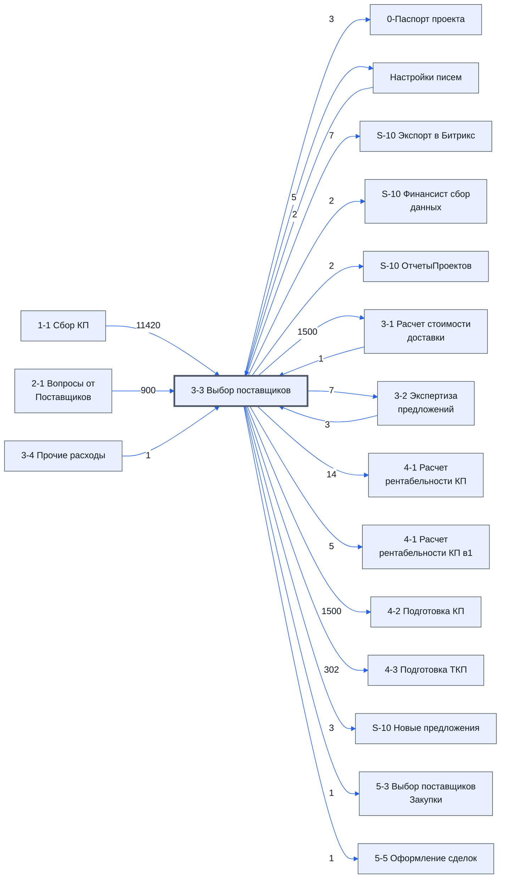

# Лист «3-3 Выбор поставщиков»

Таблица: таблица проекта · контур 1.

**Зачем** (со слов директора): выбор поставщиков из списка топ-7.

Устройство листа — заголовки, вид столбцов, списки, формулы, связи с другими листами — собрано из таблицы ниже. Строка заголовков на этом листе угадана по закреплённой области — проверить.

## Зачем лист — подробно

*Заполнить:* что на листе происходит, откуда приходят данные и куда уходят.

## Как заполнять

*Заполнить:* какие столбцы вводят руками, какие считаются сами. Что значит каждый столбец — в `stolbtsy.yaml` рядом (поля `chto` и `kak`).

## Что нельзя трогать

*Заполнить.*

## Инструкции и умения

*Заполнить:* какие инструкции и умения относятся к листу.

## Осталось сделать

- Заполнить разделы выше и `stolbtsy.yaml`.

## Устройство (из таблицы)

- **Таблица:** таблица проекта, лист «3-3 Выбор поставщиков»; контур 1
- **Аналог в другом контуре:** [5-3 Выбор поставщиков Закупки](../k2-5-3-vybor-postavshchikov/index.md)
- **Размер:** `A1:DI340`, закреплено до `M2`
- **Каркас:** свой, не общий; строка заголовков — 1, угадана по закреплённой области — проверить
- **Формул:** 27977; заполненных ячеек без формул в данных: 55; списков: 0; условного форматирования: 17; объединённых ячеек: 9

## Связи с другими листами

- **Берёт данные с листов:** [1-1 Сбор КП](../k1-1-1-sbor-kp/index.md) (11420), [2-1 Вопросы от Поставщиков](../k1-2-1-voprosy-ot-postavshchikov/index.md) (900), [3-2 Экспертиза предложений](../k1-3-2-ekspertiza-predlozheniy/index.md) (3), [Настройки писем](../k0-nastroyki-pisem/index.md) (2), [3-1 Расчет стоимости доставки](../k1-3-1-raschet-stoimosti-dostavki/index.md) (1), [3-4 Прочие расходы](../k1-3-4-prochie-raskhody/index.md) (1)
- **Его данные используют:** [0-Паспорт проекта](../k0-0-pasport-proekta/index.md) (3), [Настройки писем](../k0-nastroyki-pisem/index.md) (5), [S-10 Экспорт в Битрикс](../k0-s-10-eksport-v-bitriks/index.md) (7), [S-10 Финансист сбор данных](../k0-s-10-finansist-sbor-dannykh/index.md) (2), [S-10 ОтчетыПроектов](../k0-s-10-otchetyproektov/index.md) (2), [3-1 Расчет стоимости доставки](../k1-3-1-raschet-stoimosti-dostavki/index.md) (1500), [3-2 Экспертиза предложений](../k1-3-2-ekspertiza-predlozheniy/index.md) (7), [4-1 Расчет рентабельности КП](../k1-4-1-raschet-rentabelnosti-kp/index.md) (14), [4-1 Расчет рентабельности КП в1](../k1-4-1-raschet-rentabelnosti-kp-v1/index.md) (5), [4-2 Подготовка КП](../k1-4-2-podgotovka-kp/index.md) (1500), [4-3 Подготовка ТКП](../k1-4-3-podgotovka-tkp/index.md) (302), [S-10 Новые предложения](../k1-s-10-novye-predlozheniya/index.md) (3), [5-3 Выбор поставщиков Закупки](../k2-5-3-vybor-postavshchikov/index.md) (1), [5-5 Оформление сделок](../k2-5-5-sdelki/index.md) (1)

В скобках и на стрелках — сколько формул ссылаются.

## Кто здесь работает (по процессам)

Обязанности, у которых место работы — этот лист (из разбора регламента); должность — в карточке обязанности.

[Готовящий коммерческую часть КП](../../reg/oby/kommercheskaya-chast.md)

## Столбцы

Устройство — из таблицы; «Что это» и «Как заполняют» — из `stolbtsy.yaml` (заполняем руками).

| Столбец | Заголовок | Служебное имя | Вид | Заполняется | Список | Что это | Как заполняют |
|---|---|---|---|---|---|---|---|
| A | № |  |  | формула |  |  |  |
| B | Номенклатура |  |  | формула |  |  |  |
| C | Ед |  |  | формула |  |  |  |
| D | Кол |  |  | формула |  |  |  |
| E | Цена |  |  | формула |  |  |  |
| F | Сумма |  |  | формула |  |  |  |
| G | Группа |  |  | формула |  |  |  |
| H | Срок поставки |  |  | формула |  |  |  |
| I | Срок поставки по договору |  |  | формула |  |  |  |
| J | Нац режим 1875 |  |  | формула |  |  |  |
| K | Поставщик |  |  | руками? |  |  |  |
| L | Резервный поставщик |  |  | формула |  |  |  |
| M |  |  |  | формула |  |  |  |
| N | НМЦ |  |  | формула |  |  |  |
| O | Статус |  |  | руками? |  |  |  |
| P | Предполагаемая дата оплаты |  |  | руками? |  |  |  |
| Q | Комментарий |  |  | руками? |  |  |  |
| R | Разница от миним |  |  | формула |  |  |  |
| S | Итого разница |  |  | формула |  |  |  |
| T | Название товара в ТП |  |  | формула |  |  |  |
| Y | Всего: 0 вопросов Всего: 0 проблем |  |  | формула |  |  |  |
| Z | БлокТопНачало |  |  | руками? |  |  |  |
| AA | 1 Формула |  |  | формула |  |  |  |
| AB | 1 цена |  |  | формула |  |  |  |
| AC | 2 Формула |  |  | формула |  |  |  |
| AD | 1 Поставщик |  |  | формула |  |  |  |
| AE | 3 Формула |  |  | формула |  |  |  |
| AF | 1 Комментарий |  |  | формула |  |  |  |
| AG | 4 Формула |  |  | формула |  |  |  |
| AH | 1 срок |  |  | формула |  |  |  |
| AI | 5 Формула |  |  | формула |  |  |  |
| AJ | 1 Эксперт |  |  | формула |  |  |  |
| AK | 6 Формула |  |  | формула |  |  |  |
| AL | 2 цена |  |  | формула |  |  |  |
| AM | 7 Формула |  |  | формула |  |  |  |
| AN | 2 Поставщик |  |  | формула |  |  |  |
| AO | 8 Формула |  |  | формула |  |  |  |
| AP | 2 Комментарий |  |  | формула |  |  |  |
| AQ | 9 Формула |  |  | формула |  |  |  |
| AR | 2 срок |  |  | формула |  |  |  |
| AS | 10 Формула |  |  | формула |  |  |  |
| AT | 2 Эксперт |  |  | формула |  |  |  |
| AU | 11 Формула |  |  | формула |  |  |  |
| AV | 3 цена |  |  | формула |  |  |  |
| AW | 12 Формула |  |  | формула |  |  |  |
| AX | 3 Поставщик |  |  | формула |  |  |  |
| AY | 13 Формула |  |  | формула |  |  |  |
| AZ | 3 Комментарий |  |  | формула |  |  |  |
| BA | 14 Формула |  |  | формула |  |  |  |
| BB | 3 срок |  |  | формула |  |  |  |
| BC | 15 Формула |  |  | формула |  |  |  |
| BD | 3 Эксперт |  |  | формула |  |  |  |
| BE | 16 Формула |  |  | формула |  |  |  |
| BF | 4 цена |  |  | формула |  |  |  |
| BG | 17 Формула |  |  | формула |  |  |  |
| BH | 4 Поставщик |  |  | формула |  |  |  |
| BI | 18 Формула |  |  | формула |  |  |  |
| BJ | 4 Комментарий |  |  | формула |  |  |  |
| BK | 19 Формула |  |  | формула |  |  |  |
| BL | 4 срок |  |  | формула |  |  |  |
| BM | 20 Формула |  |  | формула |  |  |  |
| BN | 4 Эксперт |  |  | формула |  |  |  |
| BO | 21 Формула |  |  | формула |  |  |  |
| BP | 5 цена |  |  | формула |  |  |  |
| BQ | 22 Формула |  |  | формула |  |  |  |
| BR | 5 Поставщик |  |  | формула |  |  |  |
| BS | 23 Формула |  |  | формула |  |  |  |
| BT | 5 Комментарий |  |  | формула |  |  |  |
| BU | 24 Формула |  |  | формула |  |  |  |
| BV | 5 срок |  |  | формула |  |  |  |
| BW | 25 Формула |  |  | формула |  |  |  |
| BX | 5 Эксперт |  |  | формула |  |  |  |
| BY | 26 Формула |  |  | формула |  |  |  |
| BZ | 6 цена |  |  | формула |  |  |  |
| CA | 27 Формула |  |  | формула |  |  |  |
| CB | 6 Поставщик |  |  | формула |  |  |  |
| CC | 28 Формула |  |  | формула |  |  |  |
| CD | 6 Комментарий |  |  | формула |  |  |  |
| CE | 29 Формула |  |  | формула |  |  |  |
| CF | 6 срок |  |  | формула |  |  |  |
| CG | 30 Формула |  |  | формула |  |  |  |
| CH | 6 Эксперт |  |  | формула |  |  |  |
| CI | 31 Формула |  |  | формула |  |  |  |
| CJ | 7 цена |  |  | формула |  |  |  |
| CK | 32 Формула |  |  | формула |  |  |  |
| CL | 7 Поставщик |  |  | формула |  |  |  |
| CM | 33 Формула |  |  | формула |  |  |  |
| CN | 7 Комментарий |  |  | формула |  |  |  |
| CO | 34 Формула |  |  | формула |  |  |  |
| CP | 7 срок |  |  | формула |  |  |  |
| CQ | 35 Формула |  |  | формула |  |  |  |
| CR | 7 Эксперт |  |  | формула |  |  |  |
| CS | БлокТопКонец |  |  | руками? |  |  |  |
| CT | НЕТ |  |  | формула |  |  |  |
| CU |  |  |  | формула |  |  |  |
| CV |  |  |  | формула |  |  |  |
| CW |  |  |  | формула |  |  |  |
| CX |  |  |  | формула |  |  |  |
| CY |  |  |  | формула |  |  |  |
| CZ |  |  |  | формула |  |  |  |
| DA | Лист1 Номер строки |  |  | формула |  |  |  |
| DB | ТопЭксперта |  |  | руками? |  |  |  |

Формулы столбцов (95)

| Столбец | Строка | Формула |
|---|---|---|
| A | 1 | <code>='1-1 Сбор КП'!C1</code> |
| B | 1 | <code>='1-1 Сбор КП'!D1</code> |
| C | 2 | <code>='1-1 Сбор КП'!F2</code> |
| D | 2 | <code>='1-1 Сбор КП'!G2</code> |
| E | 2 | <code>=IF(CU2&gt;0,CU2,CW2)</code> |
| F | 2 | <code>=E2*D2</code> |
| G | 2 | <code>='1-1 Сбор КП'!O2</code> |
| H | 2 | <code>=IFERROR(IF(CU2&gt;0,OFFSET('1-1 Сбор КП'!$O2,0,CT2+1),OFFSET('1-1 Сбор КП'!$O2,0,CV2+1)),)</code> |
| I | 2 | <code>='1-1 Сбор КП'!N2</code> |
| J | 1 | <code>='1-1 Сбор КП'!L1</code> |
| L | 305 | <code>=COUNTA(UNIQUE(K2:K301))</code> |
| M | 2 | <code>=COUNTIF(AD:AD,K2)</code> |
| N | 2 | <code>='1-1 Сбор КП'!K2</code> |
| R | 2 | <code>=E2-AB2</code> |
| S | 2 | <code>=R2*D2</code> |
| T | 2 | <code>=IF(CT2&gt;0,OFFSET('1-1 Сбор КП'!$O2,0,CT2+2),)</code> |
| Y | 1 | <code>=LAMBDA(номенклатуры,экспертиза, BYROW(номенклатуры, LAMBDA(н, TEXTJOIN(CHAR(10),TRUE, IFERROR(VLOOKUP(н,экспертиза,2,FALSE),),IFERROR(VLOOKUP(н,экспертиза,3,FALSE),)))))('3-3 Выбор поставщиков'!B1:B301,{'3-2 Экспертиза предложений'!B:B,'3-2 Экспертиза предложений'!I:I,'3-2 Экспертиза предложений'!J:J})</code> |
| AA | 2 | <code>={"" , IFERROR( INDIRECT( CONCATENATE("'1-1 Сбор КП'!", INDEX(SPLIT($CZ2,"&#124;&#124;&#124;",FALSE,FALSE),1,1))),"")}</code> |
| AB | 2 | <code>="COMPUTED_VALUE"</code> |
| AC | 2 | <code>={"" , IFERROR( INDIRECT( CONCATENATE("'1-1 Сбор КП'!", INDEX(SPLIT($CZ2,"&#124;&#124;&#124;",FALSE,FALSE),1,2))),"")}</code> |
| AD | 2 | <code>="COMPUTED_VALUE"</code> |
| AE | 2 | <code>={"" , IFERROR(INDEX(SPLIT($CZ2,"&#124;&#124;&#124;",FALSE,FALSE),1,3),"")}</code> |
| AF | 2 | <code>="COMPUTED_VALUE"</code> |
| AG | 2 | <code>={"" , IFERROR( INDIRECT( CONCATENATE("'1-1 Сбор КП'!", INDEX(SPLIT($CZ2,"&#124;&#124;&#124;",FALSE,FALSE),1,4))),"")}</code> |
| AH | 2 | <code>="COMPUTED_VALUE"</code> |
| AI | 2 | <code>={"" , IFERROR(INDEX(SPLIT($CZ2,"&#124;&#124;&#124;",FALSE,FALSE),1,5),"")}</code> |
| AJ | 2 | <code>="COMPUTED_VALUE"</code> |
| AK | 2 | <code>={"" , IFERROR( INDIRECT( CONCATENATE("'1-1 Сбор КП'!", INDEX(SPLIT($CZ2,"&#124;&#124;&#124;",FALSE,FALSE),1,6))),"")}</code> |
| AL | 2 | <code>="COMPUTED_VALUE"</code> |
| AM | 2 | <code>={"" , IFERROR( INDIRECT( CONCATENATE("'1-1 Сбор КП'!", INDEX(SPLIT($CZ2,"&#124;&#124;&#124;",FALSE,FALSE),1,7))),"")}</code> |
| AN | 2 | <code>="COMPUTED_VALUE"</code> |
| AO | 2 | <code>={"" , IFERROR(INDEX(SPLIT($CZ2,"&#124;&#124;&#124;",FALSE,FALSE),1,8),"")}</code> |
| AP | 2 | <code>="COMPUTED_VALUE"</code> |
| AQ | 2 | <code>={"" , IFERROR( INDIRECT( CONCATENATE("'1-1 Сбор КП'!", INDEX(SPLIT($CZ2,"&#124;&#124;&#124;",FALSE,FALSE),1,9))),"")}</code> |
| AR | 2 | <code>="COMPUTED_VALUE"</code> |
| AS | 2 | <code>={"" , IFERROR(INDEX(SPLIT($CZ2,"&#124;&#124;&#124;",FALSE,FALSE),1,10),"")}</code> |
| AT | 2 | <code>="COMPUTED_VALUE"</code> |
| AU | 2 | <code>={"" , IFERROR( INDIRECT( CONCATENATE("'1-1 Сбор КП'!", INDEX(SPLIT($CZ2,"&#124;&#124;&#124;",FALSE,FALSE),1,11))),"")}</code> |
| AV | 2 | <code>="COMPUTED_VALUE"</code> |
| AW | 2 | <code>={"" , IFERROR( INDIRECT( CONCATENATE("'1-1 Сбор КП'!", INDEX(SPLIT($CZ2,"&#124;&#124;&#124;",FALSE,FALSE),1,12))),"")}</code> |
| AX | 2 | <code>="COMPUTED_VALUE"</code> |
| AY | 2 | <code>={"" , IFERROR(INDEX(SPLIT($CZ2,"&#124;&#124;&#124;",FALSE,FALSE),1,13),"")}</code> |
| AZ | 2 | <code>="COMPUTED_VALUE"</code> |
| BA | 2 | <code>={"" , IFERROR( INDIRECT( CONCATENATE("'1-1 Сбор КП'!", INDEX(SPLIT($CZ2,"&#124;&#124;&#124;",FALSE,FALSE),1,14))),"")}</code> |
| BB | 2 | <code>="COMPUTED_VALUE"</code> |
| BC | 2 | <code>={"" , IFERROR(INDEX(SPLIT($CZ2,"&#124;&#124;&#124;",FALSE,FALSE),1,15),"")}</code> |
| BD | 2 | <code>="COMPUTED_VALUE"</code> |
| BE | 2 | <code>={"" , IFERROR( INDIRECT( CONCATENATE("'1-1 Сбор КП'!", INDEX(SPLIT($CZ2,"&#124;&#124;&#124;",FALSE,FALSE),1,16))),"")}</code> |
| BF | 2 | <code>="COMPUTED_VALUE"</code> |
| BG | 2 | <code>={"" , IFERROR( INDIRECT( CONCATENATE("'1-1 Сбор КП'!", INDEX(SPLIT($CZ2,"&#124;&#124;&#124;",FALSE,FALSE),1,17))),"")}</code> |
| BH | 2 | <code>="COMPUTED_VALUE"</code> |
| BI | 2 | <code>={"" , IFERROR(INDEX(SPLIT($CZ2,"&#124;&#124;&#124;",FALSE,FALSE),1,18),"")}</code> |
| BJ | 2 | <code>="COMPUTED_VALUE"</code> |
| BK | 2 | <code>={"" , IFERROR( INDIRECT( CONCATENATE("'1-1 Сбор КП'!", INDEX(SPLIT($CZ2,"&#124;&#124;&#124;",FALSE,FALSE),1,19))),"")}</code> |
| BL | 2 | <code>="COMPUTED_VALUE"</code> |
| BM | 2 | <code>={"" , IFERROR(INDEX(SPLIT($CZ2,"&#124;&#124;&#124;",FALSE,FALSE),1,20),"")}</code> |
| BN | 2 | <code>="COMPUTED_VALUE"</code> |
| BO | 2 | <code>={"" , IFERROR( INDIRECT( CONCATENATE("'1-1 Сбор КП'!", INDEX(SPLIT($CZ2,"&#124;&#124;&#124;",FALSE,FALSE),1,21))),"")}</code> |
| BP | 2 | <code>="COMPUTED_VALUE"</code> |
| BQ | 2 | <code>={"" , IFERROR( INDIRECT( CONCATENATE("'1-1 Сбор КП'!", INDEX(SPLIT($CZ2,"&#124;&#124;&#124;",FALSE,FALSE),1,22))),"")}</code> |
| BR | 2 | <code>="COMPUTED_VALUE"</code> |
| BS | 2 | <code>={"" , IFERROR(INDEX(SPLIT($CZ2,"&#124;&#124;&#124;",FALSE,FALSE),1,23),"")}</code> |
| BT | 2 | <code>="COMPUTED_VALUE"</code> |
| BU | 2 | <code>={"" , IFERROR( INDIRECT( CONCATENATE("'1-1 Сбор КП'!", INDEX(SPLIT($CZ2,"&#124;&#124;&#124;",FALSE,FALSE),1,24))),"")}</code> |
| BV | 2 | <code>="COMPUTED_VALUE"</code> |
| BW | 2 | <code>={"" , IFERROR(INDEX(SPLIT($CZ2,"&#124;&#124;&#124;",FALSE,FALSE),1,25),"")}</code> |
| BX | 2 | <code>="COMPUTED_VALUE"</code> |
| BY | 2 | <code>={"" , IFERROR( INDIRECT( CONCATENATE("'1-1 Сбор КП'!", INDEX(SPLIT($CZ2,"&#124;&#124;&#124;",FALSE,FALSE),1,26))),"")}</code> |
| BZ | 2 | <code>="COMPUTED_VALUE"</code> |
| CA | 2 | <code>={"" , IFERROR( INDIRECT( CONCATENATE("'1-1 Сбор КП'!", INDEX(SPLIT($CZ2,"&#124;&#124;&#124;",FALSE,FALSE),1,27))),"")}</code> |
| CB | 2 | <code>="COMPUTED_VALUE"</code> |
| CC | 2 | <code>={"" , IFERROR(INDEX(SPLIT($CZ2,"&#124;&#124;&#124;",FALSE,FALSE),1,28),"")}</code> |
| CD | 2 | <code>="COMPUTED_VALUE"</code> |
| CE | 2 | <code>={"" , IFERROR( INDIRECT( CONCATENATE("'1-1 Сбор КП'!", INDEX(SPLIT($CZ2,"&#124;&#124;&#124;",FALSE,FALSE),1,29))),"")}</code> |
| CF | 2 | <code>="COMPUTED_VALUE"</code> |
| CG | 2 | <code>={"" , IFERROR(INDEX(SPLIT($CZ2,"&#124;&#124;&#124;",FALSE,FALSE),1,30),"")}</code> |
| CH | 2 | <code>="COMPUTED_VALUE"</code> |
| CI | 2 | <code>={"" , IFERROR( INDIRECT( CONCATENATE("'1-1 Сбор КП'!", INDEX(SPLIT($CZ2,"&#124;&#124;&#124;",FALSE,FALSE),1,31))),"")}</code> |
| CJ | 2 | <code>="COMPUTED_VALUE"</code> |
| CK | 2 | <code>={"" , IFERROR( INDIRECT( CONCATENATE("'1-1 Сбор КП'!", INDEX(SPLIT($CZ2,"&#124;&#124;&#124;",FALSE,FALSE),1,32))),"")}</code> |
| CL | 2 | <code>="COMPUTED_VALUE"</code> |
| CM | 2 | <code>={"" , IFERROR(INDEX(SPLIT($CZ2,"&#124;&#124;&#124;",FALSE,FALSE),1,33),"")}</code> |
| CN | 2 | <code>="COMPUTED_VALUE"</code> |
| CO | 2 | <code>={"" , IFERROR( INDIRECT( CONCATENATE("'1-1 Сбор КП'!", INDEX(SPLIT($CZ2,"&#124;&#124;&#124;",FALSE,FALSE),1,34))),"")}</code> |
| CP | 2 | <code>="COMPUTED_VALUE"</code> |
| CQ | 2 | <code>={"" , IFERROR(INDEX(SPLIT($CZ2,"&#124;&#124;&#124;",FALSE,FALSE),1,35),"")}</code> |
| CR | 2 | <code>="COMPUTED_VALUE"</code> |
| CT | 1 | <code>='Настройки писем'!$K$11</code> |
| CU | 2 | <code>=IF(CT2&gt;0,OFFSET('1-1 Сбор КП'!$O2,0,CT2),)</code> |
| CV | 2 | <code>=IFERROR(MATCH("#@!$!#$@",SPLIT(SUBSTITUTE(JOIN("&#124;&#124;&#124;",'1-1 Сбор КП'!$P$1:$KL$1),K2,"#@!$!#$@",2),"&#124;&#124;&#124;",FALSE,FALSE),0),)</code> |
| CW | 2 | <code>=IF(CV2&gt;0,OFFSET('1-1 Сбор КП'!$O2,0,CV2),)</code> |
| CX | 2 | <code>=COUNTA(IFERROR(FILTER({'2-1 Вопросы от Поставщиков'!B:B},{'2-1 Вопросы от Поставщиков'!B:B=A2},{'2-1 Вопросы от Поставщиков'!U:U=FALSE}),))</code> |
| CY | 2 | <code>=INDIRECT(ADDRESS($DA2,COLUMN('1-1 Сбор КП'!$D$1),1,TRUE,"1-1 Сбор КП"))</code> |
| CZ | 2 | <code>=INDIRECT(ADDRESS($DA2,COLUMN('1-1 Сбор КП'!$IE$1),1,TRUE,"1-1 Сбор КП"))</code> |
| DA | 2 | <code>=ROW(INDIRECT(MIDB(FORMULATEXT(INDIRECT(ADDRESS(ROW(),2,1,TRUE))),2,LENB(FORMULATEXT(INDIRECT(ADDRESS(ROW(),2,1,TRUE)))))))</code> |

