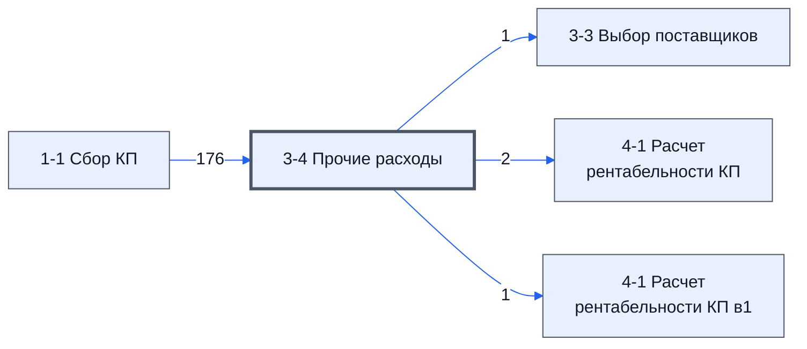

# Лист «3-4 Прочие расходы»

Таблица: таблица проекта · контур 1.

**Зачем** (со слов директора): *не записано*.

Устройство листа — заголовки, вид столбцов, списки, формулы, связи с другими листами — собрано из таблицы ниже. Строка заголовков на этом листе угадана по закреплённой области — проверить.

## Зачем лист — подробно

*Заполнить:* что на листе происходит, откуда приходят данные и куда уходят.

## Как заполнять

*Заполнить:* какие столбцы вводят руками, какие считаются сами. Что значит каждый столбец — в `stolbtsy.yaml` рядом (поля `chto` и `kak`).

## Что нельзя трогать

*Заполнить.*

## Инструкции и умения

*Заполнить:* какие инструкции и умения относятся к листу.

## Осталось сделать

- Заполнить разделы выше и `stolbtsy.yaml`.

## Устройство (из таблицы)

- **Таблица:** таблица проекта, лист «3-4 Прочие расходы»; контур 1
- **Размер:** `A1:X228`
- **Каркас:** свой, не общий; строка заголовков — 1, угадана по закреплённой области — проверить
- **Формул:** 208; заполненных ячеек без формул в данных: 92; списков: 0; условного форматирования: 0; объединённых ячеек: 1

## Связи с другими листами

- **Берёт данные с листов:** [1-1 Сбор КП](../k1-1-1-sbor-kp/index.md) (176)
- **Его данные используют:** [3-3 Выбор поставщиков](../k1-3-3-vybor-postavshchikov/index.md) (1), [4-1 Расчет рентабельности КП](../k1-4-1-raschet-rentabelnosti-kp/index.md) (2), [4-1 Расчет рентабельности КП в1](../k1-4-1-raschet-rentabelnosti-kp-v1/index.md) (1)

В скобках и на стрелках — сколько формул ссылаются.

## Столбцы

Устройство — из таблицы; «Что это» и «Как заполняют» — из `stolbtsy.yaml` (заполняем руками).

| Столбец | Заголовок | Служебное имя | Вид | Заполняется | Список | Что это | Как заполняют |
|---|---|---|---|---|---|---|---|
| A |  |  |  | формула |  |  |  |
| B |  |  |  | формула |  |  |  |
| C |  |  |  | формула |  |  |  |
| D | ПЛАН |  |  | формула |  |  |  |
| E |  |  |  | формула |  |  |  |
| F | ФАКТ(анализ) |  |  | руками? |  |  |  |
| G |  |  |  | формула |  |  |  |
| I | Переводы ПЛАН |  |  | руками? |  |  |  |
| L |  |  |  | формула |  |  |  |
| N |  |  |  | формула |  |  |  |
| O |  |  |  | формула |  |  |  |
| P |  |  |  | формула |  |  |  |
| Q |  |  |  | формула |  |  |  |
| R |  |  |  | формула |  |  |  |
| S |  |  |  | формула |  |  |  |
| U |  |  |  | формула |  |  |  |

Формулы столбцов (14)

| Столбец | Строка | Формула |
|---|---|---|
| A | 4 | <code>=A3+1</code> |
| B | 40 | <code>='1-1 Сбор КП'!D2</code> |
| C | 40 | <code>='1-1 Сбор КП'!E2</code> |
| D | 40 | <code>='1-1 Сбор КП'!F2</code> |
| E | 8 | <code>=350*U6</code> |
| G | 38 | <code>=SUM(G40)</code> |
| L | 2 | <code>=J3</code> |
| N | 6 | <code>=L4*N5</code> |
| O | 6 | <code>=O5*L4</code> |
| P | 6 | <code>=P5*L2</code> |
| Q | 6 | <code>=Q5*L2</code> |
| R | 6 | <code>=R5*L4</code> |
| S | 6 | <code>=S5*L4</code> |
| U | 6 | <code>=SUM(N6:S6)</code> |

