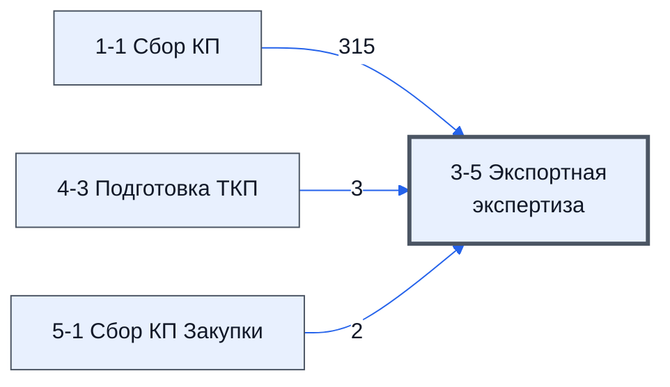

# Лист «3-5 Экспортная экспертиза»

Таблица: таблица проекта · контур 1.

**Зачем:** сведений нет — по названию лист можно сравнить с регламентом, это позже (ответ директора, раунд 5).

Устройство листа — заголовки, вид столбцов, списки, формулы, связи с другими листами — собрано из таблицы ниже. Строка заголовков на этом листе угадана по закреплённой области — проверить.

## Зачем лист — подробно

*Заполнить:* что на листе происходит, откуда приходят данные и куда уходят.

## Как заполнять

*Заполнить:* какие столбцы вводят руками, какие считаются сами. Что значит каждый столбец — в `stolbtsy.yaml` рядом (поля `chto` и `kak`).

## Что нельзя трогать

*Заполнить.*

## Инструкции и умения

*Заполнить:* какие инструкции и умения относятся к листу.

## Осталось сделать

- Заполнить разделы выше и `stolbtsy.yaml`.

## Устройство (из таблицы)

- **Таблица:** таблица проекта, лист «3-5 Экспортная экспертиза»; контур 1
- **Размер:** `A1:AA310`, закреплено до `A2`
- **Каркас:** свой, не общий; строка заголовков — 1, угадана по закреплённой области — проверить
- **Формул:** 313; заполненных ячеек без формул в данных: 1; списков: 0; условного форматирования: 0; объединённых ячеек: 0

## Связи с другими листами

- **Берёт данные с листов:** [1-1 Сбор КП](../k1-1-1-sbor-kp/index.md) (315), [4-3 Подготовка ТКП](../k1-4-3-podgotovka-tkp/index.md) (3), [5-1 Сбор КП Закупки](../k2-5-1-sbor-kp/index.md) (2)

В скобках и на стрелках — сколько формул ссылаются.

## Столбцы

Устройство — из таблицы; «Что это» и «Как заполняют» — из `stolbtsy.yaml` (заполняем руками).

| Столбец | Заголовок | Служебное имя | Вид | Заполняется | Список | Что это | Как заполняют |
|---|---|---|---|---|---|---|---|
| A | № |  |  | формула |  |  |  |
| B | Номенклатура |  |  | формула |  |  |  |
| C | Характеристики |  |  | формула |  |  |  |
| D | Ед. Изм |  |  | формула |  |  |  |
| E | Кол-во |  |  | формула |  |  |  |
| F | НМЦ за ЕД |  |  | формула |  |  |  |
| G | НМЦ Всего |  |  | формула |  |  |  |
| H | Название товара в ТП |  |  | формула |  |  |  |
| I | Таможенная процедура |  |  | руками? |  |  |  |
| J | Техническое описание и характеристики (область применения и материал из которого изготовлен) (информация необходимая для идентификации товара и подбора 10 значного кода ТН ВЭД) |  |  | руками? |  |  |  |
| K | Документы на товар, тех карты, спецификации |  |  | руками? |  |  |  |
| L | Торговая марка (зарегистрированная ТМ (при наличии)) |  |  | руками? |  |  |  |
| M | Страна происхождения товара |  |  | руками? |  |  |  |
| N | Наименование Изготовителя |  |  | руками? |  |  |  |
| O | Quantity (PCS) Кол-во штук |  |  | руками? |  |  |  |
| P | Цена за 1 шт в валюте контракта |  |  | руками? |  |  |  |
| Q | Итого стоимость в валюте контракта |  |  | формула |  |  |  |
| R | Weight netto, kg Вес нетто, кг |  |  | руками? |  |  |  |
| S | Weight Gross, kg Вес брутто, кг |  |  | руками? |  |  |  |
| T | Customs Code Код ТН-ВЭД |  |  | руками? |  |  |  |
| U | Код ОКПД2 |  |  | руками? |  |  |  |
| V | Ограничения /запреты по 311 ([ссылка] |  |  | руками? |  |  |  |
| W | Необходимость получения заключения ФСТЭК (идентификационное заключение ФСТЭК необходимо для вывоза товаров двойного назначения) МОжно определять необходимость и стоимость с помощью ресурса: [ссылка] ) то что не требует ИЗ - приведено здесь (Перечень товаров, в отношении которых при их перемещении за пределы Российской Федерации не применяются запреты и ограничения, установленные законодательством Российской Федерации в области экспортного контроля): [ссылка] |  |  | руками? |  |  |  |
| X | Необходимость получения СТ-1 ( на отечественные товары) . Она появляется если на данный товар действует запрет согласно 311 или 312. |  |  | руками? |  |  |  |
| Y | Выдача разрешения на вывоз отдельных видов промышленной продукции по перечню согласно приложению N 3 к постановлению Правительства Российской Федерации от 9 марта 2022 г. N 312 "О введении на временной основе разрешительного порядка вывоза отдельных видов товаров за пределы территории Российской Федерации" МИНПРОМТОРГ |  |  | руками? |  |  |  |
| Z | Заметки по изменениям |  |  | руками? |  |  |  |

Формулы столбцов (9)

| Столбец | Строка | Формула |
|---|---|---|
| A | 1 | <code>='1-1 Сбор КП'!C1</code> |
| B | 1 | <code>={"Номенклатура";LAMBDA(doRez,doFind,theNumbrS,theData1,theData5, BYROW(theNumbrS,LAMBDA(theN,IF(theN&lt;&gt;"", doRez(doFind(theN,theData1),doFind(theN,theData5)) ,) )))( LAMBDA(theV1,theV5,IF(theV5&lt;&gt;"",theV5,theV1)), LAMBDA(theN,theData,IFERROR(VLOOKUP(""&amp;theN,theData,2,FALSE),)), '3-5 Экспортная экспертиза'!A2:A310, {""&amp;'1-1 Сбор КП'!C2:C310,'1-1 Сбор КП'!D2:D310},{""&amp; '5-1 Сбор КП Закупки'!D11:D310, …</code> |
| C | 1 | <code>={'1-1 Сбор КП'!E1; LAMBDA(doRez,doFind,theNumbrS,theData1,theData5, BYROW(theNumbrS,LAMBDA(theN,IF(theN&lt;&gt;"", doRez(doFind(theN,theData1),doFind(theN,theData5)) ,) )))( LAMBDA(theV1,theV5,IF(theV5&lt;&gt;"",theV5,theV1)),LAMBDA(theN,theData,IFERROR(VLOOKUP(""&amp;theN,theData,2,FALSE),)), '3-5 Экспортная экспертиза'!A2:A310, {""&amp;'1-1 Сбор КП'!C2:C310,'1-1 Сбор КП'!E2:E310},) }</code> |
| D | 1 | <code>={'1-1 Сбор КП'!F1; LAMBDA(doRez,doFind,theNumbrS,theData1,theData5, BYROW(theNumbrS,LAMBDA(theN,IF(theN&lt;&gt;"", doRez(doFind(theN,theData1),doFind(theN,theData5)) ,) )))( LAMBDA(theV1,theV5,IF(theV5&lt;&gt;"",theV5,theV1)),LAMBDA(theN,theData,IFERROR(VLOOKUP(""&amp;theN,theData,2,FALSE),)), '3-5 Экспортная экспертиза'!A2:A310, {""&amp;'1-1 Сбор КП'!C2:C310,'1-1 Сбор КП'!F2:F310},) }</code> |
| E | 1 | <code>={'1-1 Сбор КП'!G1; LAMBDA(doRez,doFind,theNumbrS,theData1,theData5, BYROW(theNumbrS,LAMBDA(theN,IF(theN&lt;&gt;"", doRez(doFind(theN,theData1),doFind(theN,theData5)) ,) )))( LAMBDA(theV1,theV5,IF(theV5&lt;&gt;"",theV5,theV1)),LAMBDA(theN,theData,IFERROR(VLOOKUP(""&amp;theN,theData,2,FALSE),)), '3-5 Экспортная экспертиза'!A2:A310, {""&amp;'1-1 Сбор КП'!C2:C310,'1-1 Сбор КП'!G2:G310},) }</code> |
| F | 1 | <code>={"НМЦ за ЕД"; LAMBDA(doRez,doFind,theNumbrS,theData1,theData5, BYROW(theNumbrS,LAMBDA(theN,IF(INDEX( theN,1,2)&lt;&gt;"", doRez(doFind(INDEX( theN,,1),theData1),doFind(INDEX( theN,,1),theData5)) ,) )))( LAMBDA(theV1,theV5,IF(theV5&lt;&gt;"",theV5,theV1)),LAMBDA(theN,theData,IFERROR(VLOOKUP(""&amp;theN,theData,2,FALSE),)), '3-5 Экспортная экспертиза'!A2:B310, {""&amp;'1-1 Сбор КП'!C2:C310,'1-1 Сбор КП'!K2:K310},) }</code> |
| G | 1 | <code>={"НМЦ Всего"; IF(B2:B310&lt;&gt;"", F2:F310*E2:E310,) }</code> |
| H | 1 | <code>={'4-3 Подготовка ТКП'!I3 ; LAMBDA(doRez,doFind,theNumbrS,theData1,theData5, BYROW(theNumbrS,LAMBDA(theN,IF(theN&lt;&gt;"", doRez(doFind(theN,theData1),doFind(theN,theData5)) ,) )))( LAMBDA(theV1,theV5,IF(theV5&lt;&gt;"",theV5,theV1)),LAMBDA(theN,theData,IFERROR(VLOOKUP(""&amp;theN,theData,2,FALSE),)), '3-5 Экспортная экспертиза'!A2:A310, {""&amp;'4-3 Подготовка ТКП'!A4:A310,'4-3 Подготовка ТКП'!I4:I310},) }</code> |
| Q | 1 | <code>={"Итого стоимость в валюте контракта"; IF(B2:B301&lt;&gt;"",E2:E301*P2:P301,)}</code> |

