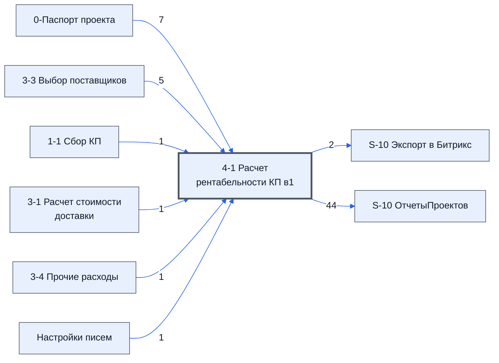

# Лист «4-1 Расчет рентабельности КП в1»

Таблица: таблица проекта · контур 1.

**Зачем** (со слов директора): *не записано*.

Устройство листа — заголовки, вид столбцов, списки, формулы, связи с другими листами — собрано из таблицы ниже. Строка заголовков на этом листе угадана по закреплённой области — проверить.

## Зачем лист — подробно

*Заполнить:* что на листе происходит, откуда приходят данные и куда уходят.

## Как заполнять

*Заполнить:* какие столбцы вводят руками, какие считаются сами. Что значит каждый столбец — в `stolbtsy.yaml` рядом (поля `chto` и `kak`).

## Что нельзя трогать

*Заполнить.*

## Инструкции и умения

*Заполнить:* какие инструкции и умения относятся к листу.

## Осталось сделать

- Заполнить разделы выше и `stolbtsy.yaml`.

## Устройство (из таблицы)

- **Таблица:** таблица проекта, лист «4-1 Расчет рентабельности КП в1»; контур 1
- **Размер:** `A1:AE825`
- **Каркас:** свой, не общий; строка заголовков — 1, угадана по закреплённой области — проверить
- **Формул:** 117; заполненных ячеек без формул в данных: 919; списков: 0; условного форматирования: 3; объединённых ячеек: 38

## Связи с другими листами

- **Берёт данные с листов:** [0-Паспорт проекта](../k0-0-pasport-proekta/index.md) (7), [3-3 Выбор поставщиков](../k1-3-3-vybor-postavshchikov/index.md) (5), [1-1 Сбор КП](../k1-1-1-sbor-kp/index.md) (1), [3-1 Расчет стоимости доставки](../k1-3-1-raschet-stoimosti-dostavki/index.md) (1), [3-4 Прочие расходы](../k1-3-4-prochie-raskhody/index.md) (1), «4-1 Расчет рентабельности КП в2» *(листа нет в реестре)* (1), [Настройки писем](../k0-nastroyki-pisem/index.md) (1)
- **Его данные используют:** [S-10 Экспорт в Битрикс](../k0-s-10-eksport-v-bitriks/index.md) (2), [S-10 ОтчетыПроектов](../k0-s-10-otchetyproektov/index.md) (44)

В скобках и на стрелках — сколько формул ссылаются.

## Столбцы

Устройство — из таблицы; «Что это» и «Как заполняют» — из `stolbtsy.yaml` (заполняем руками).

| Столбец | Заголовок | Служебное имя | Вид | Заполняется | Список | Что это | Как заполняют |
|---|---|---|---|---|---|---|---|
| A | Параметры проекта которые надо заполнить: |  |  | руками? |  |  |  |
| C |  |  |  | формула |  |  |  |
| E | Параметры которые рассчитываются автоматически: |  |  | руками? |  |  |  |
| G |  |  |  | формула |  |  |  |
| I | Переменные проекта |  |  | руками? |  |  |  |
| K |  |  |  | формула |  |  |  |
| L | Конкуренты: |  |  | формула |  |  |  |
| M | цены |  |  | формула |  |  |  |
| N | Рейтинг |  |  | руками? |  |  |  |
| O | № |  |  | формула |  |  |  |
| P | Номенклатура |  |  | руками? |  |  |  |
| Q | Ед |  |  | руками? |  |  |  |
| R | Кол |  |  | руками? |  |  |  |
| S | Цена |  |  | руками? |  |  |  |
| T | Сумма |  |  | руками? |  |  |  |
| U | Срок поставки |  |  | руками? |  |  |  |
| V | Число |  |  | формула |  |  |  |
| W | Тип |  |  | руками? |  |  |  |
| X | Срок в днях |  |  | формула |  |  |  |
| AA | Расчет прибыли |  |  | руками? |  |  |  |
| AB |  |  |  | формула |  |  |  |
| AC |  |  |  | формула |  |  |  |
| AD |  |  |  | формула |  |  |  |
| AE |  |  |  | формула |  |  |  |

Формулы столбцов (12)

| Столбец | Строка | Формула |
|---|---|---|
| C | 2 | <code>='0-Паспорт проекта'!C18</code> |
| G | 2 | <code>=COUNTA(UNIQUE('3-3 Выбор поставщиков'!B2:B301))</code> |
| K | 3 | <code>='4-1 Расчет рентабельности КП в2'!C14</code> |
| L | 2 | <code>=COUNTIF(L5:L19,"&lt;&gt;")</code> |
| M | 75 | <code>=K70/K75</code> |
| O | 1 | <code>={'3-3 Выбор поставщиков'!A1:F301,'3-3 Выбор поставщиков'!H1:H301}</code> |
| V | 1 | <code>={"Число","Тип"}</code> |
| X | 1 | <code>={"Срок в днях";IFS(IFERROR(SEARCH("нал",V2:V71,1),0)&gt;0,3,W2:W71="кд",V2:V71,W2:W71="д",V2:V71,W2:W71="рд",V2:V71/5*7,W2:W71="н",V2:V71*7,W2:W71="нед",V2:V71*7,W2:W71="м",V2:V71*30,W2:W71="мес",V2:V71*30,W2:W71="",V2:V71,1=1,1)}</code> |
| AB | 7 | <code>=B21</code> |
| AC | 19 | <code>=G35*C9</code> |
| AD | 7 | <code>=G8</code> |
| AE | 7 | <code>=AC7*AD7</code> |

