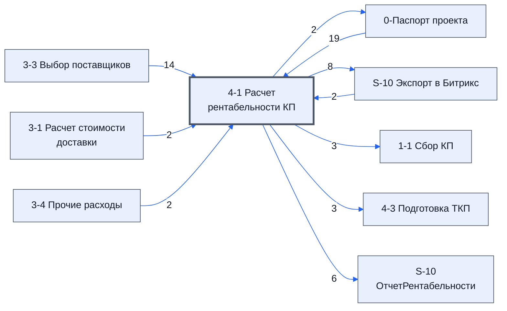

# Лист «4-1 Расчет рентабельности КП»

Таблица: таблица проекта · контур 1.

**Зачем:** сведений нет — по названию лист можно сравнить с регламентом, это позже (ответ директора, раунд 5).

Устройство листа — заголовки, вид столбцов, списки, формулы, связи с другими листами — собрано из таблицы ниже. Строка заголовков на этом листе угадана по закреплённой области — проверить.

## Зачем лист — подробно

*Заполнить:* что на листе происходит, откуда приходят данные и куда уходят.

## Как заполнять

*Заполнить:* какие столбцы вводят руками, какие считаются сами. Что значит каждый столбец — в `stolbtsy.yaml` рядом (поля `chto` и `kak`).

## Что нельзя трогать

*Заполнить.*

## Инструкции и умения

*Заполнить:* какие инструкции и умения относятся к листу.

## Осталось сделать

- Заполнить разделы выше и `stolbtsy.yaml`.

## Устройство (из таблицы)

- **Таблица:** таблица проекта, лист «4-1 Расчет рентабельности КП»; контур 1
- **Размер:** `A1:AN1103`, закреплено до `A8`
- **Каркас:** свой, не общий; строка заголовков — 7, угадана по закреплённой области — проверить
- **Формул:** 7938; заполненных ячеек без формул в данных: 1320; списков: 9; условного форматирования: 13; объединённых ячеек: 47

## Связи с другими листами

- **Берёт данные с листов:** [0-Паспорт проекта](../k0-0-pasport-proekta/index.md) (19), [3-3 Выбор поставщиков](../k1-3-3-vybor-postavshchikov/index.md) (14), [S-10 Экспорт в Битрикс](../k0-s-10-eksport-v-bitriks/index.md) (2), [3-1 Расчет стоимости доставки](../k1-3-1-raschet-stoimosti-dostavki/index.md) (2), [3-4 Прочие расходы](../k1-3-4-prochie-raskhody/index.md) (2)
- **Его данные используют:** [0-Паспорт проекта](../k0-0-pasport-proekta/index.md) (2), [S-10 Экспорт в Битрикс](../k0-s-10-eksport-v-bitriks/index.md) (8), [1-1 Сбор КП](../k1-1-1-sbor-kp/index.md) (3), [4-3 Подготовка ТКП](../k1-4-3-podgotovka-tkp/index.md) (3), [S-10 ОтчетРентабельности](../k1-s-10-otchetrentabelnosti/index.md) (6)

В скобках и на стрелках — сколько формул ссылаются.

## Столбцы

Устройство — из таблицы; «Что это» и «Как заполняют» — из `stolbtsy.yaml` (заполняем руками).

| Столбец | Заголовок | Служебное имя | Вид | Заполняется | Список | Что это | Как заполняют |
|---|---|---|---|---|---|---|---|
| A | #VALUE! |  |  | формула |  |  |  |
| B |  |  |  | формула | "Платёж −,Поступление +" |  |  |
| C |  |  |  | формула | "22%,0%,5%" |  |  |
| D |  |  |  | формула |  |  |  |
| E | #VALUE! |  |  | формула |  |  |  |
| F |  |  |  | формула |  |  |  |
| G |  |  |  | формула |  |  |  |
| I |  |  |  | формула |  |  |  |
| M |  |  |  | формула |  |  |  |
| P |  |  |  | формула |  |  |  |
| Q |  |  |  | формула |  |  |  |
| R |  |  |  | формула |  |  |  |
| S |  |  |  | формула |  |  |  |
| T |  |  |  | формула |  |  |  |
| V |  |  |  | формула |  |  |  |
| W |  |  |  | формула |  |  |  |
| AB | День № |  |  | руками? |  |  |  |
| AC | Поступления за день, ₽ |  |  | формула |  |  |  |
| AD | Платежи за день, ₽ |  |  | формула |  |  |  |
| AE | XIRR-поток: Нетто за день (пост.−плат.), ₽ |  |  | формула |  |  |  |
| AF | Остаток нарастающим, ₽ |  |  | формула |  |  |  |
| AG | XIRR-дата: базовая дата (AJ28) + номер дня (столбец R) |  |  | формула |  |  |  |
| AJ |  |  |  | формула |  |  |  |
| AL | Неделя (день оплаты) |  |  | руками? |  |  |  |
| AM | Остаток к оплате, ₽ |  |  | формула |  |  |  |

Формулы столбцов (23)

| Столбец | Строка | Формула |
|---|---|---|
| A | 7 | <code>="Пик финансирования (кассовый разрыв): "&amp;TEXT(-$AJ$25,"# ### ##0")&amp;" ₽"</code> |
| B | 10 | <code>=IF($C$10&lt;&gt;"",$C$10,IFERROR('0-Паспорт проекта'!C11,""))</code> |
| C | 64 | <code>=IF($B$51=0,"",ROUND(N($Z$31)/2,0))</code> |
| D | 63 | <code>=$B$50</code> |
| E | 7 | <code>="Целевая цена ("&amp;TEXT($Z$10,"0%")&amp;" год): "&amp;IF(AND(N($B$11)&gt;0,$AJ$16&gt;$B$11),"недостижима (&gt; НМЦ)",TEXT($AJ$16,"# ##0")&amp;" ₽")</code> |
| F | 10 | <code>=$AJ$13</code> |
| G | 16 | <code>=0</code> |
| I | 9 | <code>="ШАГ 5 · ПОСТАВЩИКИ · закупка "&amp;TEXT(IFERROR(SUMIF('3-3 Выбор поставщиков'!A:A,"@",'3-3 Выбор поставщиков'!F:F),0),"#,##0")&amp;" ₽ · "&amp;SUMPRODUCT(--($I$11:$I$313&lt;&gt;""))&amp;" поз. (авто из 3-3)"</code> |
| M | 11 | <code>="COMPUTED_VALUE"</code> |
| P | 11 | <code>=IF($I11="",,ROUND(IFERROR(VALUE(LEFT(TRIM(""&amp;$O11)&amp;" ",FIND(" ",TRIM(""&amp;$O11)&amp;" ")-1)),0)*IF(ISNUMBER(SEARCH("мес",$O11)),30,IF(ISNUMBER(SEARCH("нед",$O11)),7,IF(OR(ISNUMBER(SEARCH("рд",$O11)),ISNUMBER(SEARCH("раб",$O11))),1.4,1))),0))</code> |
| Q | 11 | <code>=IF($I11="",,$Z$30)</code> |
| R | 11 | <code>=IF($I11="",,$Z$30+$P11)</code> |
| S | 11 | <code>=IF($I11="",,$M11*IF($P11&lt;$Z$28,1,$Z$29))</code> |
| T | 11 | <code>=IF($I11="",,$M11*(1-IF($P11&lt;$Z$28,1,$Z$29)))</code> |
| V | 10 | <code>="ROI расч (Чистая÷Себест.)"</code> |
| W | 10 | <code>=IF($B$59&gt;0,$F$33/$B$59,0)</code> |
| AC | 8 | <code>=SUMIFS($D$63:$D$107,$C$63:$C$107,$AB8,$B$63:$B$107,"Поступление +")</code> |
| AD | 8 | <code>=SUMIFS($D$63:$D$107,$C$63:$C$107,$AB8,$B$63:$B$107,"Платёж −")</code> |
| AE | 8 | <code>=AC8-AD8</code> |
| AF | 8 | <code>=SUM($AE$8:AE8)</code> |
| AG | 8 | <code>=$AJ$27+$AB8</code> |
| AJ | 8 | <code>=IF($B$11&gt;0,($B$11-$B$47)/(1+$B$14)/$B$11,0)</code> |
| AM | 8 | <code>=SUMIFS($T$11:$T$313,$R$11:$R$313,"&lt;="&amp;$AL8)</code> |

