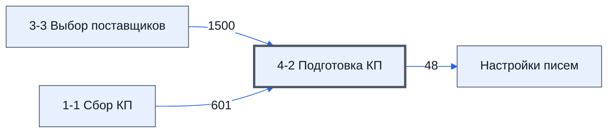

# Лист «4-2 Подготовка КП»

Таблица: таблица проекта · контур 1.

**Зачем:** сведений нет — по названию лист можно сравнить с регламентом, это позже (ответ директора, раунд 5).

Устройство листа — заголовки, вид столбцов, списки, формулы, связи с другими листами — собрано из таблицы ниже. Строка заголовков на этом листе угадана по закреплённой области — проверить.

## Зачем лист — подробно

*Заполнить:* что на листе происходит, откуда приходят данные и куда уходят.

## Как заполнять

*Заполнить:* какие столбцы вводят руками, какие считаются сами. Что значит каждый столбец — в `stolbtsy.yaml` рядом (поля `chto` и `kak`).

## Что нельзя трогать

*Заполнить.*

## Инструкции и умения

*Заполнить:* какие инструкции и умения относятся к листу.

## Осталось сделать

- Заполнить разделы выше и `stolbtsy.yaml`.

## Устройство (из таблицы)

- **Таблица:** таблица проекта, лист «4-2 Подготовка КП»; контур 1
- **Размер:** `A1:AW310`, закреплено до `A3`
- **Каркас:** свой, не общий; строка заголовков — 2, угадана по закреплённой области — проверить
- **Формул:** 11425; заполненных ячеек без формул в данных: 1206; списков: 1; условного форматирования: 10; объединённых ячеек: 8

## Связи с другими листами

- **Берёт данные с листов:** [3-3 Выбор поставщиков](../k1-3-3-vybor-postavshchikov/index.md) (1500), [1-1 Сбор КП](../k1-1-1-sbor-kp/index.md) (601)
- **Его данные используют:** [Настройки писем](../k0-nastroyki-pisem/index.md) (48)

В скобках и на стрелках — сколько формул ссылаются.

## Столбцы

Устройство — из таблицы; «Что это» и «Как заполняют» — из `stolbtsy.yaml` (заполняем руками).

| Столбец | Заголовок | Служебное имя | Вид | Заполняется | Список | Что это | Как заполняют |
|---|---|---|---|---|---|---|---|
| A | № |  |  | формула |  |  |  |
| B | Номенклатура |  |  | формула |  |  |  |
| C | Ед. Изм |  |  | формула |  |  |  |
| D | Кол-во |  |  | формула |  |  |  |
| E | Цена |  |  | формула |  |  |  |
| F | Итого |  |  | формула |  |  |  |
| H | нмц |  |  | формула |  |  |  |
| J | № |  |  | руками? |  |  |  |
| K | Номенклатура |  |  | формула |  |  |  |
| L | Ед. Изм |  |  | руками? |  |  |  |
| M | Кол-во |  |  | руками? |  |  |  |
| N | Цена С НДС |  |  | формула |  |  |  |
| O | Сумма С НДС |  |  | формула | 'Настройки писем'!$AC$6:$AC$9 |  |  |
| P | Цена без НДС |  |  | формула |  |  |  |
| Q | Сумма без НДС |  |  | формула |  |  |  |
| S |  |  |  | формула |  |  |  |
| V | № |  |  | формула |  |  |  |
| W | Номенклатура |  |  | формула |  |  |  |
| X | Ед. Изм |  |  | руками? |  |  |  |
| Y | Кол-во |  |  | руками? |  |  |  |
| Z | Цена за единицу без НДС, руб. |  |  | формула |  |  |  |
| AA | Сумма без НДС, руб. |  |  | формула | 'Настройки писем'!$AC$6:$AC$9 |  |  |
| AB | НДС 22%, руб |  |  | формула |  |  |  |
| AC | Итого с НДС 22%, руб |  |  | формула |  |  |  |
| AE |  |  |  | формула |  |  |  |
| AH | № |  |  | формула |  |  |  |
| AI | Наименование |  |  | формула |  |  |  |
| AJ | Кол-во |  |  | формула |  |  |  |
| AK | Ед. Измер. |  |  | формула |  |  |  |
| AL | Цена |  |  | формула |  |  |  |
| AM | Сумма |  |  | формула | 'Настройки писем'!$AC$6:$AC$9 |  |  |
| AN | Цена С НДС |  |  | формула |  |  |  |
| AO | Сумма С НДС |  |  | формула |  |  |  |
| AQ |  |  |  | формула |  |  |  |
| AS |  |  |  | формула |  |  |  |
| AT | Цена |  |  | формула |  |  |  |
| AU | Сумма |  |  | формула |  |  |  |
| AV | Цена |  |  | формула |  |  |  |
| AW | Сумма |  |  | формула |  |  |  |

Формулы столбцов (34)

| Столбец | Строка | Формула |
|---|---|---|
| A | 3 | <code>='3-3 Выбор поставщиков'!$A2</code> |
| B | 3 | <code>='3-3 Выбор поставщиков'!B2</code> |
| C | 3 | <code>='3-3 Выбор поставщиков'!C2</code> |
| D | 3 | <code>='3-3 Выбор поставщиков'!D2</code> |
| E | 2 | <code>='1-1 Сбор КП'!H1</code> |
| F | 3 | <code>=E3*D3</code> |
| H | 3 | <code>='1-1 Сбор КП'!K2</code> |
| K | 3 | <code>=B3</code> |
| N | 3 | <code>=P3*1.22</code> |
| O | 3 | <code>=N3*M3</code> |
| P | 3 | <code>=ROUND(E3/1.22*(N$1+R3/100),0)</code> |
| Q | 3 | <code>=P3*M3</code> |
| S | 3 | <code>=RANDBETWEEN(-10,10)</code> |
| V | 4 | <code>=V3+1</code> |
| W | 3 | <code>=B3</code> |
| Z | 3 | <code>=ROUND(E3/1.22*(Z$1+AD3/100),0)</code> |
| AA | 3 | <code>=Z3*Y3</code> |
| AB | 3 | <code>=AA3*0.22</code> |
| AC | 3 | <code>=AB3+AA3</code> |
| AE | 3 | <code>=RANDBETWEEN(-10,10)</code> |
| AH | 3 | <code>='1-1 Сбор КП'!C2</code> |
| AI | 3 | <code>=B3</code> |
| AJ | 3 | <code>=Y3</code> |
| AK | 3 | <code>=X3</code> |
| AL | 3 | <code>=ROUND(E3/1.22*(AL$1+AP3/100),0)</code> |
| AM | 3 | <code>=AL3*AJ3</code> |
| AN | 3 | <code>=AL3*1.22</code> |
| AO | 3 | <code>=AN3*AJ3</code> |
| AQ | 3 | <code>=RANDBETWEEN(-10,10)</code> |
| AS | 3 | <code>=IF(ABS(N3-AB3)&lt;AS$1*N3,"Цены совпадают",IF(ABS(N3-AN3)&lt;AS$1*N3,"Цены совпадают",IF(ABS(AB3-AN3)&lt;AS$1*AB3,"Цены совпадают","OK")))</code> |
| AT | 3 | <code>=MIN(P3,Z3,AL3)*1.2</code> |
| AU | 3 | <code>=AT3*D3</code> |
| AV | 3 | <code>=AVERAGE(P3,Z3,AL3)*1.2</code> |
| AW | 3 | <code>=AV3*D3</code> |

