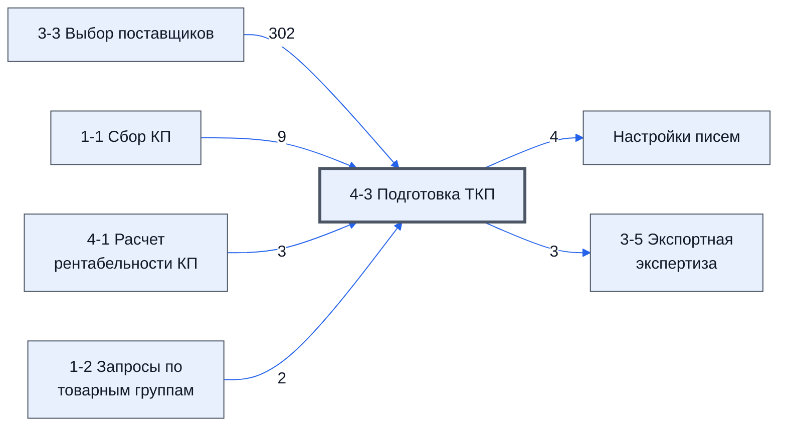

# Лист «4-3 Подготовка ТКП»

Таблица: таблица проекта · контур 1.

**Зачем** (со слов): важный: участвует в подготовке ТКП.

Устройство листа — заголовки, вид столбцов, списки, формулы, связи с другими листами — собрано из таблицы ниже. Строка заголовков на этом листе угадана по закреплённой области — проверить.

## Зачем лист — подробно

*Заполнить:* что на листе происходит, откуда приходят данные и куда уходят.

## Как заполнять

*Заполнить:* какие столбцы вводят руками, какие считаются сами. Что значит каждый столбец — в `stolbtsy.yaml` рядом (поля `chto` и `kak`).

## Что нельзя трогать

*Заполнить.*

## Инструкции и умения

*Заполнить:* какие инструкции и умения относятся к листу.

## Осталось сделать

- Заполнить разделы выше и `stolbtsy.yaml`.

## Устройство (из таблицы)

- **Таблица:** таблица проекта, лист «4-3 Подготовка ТКП»; контур 1
- **Размер:** `A1:Y320`, закреплено до `A4`
- **Каркас:** свой, не общий; строка заголовков — 3, угадана по закреплённой области — проверить
- **Формул:** 3025; заполненных ячеек без формул в данных: 16; списков: 2; условного форматирования: 7; объединённых ячеек: 2

## Связи с другими листами

- **Берёт данные с листов:** [3-3 Выбор поставщиков](../k1-3-3-vybor-postavshchikov/index.md) (302), [1-1 Сбор КП](../k1-1-1-sbor-kp/index.md) (9), [4-1 Расчет рентабельности КП](../k1-4-1-raschet-rentabelnosti-kp/index.md) (3), [1-2 Запросы по товарным группам](../k1-1-2-zaprosy-po-tovarnym-gruppam/index.md) (2)
- **Его данные используют:** [Настройки писем](../k0-nastroyki-pisem/index.md) (4), [3-5 Экспортная экспертиза](../k1-3-5-eksportnaya-ekspertiza/index.md) (3)

В скобках и на стрелках — сколько формул ссылаются.

## Кто здесь работает (по процессам)

Обязанности, у которых место работы — этот лист (из разбора регламента); должность — в карточке обязанности.

[Готовящий коммерческую часть КП](../../reg/oby/kommercheskaya-chast.md), [Готовящий техническое предложение](../../reg/oby/tp.md), [Готовящий заявку](../../reg/oby/zayavka.md)

## Столбцы

Устройство — из таблицы; «Что это» и «Как заполняют» — из `stolbtsy.yaml` (заполняем руками).

| Столбец | Заголовок | Служебное имя | Вид | Заполняется | Список | Что это | Как заполняют |
|---|---|---|---|---|---|---|---|
| A | № |  |  | формула |  |  |  |
| B | Номенклатура |  |  | формула |  |  |  |
| C | Характеристики |  |  | формула |  |  |  |
| D | Ед. Изм |  |  | формула |  |  |  |
| E | Кол-во |  |  | формула |  |  |  |
| F | НМЦ |  |  | формула |  |  |  |
| G | Нац режим 1875 |  |  | формула |  |  |  |
| H | № |  |  | формула |  |  |  |
| I | Название товара в ТП |  |  | формула | "Да,Нет" |  |  |
| J | Изгот-тель товара |  |  | руками? |  |  |  |
| K | ИНН Изгот-ля |  |  | руками? |  |  |  |
| L | Страна про-ния |  |  | руками? |  |  |  |
| M | Характеристики |  |  | формула |  |  |  |
| N | Ед. Изм |  |  | руками? |  |  |  |
| O | Кол-во |  |  | руками? |  |  |  |
| P | Цена (с НДС) |  |  | формула |  |  |  |
| Q | Сумма (с НДС) |  |  | формула |  |  |  |
| R | Цена (Без НДС) |  |  | формула |  |  |  |
| S | Сумма (Без НДС) |  |  | формула |  |  |  |
| T | Аналог |  |  | формула | 'Настройки писем'!$BF$2:$BF$8 |  |  |
| U | Комментарий, где что изменено |  |  | руками? |  |  |  |
| V | Номер реестровой записи 1875 |  |  | руками? |  |  |  |
| W | Проверка ошибок |  |  | формула |  |  |  |
| Y | Цена |  |  | руками? |  |  |  |

Формулы столбцов (16)

| Столбец | Строка | Формула |
|---|---|---|
| A | 3 | <code>=FILTER({'1-1 Сбор КП'!C1:D320,ARRAYFORMULA(IFERROR(VLOOKUP('1-1 Сбор КП'!D1:D320,{'1-2 Запросы по товарным группам'!E11:E320,'1-2 Запросы по товарным группам'!H11:H320},2,0),'1-1 Сбор КП'!E1:E320)),'1-1 Сбор КП'!F:G,'1-1 Сбор КП'!K:K,'1-1 Сбор КП'!L:L},'1,"№")</code> |
| B | 3 | <code>="COMPUTED_VALUE"</code> |
| C | 3 | <code>="COMPUTED_VALUE"</code> |
| D | 3 | <code>="COMPUTED_VALUE"</code> |
| E | 3 | <code>="COMPUTED_VALUE"</code> |
| F | 3 | <code>="COMPUTED_VALUE"</code> |
| G | 3 | <code>="COMPUTED_VALUE"</code> |
| H | 3 | <code>=A3</code> |
| I | 4 | <code>='3-3 Выбор поставщиков'!T2</code> |
| M | 3 | <code>=C3</code> |
| P | 4 | <code>=IF(LEN(I4)&gt;0,R4*1.22,)</code> |
| Q | 4 | <code>=IF(LEN(I4)&gt;0,P4*O4,)</code> |
| R | 4 | <code>=IF(LEN(I4)&gt;0,ROUNDDOWN(Y4/O4*Y$1/1.22,1),)</code> |
| S | 4 | <code>=IF(LEN(I4)&gt;0,O4*R4,)</code> |
| T | 306 | <code>=IF(ROUND(Q304-S306,2)=0,"ok","Копейки не сходятся на "&amp;ROUND(Q304-S306,2)*100&amp;" коп")</code> |
| W | 3 | <code>={"Проверка ошибок";IFS(LEN(I4:I320)&gt;0,IFS(LEN(T4:T320)=0,"Не выбрано значение в столбце Аналог",1=1,),P4:P320=0,,F4:F320=0,"НМЦ не задано",P4:P320&gt;F4:F320,"Ошибка Цена выше НМЦ",1=1,)}</code> |

