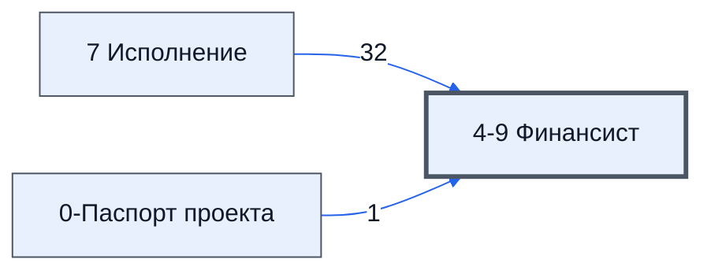

# Лист «4-9 Финансист»

Таблица: таблица проекта · контур 1.

**Зачем** (со слов): отчёт для финансиста; не используется.

Устройство листа — заголовки, вид столбцов, списки, формулы, связи с другими листами — собрано из таблицы ниже. Строка заголовков на этом листе угадана по закреплённой области — проверить.

## Зачем лист — подробно

*Заполнить:* что на листе происходит, откуда приходят данные и куда уходят.

## Как заполнять

*Заполнить:* какие столбцы вводят руками, какие считаются сами. Что значит каждый столбец — в `stolbtsy.yaml` рядом (поля `chto` и `kak`).

## Что нельзя трогать

*Заполнить.*

## Инструкции и умения

*Заполнить:* какие инструкции и умения относятся к листу.

## Осталось сделать

- Заполнить разделы выше и `stolbtsy.yaml`.

## Устройство (из таблицы)

- **Таблица:** таблица проекта, лист «4-9 Финансист»; контур 1
- **Размер:** `A1:Z20`, закреплено до `A2`
- **Каркас:** свой, не общий; строка заголовков — 1, угадана по закреплённой области — проверить
- **Формул:** 85; заполненных ячеек без формул в данных: 0; списков: 0; условного форматирования: 0; объединённых ячеек: 0

## Связи с другими листами

- **Берёт данные с листов:** [7 Исполнение](../k3-7-ispolnenie/index.md) (32), [0-Паспорт проекта](../k0-0-pasport-proekta/index.md) (1)

В скобках и на стрелках — сколько формул ссылаются.

## Столбцы

Устройство — из таблицы; «Что это» и «Как заполняют» — из `stolbtsy.yaml` (заполняем руками).

| Столбец | Заголовок | Служебное имя | Вид | Заполняется | Список | Что это | Как заполняют |
|---|---|---|---|---|---|---|---|
| A | Статья |  |  | формула |  |  |  |
| B | Проект |  |  | формула |  |  |  |
| C | Отчет |  |  | формула |  |  |  |
| D | Организация |  |  | формула |  |  |  |
| E | #N/A |  |  | формула |  |  |  |

Формулы столбцов (5)

| Столбец | Строка | Формула |
|---|---|---|
| A | 1 | <code>="Статья"</code> |
| B | 1 | <code>="Проект"</code> |
| C | 1 | <code>="Отчет"</code> |
| D | 1 | <code>="Организация"</code> |
| E | 1 | <code>=LAMBDA(doMakeList,theList,doMakeList( DATE(2025,1,1) ,EOMONTH(MAX(theList,DATE(2025,1,1)),1)))( LAMBDA(tneMin,theMax , TRANSPOSE( UNIQUE( BYROW(MAKEARRAY(theMax-tneMin+1,1,LAMBDA(r,c,tneMin + r-1)),LAMBDA(td,EOMONTH(td,0)) )))), sort(Unique( FILTER( 'S,"#N/A")</code> |

