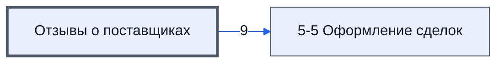

# Лист «Отзывы о поставщиках»

Таблица: таблица проекта · контур 1.

**Зачем** (со слов): отражение таблицы проверки контрагентов (ответ директора, раунд 2).

Устройство листа — заголовки, вид столбцов, списки, формулы, связи с другими листами — собрано из таблицы ниже. Строка заголовков на этом листе угадана по закреплённой области — проверить.

## Зачем лист — подробно

*Заполнить:* что на листе происходит, откуда приходят данные и куда уходят.

## Как заполнять

*Заполнить:* какие столбцы вводят руками, какие считаются сами. Что значит каждый столбец — в `stolbtsy.yaml` рядом (поля `chto` и `kak`).

## Что нельзя трогать

*Заполнить.*

## Инструкции и умения

*Заполнить:* какие инструкции и умения относятся к листу.

## Осталось сделать

- Заполнить разделы выше и `stolbtsy.yaml`.

## Устройство (из таблицы)

- **Таблица:** таблица проекта, лист «Отзывы о поставщиках»; контур 1
- **Размер:** `A1:AO1000`, закреплено до `C2`
- **Каркас:** свой, не общий; строка заголовков — 1, угадана по закреплённой области — проверить
- **Формул:** 0; заполненных ячеек без формул в данных: 8246; списков: 0; условного форматирования: 23; объединённых ячеек: 0

## Связи с другими листами

- **Его данные используют:** [5-5 Оформление сделок](../k2-5-5-sdelki/index.md) (9)

В скобках и на стрелках — сколько формул ссылаются.

## Кто здесь работает (по процессам)

Обязанности, у которых место работы — этот лист (из разбора регламента); должность — в карточке обязанности.

[Проверяющий контрагента](../../reg/oby/proverka-kontragenta.md)

## Столбцы

Устройство — из таблицы; «Что это» и «Как заполняют» — из `stolbtsy.yaml` (заполняем руками).

| Столбец | Заголовок | Служебное имя | Вид | Заполняется | Список | Что это | Как заполняют |
|---|---|---|---|---|---|---|---|
| A | № |  |  | руками? |  |  |  |
| B | E-mail |  |  | руками? |  |  |  |
| C | Итоговая оценка |  |  | руками? |  |  |  |
| D | Объединенный итог |  |  | руками? |  |  |  |
| E | Комментарий |  |  | руками? |  |  |  |
| F | Завершенных сделок |  |  | руками? |  |  |  |
| G | Кинул в сделках |  |  | руками? |  |  |  |
| H | Сделок в работе |  |  | руками? |  |  |  |
| I | Наша оценка |  |  | руками? |  |  |  |
| O | Название компании |  |  | руками? |  |  |  |
| P | ИНН |  |  | руками? |  |  |  |
| Q | Дата регистрации |  |  | руками? |  |  |  |
| R | Уставный капитал |  |  | руками? |  |  |  |
| S | Число сотрудников |  |  | руками? |  |  |  |
| T | УСН |  |  | руками? |  |  |  |
| U | Доходы |  |  | руками? |  |  |  |
| V | Прибыль |  |  | руками? |  |  |  |
| W | Налоги |  |  | руками? |  |  |  |
| X | Взносы |  |  | руками? |  |  |  |
| Y | Недоимки |  |  | руками? |  |  |  |
| Z | Связи |  |  | руками? |  |  |  |
| AA | Госзакупки |  |  | руками? |  |  |  |
| AB | Судебные дела |  |  | руками? |  |  |  |
| AC | Ответчик |  |  | руками? |  |  |  |
| AD | Проверки |  |  | руками? |  |  |  |
| AE | Нарушения |  |  | руками? |  |  |  |
| AF | Долги |  |  | руками? |  |  |  |
| AG | Сумма долгов |  |  | руками? |  |  |  |
| AH | Остаток долгов |  |  | руками? |  |  |  |
| AI | Филиалы |  |  | руками? |  |  |  |
| AJ | Лицензии |  |  | руками? |  |  |  |
