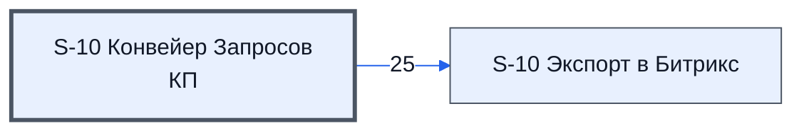

# Лист «S-10 Конвейер Запросов КП»

Таблица: таблица проекта · контур 1.

**Зачем** (со слов): следит за письмами, запоминает дату обнаружения и «температуру».

Устройство листа — заголовки, вид столбцов, списки, формулы, связи с другими листами — собрано из таблицы ниже.

## Зачем лист — подробно

*Заполнить:* что на листе происходит, откуда приходят данные и куда уходят.

## Как заполнять

*Заполнить:* какие столбцы вводят руками, какие считаются сами. Что значит каждый столбец — в `stolbtsy.yaml` рядом (поля `chto` и `kak`).

## Что нельзя трогать

*Заполнить.*

## Инструкции и умения

*Заполнить:* какие инструкции и умения относятся к листу.

## Осталось сделать

- Заполнить разделы выше и `stolbtsy.yaml`.

## Устройство (из таблицы)

- **Таблица:** таблица проекта, лист «S-10 Конвейер Запросов КП»; контур 1
- **Размер:** `A1:J10`, закреплено до `A11`
- **Каркас:** общий — служебные строки, заголовки в строке 10 ([что значат служебные строки](../../zna/lis-sluzhebnye-stroki/index.md))
- **Формул:** 0; заполненных ячеек без формул в данных: 0; списков: 0; условного форматирования: 0; объединённых ячеек: 0

## Связи с другими листами

- **Его данные используют:** [S-10 Экспорт в Битрикс](../k0-s-10-eksport-v-bitriks/index.md) (25)

В скобках и на стрелках — сколько формул ссылаются.

## Столбцы

Устройство — из таблицы; «Что это» и «Как заполняют» — из `stolbtsy.yaml` (заполняем руками).

| Столбец | Заголовок | Служебное имя | Вид | Заполняется | Список | Что это | Как заполняют |
|---|---|---|---|---|---|---|---|
| A *(скрыт)* |  | err1 |  | руками? |  |  |  |
| B *(скрыт)* |  | err2 |  | руками? |  |  |  |
| C | Емайл |  | formulaColl | формула |  |  |  |
| D | Обнаружен | Обнаружен |  | руками? |  |  |  |
| E | Одобрен | Одобрен |  | руками? |  |  |  |
| F | Отправлять | Отправлять |  | руками? |  |  |  |
| G | Отпрвален | Отпрвален |  | руками? |  |  |  |

## Переменные листа

Строки 5–6 каркаса (`var_name`, `var_value`): имя переменной и её значения — скорее всего, списки для скриптов и выпадающих списков.

| Ячейка | Имя | Значения |
|---|---|---|
| D | Дата согласования запросов |  |
