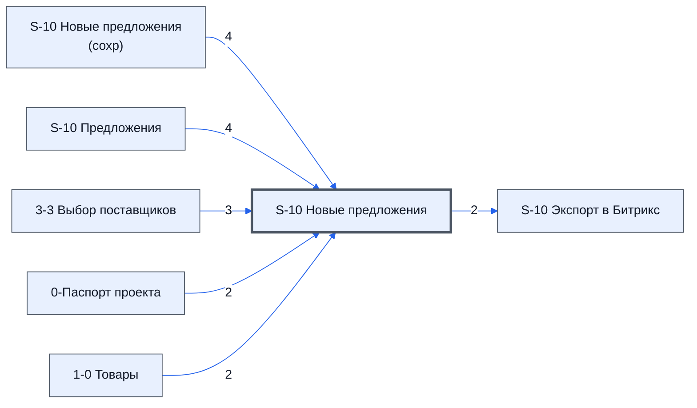

# Лист «S-10 Новые предложения»

Таблица: таблица проекта · контур 1.

**Зачем** (со слов директора): следит за новыми предложениями: если цена заметно ниже, чем на листе 3-3, эксперт получает предупреждение.

Устройство листа — заголовки, вид столбцов, списки, формулы, связи с другими листами — собрано из таблицы ниже.

## Зачем лист — подробно

*Заполнить:* что на листе происходит, откуда приходят данные и куда уходят.

## Как заполнять

*Заполнить:* какие столбцы вводят руками, какие считаются сами. Что значит каждый столбец — в `stolbtsy.yaml` рядом (поля `chto` и `kak`).

## Что нельзя трогать

*Заполнить.*

## Инструкции и умения

*Заполнить:* какие инструкции и умения относятся к листу.

## Осталось сделать

- Заполнить разделы выше и `stolbtsy.yaml`.

## Устройство (из таблицы)

- **Таблица:** таблица проекта, лист «S-10 Новые предложения»; контур 1
- **Размер:** `A1:AO1000`
- **Каркас:** общий — служебные строки, заголовки в строке 10 ([что значат служебные строки](../../zna/lis-sluzhebnye-stroki/index.md))
- **Формул:** 90; заполненных ячеек без формул в данных: 602; списков: 0; условного форматирования: 0; объединённых ячеек: 0

## Связи с другими листами

- **Берёт данные с листов:** [S-10 Новые предложения (сохр)](../k1-s-10-novye-predlozheniya-sokhr/index.md) (4), [S-10 Предложения](../k2-s-10-predlozheniya/index.md) (4), [3-3 Выбор поставщиков](../k1-3-3-vybor-postavshchikov/index.md) (3), [0-Паспорт проекта](../k0-0-pasport-proekta/index.md) (2), [1-0 Товары](../k1-1-0-tovary/index.md) (2)
- **Его данные используют:** [S-10 Экспорт в Битрикс](../k0-s-10-eksport-v-bitriks/index.md) (2)

В скобках и на стрелках — сколько формул ссылаются.

## Столбцы

Устройство — из таблицы; «Что это» и «Как заполняют» — из `stolbtsy.yaml` (заполняем руками).

| Столбец | Заголовок | Служебное имя | Вид | Заполняется | Список | Что это | Как заполняют |
|---|---|---|---|---|---|---|---|
| C | Таблица |  | formulaColl | формула |  |  |  |
| D | Лист^Предложение^Товар | Лист_Предложение_Товар |  | формула |  |  |  |
| E | Лист | Лист |  | формула |  |  |  |
| F | Предложение | Предложение |  | руками? |  |  |  |
| G | Постовшик | Постовшик |  | руками? |  |  |  |
| H | Товар | Товар |  | руками? |  |  |  |
| I | Цена | Цена |  | руками? |  |  |  |
| J |  | столбец_10 |  | руками? |  |  |  |
| K | Лист^Предложение^Товар | столбец_11 |  | формула |  |  |  |
| L | Лист | столбец_12 |  | формула |  |  |  |
| M | Предложение | столбец_13 |  | руками? |  |  |  |
| N | Постовшик | столбец_14 |  | руками? |  |  |  |
| O | Товар | столбец_15 |  | руками? |  |  |  |
| P | Цена | столбец_16 |  | руками? |  |  |  |
| Q |  | столбец_17 |  | руками? |  |  |  |
| R | Лист^Предложение^Товар | столбец_18 |  | формула |  |  |  |
| S | Лист | столбец_19 |  | формула |  |  |  |
| T | Предложение | столбец_20 |  | руками? |  |  |  |
| U | Постовшик | столбец_21 |  | руками? |  |  |  |
| V | Товар | столбец_22 |  | руками? |  |  |  |
| W | Цена | столбец_23 |  | руками? |  |  |  |
| X |  | столбец_24 |  | руками? |  |  |  |
| Y | Лист^Предложение^Товар | столбец_25 |  | формула |  |  |  |
| Z | Лист | столбец_26 |  | формула |  |  |  |
| AA | Предложение | столбец_27 |  | руками? |  |  |  |
| AB | Постовшик | столбец_28 |  | руками? |  |  |  |
| AC | Товар | столбец_29 |  | руками? |  |  |  |
| AD | Цена | столбец_30 |  | руками? |  |  |  |
| AE |  | столбец_31 |  | руками? |  |  |  |
| AF | № | столбец_32 |  | формула |  |  |  |
| AG | Поставщик | столбец_33 |  | формула |  |  |  |
| AH | Товар | столбец_34 |  | формула |  |  |  |
| AI | Цена | столбец_35 |  | формула |  |  |  |
| AJ |  | столбец_36 |  | руками? |  |  |  |
| AK |  | столбец_37 |  | руками? |  |  |  |
| AL | Новые предложения | столбец_38 |  | формула |  |  |  |

## Переменные листа

Строки 5–6 каркаса (`var_name`, `var_value`): имя переменной и её значения — скорее всего, списки для скриптов и выпадающих списков.

| Ячейка | Имя | Значения |
|---|---|---|
| D | ВписанНаЛисте | 1-1 Сбор КП |
| E |  | And ( Col2='1-1 Сбор КП' ) |
| F | ДатаЗавершенияЭкспертизы |  |
| G | Есть изменения |  |
| H | Добавлено новое предложение | 0 |
| I | изменения в топ 1 | 0 |
| J | изменения в топ 3 | 0 |
| K | изменения в топ 7 | 0 |
| L | изменения в топ 14 | 0 |
| M | ДатаСохранения |  |

Формулы столбцов (14)

| Столбец | Строка | Формула |
|---|---|---|
| C | 10 | <code>="Таблица"</code> |
| D | 10 | <code>={"Лист^Предложение^Товар";LAMBDA( doFilterProducts, doForEachProducts, doGetProductOffers,doSplitByLines, theProducts, theOffers, theNumTop, theWhereAnd, doSplitByLines(doForEachProducts(doFilterProducts (theProducts),theNumTop,theWhereAnd,theOffers,doG,"Лист^Предложение^Товар")</code> |
| E | 10 | <code>={$E$2:$I$2;LAMBDA( doComplereOffer, doTreatOffers, theOffersKey, theOffers, doComplereOffer(theOffersKey,doTreatOffers(theOffers))) ( LAMBDA(theOffersKey,theOffers, IFERROR( VLOOKUP(theOffersKey,theOffers,{2,3,4,5,6},FALSE),) ), LAMBDA(theOffers,theOffers), 'S-10 Новые предложения'!$D$11:$D1000, 'S-10 Предложения'!$D11:$K1000 )}</code> |
| K | 10 | <code>={"Лист^Предложение^Товар";LAMBDA( doFilterProducts, doForEachProducts, doGetProductOffers,doSplitByLines, theProducts, theOffers, theNumTop, theWhereAnd, doSplitByLines(doForEachProducts(doFilterProducts (theProducts),theNumTop,theWhereAnd,theOffers,doG,"Лист^Предложение^Товар")</code> |
| L | 10 | <code>={$E$2:$I$2;LAMBDA( doComplereOffer, doTreatOffers, theOffersKey, theOffers, doComplereOffer(theOffersKey,doTreatOffers(theOffers))) ( LAMBDA(theOffersKey,theOffers, IFERROR( VLOOKUP(theOffersKey,theOffers,{2,3,4,5,6},FALSE),) ), LAMBDA(theOffers,theOffers), 'S-10 Новые предложения'!$K$11:$K1000, 'S-10 Предложения'!$D11:$K1000 )}</code> |
| R | 10 | <code>={"Лист^Предложение^Товар";LAMBDA( doFilterProducts, doForEachProducts, doGetProductOffers,doSplitByLines, theProducts, theOffers, theNumTop, theWhereAnd, doSplitByLines(doForEachProducts(doFilterProducts (theProducts),theNumTop,theWhereAnd,theOffers,doG,"Лист^Предложение^Товар")</code> |
| S | 10 | <code>={$E$2:$I$2;LAMBDA( doComplereOffer, doTreatOffers, theOffersKey, theOffers, doComplereOffer(theOffersKey,doTreatOffers(theOffers))) ( LAMBDA(theOffersKey,theOffers, IFERROR( VLOOKUP(theOffersKey,theOffers,{2,3,4,5,6},FALSE),) ), LAMBDA(theOffers,theOffers), 'S-10 Новые предложения'!$R$11:$R1000, 'S-10 Предложения'!$D11:$K1000 )}</code> |
| Y | 10 | <code>={"Лист^Предложение^Товар";LAMBDA( doFilterProducts, doForEachProducts, doGetProductOffers,doSplitByLines, theProducts, theOffers, theNumTop, theWhereAnd, doSplitByLines(doForEachProducts(doFilterProducts (theProducts),theNumTop,theWhereAnd,theOffers,doG,"Лист^Предложение^Товар")</code> |
| Z | 10 | <code>={$E$2:$I$2;LAMBDA( doComplereOffer, doTreatOffers, theOffersKey, theOffers, doComplereOffer(theOffersKey,doTreatOffers(theOffers))) ( LAMBDA(theOffersKey,theOffers, IFERROR( VLOOKUP(theOffersKey,theOffers,{2,3,4,5,6},FALSE),) ), LAMBDA(theOffers,theOffers), 'S-10 Новые предложения'!$Y$11:$Y1000, 'S-10 Предложения'!$D11:$K1000 )}</code> |
| AF | 10 | <code>='3-3 Выбор поставщиков'!A1:A1000</code> |
| AG | 10 | <code>='3-3 Выбор поставщиков'!K1:K1000</code> |
| AH | 10 | <code>={"Товар";lambda(_ns,_ds, byrow(_ns,LAMBDA(n,IFERROR(VLOOKUP(n,_ds,2,FALSE),))) )(AF11:AF1000,{'1-0 Товары'!$D$1:$D1000,'1-0 Товары'!$C$1:$C1000})}</code> |
| AI | 10 | <code>='3-3 Выбор поставщиков'!E1:E1000</code> |
| AL | 10 | <code>= {"Новые предложения" ;LET( _do_join, LAMBDA(_vals, TEXTJOIN(CHAR(10), TRUE, BYROW( _vals,lambda(_v_r,TEXTJOIN(" - ",FALSE,_v_r))))), _do_map_get, LAMBDA(_map, _key, IFERROR(VLOOKUP(_key, _map, 2, FALSE), "")), _do_dif, LAMBDA(_new, _save, ,"Новые предложения")</code> |

