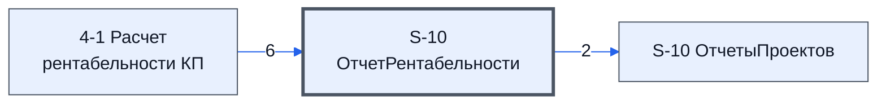

# Лист «S-10 ОтчетРентабельности»

Таблица: таблица проекта · контур 1.

**Зачем** (со слов директора): *не записано*.

Устройство листа — заголовки, вид столбцов, списки, формулы, связи с другими листами — собрано из таблицы ниже. Строка заголовков на этом листе угадана по закреплённой области — проверить.

## Зачем лист — подробно

*Заполнить:* что на листе происходит, откуда приходят данные и куда уходят.

## Как заполнять

*Заполнить:* какие столбцы вводят руками, какие считаются сами. Что значит каждый столбец — в `stolbtsy.yaml` рядом (поля `chto` и `kak`).

## Что нельзя трогать

*Заполнить.*

## Инструкции и умения

*Заполнить:* какие инструкции и умения относятся к листу.

## Осталось сделать

- Заполнить разделы выше и `stolbtsy.yaml`.

## Устройство (из таблицы)

- **Таблица:** таблица проекта, лист «S-10 ОтчетРентабельности»; контур 1
- **Размер:** `A1:J60`, закреплено до `A11`
- **Каркас:** свой, не общий; строка заголовков — 10, угадана по закреплённой области — проверить
- **Формул:** 74; заполненных ячеек без формул в данных: 60; списков: 0; условного форматирования: 0; объединённых ячеек: 0

## Связи с другими листами

- **Берёт данные с листов:** [4-1 Расчет рентабельности КП](../k1-4-1-raschet-rentabelnosti-kp/index.md) (6)
- **Его данные используют:** [S-10 ОтчетыПроектов](../k0-s-10-otchetyproektov/index.md) (2)

В скобках и на стрелках — сколько формул ссылаются.

## Столбцы

Устройство — из таблицы; «Что это» и «Как заполняют» — из `stolbtsy.yaml` (заполняем руками).

| Столбец | Заголовок | Служебное имя | Вид | Заполняется | Список | Что это | Как заполняют |
|---|---|---|---|---|---|---|---|
| A | № |  |  | формула |  |  |  |
| B | Название |  |  | руками? |  |  |  |
| C | Значение |  |  | формула |  |  |  |
| E | Столбец Поиска |  |  | формула |  |  |  |
| F | Столбец Значения |  |  | формула |  |  |  |

Формулы столбцов (4)

| Столбец | Строка | Формула |
|---|---|---|
| A | 11 | <code>=row(A11)-10</code> |
| C | 10 | <code>={"Значение" ;Let( dha_data_mtx, '4-1 Расчет рентабельности КП'!A1:BM60, dha_name_ar,B11:B60, dha_strategi_ar,D11:D60, dha_col_name_ar,E11:E60, dha_col_val_ar,F11:F60, do_check ,Lambda(v, v&lt;&gt;""), is_ar_mtx, { Map( dha_name_ar ,do_check) , Map( dha_strategi_ar ,do_check) , Map( dha_col_name_ar ,do_check) , Map( dha_col_val_ar ,do_check) }, is_ar, ByRow(is_ar_mtx , Lambda( r, AND(r) ) ), do_strategi …</code> |
| E | 11 | <code>=$E$3</code> |
| F | 11 | <code>=E11+1</code> |

