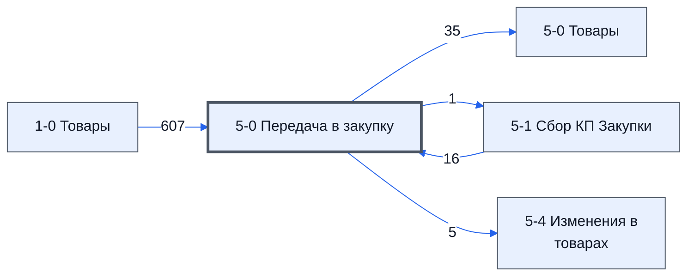

> Черновик: текст не проверен.

# Лист «5-0 Передача в закупку»

**Назначение**

Лист — **зеркало договора поставки с заказчиком**: перечень товаров в том виде, как он записан в договоре и спецификации. Под этот договор формируется всё исполнение. Договоры с поставщиками, у которых товары закупаем мы, — на листе **[5-5 Оформление сделок](../../lis/k2-5-5-sdelki/index.md)**. Это отправная точка для исполнения — как приказ от менеджера проекта.

**Кто работает:** [Менеджер проекта](../../reg/rol/proekt.md) — проверяет, что товары заполнены в соответствии с договором и спецификацией, и фиксирует лист. [Закупщик (специалист по закупке)](../../reg/rol/zakupka.md) этот лист не трогает: изменения он планирует на листе **[5-4 Изменения в товарах](../../lis/k2-5-4-izmeneniya/index.md)**, а подтверждает на листе **[5-3 Выбор поставщиков Закупки](../../lis/k2-5-3-vybor-postavshchikov/index.md)**.

Устройство листа — размер, столбцы, формулы, связи с другими листами — собрано из таблицы в конце страницы.

## Как заполняется

- Лист предзаполняется сам: данные приходят с листа **1-1 Сбор КП** через лист **1-0 Товары**.
- Менеджер проекта проверяет товары и **фиксирует значения**: вставкой только значений (Ctrl + Shift + V) либо через меню `Доп.Меню` → `5-0 Передача в закупку` → `Передать в закупку`.
- **После фиксации лист не изменяется** — он должен оставаться таким, как в договоре.
- `ID_Товара`, `№` и `Номенклатура` у каждого товара должны быть уникальными. Если товары называются одинаково — добавьте в скобках или иначе отличительный признак.

###### **Внешний вид / Фото**

**Текст на фото:**

* Доп.Меню
* 5-0 Передача в закупку
* Передать в закупку

## Полный перечень столбцов

РазличиеМужду, ID_Товара, №, Номенклатура, Название товара по договору, Изготовитель товара по договору, Характеристики, Состав поставляемой с продукцией технической документации, Ед. Изм, Кол-во, НМЦ, Срок поставки по договору, Нац режим 1875, Код ОКПД 2.

## Столбец B «РазличиеМужду»

Показывает, в каких полях товар на этом листе отличается от листа **[5-1 Сбор КП Закупки](../../lis/k2-5-1-sbor-kp/index.md)**; отличающиеся ячейки подсвечиваются условным форматированием.

## Осталось сделать

- Подписать снимки

## Устройство (из таблицы)

- **Таблица:** таблица проекта, лист «5-0 Передача в закупку»; контур 2
- **Размер:** `A1:Z319`, закреплено до `A11`
- **Каркас:** общий — служебные строки, заголовки в строке 10 ([что значат служебные строки](../../zna/lis-sluzhebnye-stroki/index.md))
- **Формул:** 623; заполненных ячеек без формул в данных: 54; списков: 0; условного форматирования: 1; объединённых ячеек: 0

## Связи с другими листами

- **Берёт данные с листов:** [1-0 Товары](../k1-1-0-tovary/index.md) (607), [5-1 Сбор КП Закупки](../k2-5-1-sbor-kp/index.md) (16)
- **Его данные используют:** [5-0 Товары](../k2-5-0-tovary/index.md) (35), [5-1 Сбор КП Закупки](../k2-5-1-sbor-kp/index.md) (1), [5-4 Изменения в товарах](../k2-5-4-izmeneniya/index.md) (5)

В скобках и на стрелках — сколько формул ссылаются.

## Кто здесь работает (по процессам)

Обязанности, у которых место работы — этот лист (из разбора регламента); должность — в карточке обязанности.

[Фиксирующий задание на закупку (лист 5-0)](../../reg/oby/list-5-0.md), [Проверяющий комплектность передачи в закупку](../../reg/oby/proverka-komplektnosti.md)

## Столбцы

Устройство — из таблицы; «Что это» и «Как заполняют» — из `stolbtsy.yaml` (заполняем руками).

| Столбец | Заголовок | Служебное имя | Вид | Заполняется | Список | Что это | Как заполняют |
|---|---|---|---|---|---|---|---|
| A *(скрыт)* |  | err | formulaColl | формула |  | причина исключения товара — её показывает лист 5-0 Товары, столбец B (догадка: заголовка нет) |  |
| B *(скрыт)* | РазличиеМужду | РазличиеМужду | formulaColl | формула |  | в каких полях (F–I) товар отличается от листа 5-1; отличающиеся ячейки подсвечиваются | формула: показывает столбец Y листа 5-1, где идёт сравнение |
| C | ID_Товара |  | formulaCell | формула |  | ID_Товара — ключ товара | предзаполняется формулой; менеджер проекта сверяет с договором и фиксирует значения (Доп.Меню → 5-0 Передача в закупку → Передать в закупку); формула заголовка — с листа 1-0 Товары |
| D | № | Номер | formulaCell | формула |  | № позиции, как в договоре; у каждого товара свой | предзаполняется формулой; менеджер проекта сверяет с договором и фиксирует значения (Доп.Меню → 5-0 Передача в закупку → Передать в закупку) |
| E | Номенклатура | Номенклатура | formulaCell | формула |  | название товара; должно быть уникальным — одинаковые отличают припиской в скобках | предзаполняется формулой; менеджер проекта сверяет с договором и фиксирует значения (Доп.Меню → 5-0 Передача в закупку → Передать в закупку) |
| F | Название товара по договору | НазваниеТовараПоДоговору |  | формула |  | название товара точно как в договоре с заказчиком | предзаполняется формулой; менеджер проекта сверяет с договором и фиксирует значения (Доп.Меню → 5-0 Передача в закупку → Передать в закупку) |
| G | Изготовитель товара по договору | ИзготовительТовараПоДоговору |  | формула |  | изготовитель, если договор его требует | предзаполняется формулой; менеджер проекта сверяет с договором и фиксирует значения (Доп.Меню → 5-0 Передача в закупку → Передать в закупку) |
| H | Характеристики | Характеристики | formulaCell | формула |  | характеристики, как в спецификации договора | предзаполняется формулой; менеджер проекта сверяет с договором и фиксирует значения (Доп.Меню → 5-0 Передача в закупку → Передать в закупку) |
| I | Состав поставляемой с продукцией технической документации | СоставТехническойДокументации |  | формула |  | какие документы должны идти с товаром (паспорта, сертификаты, инструкции) — по договору и ТЗ | предзаполняется формулой; менеджер проекта сверяет с договором и фиксирует значения (Доп.Меню → 5-0 Передача в закупку → Передать в закупку) |
| J | Ед. Изм |  |  | формула |  | единица измерения | предзаполняется формулой; менеджер проекта сверяет с договором и фиксирует значения (Доп.Меню → 5-0 Передача в закупку → Передать в закупку); формула заголовка — с листа 1-0 Товары |
| K | Кол-во |  |  | формула |  | количество по договору | предзаполняется формулой; менеджер проекта сверяет с договором и фиксирует значения (Доп.Меню → 5-0 Передача в закупку → Передать в закупку) |
| L | НМЦ |  |  | формула |  | НМЦ за единицу | предзаполняется формулой; менеджер проекта сверяет с договором и фиксирует значения (Доп.Меню → 5-0 Передача в закупку → Передать в закупку) |
| M | Срок поставки по договору |  |  | формула |  | срок поставки по договору | предзаполняется формулой; менеджер проекта сверяет с договором и фиксирует значения (Доп.Меню → 5-0 Передача в закупку → Передать в закупку) |
| N | Нац режим 1875 |  |  | формула |  | национальный режим по постановлению № 1875 (догадка по названию) | предзаполняется формулой; менеджер проекта сверяет с договором и фиксирует значения (Доп.Меню → 5-0 Передача в закупку → Передать в закупку) |
| O | Код ОКПД 2 |  |  | формула |  | код ОКПД 2 | предзаполняется формулой; менеджер проекта сверяет с договором и фиксирует значения (Доп.Меню → 5-0 Передача в закупку → Передать в закупку) |

Формулы столбцов (14)

| Столбец | Строка | Формула |
|---|---|---|
| B | 10 | <code>='5-1 Сбор КП Закупки'!$Y$10:$Y$310</code> |
| C | 10 | <code>='1-0 Товары'!C10</code> |
| D | 10 | <code>='5-1 Сбор КП Закупки'!D10</code> |
| E | 10 | <code>='5-1 Сбор КП Закупки'!E10</code> |
| F | 10 | <code>='5-1 Сбор КП Закупки'!F10</code> |
| G | 10 | <code>='5-1 Сбор КП Закупки'!G10</code> |
| H | 10 | <code>='5-1 Сбор КП Закупки'!H10</code> |
| I | 10 | <code>='5-1 Сбор КП Закупки'!I10</code> |
| J | 10 | <code>='1-0 Товары'!G$10</code> |
| K | 10 | <code>='1-0 Товары'!H$10</code> |
| L | 10 | <code>='1-0 Товары'!I$10</code> |
| M | 10 | <code>='1-0 Товары'!N$10</code> |
| N | 10 | <code>='1-0 Товары'!O$10</code> |
| O | 10 | <code>='1-0 Товары'!P$10</code> |

