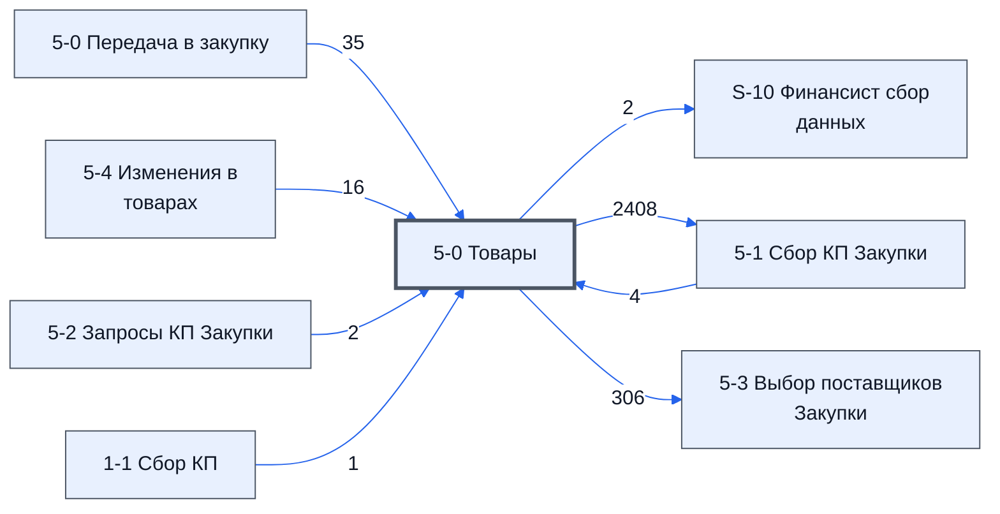

> Черновик: текст не проверен.

# Лист «5-0 Товары»

**Назначение**

**Автоматический** лист: собирает данные для работы всего контура закупки. Аналог листа **1-0 Товары** для контура 2.

Берёт товары с листа **[5-0 Передача в закупку](../../lis/k2-5-0-peredacha/index.md)** (основной источник) и поправки с листа **[5-4 Изменения в товарах](../../lis/k2-5-4-izmeneniya/index.md)**. Отсюда данные расходятся по остальным листам контура.

**Кто работает:** никто — лист полностью автоматический.

Устройство листа — размер, столбцы, формулы, связи с другими листами — собрано из таблицы в конце страницы.

## Что нельзя трогать

**ВНИМАНИЕ** на этом листе завязана вся логика других листов. Руками ничего не менять. Если нужен новый столбец — добавлять только справа.

## Полный перечень столбцов

Со слов директора: Исключить по причине, ID_Товара, №, Номенклатура, Характеристики, Ед. Изм, Кол-во, НМЦ, Название товара по договору, Изготовитель товара по договору, Группа, Группа, Срок поставки по договору, Нац режим 1875, Код ОКПД 2.

## Осталось сделать

- Два столбца «Группа» — чем они отличаются (в служебных именах `Группа_1_2` и `Группа_5_2`)?

## Устройство (из таблицы)

- **Таблица:** таблица проекта, лист «5-0 Товары»; контур 2
- **Аналог в другом контуре:** [1-0 Товары](../k1-1-0-tovary/index.md)
- **Размер:** `A1:Z310`, закреплено до `A11`
- **Каркас:** общий — служебные строки, заголовки в строке 10 ([что значат служебные строки](../../zna/lis-sluzhebnye-stroki/index.md))
- **Формул:** 9; заполненных ячеек без формул в данных: 629; списков: 0; условного форматирования: 0; объединённых ячеек: 0

## Связи с другими листами

- **Берёт данные с листов:** [5-0 Передача в закупку](../k2-5-0-peredacha/index.md) (35), [5-4 Изменения в товарах](../k2-5-4-izmeneniya/index.md) (16), [5-1 Сбор КП Закупки](../k2-5-1-sbor-kp/index.md) (4), [5-2 Запросы КП Закупки](../k2-5-2-zaprosy-kp/index.md) (2), [1-1 Сбор КП](../k1-1-1-sbor-kp/index.md) (1)
- **Его данные используют:** [S-10 Финансист сбор данных](../k0-s-10-finansist-sbor-dannykh/index.md) (2), [5-1 Сбор КП Закупки](../k2-5-1-sbor-kp/index.md) (2408), [5-3 Выбор поставщиков Закупки](../k2-5-3-vybor-postavshchikov/index.md) (306)

В скобках и на стрелках — сколько формул ссылаются.

## Столбцы

Устройство — из таблицы; «Что это» и «Как заполняют» — из `stolbtsy.yaml` (заполняем руками).

| Столбец | Заголовок | Служебное имя | Вид | Заполняется | Список | Что это | Как заполняют |
|---|---|---|---|---|---|---|---|
| B | Исключить по причине |  |  | формула |  |  |  |
| C | ID_Товара |  | formulaColl | формула |  |  |  |
| D | № | Номер | formulaColl | формула |  |  |  |
| E | Номенклатура | Номенклатура | formulaFree | руками, потом формула |  |  |  |
| F | Характеристики | Характеристики | formulaFree | руками, потом формула |  |  |  |
| G | Ед. Изм | ЕдИзм | formulaFree | руками, потом формула |  |  |  |
| H | Кол-во | Количевство | formulaFree | руками, потом формула |  |  |  |
| I | НМЦ | НМЦ | formulaFree | руками, потом формула |  |  |  |
| J | Название товара по договору | НазваниеТовараПоДоговору | formulaColl | формула |  |  |  |
| K | Изготовитель товара по договору | ИзготовительТовараПоДоговору | formulaColl | формула |  |  |  |
| L | Группа | Группа_1_2 | formulaColl | формула |  |  |  |
| M | Группа | Группа_5_2 | formulaColl | формула |  |  |  |
| N | Срок поставки по договору | СрокПоставкиПоДоговору | formulaColl | формула |  |  |  |
| O | Нац режим 1875 |  |  | руками? |  |  |  |
| P | Код ОКПД 2 |  |  | руками? |  |  |  |

Формулы столбцов (8)

| Столбец | Строка | Формула |
|---|---|---|
| B | 10 | <code>= { '5-4 Изменения в товарах'!$C10; Let( _do_row, LAMBDA(_id,_ds, IFERROR( VLOOKUP( _id, _ds, 2, FALSE) ,)), _ids, '5-0 Товары'!$C$11:$C310, _ids_org, '5-0 Передача в закупку'!$C$1:$C310, _ids_izm, '5-4 Изменения в товарах'!$E1:$E310 , _ds_org, '5-0 Передача в закупку'!$A$1:$A310, _ds_izm, '5-4 Изменения в товарах'!$C1:$C310 , _map_org, map(_ids_org,LAMBDA(_id,{ _id , ROW(_id)})), _map_izm, map(_i …</code> |
| C | 10 | <code>={"ID_Товара";let( _t_org, '5-0 Передача в закупку'!$C$11:$C310, _t_izm, '5-4 Изменения в товарах'!$E$11:$E$60 , _t_dop, '5-4 Изменения в товарах'!$E$62:$E310, IFERROR( Sort(UNIQUE({ _t_org; _t_izm; _t_dop })),) )}</code> |
| D | 10 | <code>= { {'5-0 Передача в закупку'!$D$10 ,'5-0 Передача в закупку'!$E$10 ,'5-0 Передача в закупку'!$H$10 ,'5-0 Передача в закупку'!$J$10 ,'5-0 Передача в закупку'!$K$10 ,'5-0 Передача в закупку'!$L$10}; Let( _do_row, LAMBDA(_id,_ds, IFERROR( VLOOKUP( _id, _ds, 2, FALSE) ,)), _ids, '5-0 Товары'!$C$11:$C310, _ids_org, '5-0 Передача в закупку'!$C$1:$C310, _ids_izm, '5-4 Изменения в товарах'!$E1:$E310 , _d …</code> |
| J | 10 | <code>=IF('5-0 Товары'!$E$10:$E310&lt;&gt;"",IFERROR(VLOOKUP('5-0 Товары'!$E$10:$E310,{'5-1 Сбор КП Закупки'!$E$10:$E310,'5-1 Сбор КП Закупки'!$F10:$F310},2,FALSE) ,),)</code> |
| K | 10 | <code>=IF('5-0 Товары'!$E$10:$E310&lt;&gt;"",IFERROR(VLOOKUP('5-0 Товары'!$E$10:$E310,{'5-1 Сбор КП Закупки'!$E$10:$E310,'5-1 Сбор КП Закупки'!$G$10:$G310},2,FALSE) ,),)</code> |
| L | 10 | <code>=BYROW({ {'1-1 Сбор КП'!O1}; {LAMBDA( doFindRow, doFilter, theWordStart, theCStart, theWordEnd, theCEnd, theDataWord, theData, doFilter(doFindRow(theDataWord,theWordStart,theCStart),doFindRow(theDataWord,theWordEnd,theCEnd),theData) )( LAMBDA(theWord,"Группа")</code> |
| M | 10 | <code>={"Группа";LAMBDA(doFind,theIds,theData, doFind(theIds,theData) )( LAMBDA(theIds,theData, BYROW(theIds,LAMBDA(ti,IF(ti&lt;&gt;"", IFERROR(VLOOKUP(ti,theData,2,0),),)))), '5-0 Товары'!C11:C310, {'5-2 Запросы КП Закупки'!C11:C310,'5-2 Запросы КП Закупки'!N11:N310} )}</code> |
| N | 10 | <code>={ {'5-0 Передача в закупку'!$M$10 ,'5-0 Передача в закупку'!$N$10 ,'5-0 Передача в закупку'!$O$10}; Let( _do_row, LAMBDA(_id,_ds, IFERROR( VLOOKUP( _id, _ds, 2, FALSE) ,)), _ids, '5-0 Товары'!$C$11:$C310, _ids_org, '5-0 Передача в закупку'!$C$1:$C310, _ids_izm, '5-4 Изменения в товарах'!$E1:$E310 , _ds_org, {'5-0 Передача в закупку'!$M$1:$M310 ,'5-0 Передача в закупку'!$N$1:$N310 ,'5-0 Передача в …</code> |

