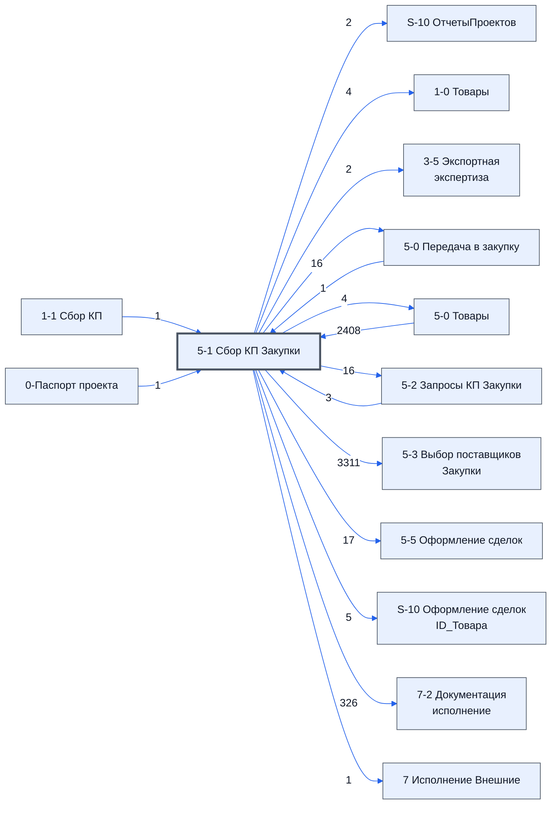

> Черновик: текст не проверен.

# Лист «5-1 Сбор КП Закупки»

**Назначение**

Здесь все товары контура, по ним собираются предложения поставщиков. Товары попадают сюда с листов **[5-0 Передача в закупку](../../lis/k2-5-0-peredacha/index.md)** и **[5-4 Изменения в товарах](../../lis/k2-5-4-izmeneniya/index.md)** через лист **[5-0 Товары](../../lis/k2-5-0-tovary/index.md)**.

*Записано коротко, чтобы закрыть инструкцию «Разделение товаров»; подробности — позже.*

Устройство листа — размер, столбцы, формулы, связи с другими листами — собрано из таблицы в конце страницы.

## Осталось сделать

**Вопросы**

найти инструкцию листа 1-1

листа аналог листа 1-1 для второго контура на нем собираются предложения от поставщиков 

лист разлелен на 3 части 1.курс валют  2.о товаре 3. о проедложениях  

о предложения
на одно предложение выделяется три столбца  1.цена 2. срок 3. модель

о товаре
3 обязательных столбца для заполнения  (надо согласовать  где они заполняются 5-0  [5-0 Передача в закупку](../../lis/k2-5-0-peredacha/index.md)или ли итам и тут )
1.Название товара по договору	
2.Изготовитель товара по договору	
3.Состав поставляемой с продукцией технической документации
другие столбци заполняются автомитический

о валюте формулой с  ={'1-1 Сбор КП'!A1:B9}  используется для диномического изменения цены
Доллар	90,00
Евро	100,00
CNY	12,50
	
откл от ср	50%
Первые мин знач	1
Мало ответов	3
Инструкция	https://docs.google.com/document/d/11e

делать паралельно с 1-1

1. Кто и как вносит предложения поставщиков?
2. Какие столбцы заполняет человек, а какие считаются сами?
3. Что на листе нельзя трогать?
4. Верен ли список столбцов выше?

## Устройство (из таблицы)

- **Таблица:** таблица проекта, лист «5-1 Сбор КП Закупки»; контур 2
- **Аналог в другом контуре:** [1-1 Сбор КП](../k1-1-1-sbor-kp/index.md)
- **Размер:** `A1:CZ319`, закреплено до `J11`
- **Каркас:** общий — служебные строки, заголовки в строке 10 ([что значат служебные строки](../../zna/lis-sluzhebnye-stroki/index.md))
- **Формул:** 3407; заполненных ячеек без формул в данных: 398; списков: 1; условного форматирования: 14; объединённых ячеек: 0

## Связи с другими листами

- **Берёт данные с листов:** [5-0 Товары](../k2-5-0-tovary/index.md) (2408), [5-2 Запросы КП Закупки](../k2-5-2-zaprosy-kp/index.md) (3), [1-1 Сбор КП](../k1-1-1-sbor-kp/index.md) (1), [0-Паспорт проекта](../k0-0-pasport-proekta/index.md) (1), [5-0 Передача в закупку](../k2-5-0-peredacha/index.md) (1)
- **Его данные используют:** [S-10 ОтчетыПроектов](../k0-s-10-otchetyproektov/index.md) (2), [1-0 Товары](../k1-1-0-tovary/index.md) (4), [3-5 Экспортная экспертиза](../k1-3-5-eksportnaya-ekspertiza/index.md) (2), [5-0 Передача в закупку](../k2-5-0-peredacha/index.md) (16), [5-0 Товары](../k2-5-0-tovary/index.md) (4), [5-2 Запросы КП Закупки](../k2-5-2-zaprosy-kp/index.md) (16), [5-3 Выбор поставщиков Закупки](../k2-5-3-vybor-postavshchikov/index.md) (3311), [5-5 Оформление сделок](../k2-5-5-sdelki/index.md) (17), [S-10 Оформление сделок ID_Товара](../k2-s-10-oformlenie-sdelok-id-tovara/index.md) (5), [7-2 Документация исполнение](../k3-7-2-dokumentatsiya-ispolnenie/index.md) (326), [7 Исполнение Внешние](../k3-vo-7-ispolnenie-vneshnie/index.md) (1)

В скобках и на стрелках — сколько формул ссылаются.

## Кто здесь работает (по процессам)

Обязанности, у которых место работы — этот лист (из разбора регламента); должность — в карточке обязанности.

[Рассылающий повторные запросы](../../reg/oby/povtornaya-rassylka.md)

## Столбцы

Устройство — из таблицы; «Что это» и «Как заполняют» — из `stolbtsy.yaml` (заполняем руками).

| Столбец | Заголовок | Служебное имя | Вид | Заполняется | Список | Что это | Как заполняют |
|---|---|---|---|---|---|---|---|
| A |  | err | formulaColl | формула |  |  |  |
| B |  | err2 | formulaFree | руками, потом формула |  |  |  |
| C | ID_Товара |  | formulaCell | формула |  |  |  |
| D | № | Номер | formulaCell | формула |  |  |  |
| E | Номенклатура | Номенклатура | formulaCell | формула |  |  |  |
| F | Название товара по договору | НазваниеТовараПоДоговору |  | руками? |  |  |  |
| G | Изготовитель товара по договору | ИзготовительТовараПоДоговору |  | руками? |  |  |  |
| H | Характеристики | Характеристики | formulaCell | формула |  |  |  |
| I | Состав поставляемой с продукцией технической документации | СоставТехническойДокументации |  | руками? |  |  |  |
| J | Ед. Изм | ЕдИзм | formulaCell | формула |  |  |  |
| K | Кол-во | Количевство | formulaCell | формула |  |  |  |
| L | Цена | Цена | formulaCell | формула |  |  |  |
| M | Итого | Итого | formulaColl | формула |  |  |  |
| N | Предложений | Предложений | formulaColl | формула |  |  |  |
| O | НМЦ | НМЦ | formulaColl | формула |  |  |  |
| P | Срок поставки по договору | СрокПоставкиПоДоговору |  | формула |  |  |  |
| Q | Запросить | Запросить |  | руками, из списка | 'Настройки писем'!$AL$1:$AL$8 |  |  |
| R | Группа | Группа | formulaColl | формула |  |  |  |
| S *(скрыт)* | Доля ответов | свободные_01 |  | формула |  |  |  |
| T *(скрыт)* | Предложение | свободные_02 |  | формула |  |  |  |
| U *(скрыт)* | Писем | свободные_03 |  | формула |  |  |  |
| V *(скрыт)* | свободные | свободные_04 |  | руками? |  |  |  |
| W *(скрыт)* | свободные | свободные_05 |  | руками? |  |  |  |
| X *(скрыт)* | свободные | свободные_06 |  | руками? |  |  |  |
| Y *(скрыт)* | РазличиеМужду | РазличиеМужду | formulaColl | формула |  |  |  |
| Z *(скрыт)* | Цены Начало | ЦеныНачало | formulaCell | формула |  |  |  |
| AA | [почта] | AA.цена |  | руками? |  |  |  |
| AB |  | AA.срок |  | руками? |  |  |  |
| AC |  | AA.модель |  | руками? |  |  |  |
| AD | [почта] | AD.цена |  | руками? |  |  |  |
| AE |  | AD.срок |  | руками? |  |  |  |
| AF |  | AD.модель |  | руками? |  |  |  |
| AG | [почта] | AG.цена |  | руками? |  |  |  |
| AH |  | AG.срок |  | руками? |  |  |  |
| AI |  | AG.модель |  | руками? |  |  |  |
| AJ | [почта] | AJ.цена |  | руками? |  |  |  |
| AK |  | AJ.срок |  | руками? |  |  |  |
| AL |  | AJ.модель |  | руками? |  |  |  |
| AM | [почта] | AM.цена |  | руками? |  |  |  |
| AN |  | AM.срок |  | руками? |  |  |  |
| AO |  | AM.модель |  | руками? |  |  |  |
| AP | [почта] | AP.цена |  | руками? |  |  |  |
| AQ |  | AP.срок |  | руками? |  |  |  |
| AR |  | AP.модель |  | руками? |  |  |  |
| AS |  | AS.цена |  | руками? |  |  |  |
| AT |  | AS.срок |  | руками? |  |  |  |
| AU |  | AS.модель |  | руками? |  |  |  |
| AV |  | AV.цена |  | руками? |  |  |  |
| AW |  | AV.срок |  | руками? |  |  |  |
| AX |  | AV.модель |  | руками? |  |  |  |
| AY |  | AY.цена |  | руками? |  |  |  |
| AZ |  | AY.срок |  | руками? |  |  |  |
| BA |  | AY.модель |  | руками? |  |  |  |
| BB |  | BB.цена |  | руками? |  |  |  |
| BC |  | BB.срок |  | руками? |  |  |  |
| BD |  | BB.модель |  | руками? |  |  |  |
| BE |  | BE.цена |  | руками? |  |  |  |
| BF |  | BE.срок |  | руками? |  |  |  |
| BG |  | BE.модель |  | руками? |  |  |  |
| BH |  | BH.цена |  | руками? |  |  |  |
| BI |  | BH.срок |  | руками? |  |  |  |
| BJ |  | BH.модель |  | руками? |  |  |  |
| BK |  | BK.цена |  | руками? |  |  |  |
| BL |  | BK.срок |  | руками? |  |  |  |
| BM |  | BK.модель |  | руками? |  |  |  |
| BN |  | BN.цена |  | руками? |  |  |  |
| BO |  | BN.срок |  | руками? |  |  |  |
| BP |  | BN.модель |  | руками? |  |  |  |
| BQ |  | BQ.цена |  | руками? |  |  |  |
| BR |  | BQ.срок |  | руками? |  |  |  |
| BS |  | BQ.модель |  | руками? |  |  |  |
| BT |  | BT.цена |  | руками? |  |  |  |
| BU |  | BT.срок |  | руками? |  |  |  |
| BV |  | BT.модель |  | руками? |  |  |  |
| BW |  | BW.цена |  | руками? |  |  |  |
| BX |  | BW.срок |  | руками? |  |  |  |
| BY |  | BW.модель |  | руками? |  |  |  |
| BZ |  | BZ.цена |  | руками? |  |  |  |
| CA |  | BZ.срок |  | руками? |  |  |  |
| CB |  | BZ.модель |  | руками? |  |  |  |
| CC |  | CC.цена |  | руками? |  |  |  |
| CD |  | CC.срок |  | руками? |  |  |  |
| CE |  | CC.модель |  | руками? |  |  |  |
| CF |  | CF.цена |  | руками? |  |  |  |
| CG |  | CF.срок |  | руками? |  |  |  |
| CH |  | CF.модель |  | руками? |  |  |  |
| CI |  | CI.цена |  | руками? |  |  |  |
| CJ |  | CI.срок |  | руками? |  |  |  |
| CK |  | CI.модель |  | руками? |  |  |  |
| CL |  | CL.цена |  | руками? |  |  |  |
| CM |  | CL.срок |  | руками? |  |  |  |
| CN |  | CL.модель |  | руками? |  |  |  |
| CO |  | CO.цена |  | руками? |  |  |  |
| CP |  | CO.срок |  | руками? |  |  |  |
| CQ |  | CO.модель |  | руками? |  |  |  |
| CR |  | CR.цена |  | руками? |  |  |  |
| CS |  | CR.срок |  | руками? |  |  |  |
| CT |  | CR.модель |  | руками? |  |  |  |
| CU |  | CU.цена |  | руками? |  |  |  |
| CV |  | CU.срок |  | руками? |  |  |  |
| CW |  | CU.модель |  | руками? |  |  |  |
| CX |  | CX.цена |  | руками? |  |  |  |
| CY |  | CX.срок |  | руками? |  |  |  |
| CZ |  | CX.модель |  | руками? |  |  |  |

## Переменные листа

Строки 5–6 каркаса (`var_name`, `var_value`): имя переменной и её значения — скорее всего, списки для скриптов и выпадающих списков.

| Ячейка | Имя | Значения |
|---|---|---|
| D | Доллар | 90,00 |
| M | Итого | 36591.34 |

Формулы столбцов (18)

| Столбец | Строка | Формула |
|---|---|---|
| A | 10 | <code>='1-1 Сбор КП'!A1:B9</code> |
| C | 10 | <code>='5-0 Товары'!C10</code> |
| D | 11 | <code>='5-0 Товары'!D11</code> |
| E | 11 | <code>='5-0 Товары'!E11</code> |
| H | 11 | <code>='5-0 Товары'!F11</code> |
| J | 11 | <code>='5-0 Товары'!G11</code> |
| K | 11 | <code>='5-0 Товары'!H11</code> |
| L | 10 | <code>="Цена"</code> |
| M | 10 | <code>={"Итого";LAMBDA(theData,{theData;SUM(theData)})( IF(D11:D310="",,K11:K310*L11:L310) )}</code> |
| N | 10 | <code>={"Предложений";LAMBDA(doCommet,doFind,doSum,theMalo,theIds,theData,doCommet(theMalo,doFind(theIds,doSum(theData))))( LAMBDA(theMalo,theV,ByRow(theV,LAMBDA(tv, ifs(tv="",,tv&lt;=theMalo,"Мало "&amp;tv,TRUE,tv)))), LAMBDA(theIds,theSum,BYROW(theIds,LAMBDA(ti,"Предложений")</code> |
| O | 10 | <code>='5-0 Товары'!I10</code> |
| P | 10 | <code>='5-0 Товары'!N10</code> |
| R | 10 | <code>={"Группа";IFERROR( VLOOKUP(C11:C310,{ '5-0 Товары'!C11:C319,IF('5-0 Товары'!M11:M319&lt;&gt;"","5-1 "&amp;'5-0 Товары'!M11:M319, IF('5-0 Товары'!L11:L319&lt;&gt;"", "1-1 "&amp;'5-0 Товары'!L11:L319,))},2,0),)}</code> |
| S | 10 | <code>={{"Доля ответов","Предложение","Писем"};let( _t_em_map , let( _t_gr, '5-2 Запросы КП Закупки'!$N11:$N312, _t_nm, '5-2 Запросы КП Закупки'!$O11:$O312, _t_em, '5-2 Запросы КП Закупки'!$AB11:CZ$312, do_sm, LAMBDA(em_mp, BYROW(em_mp,LAMBDA(,"Доля ответов")</code> |
| T | 10 | <code>="COMPUTED_VALUE"</code> |
| U | 10 | <code>="COMPUTED_VALUE"</code> |
| Y | 10 | <code>={"РазличиеМужду";LAMBDA(doCompFild,doCon,doCompare,theICol,theIRow,theName,theD1,theD2, byRow(theIRow,LAMBDA(theIR, IF( OR(doCon(INDEX(theD1,theIR,))="",doCompare(doCon,INDEX(theD1,theIR,),INDEX(theD2,theIR,))), doCompFild(theICol,theName,INDEX(theD1,theIR,),INDEX(theD2,theIR,)) ,))) )( LAMBDA(theICol,theName,theR1,theR2, TEXTJOIN(" ",TRUE,BYCOL(theICol,LAMBDA(theIC, IF( INDEX(theR1,,theIC)&lt;&gt;INDE …</code> |
| Z | 10 | <code>="Цены Начало"</code> |

