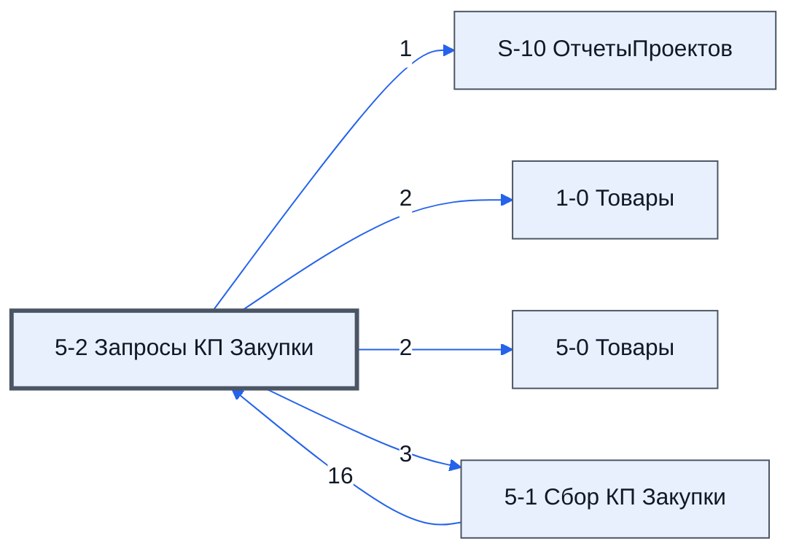

> Черновик: текст не проверен.

# Лист «5-2 Запросы КП Закупки»

**Назначение**

*Не описано — см. вопросы ниже.*

Устройство листа — размер, столбцы, формулы, связи с другими листами — собрано из таблицы в конце страницы.

## Осталось сделать

делать паралельно с 1-2

**Вопросы**

1. Для чего этот лист и кто в нём работает?
2. Какие столбцы заполняет человек, а какие считаются сами?
3. Что на листе нельзя трогать?
4. Верен ли список столбцов выше — выгрузка была неполной?

## Устройство (из таблицы)

- **Таблица:** таблица проекта, лист «5-2 Запросы КП Закупки»; контур 2
- **Аналог в другом контуре:** [1-2 Запросы по товарным группам](../k1-1-2-zaprosy-po-tovarnym-gruppam/index.md)
- **Размер:** `A1:BA399`, закреплено до `F11`
- **Каркас:** общий — служебные строки, заголовки в строке 10 ([что значат служебные строки](../../zna/lis-sluzhebnye-stroki/index.md))
- **Формул:** 437; заполненных ячеек без формул в данных: 30; списков: 1; условного форматирования: 1; объединённых ячеек: 0

## Связи с другими листами

- **Берёт данные с листов:** [5-1 Сбор КП Закупки](../k2-5-1-sbor-kp/index.md) (16)
- **Его данные используют:** [S-10 ОтчетыПроектов](../k0-s-10-otchetyproektov/index.md) (1), [1-0 Товары](../k1-1-0-tovary/index.md) (2), [5-0 Товары](../k2-5-0-tovary/index.md) (2), [5-1 Сбор КП Закупки](../k2-5-1-sbor-kp/index.md) (3)

В скобках и на стрелках — сколько формул ссылаются.

## Кто здесь работает (по процессам)

Обязанности, у которых место работы — этот лист (из разбора регламента); должность — в карточке обязанности.

[Рассылающий повторные запросы](../../reg/oby/povtornaya-rassylka.md)

## Столбцы

Устройство — из таблицы; «Что это» и «Как заполняют» — из `stolbtsy.yaml` (заполняем руками).

| Столбец | Заголовок | Служебное имя | Вид | Заполняется | Список | Что это | Как заполняют |
|---|---|---|---|---|---|---|---|
| A *(скрыт)* |  | err |  | руками? |  | служебный столбец каркаса |  |
| B *(скрыт)* |  | err2 |  | руками? |  | служебный столбец каркаса |  |
| C | ID_Товара |  | formulaColl | формула |  | ID_Товара | формула: по № с листа 5-1 |
| D | № | Номер |  | руками, из списка | '5-1 Сбор КП Закупки'!$D$11:$D399 | № товара в группе повторной рассылки | руками: из списка номеров листа 5-1 или вставкой значений |
| E | Номенклатура | Номенклатура |  | формула |  | название товара | формула: по № с листа 5-1 |
| F | Название товара по договору | НазваниеТовараПоДоговору | formulaColl | формула |  | название товара по договору | формула: по № с листа 5-1 |
| G | Изготовитель товара по договору | ИзготовительТовараПоДоговору | formulaColl | формула |  | изготовитель по договору | формула: по № с листа 5-1 |
| H | Характеристики | Характеристики | formulaColl | формула |  | характеристики | формула: по № с листа 5-1 |
| I | Состав поставляемой с продукцией технической документации | СоставТехническойДокументации | formulaColl | формула |  | состав технической документации | формула: по № с листа 5-1 |
| J | Ед. Изм | ЕдИзм | formulaColl | формула |  | единица измерения | формула: по № с листа 5-1 |
| K | Кол-во | Количевство | formulaColl | формула |  | количество | формула: по № с листа 5-1 |
| L | Название товара для запроса | НазваниеТовраДляЗапроса | formulaCell | формула |  | название товара, как оно уйдёт в письме поставщику | формула в каждой ячейке (= номенклатура); для уточнений можно вписать своё (догадка) |
| M | Файлы | Файлы |  | руками? |  | ссылки на файлы к товару; каждая с новой строки; без упоминания конечного заказчика | руками (как на 1-2) |
| N | Группа | Группа | formulaColl | формула |  | номер группы товаров повторной рассылки; группы разделяют две и более пустые строки | формула на два столбца: группа и строка в группе |
| O | Строка в группе | СтрокаВГруппе | formulaFree | руками, потом формула |  | номер строки в группе: первая — адреса, вторая — уникальные адреса | формула столбца «Группа» |
| P | Ключ фразы 1 | Ключ фразы 1 |  | руками? |  | ключевые фразы для поиска поставщиков; действуют на всю группу | руками |
| Q | Ключ фразы 2 | Ключ фразы 2 |  | руками? |  | ключевые фразы для поиска поставщиков; действуют на всю группу | руками |
| R | Ключ фразы 3 | Ключ фразы 3 |  | руками? |  | ключевые фразы для поиска поставщиков; действуют на всю группу | руками |
| S *(скрыт)* |  | Свободно01 |  | руками? |  | запас под новые столбцы | не заполнять |
| T *(скрыт)* |  | Свободно02 |  | руками? |  | запас под новые столбцы | не заполнять |
| U *(скрыт)* |  | Свободно03 |  | руками? |  | запас под новые столбцы | не заполнять |
| V *(скрыт)* |  | Свободно04 |  | руками? |  | запас под новые столбцы | не заполнять |
| W *(скрыт)* |  | Свободно05 |  | руками? |  | запас под новые столбцы | не заполнять |
| X *(скрыт)* |  | Свободно06 |  | руками? |  | запас под новые столбцы | не заполнять |
| Y *(скрыт)* |  | Свободно07 |  | руками? |  | запас под новые столбцы | не заполнять |
| Z *(скрыт)* |  | Свободно08 |  | руками? |  | запас под новые столбцы | не заполнять |
| AA *(скрыт)* |  | ПочтыНачало |  | руками? |  | метка: отсюда вправо — адреса поставщиков | не трогать: по метке формулы и скрипты находят начало или конец блока |
| AB |  | Почта.AB |  | руками? |  | адреса поставщиков группы; после отправки ячейка окрашивается, в заметке — кто, кому, когда | руками: в первую строку группы, с AB вправо (как на 1-2) |
| AC |  | Почта.AC |  | руками? |  | адреса поставщиков группы; после отправки ячейка окрашивается, в заметке — кто, кому, когда | руками: в первую строку группы, с AB вправо (как на 1-2) |
| AD |  | Почта.AD |  | руками? |  | адреса поставщиков группы; после отправки ячейка окрашивается, в заметке — кто, кому, когда | руками: в первую строку группы, с AB вправо (как на 1-2) |
| AE |  | Почта.AE |  | руками? |  | адреса поставщиков группы; после отправки ячейка окрашивается, в заметке — кто, кому, когда | руками: в первую строку группы, с AB вправо (как на 1-2) |
| AF |  | Почта.AF |  | руками? |  | адреса поставщиков группы; после отправки ячейка окрашивается, в заметке — кто, кому, когда | руками: в первую строку группы, с AB вправо (как на 1-2) |
| AG |  | Почта.AG |  | руками? |  | адреса поставщиков группы; после отправки ячейка окрашивается, в заметке — кто, кому, когда | руками: в первую строку группы, с AB вправо (как на 1-2) |
| AH |  | Почта.AH |  | руками? |  | адреса поставщиков группы; после отправки ячейка окрашивается, в заметке — кто, кому, когда | руками: в первую строку группы, с AB вправо (как на 1-2) |
| AI |  | Почта.AI |  | руками? |  | адреса поставщиков группы; после отправки ячейка окрашивается, в заметке — кто, кому, когда | руками: в первую строку группы, с AB вправо (как на 1-2) |
| AJ |  | Почта.AJ |  | руками? |  | адреса поставщиков группы; после отправки ячейка окрашивается, в заметке — кто, кому, когда | руками: в первую строку группы, с AB вправо (как на 1-2) |
| AK |  | Почта.AK |  | руками? |  | адреса поставщиков группы; после отправки ячейка окрашивается, в заметке — кто, кому, когда | руками: в первую строку группы, с AB вправо (как на 1-2) |
| AL |  | Почта.AL |  | руками? |  | адреса поставщиков группы; после отправки ячейка окрашивается, в заметке — кто, кому, когда | руками: в первую строку группы, с AB вправо (как на 1-2) |
| AM |  | Почта.AM |  | руками? |  | адреса поставщиков группы; после отправки ячейка окрашивается, в заметке — кто, кому, когда | руками: в первую строку группы, с AB вправо (как на 1-2) |
| AN |  | Почта.AN |  | руками? |  | адреса поставщиков группы; после отправки ячейка окрашивается, в заметке — кто, кому, когда | руками: в первую строку группы, с AB вправо (как на 1-2) |
| AO |  | Почта.AO |  | руками? |  | адреса поставщиков группы; после отправки ячейка окрашивается, в заметке — кто, кому, когда | руками: в первую строку группы, с AB вправо (как на 1-2) |
| AP |  | Почта.AP |  | руками? |  | адреса поставщиков группы; после отправки ячейка окрашивается, в заметке — кто, кому, когда | руками: в первую строку группы, с AB вправо (как на 1-2) |
| AQ |  | Почта.AQ |  | руками? |  | адреса поставщиков группы; после отправки ячейка окрашивается, в заметке — кто, кому, когда | руками: в первую строку группы, с AB вправо (как на 1-2) |
| AR |  | Почта.AR |  | руками? |  | адреса поставщиков группы; после отправки ячейка окрашивается, в заметке — кто, кому, когда | руками: в первую строку группы, с AB вправо (как на 1-2) |
| AS |  | Почта.AS |  | руками? |  | адреса поставщиков группы; после отправки ячейка окрашивается, в заметке — кто, кому, когда | руками: в первую строку группы, с AB вправо (как на 1-2) |
| AT |  | Почта.AT |  | руками? |  | адреса поставщиков группы; после отправки ячейка окрашивается, в заметке — кто, кому, когда | руками: в первую строку группы, с AB вправо (как на 1-2) |
| AU |  | Почта.AU |  | руками? |  | адреса поставщиков группы; после отправки ячейка окрашивается, в заметке — кто, кому, когда | руками: в первую строку группы, с AB вправо (как на 1-2) |
| AV |  | Почта.AV |  | руками? |  | адреса поставщиков группы; после отправки ячейка окрашивается, в заметке — кто, кому, когда | руками: в первую строку группы, с AB вправо (как на 1-2) |
| AW |  | Почта.AW |  | руками? |  | адреса поставщиков группы; после отправки ячейка окрашивается, в заметке — кто, кому, когда | руками: в первую строку группы, с AB вправо (как на 1-2) |
| AX |  | Почта.AX |  | руками? |  | адреса поставщиков группы; после отправки ячейка окрашивается, в заметке — кто, кому, когда | руками: в первую строку группы, с AB вправо (как на 1-2) |
| AY |  | Почта.AY |  | руками? |  | адреса поставщиков группы; после отправки ячейка окрашивается, в заметке — кто, кому, когда | руками: в первую строку группы, с AB вправо (как на 1-2) |
| AZ |  | Почта.AZ |  | руками? |  | адреса поставщиков группы; после отправки ячейка окрашивается, в заметке — кто, кому, когда | руками: в первую строку группы, с AB вправо (как на 1-2) |
| BA |  | Почта.BA |  | руками? |  | адреса поставщиков группы; после отправки ячейка окрашивается, в заметке — кто, кому, когда | руками: в первую строку группы, с AB вправо (как на 1-2) |

## Переменные листа

Строки 5–6 каркаса (`var_name`, `var_value`): имя переменной и её значения — скорее всего, списки для скриптов и выпадающих списков.

| Ячейка | Имя | Значения |
|---|---|---|
| D | Ответственный | 0 |
| E | ПоУмолчанию | <- ID из битрикс \| По умолчанию \| Текст подписи -> |
| F | Подпись |  [сотрудник]   [телефон] |

Формулы столбцов (11)

| Столбец | Строка | Формула |
|---|---|---|
| C | 10 | <code>=LAMBDA(doFind,theNames,theDatas,BYROW(theNames,LAMBDA(theName,IF(theName&lt;&gt;"",doFind(theName,theDatas),)))) ( LAMBDA(theName,theDatas,VLOOKUP(theName,theDatas,2,0)), '5-2 Запросы КП Закупки'!$D$10:$D399,{'5-1 Сбор КП Закупки'!$D$10:$D399,'5-1 Сбор КП Закупки'!$C$10:$C399} )</code> |
| E | 10 | <code>=LAMBDA(doFind,theNames,theDatas,BYROW(theNames,LAMBDA(theName,IF(theName&lt;&gt;"",doFind(theName,theDatas),)))) ( LAMBDA(theName,theDatas,VLOOKUP(theName,theDatas,2,0)), '5-2 Запросы КП Закупки'!$D$10:$D399,{'5-1 Сбор КП Закупки'!$D$10:$D399,'5-1 Сбор КП Закупки'!$E$10:$E399} )</code> |
| F | 10 | <code>=LAMBDA(doFind,theNames,theDatas,BYROW(theNames,LAMBDA(theName,IF(theName&lt;&gt;"",doFind(theName,theDatas),)))) ( LAMBDA(theName,theDatas,VLOOKUP(theName,theDatas,2,0)), '5-2 Запросы КП Закупки'!$D$10:$D399,{'5-1 Сбор КП Закупки'!$D$10:$D399,'5-1 Сбор КП Закупки'!$F$10:$F399} )</code> |
| G | 10 | <code>=LAMBDA(doFind,theNames,theDatas,BYROW(theNames,LAMBDA(theName,IF(theName&lt;&gt;"",doFind(theName,theDatas),)))) ( LAMBDA(theName,theDatas,VLOOKUP(theName,theDatas,2,0)), '5-2 Запросы КП Закупки'!$D$10:$D399,{'5-1 Сбор КП Закупки'!$D$10:$D399,'5-1 Сбор КП Закупки'!$G$10:$G399} )</code> |
| H | 10 | <code>=LAMBDA(doFind,theNames,theDatas,BYROW(theNames,LAMBDA(theName,IF(theName&lt;&gt;"",doFind(theName,theDatas),)))) ( LAMBDA(theName,theDatas,VLOOKUP(theName,theDatas,2,0)), '5-2 Запросы КП Закупки'!$D$10:$D399,{'5-1 Сбор КП Закупки'!$D$10:$D399,'5-1 Сбор КП Закупки'!$H$10:$H399} )</code> |
| I | 10 | <code>=LAMBDA(doFind,theNames,theDatas,BYROW(theNames,LAMBDA(theName,IF(theName&lt;&gt;"",doFind(theName,theDatas),)))) ( LAMBDA(theName,theDatas,VLOOKUP(theName,theDatas,2,0)), '5-2 Запросы КП Закупки'!$D$10:$D399,{'5-1 Сбор КП Закупки'!$D$10:$D399,'5-1 Сбор КП Закупки'!$I$10:$I399} )</code> |
| J | 10 | <code>=LAMBDA(doFind,theNames,theDatas,BYROW(theNames,LAMBDA(theName,IF(theName&lt;&gt;"",doFind(theName,theDatas),)))) ( LAMBDA(theName,theDatas,VLOOKUP(theName,theDatas,2,0)), '5-2 Запросы КП Закупки'!$D$10:$D399,{'5-1 Сбор КП Закупки'!$D$10:$D399,'5-1 Сбор КП Закупки'!$J$10:$J399} )</code> |
| K | 10 | <code>=LAMBDA(doFind,theNames,theDatas,BYROW(theNames,LAMBDA(theName,IF(theName&lt;&gt;"",doFind(theName,theDatas),)))) ( LAMBDA(theName,theDatas,VLOOKUP(theName,theDatas,2,0)), '5-2 Запросы КП Закупки'!$D$10:$D399,{'5-1 Сбор КП Закупки'!$D$10:$D399,'5-1 Сбор КП Закупки'!$K$10:$K399} )</code> |
| L | 11 | <code>=E11</code> |
| N | 10 | <code>={{"Группа","Строка в группе"}; LAMBDA(doNorm, doGrop, doExtact, doJoin, doScan,doResolveItem, нач,дата, doGrop(doExtact, doScan( doResolveItem , doExtact, doJoin,нач,doNorm(дата) )) )( LAMBDA(dr,BYROW(dr ,LAMBDA(r,NOT( ISBLANK(r))))), LAMBDA(doE,"Группа")</code> |
| O | 10 | <code>="COMPUTED_VALUE"</code> |

