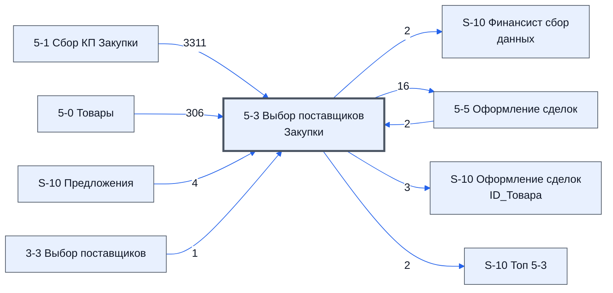

> Черновик: текст не проверен.

# Лист «5-3 Выбор поставщиков Закупки»

**Назначение**

Лист для подбора цены между предложениями с листа **[5-1 Сбор КП Закупки](../../lis/k2-5-1-sbor-kp/index.md)** и для выбора, какие товары идут в исполнение.

**Кто работает:** [Закупщик (специалист по закупке)](../../reg/rol/zakupka.md).

*Записано коротко; директор вернётся и дозаполнит.*

Устройство листа — размер, столбцы, формулы, связи с другими листами — собрано из таблицы в конце страницы.

## Главные столбцы

- **A «Сделка»** — «Да» или «Нет», заполняется руками. «Да» — товар войдёт в исполнение и попадёт на лист **[5-5 Оформление сделок](../../lis/k2-5-5-sdelki/index.md)**.
- **L «Кол-во»** — считается само: `=ЕСЛИ(A19="Да";'5-1 Сбор КП Закупки'!K19;)`. У товара без «Да» количество пустое.
- **B «Исключить по причине»** — причина изменения или дополнения, приходит с листа **[5-4 Изменения в товарах](../../lis/k2-5-4-izmeneniya/index.md)**.
- `ID_Товара`, `№`, `Номенклатура` и другие сквозные столбцы приходят формулой с листа **[5-0 Товары](../../lis/k2-5-0-tovary/index.md)**.

Как пользоваться столбцом «Сделка»: [«Да» и «Нет» в столбце «Сделка»](../../um/tov-k2-5-3-sdelka/index.md).

## Осталось сделать

делать паралельно с 1-3

**Вопросы** (не закрыто)

1. Как выбирается основной и резервный поставщик?
2. Какие ещё столбцы заполняет человек?
3. Что на листе нельзя трогать?
4. Верен ли список столбцов выше?

## Устройство (из таблицы)

- **Таблица:** таблица проекта, лист «5-3 Выбор поставщиков Закупки»; контур 2
- **Аналог в другом контуре:** [3-3 Выбор поставщиков](../k1-3-3-vybor-postavshchikov/index.md)
- **Размер:** `A1:EE319`, закреплено до `J1`
- **Каркас:** общий — служебные строки, заголовки в строке 10 ([что значат служебные строки](../../zna/lis-sluzhebnye-stroki/index.md))
- **Формул:** 17062; заполненных ячеек без формул в данных: 937; списков: 2; условного форматирования: 3; объединённых ячеек: 1

## Связи с другими листами

- **Берёт данные с листов:** [5-1 Сбор КП Закупки](../k2-5-1-sbor-kp/index.md) (3311), [5-0 Товары](../k2-5-0-tovary/index.md) (306), [S-10 Предложения](../k2-s-10-predlozheniya/index.md) (4), [5-5 Оформление сделок](../k2-5-5-sdelki/index.md) (2), [3-3 Выбор поставщиков](../k1-3-3-vybor-postavshchikov/index.md) (1)
- **Его данные используют:** [S-10 Финансист сбор данных](../k0-s-10-finansist-sbor-dannykh/index.md) (2), [5-5 Оформление сделок](../k2-5-5-sdelki/index.md) (16), [S-10 Оформление сделок ID_Товара](../k2-s-10-oformlenie-sdelok-id-tovara/index.md) (3), [S-10 Топ 5-3](../k2-s-10-top-5-3/index.md) (2)

В скобках и на стрелках — сколько формул ссылаются.

## Кто здесь работает (по процессам)

Обязанности, у которых место работы — этот лист (из разбора регламента); должность — в карточке обязанности.

[Отслеживающий выбор поставщиков](../../reg/oby/kontrol-vybora.md), [Готовящий выбор поставщика](../../reg/oby/vybor-postavshchika.md)

## Столбцы

Устройство — из таблицы; «Что это» и «Как заполняют» — из `stolbtsy.yaml` (заполняем руками).

| Столбец | Заголовок | Служебное имя | Вид | Заполняется | Список | Что это | Как заполняют |
|---|---|---|---|---|---|---|---|
| A *(скрыт)* | Сделка | err |  | формула |  | «Сделка»: «Да» — товар идёт на оформление сделки (лист 5-5, через «S-10 Оформление сделок ID_Товар») | формула: «Да» у каждой строки с № |
| B *(скрыт)* | Исключить по причине | err2 |  | формула |  | причина исключить товар (с листа 5-0 Товары) | формула |
| C | ID_Товара |  | formulaCell | формула |  | ID_Товара | формула: с листа 5-1 |
| D | № | Номер | formulaCell | формула |  | № позиции | формула: с листа 5-1 |
| E *(скрыт)* | Номенклатура | Номенклатура | formulaCell | формула |  | название товара | формула: с листа 5-1 |
| F | Название товара по договору | НазваниеТовараПоДоговору | formulaCell | формула | "1-1 Сбор КП,5-1 Сбор КП Закупки" | название по договору | формула: с листа 5-1 |
| G *(скрыт)* | Изготовитель товара по договору | ИзготовительТовараПоДоговору | formulaCell | формула |  | изготовитель по договору | формула: с листа 5-1 |
| H *(скрыт)* | Характеристики | Характеристики | formulaCell | формула |  | характеристики | формула: с листа 5-1 |
| I *(скрыт)* | Состав поставляемой с продукцией технической документации | СоставТехническойДокументации | formulaCell | формула |  | состав технической документации | формула: с листа 5-1 |
| J | Группа | Группа | formulaColl | формула |  | группа рассылки («5-1 …» или «1-1 …») | формула: с листа 5-0 Товары; ⚠ диапазон только до строки 46, у соседних — до 310 |
| K | Изготовитель товара по договору | ЕдИзм | formulaCell | формула |  | изготовитель по договору: так говорят заголовок и формула (столбец G листа 5-1) | формула; ⚠ служебное имя «ЕдИзм» не совпадает с заголовком — проверить, что задумано |
| L | Кол-во | Количевство | formulaCell | формула |  | количество | формула: с листа 5-1 |
| M | Цена | Цена | formulaColl | формула |  | цена выбранного основного предложения | формула: по «Основному предложению» (S) с листа «S-10 Предложения» |
| N | Сумма | Сумма | formulaColl | формула |  | количество × цена | формула |
| O | Срок поставки | Срок поставки | formulaColl | формула |  | срок поставки выбранного предложения | формула: как у цены |
| P | Срок поставки по договору | СрокПоставкиПоДоговору | formulaColl | формула |  | срок поставки по договору | формула: с листа 5-1 |
| Q | Основной Поставщик | ОснвнойПоставщик |  | руками? |  | основной поставщик — e-mail (по 3.1.7) | руками (догадка) |
| R *(скрыт)* |  | Свободно3 |  | руками? |  | запас под новые столбцы | не заполнять |
| S | Основное Предложение | ОснвноеЛистИПредложение |  | руками? |  | какое предложение выбрано основным: лист (1-1 или 5-1) и блок поставщика | руками (догадка: берут из блока топ-7, столбец «Предложение N») |
| T *(скрыт)* | Резервный Поставщик | РезервныйПоставщик |  | руками? |  | резервный поставщик (по 3.1.7 его лучше выбирать всегда) | руками; столбец скрыт |
| U *(скрыт)* |  | Свободно4 |  | руками? |  | запас под новые столбцы | не заполнять |
| V *(скрыт)* | Резервное Предложение | РезервноеЛистИПредложение |  | формула |  | резервное предложение: лист и блок поставщика | руками; столбец скрыт; ⚠ в заголовке формула «Итого …» — проверить |
| W | НМЦ | НМЦ | formulaCell | формула |  | НМЦ за единицу | формула: с листа 5-1 |
| X *(скрыт)* | Счет Поставщиков | СчетПоставщиков |  | руками? |  | счёт поставщика (догадка) | столбец скрыт — проверить, нужен ли |
| Y *(скрыт)* | Статус | Статус | formulaColl | формула | 'Настройки писем'!$AX$1:$AX$30 | статус закупки товара — тот, что закупщик ставит на 5-5 | формула: с листа 5-5, столбец AF; список — «Статус закупщика» |
| Z *(скрыт)* | Предполагаемая дата оплаты | ПредполагаемаяДатаОплаты |  | руками? |  | когда предполагается оплата | столбец скрыт — проверить, нужен ли |
| AA | Комментарий | Комментарий |  | руками? |  | комментарий к товару при выборе поставщика; уходит на лист 5-5 (столбец AD) | руками; хранится на листе «S-10 Комментарии» (догадка) |
| AB | Разница от миним | РазницаОтМиним | formulaColl | формула |  | насколько цена выбранного предложения выше лучшей (место 1 топа) | формула: «Цена» − «Цена 1» |
| AC | Итого разница | ИтогоРазница | formulaColl | формула |  | то же на всё количество | формула |
| AD *(скрыт)* | БлокТопНачало | БлокТопНачало |  | формула |  | начало блока топ-7: 7 мест по 15 столбцов; формула пишет заголовки блока | не трогать: по метке формулы и скрипты находят начало или конец блока |
| AE *(скрыт)* | Цена.Ф 1 | ТопA.Цена.Ф | formulaCell | формула |  | скрытые столбцы блока топ-7 с формулами; видимое значение — в соседнем столбце без «.Ф» | формула; не трогать |
| AF | Цена 1 | ТопA.Цена.З |  | формула |  | место 1–7 по цене: цена предложения (данные готовит лист «S-10 Топ 5-3», догадка) | формула блока |
| AG *(скрыт)* | Постовшик.Ф 1 | ТопA.Постовшик.Ф | formulaCell | формула |  | скрытые столбцы блока топ-7 с формулами; видимое значение — в соседнем столбце без «.Ф» | формула; не трогать |
| AH | Постовшик 1 | ТопA.Постовшик.З |  | формула |  | поставщик этого предложения (e-mail) | формула блока |
| AI *(скрыт)* | ЛистИПредложение.Ф 1 | ТопA.ЛистИПредложение.Ф | formulaCell | формула |  | скрытые столбцы блока топ-7 с формулами; видимое значение — в соседнем столбце без «.Ф» | формула; не трогать |
| AJ | Предложение 1 | ТопA.ЛистИПредложение.З |  | формула |  | откуда предложение: лист (1-1 или 5-1) и блок поставщика | формула блока |
| AK *(скрыт)* | Комментарий.Ф 1 | ТопA.Комментарий.Ф | formulaCell | формула |  | скрытые столбцы блока топ-7 с формулами; видимое значение — в соседнем столбце без «.Ф» | формула; не трогать |
| AL | Комментарий 1 | ТопA.Комментарий.З |  | формула |  | комментарий к предложению | формула блока |
| AM *(скрыт)* | Срок.Ф 1 | ТопA.Срок.Ф | formulaCell | формула |  | скрытые столбцы блока топ-7 с формулами; видимое значение — в соседнем столбце без «.Ф» | формула; не трогать |
| AN | Срок 1 | ТопA.Срок.З |  | формула |  | срок поставки предложения | формула блока |
| AO *(скрыт)* | Эксперт.Ф 1 | ТопA.Эксперт.Ф | formulaCell | формула |  | скрытые столбцы блока топ-7 с формулами; видимое значение — в соседнем столбце без «.Ф» | формула; не трогать |
| AP | Эксперт 1 | ТопA.Эксперт.З |  | формула |  | оценка эксперта по предложению (лист 3-2, догадка) | формула блока |
| AQ *(скрыт)* | Свободно_3 1 | ТопA.Свободно_3 |  | формула |  | запас под новые столбцы | не заполнять |
| AR *(скрыт)* | Свободно_4 1 | ТопA.Свободно_4 |  | формула |  | запас под новые столбцы | не заполнять |
| AS *(скрыт)* | Свободно_5 1 | ТопA.Свободно_5 |  | формула |  | запас под новые столбцы | не заполнять |
| AT *(скрыт)* | Цена.Ф 2 | ТопB.Цена.Ф | formulaCell | формула |  | скрытые столбцы блока топ-7 с формулами; видимое значение — в соседнем столбце без «.Ф» | формула; не трогать |
| AU | Цена 2 | ТопB.Цена.З |  | формула |  | место 1–7 по цене: цена предложения (данные готовит лист «S-10 Топ 5-3», догадка) | формула блока |
| AV *(скрыт)* | Постовшик.Ф 2 | ТопB.Постовшик.Ф | formulaCell | формула |  | скрытые столбцы блока топ-7 с формулами; видимое значение — в соседнем столбце без «.Ф» | формула; не трогать |
| AW | Постовшик 2 | ТопB.Постовшик.З |  | формула |  | поставщик этого предложения (e-mail) | формула блока |
| AX *(скрыт)* | ЛистИПредложение.Ф 2 | ТопB.ЛистИПредложение.Ф | formulaCell | формула |  | скрытые столбцы блока топ-7 с формулами; видимое значение — в соседнем столбце без «.Ф» | формула; не трогать |
| AY | Предложение 2 | ТопB.ЛистИПредложение.З |  | формула |  | откуда предложение: лист (1-1 или 5-1) и блок поставщика | формула блока |
| AZ *(скрыт)* | Комментарий.Ф 2 | ТопB.Комментарий.Ф | formulaCell | формула |  | скрытые столбцы блока топ-7 с формулами; видимое значение — в соседнем столбце без «.Ф» | формула; не трогать |
| BA | Комментарий 2 | ТопB.Комментарий.З |  | формула |  | комментарий к предложению | формула блока |
| BB *(скрыт)* | Срок.Ф 2 | ТопB.Срок.Ф | formulaCell | формула |  | скрытые столбцы блока топ-7 с формулами; видимое значение — в соседнем столбце без «.Ф» | формула; не трогать |
| BC | Срок 2 | ТопB.Срок.З |  | формула |  | срок поставки предложения | формула блока |
| BD *(скрыт)* | Эксперт.Ф 2 | ТопB.Эксперт.Ф | formulaCell | формула |  | скрытые столбцы блока топ-7 с формулами; видимое значение — в соседнем столбце без «.Ф» | формула; не трогать |
| BE | Эксперт 2 | ТопB.Эксперт.З |  | формула |  | оценка эксперта по предложению (лист 3-2, догадка) | формула блока |
| BF *(скрыт)* | Свободно_3 2 | ТопB.Свободно_3 |  | формула |  | запас под новые столбцы | не заполнять |
| BG *(скрыт)* | Свободно_4 2 | ТопB.Свободно_4 |  | формула |  | запас под новые столбцы | не заполнять |
| BH *(скрыт)* | Свободно_5 2 | ТопB.Свободно_5 |  | формула |  | запас под новые столбцы | не заполнять |
| BI *(скрыт)* | Цена.Ф 3 | ТопC.Цена.Ф | formulaCell | формула |  | скрытые столбцы блока топ-7 с формулами; видимое значение — в соседнем столбце без «.Ф» | формула; не трогать |
| BJ | Цена 3 | ТопC.Цена.З |  | формула |  | место 1–7 по цене: цена предложения (данные готовит лист «S-10 Топ 5-3», догадка) | формула блока |
| BK *(скрыт)* | Постовшик.Ф 3 | ТопC.Постовшик.Ф | formulaCell | формула |  | скрытые столбцы блока топ-7 с формулами; видимое значение — в соседнем столбце без «.Ф» | формула; не трогать |
| BL | Постовшик 3 | ТопC.Постовшик.З |  | формула |  | поставщик этого предложения (e-mail) | формула блока |
| BM *(скрыт)* | ЛистИПредложение.Ф 3 | ТопC.ЛистИПредложение.Ф | formulaCell | формула |  | скрытые столбцы блока топ-7 с формулами; видимое значение — в соседнем столбце без «.Ф» | формула; не трогать |
| BN | Предложение 3 | ТопC.ЛистИПредложение.З |  | формула |  | откуда предложение: лист (1-1 или 5-1) и блок поставщика | формула блока |
| BO *(скрыт)* | Комментарий.Ф 3 | ТопC.Комментарий.Ф | formulaCell | формула |  | скрытые столбцы блока топ-7 с формулами; видимое значение — в соседнем столбце без «.Ф» | формула; не трогать |
| BP | Комментарий 3 | ТопC.Комментарий.З |  | формула |  | комментарий к предложению | формула блока |
| BQ *(скрыт)* | Срок.Ф 3 | ТопC.Срок.Ф | formulaCell | формула |  | скрытые столбцы блока топ-7 с формулами; видимое значение — в соседнем столбце без «.Ф» | формула; не трогать |
| BR | Срок 3 | ТопC.Срок.З |  | формула |  | срок поставки предложения | формула блока |
| BS *(скрыт)* | Эксперт.Ф 3 | ТопC.Эксперт.Ф | formulaCell | формула |  | скрытые столбцы блока топ-7 с формулами; видимое значение — в соседнем столбце без «.Ф» | формула; не трогать |
| BT | Эксперт 3 | ТопC.Эксперт.З |  | формула |  | оценка эксперта по предложению (лист 3-2, догадка) | формула блока |
| BU *(скрыт)* | Свободно_3 3 | ТопC.Свободно_3 |  | формула |  | запас под новые столбцы | не заполнять |
| BV *(скрыт)* | Свободно_4 3 | ТопC.Свободно_4 |  | формула |  | запас под новые столбцы | не заполнять |
| BW *(скрыт)* | Свободно_5 3 | ТопC.Свободно_5 |  | формула |  | запас под новые столбцы | не заполнять |
| BX *(скрыт)* | Цена.Ф 4 | ТопD.Цена.Ф | formulaCell | формула |  | скрытые столбцы блока топ-7 с формулами; видимое значение — в соседнем столбце без «.Ф» | формула; не трогать |
| BY | Цена 4 | ТопD.Цена.З |  | формула |  | место 1–7 по цене: цена предложения (данные готовит лист «S-10 Топ 5-3», догадка) | формула блока |
| BZ *(скрыт)* | Постовшик.Ф 4 | ТопD.Постовшик.Ф | formulaCell | формула |  | скрытые столбцы блока топ-7 с формулами; видимое значение — в соседнем столбце без «.Ф» | формула; не трогать |
| CA | Постовшик 4 | ТопD.Постовшик.З |  | формула |  | поставщик этого предложения (e-mail) | формула блока |
| CB *(скрыт)* | ЛистИПредложение.Ф 4 | ТопD.ЛистИПредложение.Ф | formulaCell | формула |  | скрытые столбцы блока топ-7 с формулами; видимое значение — в соседнем столбце без «.Ф» | формула; не трогать |
| CC | Предложение 4 | ТопD.ЛистИПредложение.З |  | формула |  | откуда предложение: лист (1-1 или 5-1) и блок поставщика | формула блока |
| CD *(скрыт)* | Комментарий.Ф 4 | ТопD.Комментарий.Ф | formulaCell | формула |  | скрытые столбцы блока топ-7 с формулами; видимое значение — в соседнем столбце без «.Ф» | формула; не трогать |
| CE | Комментарий 4 | ТопD.Комментарий.З |  | формула |  | комментарий к предложению | формула блока |
| CF *(скрыт)* | Срок.Ф 4 | ТопD.Срок.Ф | formulaCell | формула |  | скрытые столбцы блока топ-7 с формулами; видимое значение — в соседнем столбце без «.Ф» | формула; не трогать |
| CG | Срок 4 | ТопD.Срок.З |  | формула |  | срок поставки предложения | формула блока |
| CH *(скрыт)* | Эксперт.Ф 4 | ТопD.Эксперт.Ф | formulaCell | формула |  | скрытые столбцы блока топ-7 с формулами; видимое значение — в соседнем столбце без «.Ф» | формула; не трогать |
| CI | Эксперт 4 | ТопD.Эксперт.З |  | формула |  | оценка эксперта по предложению (лист 3-2, догадка) | формула блока |
| CJ *(скрыт)* | Свободно_3 4 | ТопD.Свободно_3 |  | формула |  | запас под новые столбцы | не заполнять |
| CK *(скрыт)* | Свободно_4 4 | ТопD.Свободно_4 |  | формула |  | запас под новые столбцы | не заполнять |
| CL *(скрыт)* | Свободно_5 4 | ТопD.Свободно_5 |  | формула |  | запас под новые столбцы | не заполнять |
| CM *(скрыт)* | Цена.Ф 5 | ТопE.Цена.Ф | formulaCell | формула |  | скрытые столбцы блока топ-7 с формулами; видимое значение — в соседнем столбце без «.Ф» | формула; не трогать |
| CN | Цена 5 | ТопE.Цена.З |  | формула |  | место 1–7 по цене: цена предложения (данные готовит лист «S-10 Топ 5-3», догадка) | формула блока |
| CO *(скрыт)* | Постовшик.Ф 5 | ТопE.Постовшик.Ф | formulaCell | формула |  | скрытые столбцы блока топ-7 с формулами; видимое значение — в соседнем столбце без «.Ф» | формула; не трогать |
| CP | Постовшик 5 | ТопE.Постовшик.З |  | формула |  | поставщик этого предложения (e-mail) | формула блока |
| CQ *(скрыт)* | ЛистИПредложение.Ф 5 | ТопE.ЛистИПредложение.Ф | formulaCell | формула |  | скрытые столбцы блока топ-7 с формулами; видимое значение — в соседнем столбце без «.Ф» | формула; не трогать |
| CR | Предложение 5 | ТопE.ЛистИПредложение.З |  | формула |  | откуда предложение: лист (1-1 или 5-1) и блок поставщика | формула блока |
| CS *(скрыт)* | Комментарий.Ф 5 | ТопE.Комментарий.Ф | formulaCell | формула |  | скрытые столбцы блока топ-7 с формулами; видимое значение — в соседнем столбце без «.Ф» | формула; не трогать |
| CT | Комментарий 5 | ТопE.Комментарий.З |  | формула |  | комментарий к предложению | формула блока |
| CU *(скрыт)* | Срок.Ф 5 | ТопE.Срок.Ф | formulaCell | формула |  | скрытые столбцы блока топ-7 с формулами; видимое значение — в соседнем столбце без «.Ф» | формула; не трогать |
| CV | Срок 5 | ТопE.Срок.З |  | формула |  | срок поставки предложения | формула блока |
| CW *(скрыт)* | Эксперт.Ф 5 | ТопE.Эксперт.Ф | formulaCell | формула |  | скрытые столбцы блока топ-7 с формулами; видимое значение — в соседнем столбце без «.Ф» | формула; не трогать |
| CX | Эксперт 5 | ТопE.Эксперт.З |  | формула |  | оценка эксперта по предложению (лист 3-2, догадка) | формула блока |
| CY *(скрыт)* | Свободно_3 5 | ТопE.Свободно_3 |  | формула |  | запас под новые столбцы | не заполнять |
| CZ *(скрыт)* | Свободно_4 5 | ТопE.Свободно_4 |  | формула |  | запас под новые столбцы | не заполнять |
| DA *(скрыт)* | Свободно_5 5 | ТопE.Свободно_5 |  | формула |  | запас под новые столбцы | не заполнять |
| DB *(скрыт)* | Цена.Ф 6 | ТопF.Цена.Ф | formulaCell | формула |  | скрытые столбцы блока топ-7 с формулами; видимое значение — в соседнем столбце без «.Ф» | формула; не трогать |
| DC | Цена 6 | ТопF.Цена.З |  | формула |  | место 1–7 по цене: цена предложения (данные готовит лист «S-10 Топ 5-3», догадка) | формула блока |
| DD *(скрыт)* | Постовшик.Ф 6 | ТопF.Постовшик.Ф | formulaCell | формула |  | скрытые столбцы блока топ-7 с формулами; видимое значение — в соседнем столбце без «.Ф» | формула; не трогать |
| DE | Постовшик 6 | ТопF.Постовшик.З |  | формула |  | поставщик этого предложения (e-mail) | формула блока |
| DF *(скрыт)* | ЛистИПредложение.Ф 6 | ТопF.ЛистИПредложение.Ф | formulaCell | формула |  | скрытые столбцы блока топ-7 с формулами; видимое значение — в соседнем столбце без «.Ф» | формула; не трогать |
| DG | Предложение 6 | ТопF.ЛистИПредложение.З |  | формула |  | откуда предложение: лист (1-1 или 5-1) и блок поставщика | формула блока |
| DH *(скрыт)* | Комментарий.Ф 6 | ТопF.Комментарий.Ф | formulaCell | формула |  | скрытые столбцы блока топ-7 с формулами; видимое значение — в соседнем столбце без «.Ф» | формула; не трогать |
| DI | Комментарий 6 | ТопF.Комментарий.З |  | формула |  | комментарий к предложению | формула блока |
| DJ *(скрыт)* | Срок.Ф 6 | ТопF.Срок.Ф | formulaCell | формула |  | скрытые столбцы блока топ-7 с формулами; видимое значение — в соседнем столбце без «.Ф» | формула; не трогать |
| DK | Срок 6 | ТопF.Срок.З |  | формула |  | срок поставки предложения | формула блока |
| DL *(скрыт)* | Эксперт.Ф 6 | ТопF.Эксперт.Ф | formulaCell | формула |  | скрытые столбцы блока топ-7 с формулами; видимое значение — в соседнем столбце без «.Ф» | формула; не трогать |
| DM | Эксперт 6 | ТопF.Эксперт.З |  | формула |  | оценка эксперта по предложению (лист 3-2, догадка) | формула блока |
| DN *(скрыт)* | Свободно_3 6 | ТопF.Свободно_3 |  | формула |  | запас под новые столбцы | не заполнять |
| DO *(скрыт)* | Свободно_4 6 | ТопF.Свободно_4 |  | формула |  | запас под новые столбцы | не заполнять |
| DP *(скрыт)* | Свободно_5 6 | ТопF.Свободно_5 |  | формула |  | запас под новые столбцы | не заполнять |
| DQ *(скрыт)* | Цена.Ф 7 | ТопG.Цена.Ф | formulaCell | формула |  | скрытые столбцы блока топ-7 с формулами; видимое значение — в соседнем столбце без «.Ф» | формула; не трогать |
| DR | Цена 7 | ТопG.Цена.З |  | формула |  | место 1–7 по цене: цена предложения (данные готовит лист «S-10 Топ 5-3», догадка) | формула блока |
| DS *(скрыт)* | Постовшик.Ф 7 | ТопG.Постовшик.Ф | formulaCell | формула |  | скрытые столбцы блока топ-7 с формулами; видимое значение — в соседнем столбце без «.Ф» | формула; не трогать |
| DT | Постовшик 7 | ТопG.Постовшик.З |  | формула |  | поставщик этого предложения (e-mail) | формула блока |
| DU *(скрыт)* | ЛистИПредложение.Ф 7 | ТопG.ЛистИПредложение.Ф | formulaCell | формула |  | скрытые столбцы блока топ-7 с формулами; видимое значение — в соседнем столбце без «.Ф» | формула; не трогать |
| DV | Предложение 7 | ТопG.ЛистИПредложение.З |  | формула |  | откуда предложение: лист (1-1 или 5-1) и блок поставщика | формула блока |
| DW *(скрыт)* | Комментарий.Ф 7 | ТопG.Комментарий.Ф | formulaCell | формула |  | скрытые столбцы блока топ-7 с формулами; видимое значение — в соседнем столбце без «.Ф» | формула; не трогать |
| DX | Комментарий 7 | ТопG.Комментарий.З |  | формула |  | комментарий к предложению | формула блока |
| DY *(скрыт)* | Срок.Ф 7 | ТопG.Срок.Ф | formulaCell | формула |  | скрытые столбцы блока топ-7 с формулами; видимое значение — в соседнем столбце без «.Ф» | формула; не трогать |
| DZ | Срок 7 | ТопG.Срок.З |  | формула |  | срок поставки предложения | формула блока |
| EA *(скрыт)* | Эксперт.Ф 7 | ТопG.Эксперт.Ф | formulaCell | формула |  | скрытые столбцы блока топ-7 с формулами; видимое значение — в соседнем столбце без «.Ф» | формула; не трогать |
| EB | Эксперт 7 | ТопG.Эксперт.З |  | формула |  | оценка эксперта по предложению (лист 3-2, догадка) | формула блока |
| EC *(скрыт)* | Свободно_3 7 | ТопG.Свободно_3 |  | формула |  | запас под новые столбцы | не заполнять |
| ED *(скрыт)* | Свободно_4 7 | ТопG.Свободно_4 |  | формула |  | запас под новые столбцы | не заполнять |
| EE *(скрыт)* | Свободно_5 7 | ТопG.Свободно_5 |  | формула |  | запас под новые столбцы | не заполнять |

## Переменные листа

Строки 5–6 каркаса (`var_name`, `var_value`): имя переменной и её значения — скорее всего, списки для скриптов и выпадающих списков.

| Ячейка | Имя | Значения |
|---|---|---|
| AD | БлокТопНачало |  |
| AE | 7 |  |
| AF | Цена.З |  |
| AG | 5 |  |
| AH | Постовшик.З |  |
| AI | 2 |  |
| AJ | ЛистИПредложение.З |  |
| AK | 10 |  |
| AL | Комментарий.З |  |
| AM | 8 |  |
| AN | Срок.З |  |
| AO | 13 |  |
| AP | Эксперт.З |  |
| AQ | Свободно_3 |  |
| AR | Свободно_4 |  |
| AS | Свободно_5 |  |
| AT | 7 |  |
| AU | Цена.З |  |
| AV | 5 |  |
| AW | Постовшик.З |  |
| AX | 2 |  |
| AY | ЛистИПредложение.З |  |
| AZ | 10 |  |
| BA | Комментарий.З |  |
| BB | 8 |  |
| BC | Срок.З |  |
| BD | 13 |  |
| BE | Эксперт.З |  |
| BF | Свободно_3 |  |
| BG | Свободно_4 |  |
| BH | Свободно_5 |  |
| BI | 7 |  |
| BJ | Цена.З |  |
| BK | 5 |  |
| BL | Постовшик.З |  |
| BM | 2 |  |
| BN | ЛистИПредложение.З |  |
| BO | 10 |  |
| BP | Комментарий.З |  |
| BQ | 8 |  |
| BR | Срок.З |  |
| BS | 13 |  |
| BT | Эксперт.З |  |
| BU | Свободно_3 |  |
| BV | Свободно_4 |  |
| BW | Свободно_5 |  |
| BX | 7 |  |
| BY | Цена.З |  |
| BZ | 5 |  |
| CA | Постовшик.З |  |
| CB | 2 |  |
| CC | ЛистИПредложение.З |  |
| CD | 10 |  |
| CE | Комментарий.З |  |
| CF | 8 |  |
| CG | Срок.З |  |
| CH | 13 |  |
| CI | Эксперт.З |  |
| CJ | Свободно_3 |  |
| CK | Свободно_4 |  |
| CL | Свободно_5 |  |
| CM | 7 |  |
| CN | Цена.З |  |
| CO | 5 |  |
| CP | Постовшик.З |  |
| CQ | 2 |  |
| CR | ЛистИПредложение.З |  |
| CS | 10 |  |
| CT | Комментарий.З |  |
| CU | 8 |  |
| CV | Срок.З |  |
| CW | 13 |  |
| CX | Эксперт.З |  |
| CY | Свободно_3 |  |
| CZ | Свободно_4 |  |
| DA | Свободно_5 |  |
| DB | 7 |  |
| DC | Цена.З |  |
| DD | 5 |  |
| DE | Постовшик.З |  |
| DF | 2 |  |
| DG | ЛистИПредложение.З |  |
| DH | 10 |  |
| DI | Комментарий.З |  |
| DJ | 8 |  |
| DK | Срок.З |  |
| DL | 13 |  |
| DM | Эксперт.З |  |
| DN | Свободно_3 |  |
| DO | Свободно_4 |  |
| DP | Свободно_5 |  |
| DQ | 7 |  |
| DR | Цена.З |  |
| DS | 5 |  |
| DT | Постовшик.З |  |
| DU | 2 |  |
| DV | ЛистИПредложение.З |  |
| DW | 10 |  |
| DX | Комментарий.З |  |
| DY | 8 |  |
| DZ | Срок.З |  |
| EA | 13 |  |
| EB | Эксперт.З |  |
| EC | Свободно_3 |  |
| ED | Свободно_4 |  |
| EE | Свободно_5 |  |

Формулы столбцов (127)

| Столбец | Строка | Формула |
|---|---|---|
| A | 11 | <code>=IF(D11&lt;&gt;"","Да",)</code> |
| B | 10 | <code>='5-0 Товары'!B10</code> |
| C | 10 | <code>='5-1 Сбор КП Закупки'!C10</code> |
| D | 10 | <code>='5-1 Сбор КП Закупки'!D10</code> |
| E | 10 | <code>='5-1 Сбор КП Закупки'!E10</code> |
| F | 10 | <code>='5-1 Сбор КП Закупки'!F10</code> |
| G | 10 | <code>='5-1 Сбор КП Закупки'!G10</code> |
| H | 10 | <code>='5-1 Сбор КП Закупки'!H10</code> |
| I | 10 | <code>='5-1 Сбор КП Закупки'!I10</code> |
| J | 10 | <code>={"Группа";IFERROR( VLOOKUP(C11:C46,{ '5-0 Товары'!C11:C319,IF('5-0 Товары'!M11:M319&lt;&gt;"","5-1 "&amp;'5-0 Товары'!M11:M319, IF('5-0 Товары'!L11:L319&lt;&gt;"", "1-1 "&amp;'5-0 Товары'!L11:L319,))},2,0),)}</code> |
| K | 10 | <code>='5-1 Сбор КП Закупки'!G10</code> |
| L | 10 | <code>='5-1 Сбор КП Закупки'!K10</code> |
| M | 10 | <code>={"Цена";LAMBDA(theOffer, theData, byRow(theOffer,LAMBDA(theO, IFERROR( VLOOKUP( theO,theData,2,FALSE),))) )( IF((($C$11:$C310&lt;&gt;"")+( $S$11:$S310&lt;&gt;"")) =2, $S$11:$S310&amp;" "&amp;$C$11:$C310,), {'S-10 Предложения'!C:C,'S-10 Предложения'!I:I} )}</code> |
| N | 10 | <code>={"Сумма";LAMBDA(theId, theCol, thePrice,IF(theId&lt;&gt;"",theCol*thePrice,))(C11:C310,L11:L310,M11:M310)}</code> |
| O | 10 | <code>={"Срок поставки";LAMBDA(theOffer, theData, byRow(theOffer,LAMBDA(theO, IFERROR( VLOOKUP( theO,theData,2,FALSE),))) )( IF((($C$11:$C310&lt;&gt;"")+( $S$11:$S310&lt;&gt;"")) =2, $S$11:$S310&amp;" "&amp;$C$11:$C310,), {'S-10 Предложения'!C:C,'S-10 Предложения'!J:J} )}</code> |
| P | 10 | <code>='5-1 Сбор КП Закупки'!P10</code> |
| V | 311 | <code>="Итого " &amp;W10</code> |
| W | 10 | <code>='5-1 Сбор КП Закупки'!O10</code> |
| Y | 10 | <code>={"Статус";IFERROR( VLOOKUP(C11:C310,{'5-5 Оформление сделок'!C11:C310,'5-5 Оформление сделок'!AF11:AF310},2,0),)}</code> |
| AB | 10 | <code>={"Разница от миним";LAMBDA(doSum,theData, byRow(theData,LAMBDA(theR, doSum( INDEX(theR,1,1),INDEX(theR,1,2)))) )( LAMBDA(theP,theM,SUM(theP,0-theM)), {'5-3 Выбор поставщиков Закупки'!$M$11:$M310,'5-3 Выбор поставщиков Закупки'!$AF$11:$AF310} )}</code> |
| AC | 10 | <code>={"Итого разница";LAMBDA(theId, theCol, thePrice,IF(theId&lt;&gt;"",theCol*thePrice,))('5-3 Выбор поставщиков Закупки'!C11:C310,'5-3 Выбор поставщиков Закупки'!L11:L310,'5-3 Выбор поставщиков Закупки'!AB11:AB310)}</code> |
| AD | 10 | <code>={"БлокТопНачало",LAMBDA(имена,MAKEARRAY(1,7*15,LAMBDA(ri,ci, IFERROR( VLOOKUP( MOD((ci-1),15),имена,2,FALSE),) &amp;" "&amp; INT( (ci-1)/15+1)))) ( LAMBDA(theSre,SCAN(-1,TRANSPOSE( Split(theSre,CHAR(32),FALSE)),LAMBDA(t,v,{t+1,v}))) ("Цена.Ф Цена Постовшик.,"БлокТопНачало")</code> |
| AE | 10 | <code>="COMPUTED_VALUE"</code> |
| AF | 10 | <code>="COMPUTED_VALUE"</code> |
| AG | 10 | <code>="COMPUTED_VALUE"</code> |
| AH | 10 | <code>="COMPUTED_VALUE"</code> |
| AI | 10 | <code>="COMPUTED_VALUE"</code> |
| AJ | 10 | <code>="COMPUTED_VALUE"</code> |
| AK | 10 | <code>="COMPUTED_VALUE"</code> |
| AL | 10 | <code>="COMPUTED_VALUE"</code> |
| AM | 10 | <code>="COMPUTED_VALUE"</code> |
| AN | 10 | <code>="COMPUTED_VALUE"</code> |
| AO | 10 | <code>="COMPUTED_VALUE"</code> |
| AP | 10 | <code>="COMPUTED_VALUE"</code> |
| AQ | 10 | <code>="COMPUTED_VALUE"</code> |
| AR | 10 | <code>="COMPUTED_VALUE"</code> |
| AS | 10 | <code>="COMPUTED_VALUE"</code> |
| AT | 10 | <code>="COMPUTED_VALUE"</code> |
| AU | 10 | <code>="COMPUTED_VALUE"</code> |
| AV | 10 | <code>="COMPUTED_VALUE"</code> |
| AW | 10 | <code>="COMPUTED_VALUE"</code> |
| AX | 10 | <code>="COMPUTED_VALUE"</code> |
| AY | 10 | <code>="COMPUTED_VALUE"</code> |
| AZ | 10 | <code>="COMPUTED_VALUE"</code> |
| BA | 10 | <code>="COMPUTED_VALUE"</code> |
| BB | 10 | <code>="COMPUTED_VALUE"</code> |
| BC | 10 | <code>="COMPUTED_VALUE"</code> |
| BD | 10 | <code>="COMPUTED_VALUE"</code> |
| BE | 10 | <code>="COMPUTED_VALUE"</code> |
| BF | 10 | <code>="COMPUTED_VALUE"</code> |
| BG | 10 | <code>="COMPUTED_VALUE"</code> |
| BH | 10 | <code>="COMPUTED_VALUE"</code> |
| BI | 10 | <code>="COMPUTED_VALUE"</code> |
| BJ | 10 | <code>="COMPUTED_VALUE"</code> |
| BK | 10 | <code>="COMPUTED_VALUE"</code> |
| BL | 10 | <code>="COMPUTED_VALUE"</code> |
| BM | 10 | <code>="COMPUTED_VALUE"</code> |
| BN | 10 | <code>="COMPUTED_VALUE"</code> |
| BO | 10 | <code>="COMPUTED_VALUE"</code> |
| BP | 10 | <code>="COMPUTED_VALUE"</code> |
| BQ | 10 | <code>="COMPUTED_VALUE"</code> |
| BR | 10 | <code>="COMPUTED_VALUE"</code> |
| BS | 10 | <code>="COMPUTED_VALUE"</code> |
| BT | 10 | <code>="COMPUTED_VALUE"</code> |
| BU | 10 | <code>="COMPUTED_VALUE"</code> |
| BV | 10 | <code>="COMPUTED_VALUE"</code> |
| BW | 10 | <code>="COMPUTED_VALUE"</code> |
| BX | 10 | <code>="COMPUTED_VALUE"</code> |
| BY | 10 | <code>="COMPUTED_VALUE"</code> |
| BZ | 10 | <code>="COMPUTED_VALUE"</code> |
| CA | 10 | <code>="COMPUTED_VALUE"</code> |
| CB | 10 | <code>="COMPUTED_VALUE"</code> |
| CC | 10 | <code>="COMPUTED_VALUE"</code> |
| CD | 10 | <code>="COMPUTED_VALUE"</code> |
| CE | 10 | <code>="COMPUTED_VALUE"</code> |
| CF | 10 | <code>="COMPUTED_VALUE"</code> |
| CG | 10 | <code>="COMPUTED_VALUE"</code> |
| CH | 10 | <code>="COMPUTED_VALUE"</code> |
| CI | 10 | <code>="COMPUTED_VALUE"</code> |
| CJ | 10 | <code>="COMPUTED_VALUE"</code> |
| CK | 10 | <code>="COMPUTED_VALUE"</code> |
| CL | 10 | <code>="COMPUTED_VALUE"</code> |
| CM | 10 | <code>="COMPUTED_VALUE"</code> |
| CN | 10 | <code>="COMPUTED_VALUE"</code> |
| CO | 10 | <code>="COMPUTED_VALUE"</code> |
| CP | 10 | <code>="COMPUTED_VALUE"</code> |
| CQ | 10 | <code>="COMPUTED_VALUE"</code> |
| CR | 10 | <code>="COMPUTED_VALUE"</code> |
| CS | 10 | <code>="COMPUTED_VALUE"</code> |
| CT | 10 | <code>="COMPUTED_VALUE"</code> |
| CU | 10 | <code>="COMPUTED_VALUE"</code> |
| CV | 10 | <code>="COMPUTED_VALUE"</code> |
| CW | 10 | <code>="COMPUTED_VALUE"</code> |
| CX | 10 | <code>="COMPUTED_VALUE"</code> |
| CY | 10 | <code>="COMPUTED_VALUE"</code> |
| CZ | 10 | <code>="COMPUTED_VALUE"</code> |
| DA | 10 | <code>="COMPUTED_VALUE"</code> |
| DB | 10 | <code>="COMPUTED_VALUE"</code> |
| DC | 10 | <code>="COMPUTED_VALUE"</code> |
| DD | 10 | <code>="COMPUTED_VALUE"</code> |
| DE | 10 | <code>="COMPUTED_VALUE"</code> |
| DF | 10 | <code>="COMPUTED_VALUE"</code> |
| DG | 10 | <code>="COMPUTED_VALUE"</code> |
| DH | 10 | <code>="COMPUTED_VALUE"</code> |
| DI | 10 | <code>="COMPUTED_VALUE"</code> |
| DJ | 10 | <code>="COMPUTED_VALUE"</code> |
| DK | 10 | <code>="COMPUTED_VALUE"</code> |
| DL | 10 | <code>="COMPUTED_VALUE"</code> |
| DM | 10 | <code>="COMPUTED_VALUE"</code> |
| DN | 10 | <code>="COMPUTED_VALUE"</code> |
| DO | 10 | <code>="COMPUTED_VALUE"</code> |
| DP | 10 | <code>="COMPUTED_VALUE"</code> |
| DQ | 10 | <code>="COMPUTED_VALUE"</code> |
| DR | 10 | <code>="COMPUTED_VALUE"</code> |
| DS | 10 | <code>="COMPUTED_VALUE"</code> |
| DT | 10 | <code>="COMPUTED_VALUE"</code> |
| DU | 10 | <code>="COMPUTED_VALUE"</code> |
| DV | 10 | <code>="COMPUTED_VALUE"</code> |
| DW | 10 | <code>="COMPUTED_VALUE"</code> |
| DX | 10 | <code>="COMPUTED_VALUE"</code> |
| DY | 10 | <code>="COMPUTED_VALUE"</code> |
| DZ | 10 | <code>="COMPUTED_VALUE"</code> |
| EA | 10 | <code>="COMPUTED_VALUE"</code> |
| EB | 10 | <code>="COMPUTED_VALUE"</code> |
| EC | 10 | <code>="COMPUTED_VALUE"</code> |
| ED | 10 | <code>="COMPUTED_VALUE"</code> |
| EE | 10 | <code>="COMPUTED_VALUE"</code> |

