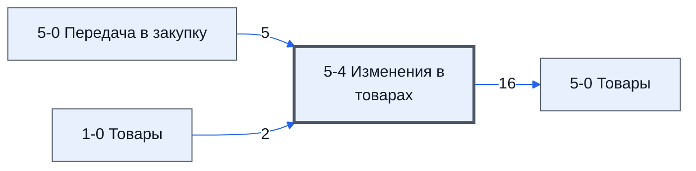

> Черновик: текст не проверен.

# Лист «5-4 Изменения в товарах»

**Назначение**

Лист для **планирования изменений в списке товаров**: добавление новых товаров, отмена, замена, разделение, объединение нескольких в один и другое, что может понадобиться.

**Кто работает:** [Закупщик (специалист по закупке)](../../reg/rol/zakupka.md). Во всём контуре 2 менеджер один.

Устройство листа — размер, столбцы, формулы, связи с другими листами — собрано из таблицы в конце страницы.

## Два блока

| Блок | Строки | Что редактируем | Что заполняется само |
|---|---|---|---|
| 1. Исключить позиции товара | 11–60 | B, C, D, F | остальные столбцы товара — по номеру позиции в F |
| 2. Добавляем новые товары | 62–112 | B, C, D, G–Q | E и F — формулой |

- **C** — причина изменения; она попадёт на лист **[5-3 Выбор поставщиков Закупки](../../lis/k2-5-3-vybor-postavshchikov/index.md)**. В верхнем блоке столбец называется «Исключить по причине», в нижнем — «Добавить по причине».
- **D «Что проверить»** — короткая заметка, что проверить после изменения: «Количество», «Замена», «Слияние», «Отмена», «Добавление».

Пример заполнения:

**Текст на фото:**

* 001 «Раздельно по поставщикам»: позиция 3 исключена, взамен добавлены 501 и 502 — две части.
* 002 «Меняем на другой аналог»: позиция 2 исключена, взамен добавлена 503.
* 003 «Передумали, отражено в договоре»: позиция 1 отменена, взамен ничего.
* **№ Изменения** связывает исключённую позицию с новыми.
* Не хватает строк — внизу листа «Добавьте больше строк».

Как работать с блоками:

- [Умение. Запланировать исключение или изменение позиции](../../um/tov-k2-5-4-isklyuchit/index.md) — На листе «5-4 Изменения в товарах» в верхнем блоке выбрать позицию, вписать причину и что проверить.
- [Умение. Добавить новую позицию товара](../../um/tov-k2-5-4-dobavit/index.md) — На листе «5-4 Изменения в товарах» в нижнем блоке описать новый товар так же, как товары в договоре.

## Что нельзя трогать

Столбцы **A** и **E** — в них важные формулы.

## Полный перечень столбцов

Со слов директора: ID_Изменения, № Изменения, Исключить по причине, Что проверить, ID_Товара, №, Номенклатура, Название товара по договору, Изготовитель товара по договору, Характеристики, Состав поставляемой с продукцией технической документации, Ед. Изм, Кол-во, НМЦ, Срок поставки по договору, Нац режим 1875, Код ОКПД 2.

## Осталось сделать

- Снимки заменить (пометка директора).

## Устройство (из таблицы)

- **Таблица:** таблица проекта, лист «5-4 Изменения в товарах»; контур 2
- **Размер:** `A1:AB112`, закреплено до `A11`
- **Каркас:** свой, не общий; строка заголовков — 10, угадана по закреплённой области — проверить
- **Формул:** 8; заполненных ячеек без формул в данных: 14; списков: 3; условного форматирования: 0; объединённых ячеек: 0

## Связи с другими листами

- **Берёт данные с листов:** [5-0 Передача в закупку](../k2-5-0-peredacha/index.md) (5), [1-0 Товары](../k1-1-0-tovary/index.md) (2)
- **Его данные используют:** [5-0 Товары](../k2-5-0-tovary/index.md) (16)

В скобках и на стрелках — сколько формул ссылаются.

## Столбцы

Устройство — из таблицы; «Что это» и «Как заполняют» — из `stolbtsy.yaml` (заполняем руками).

| Столбец | Заголовок | Служебное имя | Вид | Заполняется | Список | Что это | Как заполняют |
|---|---|---|---|---|---|---|---|
| A | ID_Изменения |  |  | формула |  | ключ изменения (ID_Z…); формула заодно выводит № изменения | формула: из столбца B |
| B | № Изменения |  |  | руками, из списка | '5-4 Изменения в товарах'!$B$11:$B$60 | № изменения | руками; список берёт значения из этого же столбца (строки 11–60) — проверить, зачем |
| C | Исключить по причине |  |  | руками? |  | почему товар убрать из закупки | руками; уходит на лист 5-0 Товары, столбец B |
| D | Что проверить |  |  | руками, из списка | '5-4 Изменения в товарах'!$D$2:$D$8 | что проверить по этому изменению | руками, из списка (варианты — в ячейках D2:D8 этого листа) |
| E | ID_Товара |  |  | формула |  | ID_Товара изменяемого товара | формула: находит по № (столбец F) на листе 1-0 Товары |
| F | № |  |  | формула | '1-0 Товары'!$D$11:$D112 | № товара, который меняем | руками, из списка номеров листа 1-0 Товары |
| G | Номенклатура |  |  | формула |  | новая номенклатура | руками: новое значение; пусто — остаётся как в договоре (лист 5-0 Передача); формула в заголовке тянет заголовки с 5-0 Передача |
| H | Название товара по договору |  |  | руками? |  | новое название товара по договору | руками: новое значение; пусто — остаётся как в договоре (лист 5-0 Передача) |
| I | Изготовитель товара по договору |  |  | руками? |  | новый изготовитель по договору | руками: новое значение; пусто — остаётся как в договоре (лист 5-0 Передача) |
| J | Характеристики |  |  | руками? |  | новые характеристики | руками: новое значение; пусто — остаётся как в договоре (лист 5-0 Передача) |
| K | Состав поставляемой с продукцией технической документации |  |  | руками? |  | новый состав технической документации | руками: новое значение; пусто — остаётся как в договоре (лист 5-0 Передача) |
| L | Ед. Изм |  |  | руками? |  | новая единица измерения | руками: новое значение; пусто — остаётся как в договоре (лист 5-0 Передача) |
| M | Кол-во |  |  | руками? |  | новое количество | руками: новое значение; пусто — остаётся как в договоре (лист 5-0 Передача) |
| N | НМЦ |  |  | руками? |  | новая НМЦ за единицу | руками: новое значение; пусто — остаётся как в договоре (лист 5-0 Передача) |
| O | Срок поставки по договору |  |  | руками? |  | новый срок поставки по договору | руками: новое значение; пусто — остаётся как в договоре (лист 5-0 Передача) |
| P | Нац режим 1875 |  |  | руками? |  | нац. режим 1875 — новое значение | руками: новое значение; пусто — остаётся как в договоре (лист 5-0 Передача) |
| Q | Код ОКПД 2 |  |  | руками? |  | код ОКПД 2 — новое значение | руками: новое значение; пусто — остаётся как в договоре (лист 5-0 Передача) |

Формулы столбцов (4)

| Столбец | Строка | Формула |
|---|---|---|
| A | 10 | <code>={{"ID_Изменения","№ Изменения"} ;LAMBDA(_arr_rs,_rf, BYROW(_arr_rs, LAMBDA(r , LAmbda(id, { IF(id&lt;&gt;0, "ID_Z"&amp;id, ) , IF(id&lt;&gt;0, ""&amp;id , ) } ) ( IF(r&lt;&gt;"", RIGHT("000" &amp; ROW(r)-_rf+1,3),0) ) ) ) )('5-4 Изменения в товарах'!$G$11:$G$60, ROW( '5-4 Изменения в товарах'!$G$11)) }</code> |
| E | 10 | <code>={"ID_Товара";BYROW('5-4 Изменения в товарах'!F11:F60,lambda(_n,IF(_n&lt;&gt;"",IFERROR(VLOOKUP(_n,{'1-0 Товары'!D:D,'1-0 Товары'!C:C},2,FALSE),),)))}</code> |
| F | 10 | <code>='5-0 Передача в закупку'!D10</code> |
| G | 10 | <code>='5-0 Передача в закупку'!E10:O10</code> |

