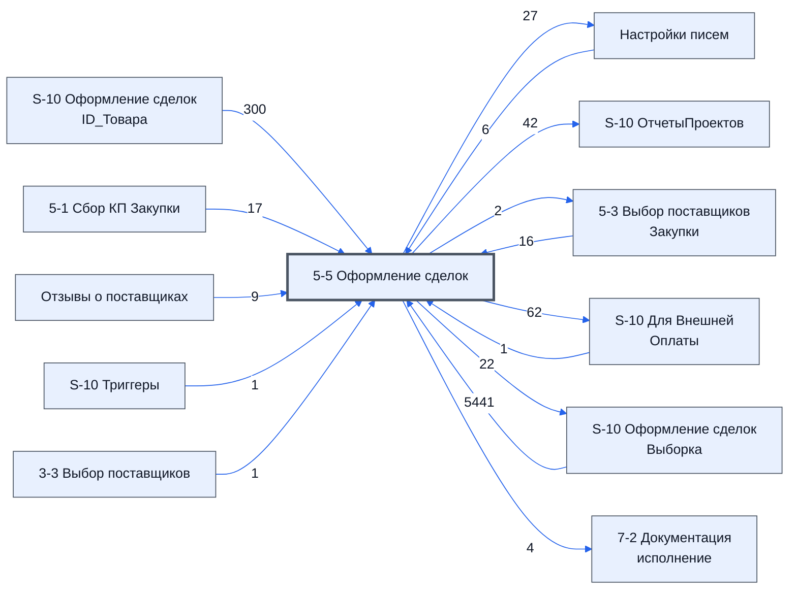

> Черновик: текст не проверен.

# Лист «5-5 Оформление сделок»

**Назначение**

Сюда попадают товары, у которых на листе **[5-3 Выбор поставщиков Закупки](../../lis/k2-5-3-vybor-postavshchikov/index.md)** в столбце «Сделка» стоит «Да» (через служебный лист «S-10 Оформление сделок ID_Товара»). Здесь заполняются подробные сведения о поставщиках и ценах: это договоры с поставщиками о закупке товаров нами.

Память листа — на служебном листе «S-10 Оформление сделок Комментарии», подготовка данных — на «S-10 Оформление сделок Выборка».

*Записано коротко; подробности — позже.*

Устройство листа — размер, столбцы, формулы, связи с другими листами — собрано из таблицы в конце страницы.

## Осталось сделать

**Вопросы**

1. Кто работает на листе и что заполняет руками?
2. Что на листе нельзя трогать?
3. Верен ли список столбцов выше?

## Устройство (из таблицы)

- **Таблица:** таблица проекта, лист «5-5 Оформление сделок»; контур 2
- **Размер:** `A1:BX319`, закреплено до `L11`
- **Каркас:** общий — служебные строки, заголовки в строке 10 ([что значат служебные строки](../../zna/lis-sluzhebnye-stroki/index.md))
- **Формул:** 5791; заполненных ячеек без формул в данных: 662; списков: 5; условного форматирования: 24; объединённых ячеек: 1
- **Данные из других таблиц (IMPORTRANGE):** 1

## Связи с другими листами

- **Берёт данные с листов:** [S-10 Оформление сделок Выборка](../k2-s-10-oformlenie-sdelok-vyborka/index.md) (5441), [S-10 Оформление сделок ID_Товара](../k2-s-10-oformlenie-sdelok-id-tovara/index.md) (300), [5-1 Сбор КП Закупки](../k2-5-1-sbor-kp/index.md) (17), [5-3 Выбор поставщиков Закупки](../k2-5-3-vybor-postavshchikov/index.md) (16), [Отзывы о поставщиках](../k1-otzyvy-o-postavshchikakh/index.md) (9), [Настройки писем](../k0-nastroyki-pisem/index.md) (6), [S-10 Для Внешней Оплаты](../k2-s-10-dlya-vneshney-oplaty/index.md) (1), [S-10 Триггеры](../k0-s-10-triggery/index.md) (1), [3-3 Выбор поставщиков](../k1-3-3-vybor-postavshchikov/index.md) (1)
- **Его данные используют:** [Настройки писем](../k0-nastroyki-pisem/index.md) (27), [S-10 ОтчетыПроектов](../k0-s-10-otchetyproektov/index.md) (42), [5-3 Выбор поставщиков Закупки](../k2-5-3-vybor-postavshchikov/index.md) (2), [S-10 Для Внешней Оплаты](../k2-s-10-dlya-vneshney-oplaty/index.md) (62), [S-10 Оформление сделок Выборка](../k2-s-10-oformlenie-sdelok-vyborka/index.md) (22), [7-2 Документация исполнение](../k3-7-2-dokumentatsiya-ispolnenie/index.md) (4)

В скобках и на стрелках — сколько формул ссылаются.

## Кто здесь работает (по процессам)

Обязанности, у которых место работы — этот лист (из разбора регламента); должность — в карточке обязанности.

[Ведущий лист оформления сделок](../../reg/oby/vedenie-sdelok.md), [Передающий согласованное в оплату](../../reg/oby/v-oplatu.md)

## Столбцы

Устройство — из таблицы; «Что это» и «Как заполняют» — из `stolbtsy.yaml` (заполняем руками).

| Столбец | Заголовок | Служебное имя | Вид | Заполняется | Список | Что это | Как заполняют |
|---|---|---|---|---|---|---|---|
| A *(скрыт)* |  | err |  | руками? |  |  |  |
| B *(скрыт)* |  | err2 |  | руками? |  |  |  |
| C | ID_Товара |  | formulaCell | формула |  |  |  |
| D | № | Номер | formulaColl | формула |  |  |  |
| E *(скрыт)* | Номенклатура | Номенклатура | formulaColl | формула |  |  |  |
| F | Название товара по договору | НазваниеТовараПоДоговору | formulaColl | формула |  |  |  |
| G *(скрыт)* | Изготовитель товара по договору | ИзготовительТовараПоДоговору | formulaColl | формула |  |  |  |
| H *(скрыт)* | Характеристики | Характеристики |  | формула |  |  |  |
| I *(скрыт)* | Состав поставляемой с продукцией технической документации | СоставТехническойДокументации |  | формула |  |  |  |
| J | Ед. Изм | ЕдИзм | formulaColl | формула |  |  |  |
| K | Кол-во | Количевство | formulaColl | формула |  |  |  |
| L | Группа | Группа | formulaColl | формула |  |  |  |
| M | Цена | Цена | formulaColl | формула |  |  |  |
| N | Сумма | Сумма | formulaColl | формула |  |  |  |
| O | Срок поставки | Срок поставки | formulaColl | формула |  |  |  |
| P | Срок поставки по договору | СрокПоставкиПоДоговору | formulaColl | формула |  |  |  |
| Q *(скрыт)* |  | Свободно1 |  | руками? |  |  |  |
| R *(скрыт)* |  | Свободно2 |  | руками? |  |  |  |
| S *(скрыт)* |  | Свободно3 |  | руками? |  |  |  |
| T *(скрыт)* |  | Свободно4 |  | руками? |  |  |  |
| U *(скрыт)* | Кто контактирует с заказчиком по вопросу исполнения | КонтактируетСЗаказчикомПоВопросуИсполнения | formulaColl | формула |  |  |  |
| V *(скрыт)* | Особые условия | ОсобыеУсловия | formulaColl | формула |  |  |  |
| W *(скрыт)* | Дата подписания договора | ДатаПодписанияДоговора | formulaColl | формула |  |  |  |
| X *(скрыт)* | Место поставки товара | МестоПоставкиТовара | formulaColl | формула |  |  |  |
| Y *(скрыт)* | Контакты покупателя | КонтактыПокупателя | formulaColl | формула |  |  |  |
| Z *(скрыт)* | Экспортный контракт | ЭкспортныйКонтракт | formulaColl | формула |  |  |  |
| AA *(скрыт)* | Основной Поставщик | ПоставщикВыбор | formulaColl | формула |  |  |  |
| AB | Поставщик | Поставщик |  | руками? |  |  |  |
| AC | Основное Предложение | ЛистИПредложение | formulaColl | формула |  |  |  |
| AD | Комментарий к товару с листа 5-3 | Комментарий | formulaColl | формула |  |  |  |
| AE *(скрыт)* |  | Статус.Ф | formulaCell | формула |  |  |  |
| AF | Статус | Статус | formulaFree | руками, потом формула | 'Настройки писем'!$AX$2:$AX$25 |  |  |
| AG | Результат проверки контаргента | РезультатПроверкиКонтаргента | formulaColl | формула |  |  |  |
| AH | Завершенных сделок | ЗавершенныхСделок | formulaColl | формула |  |  |  |
| AI | Кинул | Кинул | formulaColl | формула |  |  |  |
| AJ | Сделок в работе | СделокВРаботе | formulaColl | формула |  |  |  |
| AK *(скрыт)* |  | КомментарийКСделке.Ф | formulaCell | формула |  |  |  |
| AL | Комментарий закупщика к сделке | КомментарийКСделке | formulaFree | руками, потом формула |  |  |  |
| AM *(скрыт)* |  | ДатаСледКонтакта.Ф | formulaCell | формула |  |  |  |
| AN | Дата след контакта | ДатаСледКонтакта | formulaFree | руками, потом формула |  |  |  |
| AO *(скрыт)* |  | РеальнаяЦена.Ф | formulaCell | формула |  |  |  |
| AP | Реальная цена | РеальнаяЦена | formulaFree | руками, потом формула |  |  |  |
| AQ | Реальная цена Итого | РеальнаяЦенаИтого | formulaColl | формула |  |  |  |
| AR *(скрыт)* |  | РеальныйСрок.Ф | formulaCell | формула |  |  |  |
| AS | Реальный срок | РеальныйСрок | formulaFree | руками, потом формула |  |  |  |
| AT *(скрыт)* |  | НДС.Ф | formulaCell | формула |  |  |  |
| AU | НДС | НДС | formulaFree | руками, потом формула | 'Настройки писем'!$BG$2:$BG$8 |  |  |
| AV *(скрыт)* |  | ВидОплаты.Ф | formulaCell | формула |  |  |  |
| AW | Вид оплаты | ВидОплаты | formulaFree | руками, потом формула | 'Настройки писем'!$BQ$2:$BQ$10 |  |  |
| AX | Разница в цене за штуку | РазницаЗаШтуку | formulaColl | формула |  |  |  |
| AY | Разница итого | РазницаИтого | formulaColl | формула |  |  |  |
| AZ *(скрыт)* |  | ИннПоставщика.Ф | formulaCell | формула |  |  |  |
| BA | ИНН Постав-ка | ИннПоставщика | formulaFree | руками, потом формула |  |  |  |
| BB *(скрыт)* |  | ПроцентПервоначальнойОплаты.Ф | formulaCell | формула |  |  |  |
| BC | Процент перв-ной оп-ты | ПроцентПервоначальнойОплаты | formulaFree | руками, потом формула |  |  |  |
| BD *(скрыт)* |  | УсловияОплаты.Ф | formulaCell | формула |  |  |  |
| BE | Условия оплаты | УсловияОплаты | formulaFree | руками, потом формула | 'Настройки писем'!$AU$2:$AU319 |  |  |
| BF *(скрыт)* |  | ИныеУсловияОплаты.Ф | formulaCell | формула |  |  |  |
| BG | Иные условия оплаты | ИныеУсловияОплаты | formulaFree | руками, потом формула |  |  |  |
| BH *(скрыт)* |  | ОтсрочкаКалендарныхДней.Ф | formulaCell | формула |  |  |  |
| BI | Отсрочка календарных дней | ОтсрочкаКалендарныхДней | formulaFree | руками, потом формула |  |  |  |
| BJ *(скрыт)* |  | КудаДоставитьГруз.Ф | formulaCell | формула |  |  |  |
| BK | Куда доставить груз (промежучточное место комплектации) | КудаДоставитьГруз | formulaFree | руками, потом формула |  |  |  |
| BL *(скрыт)* |  | ОбязательстваПоставщикаПоДоставке.Ф | formulaCell | формула |  |  |  |
| BM | Обязательства поставщика по доставке | ОбязательстваПоставщикаПоДоставке | formulaFree | руками, потом формула | 'Настройки писем'!$AW$2:$AW319 |  |  |
| BN *(скрыт)* |  | СтатусОплаты.Ф | formulaCell | формула |  |  |  |
| BO | Статус оплаты | СтатусОплаты | formulaFree | руками, потом формула |  |  |  |
| BP *(скрыт)* |  | ПроцентОплаты.Ф | formulaCell | формула |  |  |  |
| BQ | Процент оплаты | ПроцентОплаты |  | руками? |  |  |  |
| BR *(скрыт)* |  | ДатаПолученияФинальногоСчетДоговора.Ф | formulaCell | формула |  |  |  |
| BS | Дата получения финального счет договора | ДатаПолученияФинальногоСчетДоговора | formulaFree | руками, потом формула |  |  |  |
| BT *(скрыт)* |  | ДатаОтправкиПодписанногоСНашейСтороныСчетДоговора.Ф | formulaCell | формула |  |  |  |
| BU | Дата отправки подписанного нами счет договора | ДатаОтправкиПодписанногоСНашейСтороныСчетДоговора | formulaFree | руками, потом формула |  |  |  |
| BV *(скрыт)* |  | ПроверкаОшибок.Ф | formulaCell | формула |  |  |  |
| BW | Проверка ошибок | ПроверкаОшибок | formulaFree | руками, потом формула |  |  |  |

## Переменные листа

Строки 5–6 каркаса (`var_name`, `var_value`): имя переменной и её значения — скорее всего, списки для скриптов и выпадающих списков.

| Ячейка | Имя | Значения |
|---|---|---|
| D | Реальная цена | Дополнить счет; Попросили скидку; Уточняем срок поставки; Согласовываем оплату 50 на 50; Счет готов к оплате; Дополнительные пункты указать отказался; Счет передан в оплату с доп пунктами; Счет передан в оплату без доп пунктов; Готовим договор; Договор отправлен на согласование; Согласовать правки поставщика; Дополнить договор поставщика; Отправлена финальная версия договора; Скан подписанного договора получен; Договор передан в оплату Наша версия договора; Договор передан в оплату Версия поставщика |
| E | Реальный срок | Согласовываем оплату 50 на 50; Счет готов к оплате; Дополнительные пункты указать отказался; Счет передан в оплату с доп пунктами; Счет передан в оплату без доп пунктов; Готовим договор; Договор отправлен на согласование; Согласовать правки поставщика; Дополнить договор поставщика; Отправлена финальная версия договора; Скан подписанного договора получен; Договор передан в оплату Наша версия договора; Договор передан в оплату Версия поставщика |
| F | Статусы Условия получены | Счет готов к оплате; Дополнительные пункты указать отказался; Счет передан в оплату с доп пунктами; Счет передан в оплату без доп пунктов; Готовим договор; Договор отправлен на согласование; Согласовать правки поставщика; Дополнить договор поставщика; Отправлена финальная версия договора; Скан подписанного договора получен; Договор передан в оплату Наша версия договора; Договор передан в оплату Версия поставщика |

Формулы столбцов (50)

| Столбец | Строка | Формула |
|---|---|---|
| C | 10 | <code>='5-1 Сбор КП Закупки'!C10</code> |
| D | 10 | <code>=LAMBDA(doNothing,doFind,doRezolve,theIds,theData, byrow(doRezolve(doNothing,doFind,theIds,theData),LAMBDA(t,t)) )( LAMBDA(theIds,theData,), LAMBDA(theId,theData, VLOOKUP(theId,theData,2,FALSE) ), LAMBDA(doNothing,doFind,theIds,theData, ByRow(theIds,LAMBDA(theId,IF(theId&lt;&gt;"",doFind,doNothing)(theId,theData) ))), '5-5 Оформление сделок'!$C$10:$C310,{'5-1 Сбор КП Закупки'!$C$10:$C319,'5-1 Сбор КП За …</code> |
| E | 10 | <code>=LAMBDA(doNothing,doFind,doRezolve,theIds,theData, byrow(doRezolve(doNothing,doFind,theIds,theData),LAMBDA(t,t)) )( LAMBDA(theIds,theData,), LAMBDA(theId,theData, VLOOKUP(theId,theData,2,FALSE) ), LAMBDA(doNothing,doFind,theIds,theData, ByRow(theIds,LAMBDA(theId,IF(theId&lt;&gt;"",doFind,doNothing)(theId,theData) ))), '5-5 Оформление сделок'!$C$10:$C310,{'5-1 Сбор КП Закупки'!$C$10:$C319,'5-1 Сбор КП За …</code> |
| F | 10 | <code>=LAMBDA(doNothing,doFind,doRezolve,theIds,theData, byrow(doRezolve(doNothing,doFind,theIds,theData),LAMBDA(t,t)) )( LAMBDA(theIds,theData,), LAMBDA(theId,theData, VLOOKUP(theId,theData,2,FALSE) ), LAMBDA(doNothing,doFind,theIds,theData, ByRow(theIds,LAMBDA(theId,IF(theId&lt;&gt;"",doFind,doNothing)(theId,theData) ))), '5-5 Оформление сделок'!$C$10:$C310,{'5-1 Сбор КП Закупки'!$C$10:$C319,'5-1 Сбор КП За …</code> |
| G | 10 | <code>=LAMBDA(doNothing,doFind,doRezolve,theIds,theData, byrow(doRezolve(doNothing,doFind,theIds,theData),LAMBDA(t,t)) )( LAMBDA(theIds,theData,), LAMBDA(theId,theData, VLOOKUP(theId,theData,2,FALSE) ), LAMBDA(doNothing,doFind,theIds,theData, ByRow(theIds,LAMBDA(theId,IF(theId&lt;&gt;"",doFind,doNothing)(theId,theData) ))), '5-5 Оформление сделок'!$C$10:$C$310,{'5-1 Сбор КП Закупки'!$C$10:$C319,'5-1 Сбор КП З …</code> |
| H | 10 | <code>=LAMBDA(doNothing,doFind,doRezolve,theIds,theData, byrow(doRezolve(doNothing,doFind,theIds,theData),LAMBDA(t,t)) )( LAMBDA(theIds,theData,), LAMBDA(theId,theData, VLOOKUP(theId,theData,2,FALSE) ), LAMBDA(doNothing,doFind,theIds,theData, ByRow(theIds,LAMBDA(theId,IF(theId&lt;&gt;"",doFind,doNothing)(theId,theData) ))), '5-5 Оформление сделок'!$C$10:$C$310,{'5-1 Сбор КП Закупки'!$C$10:$C319,'5-1 Сбор КП З …</code> |
| I | 10 | <code>=LAMBDA(doNothing,doFind,doRezolve,theIds,theData, byrow(doRezolve(doNothing,doFind,theIds,theData),LAMBDA(t,t)) )( LAMBDA(theIds,theData,), LAMBDA(theId,theData, VLOOKUP(theId,theData,2,FALSE) ), LAMBDA(doNothing,doFind,theIds,theData, ByRow(theIds,LAMBDA(theId,IF(theId&lt;&gt;"",doFind,doNothing)(theId,theData) ))), '5-5 Оформление сделок'!$C$10:$C$310,{'5-1 Сбор КП Закупки'!$C$10:$C319,'5-1 Сбор КП З …</code> |
| J | 10 | <code>=LAMBDA(doNothing,doFind,doRezolve,theIds,theData, byrow(doRezolve(doNothing,doFind,theIds,theData),LAMBDA(t,t)) )( LAMBDA(theIds,theData,), LAMBDA(theId,theData, VLOOKUP(theId,theData,2,FALSE) ), LAMBDA(doNothing,doFind,theIds,theData, ByRow(theIds,LAMBDA(theId,IF(theId&lt;&gt;"",doFind,doNothing)(theId,theData) ))), '5-5 Оформление сделок'!$C$10:$C$310,{'5-1 Сбор КП Закупки'!$C$10:$C319,'5-1 Сбор КП З …</code> |
| K | 10 | <code>=LAMBDA(doNothing,doFind,doRezolve,theIds,theData, byrow(doRezolve(doNothing,doFind,theIds,theData),LAMBDA(t,t)) )( LAMBDA(theIds,theData,), LAMBDA(theId,theData, VLOOKUP(theId,theData,2,FALSE) ), LAMBDA(doNothing,doFind,theIds,theData, ByRow(theIds,LAMBDA(theId,IF(theId&lt;&gt;"",doFind,doNothing)(theId,theData) ))), '5-5 Оформление сделок'!$C$10:$C$310,{'5-1 Сбор КП Закупки'!$C$10:$C319,'5-1 Сбор КП З …</code> |
| L | 10 | <code>=LAMBDA(doNothing, doFind, doRezolve, theIds, theData, doRezolve(doNothing,doFind,theIds,theData))( LAMBDA(theIds,theData,), LAMBDA(theId,theData, VLOOKUP(theId,theData,2,FALSE) ), LAMBDA(doNothing,doFind,theIds,theData, ByRow(theIds,LAMBDA(theId,IF(theId&lt;&gt;"",doFind,doNothing)(theId,theData) ))), '5-5 Оформление сделок'!$C$10:$C$310, {'5-3 Выбор поставщиков Закупки'!$C$10:$C319,'5-3 Выбор поставщи …</code> |
| M | 10 | <code>=LAMBDA(doNothing, doFind, doRezolve, theIds, theData, doRezolve(doNothing,doFind,theIds,theData))( LAMBDA(theIds,theData,), LAMBDA(theId,theData, VLOOKUP(theId,theData,2,FALSE) ), LAMBDA(doNothing,doFind,theIds,theData, ByRow(theIds,LAMBDA(theId,IF(theId&lt;&gt;"",doFind,doNothing)(theId,theData) ))), '5-5 Оформление сделок'!$C$10:$C$310, {'5-3 Выбор поставщиков Закупки'!$C$10:$C319,'5-3 Выбор поставщи …</code> |
| N | 10 | <code>=LAMBDA(doNothing, doFind, doRezolve, theIds, theData, doRezolve(doNothing,doFind,theIds,theData))( LAMBDA(theIds,theData,), LAMBDA(theId,theData, VLOOKUP(theId,theData,2,FALSE) ), LAMBDA(doNothing,doFind,theIds,theData, ByRow(theIds,LAMBDA(theId,IF(theId&lt;&gt;"",doFind,doNothing)(theId,theData) ))), '5-5 Оформление сделок'!$C$10:$C$310, {'5-3 Выбор поставщиков Закупки'!$C$10:$C319,'5-3 Выбор поставщи …</code> |
| O | 10 | <code>=LAMBDA(doNothing, doFind, doRezolve, theIds, theData, doRezolve(doNothing,doFind,theIds,theData))( LAMBDA(theIds,theData,), LAMBDA(theId,theData, VLOOKUP(theId,theData,2,FALSE) ), LAMBDA(doNothing,doFind,theIds,theData, ByRow(theIds,LAMBDA(theId,IF(theId&lt;&gt;"",doFind,doNothing)(theId,theData) ))), '5-5 Оформление сделок'!$C$10:$C$310, {'5-3 Выбор поставщиков Закупки'!$C$10:$C319,'5-3 Выбор поставщи …</code> |
| P | 10 | <code>=LAMBDA(doNothing, doFind, doRezolve, theIds, theData, doRezolve(doNothing,doFind,theIds,theData))( LAMBDA(theIds,theData,), LAMBDA(theId,theData, VLOOKUP(theId,theData,2,FALSE) ), LAMBDA(doNothing,doFind,theIds,theData, ByRow(theIds,LAMBDA(theId,IF(theId&lt;&gt;"",doFind,doNothing)(theId,theData) ))), '5-5 Оформление сделок'!$C$10:$C$310, {'5-3 Выбор поставщиков Закупки'!$C$10:$C319,'5-3 Выбор поставщи …</code> |
| U | 10 | <code>=LAMBDA(doNothing, doFind, doRezolve, theIds, theData, doRezolve(doNothing,doFind,theIds,theData))( LAMBDA(theIds,theData,), LAMBDA(theId,theData, VLOOKUP(theId,theData,2,FALSE) ), LAMBDA(doNothing,doFind,theIds,theData, ByRow(theIds,LAMBDA(theId,IF(theId&lt;&gt;"",doFind,doNothing)(theId,theData) ))), '5-5 Оформление сделок'!$C$10:$C$310, {'S-10 Оформление сделок Выборка'!$C$10:$C319,'S-10 Оформление с …</code> |
| V | 10 | <code>=LAMBDA(doNothing, doFind, doRezolve, theIds, theData, doRezolve(doNothing,doFind,theIds,theData))( LAMBDA(theIds,theData,), LAMBDA(theId,theData, VLOOKUP(theId,theData,2,FALSE) ), LAMBDA(doNothing,doFind,theIds,theData, ByRow(theIds,LAMBDA(theId,IF(theId&lt;&gt;"",doFind,doNothing)(theId,theData) ))), '5-5 Оформление сделок'!$C$10:$C$310, {'S-10 Оформление сделок Выборка'!$C$10:$C319,'S-10 Оформление с …</code> |
| W | 10 | <code>=LAMBDA(doNothing, doFind, doRezolve, theIds, theData, doRezolve(doNothing,doFind,theIds,theData))( LAMBDA(theIds,theData,), LAMBDA(theId,theData, VLOOKUP(theId,theData,2,FALSE) ), LAMBDA(doNothing,doFind,theIds,theData, ByRow(theIds,LAMBDA(theId,IF(theId&lt;&gt;"",doFind,doNothing)(theId,theData) ))), '5-5 Оформление сделок'!$C$10:$C$310, {'S-10 Оформление сделок Выборка'!$C$10:$C319,'S-10 Оформление с …</code> |
| X | 10 | <code>=LAMBDA(doNothing, doFind, doRezolve, theIds, theData, doRezolve(doNothing,doFind,theIds,theData))( LAMBDA(theIds,theData,), LAMBDA(theId,theData, VLOOKUP(theId,theData,2,FALSE) ), LAMBDA(doNothing,doFind,theIds,theData, ByRow(theIds,LAMBDA(theId,IF(theId&lt;&gt;"",doFind,doNothing)(theId,theData) ))), '5-5 Оформление сделок'!$C$10:$C$310, {'S-10 Оформление сделок Выборка'!$C$10:$C319,'S-10 Оформление с …</code> |
| Y | 10 | <code>=LAMBDA(doNothing, doFind, doRezolve, theIds, theData, doRezolve(doNothing,doFind,theIds,theData))( LAMBDA(theIds,theData,), LAMBDA(theId,theData, VLOOKUP(theId,theData,2,FALSE) ), LAMBDA(doNothing,doFind,theIds,theData, ByRow(theIds,LAMBDA(theId,IF(theId&lt;&gt;"",doFind,doNothing)(theId,theData) ))), '5-5 Оформление сделок'!$C$10:$C$310, {'S-10 Оформление сделок Выборка'!$C$10:$C319,'S-10 Оформление с …</code> |
| Z | 10 | <code>=LAMBDA(doNothing, doFind, doRezolve, theIds, theData, doRezolve(doNothing,doFind,theIds,theData))( LAMBDA(theIds,theData,), LAMBDA(theId,theData, VLOOKUP(theId,theData,2,FALSE) ), LAMBDA(doNothing,doFind,theIds,theData, ByRow(theIds,LAMBDA(theId,IF(theId&lt;&gt;"",doFind,doNothing)(theId,theData) ))), '5-5 Оформление сделок'!$C$10:$C$310, {'S-10 Оформление сделок Выборка'!$C$10:$C319,'S-10 Оформление с …</code> |
| AA | 10 | <code>=LAMBDA(doNothing, doFind, doRezolve, theIds, theData, doRezolve(doNothing,doFind,theIds,theData))( LAMBDA(theIds,theData,), LAMBDA(theId,theData, VLOOKUP(theId,theData,2,FALSE) ), LAMBDA(doNothing,doFind,theIds,theData, ByRow(theIds,LAMBDA(theId,IF(theId&lt;&gt;"",doFind,doNothing)(theId,theData) ))), '5-5 Оформление сделок'!$C$10:$C$310, {'5-3 Выбор поставщиков Закупки'!$C$10:$C319,'5-3 Выбор поставщи …</code> |
| AC | 10 | <code>=LAMBDA(doNothing, doFind, doRezolve, theIds, theData, doRezolve(doNothing,doFind,theIds,theData))( LAMBDA(theIds,theData,), LAMBDA(theId,theData, VLOOKUP(theId,theData,2,FALSE) ), LAMBDA(doNothing,doFind,theIds,theData, ByRow(theIds,LAMBDA(theId,IF(theId&lt;&gt;"",doFind,doNothing)(theId,theData) ))), '5-5 Оформление сделок'!$C$10:$C$310, {'5-3 Выбор поставщиков Закупки'!$C$10:$C319,'5-3 Выбор поставщи …</code> |
| AD | 10 | <code>={"Комментарий к товару с листа 5-3";LAMBDA(doNothing, doFind, doRezolve, theIds, theData, doRezolve(doNothing,doFind,theIds,theData))( LAMBDA(theIds,theData,), LAMBDA(theId,theData, VLOOKUP(theId,theData,2,FALSE) ), LAMBDA(doNothing,doFind,theIds,theData, ByRow(theIds,LAMBDA(theId,IF(theId&lt;&gt;"",doFind,doNothing)(theId,theData) ))), '5-5 Оформление сделок'!$C$11:$C$310, {'5-3 Выбор поставщиков Заку …</code> |
| AE | 10 | <code>={"",'S-10 Оформление сделок Выборка'!AF10}</code> |
| AG | 10 | <code>={"Результат проверки контаргента";LAMBDA(doNafing, doFind,doRezolve, theMails,theReviews, doRezolve(doNafing, doFind,theMails,theReviews))( LAMBDA( theMail,theReviews,), LAMBDA(theMail, theReviews, IFERROR(HYPERLINK("#gid=365917017&amp;range=B"&amp;VLOOKUP(theMail,theReviews,3,0), LAMBDA(the,IF(the="","Без оценки",the))(VLOOKUP(theMail,theReviews,2,0)) ),"Надо проверить")), LAMBDA(doNafing, doFind, theMa …</code> |
| AH | 10 | <code>={"Завершенных сделок";LAMBDA(doNafing, doFind,doRezolve, theMails,theReviews, doRezolve(doNafing, doFind,theMails,theReviews))( LAMBDA( theMail,theReviews,), LAMBDA(theMail, theReviews, IFERROR(VLOOKUP(theMail,theReviews,2,0),"-")), LAMBDA(doNafing, doFind, theMails,theReviews,BYROW(theMails,LAMBDA(theMail, IF(LEN(theMail)&gt;0, doFind, doNafing)(theMail,theReviews) ))), '5-5 Оформление сделок'!$AB$ …</code> |
| AI | 10 | <code>={"Кинул";LAMBDA(doNafing, doFind,doRezolve, theMails,theReviews, doRezolve(doNafing, doFind,theMails,theReviews))( LAMBDA( theMail,theReviews,), LAMBDA(theMail, theReviews, IFERROR(VLOOKUP(theMail,theReviews,2,0),"-")), LAMBDA(doNafing, doFind, theMails,theReviews,BYROW(theMails,LAMBDA(theMail, IF(LEN(theMail)&gt;0, doFind, doNafing)(theMail,theReviews) ))), '5-5 Оформление сделок'!$AB$11:$AB$310, { …</code> |
| AJ | 10 | <code>={"Сделок в работе";LAMBDA(doNafing, doFind,doRezolve, theMails,theReviews, doRezolve(doNafing, doFind,theMails,theReviews))( LAMBDA( theMail,theReviews,), LAMBDA(theMail, theReviews, IFERROR(VLOOKUP(theMail,theReviews,2,0),"-")), LAMBDA(doNafing, doFind, theMails,theReviews,BYROW(theMails,LAMBDA(theMail, IF(LEN(theMail)&gt;0, doFind, doNafing)(theMail,theReviews) ))), '5-5 Оформление сделок'!$AB$11: …</code> |
| AK | 10 | <code>={"",'S-10 Оформление сделок Выборка'!AL10}</code> |
| AM | 10 | <code>={"",'S-10 Оформление сделок Выборка'!AN10}</code> |
| AO | 10 | <code>={"",'S-10 Оформление сделок Выборка'!AP10}</code> |
| AP | 311 | <code>="Итого"</code> |
| AQ | 10 | <code>={"Реальная цена Итого";LAMBDA(theData,{ theData; SUM(theData)} )(IF(E11:E$310&lt;&gt;"",(K11:K$310* AP11:AP$310),))}</code> |
| AR | 10 | <code>={"",'S-10 Оформление сделок Выборка'!AS10}</code> |
| AT | 10 | <code>={"",'S-10 Оформление сделок Выборка'!AU10}</code> |
| AV | 10 | <code>={"",'S-10 Оформление сделок Выборка'!AW10}</code> |
| AX | 10 | <code>={"Разница в цене за штуку";IF(E11:E$310&lt;&gt;"",(M11:M$310-AP11:AP$310),)}</code> |
| AY | 10 | <code>={"Разница итого"; LAMBDA(theData,{theData;SUM(theData)})( IF(E11:E$310&lt;&gt;"",(K11:K$310* AX11:AX$310),) ) }</code> |
| AZ | 10 | <code>={"",'S-10 Оформление сделок Выборка'!BA10}</code> |
| BB | 10 | <code>={"",'S-10 Оформление сделок Выборка'!BC10}</code> |
| BD | 10 | <code>={"",'S-10 Оформление сделок Выборка'!BE10}</code> |
| BF | 10 | <code>={"",'S-10 Оформление сделок Выборка'!BG10}</code> |
| BH | 10 | <code>={"",'S-10 Оформление сделок Выборка'!BI10}</code> |
| BJ | 10 | <code>={"",'S-10 Оформление сделок Выборка'!BK10}</code> |
| BL | 10 | <code>={"",'S-10 Оформление сделок Выборка'!BM10}</code> |
| BN | 10 | <code>={"",'S-10 Оформление сделок Выборка'!BO10}</code> |
| BP | 10 | <code>={"",'S-10 Оформление сделок Выборка'!BQ10}</code> |
| BR | 10 | <code>={"",'S-10 Оформление сделок Выборка'!BS10}</code> |
| BT | 10 | <code>={"",'S-10 Оформление сделок Выборка'!BU10}</code> |
| BV | 10 | <code>={"",'S-10 Оформление сделок Выборка'!BW10}</code> |

