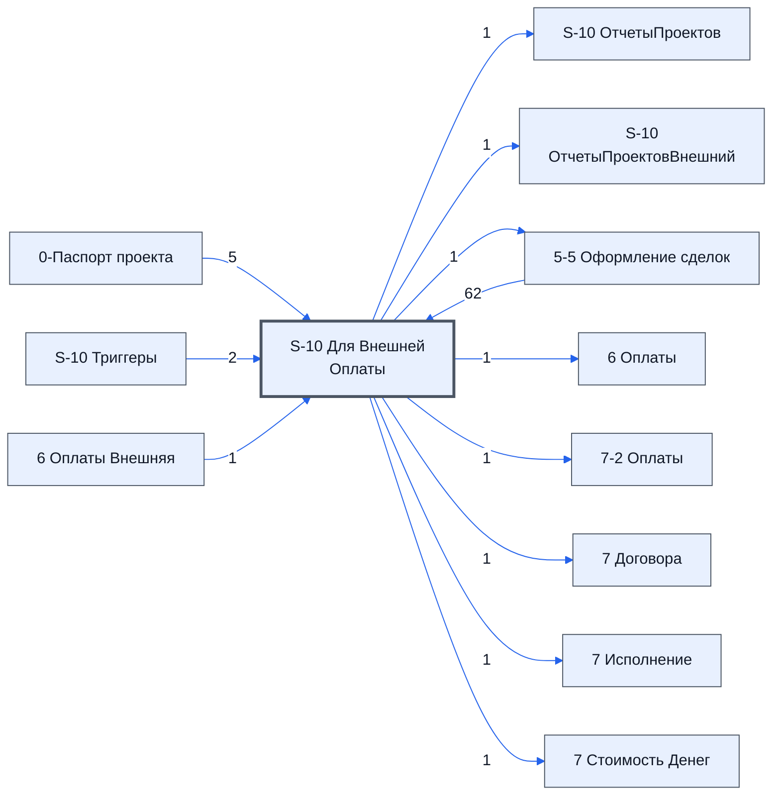

# Лист «S-10 Для Внешней Оплаты»

Таблица: таблица проекта · контур 2.

**Зачем** (со слов): по листу 5-5 готовит данные для контура 3 — для листа «6 Оплаты Внешняя».

Устройство листа — заголовки, вид столбцов, списки, формулы, связи с другими листами — собрано из таблицы ниже.

## Зачем лист — подробно

*Заполнить:* что на листе происходит, откуда приходят данные и куда уходят.

## Как заполнять

*Заполнить:* какие столбцы вводят руками, какие считаются сами. Что значит каждый столбец — в `stolbtsy.yaml` рядом (поля `chto` и `kak`).

## Что нельзя трогать

*Заполнить.*

## Инструкции и умения

*Заполнить:* какие инструкции и умения относятся к листу.

## Осталось сделать

- Заполнить разделы выше и `stolbtsy.yaml`.

## Устройство (из таблицы)

- **Таблица:** таблица проекта, лист «S-10 Для Внешней Оплаты»; контур 2
- **Размер:** `A1:AG30`, закреплено до `A11`
- **Каркас:** общий — служебные строки, заголовки в строке 10 ([что значат служебные строки](../../zna/lis-sluzhebnye-stroki/index.md))
- **Формул:** 53; заполненных ячеек без формул в данных: 39; списков: 0; условного форматирования: 0; объединённых ячеек: 0

## Связи с другими листами

- **Берёт данные с листов:** [5-5 Оформление сделок](../k2-5-5-sdelki/index.md) (62), «10 - Настройки проекта» *(листа нет в реестре)* (6), [0-Паспорт проекта](../k0-0-pasport-proekta/index.md) (5), [S-10 Триггеры](../k0-s-10-triggery/index.md) (2), [6 Оплаты Внешняя](../k3-vo-6-oplaty-vneshnyaya/index.md) (1)
- **Его данные используют:** [S-10 ОтчетыПроектов](../k0-s-10-otchetyproektov/index.md) (1), [S-10 ОтчетыПроектовВнешний](../k0-s-10-otchetyproektovvneshniy/index.md) (1), [5-5 Оформление сделок](../k2-5-5-sdelki/index.md) (1), [6 Оплаты](../k3-6-oplaty/index.md) (1), [7-2 Оплаты](../k3-7-2-oplaty/index.md) (1), [7 Договора](../k3-7-dogovora/index.md) (1), [7 Исполнение](../k3-7-ispolnenie/index.md) (1), [7 Стоимость Денег](../k3-7-stoimost-deneg/index.md) (1)

В скобках и на стрелках — сколько формул ссылаются.

## Столбцы

Устройство — из таблицы; «Что это» и «Как заполняют» — из `stolbtsy.yaml` (заполняем руками).

| Столбец | Заголовок | Служебное имя | Вид | Заполняется | Список | Что это | Как заполняют |
|---|---|---|---|---|---|---|---|
| A *(скрыт)* |  | err |  | руками? |  |  |  |
| B *(скрыт)* |  | err2 |  | руками? |  |  |  |
| C | ID_Товара |  | formulaColl | формула |  |  |  |
| D | № | Номер | formulaColl | формула |  |  |  |
| E | Номенклатура | Номенклатура | formulaColl | формула |  |  |  |
| F *(скрыт)* | Название товара по договору | НазваниеТовараПоДоговору | formulaColl | формула |  |  |  |
| G *(скрыт)* | Изготовитель товара по договору | ИзготовительТовараПоДоговору | formulaColl | формула |  |  |  |
| H *(скрыт)* | Характеристики | Характеристики |  | формула |  |  |  |
| I *(скрыт)* | Состав поставляемой с продукцией технической документации | СоставТехническойДокументации |  | формула |  |  |  |
| J | Ед. Изм | ЕдИзм | formulaColl | формула |  |  |  |
| K | Кол-во | Количевство | formulaColl | формула |  |  |  |
| L | Реальная цена | РеальнаяЦена | formulaColl | формула |  |  |  |
| M | Реальная цена Итого | РеальнаяЦенаИтого | formulaColl | формула |  |  |  |
| N *(скрыт)* | Группа | Группа | formulaColl | формула |  |  |  |
| O | Реальный срок | РеальныйСрок | formulaColl | формула |  |  |  |
| P *(скрыт)* | Срок поставки по договору | СрокПоставкиПоДоговору | formulaColl | формула |  |  |  |
| Q *(скрыт)* | Поставщик | Поставщик | formulaColl | формула |  |  |  |
| R *(скрыт)* | ИНН Постав-ка | ИннПоставщика | formulaColl | формула |  |  |  |
| S *(скрыт)* | Комментарий к товару с листа 5-3 | Комментарий | formulaColl | формула |  |  |  |
| T *(скрыт)* | Комментарий закупщика к сделке | КомментарийКСделке | formulaColl | формула |  |  |  |
| U | Статус | Статус | formulaColl | формула |  |  |  |
| V | Результат проверки контаргента | РезультатПроверкиКонтаргента | formulaColl | формула |  |  |  |
| W *(скрыт)* | Завершенных сделок | ЗавершенныхСделок | formulaColl | формула |  |  |  |
| X *(скрыт)* | Кинул | Кинул | formulaColl | формула |  |  |  |
| Y *(скрыт)* | Сделок в работе | СделокВРаботе | formulaColl | формула |  |  |  |
| Z | НДС | НДС | formulaColl | формула |  |  |  |
| AA | Вид оплаты | ВидОплаты | formulaColl | формула |  |  |  |
| AB | Процент перв-ной оп-ты | ПроцентПервоначальнойОплаты | formulaColl | формула |  |  |  |
| AC *(скрыт)* | Условия оплаты | УсловияОплаты | formulaColl | формула |  |  |  |
| AD | Иные условия оплаты | ИныеУсловияОплаты | formulaFree | руками, потом формула |  |  |  |
| AE | Отсрочка календарных дней | ОтсрочкаКалендарныхДней | formulaFree | руками, потом формула |  |  |  |
| AF *(скрыт)* | Куда доставить груз (промежучточное место комплектации) | КудаДоставитьГруз | formulaColl | формула |  |  |  |
| AG *(скрыт)* | Обязательства поставщика по доставке | ОбязательстваПоставщикаПоДоставке | formulaColl | формула |  |  |  |

## Переменные листа

Строки 5–6 каркаса (`var_name`, `var_value`): имя переменной и её значения — скорее всего, списки для скриптов и выпадающих списков.

| Ячейка | Имя | Значения |
|---|---|---|
| D | Диапозон для импорта | '6 Оплаты Внешняя'!G1:BZ |
| E | ссылка на папку со счетами |  |
| F | Ссылка на таблицу оплаты |  |
| G | Ссылка на таблицу проекта |  |
| H | Номер Проекта |  |
| I | Название Таблицы |  |
| J | Плательщик |  |
| K | Исполнение.Закупает |  |
| L | Реестр.Победил |  |
| M | Время Последней Синхронизации |  |
| N | 0-Паспорт проекта - Срок поставки по договору (справочно), календарные дни |  |
| O | 0-Паспорт проекта - Срок доставки, календарные дни |  |
| P | 0-Паспорт проекта - Срок приемки, календарные дни |  |
| Q | 0-Паспорт проекта - Срок оплаты, календарные дни |  |
| R | Триггеры оплат | Триггеры оплат не запущены |

Формулы столбцов (31)

| Столбец | Строка | Формула |
|---|---|---|
| C | 10 | <code>={LAMBDA( doFindRow, doFilter, doStrWhere, theWordStart, theCStart, theWordEnd, theCEnd, theDataWord, theData,theDataFul, QUERY(theDataFul,"Select Col1 " &amp; doStrWhere(doFilter(doFindRow(theDataWord,theWordStart,theCStart),doFindRow(theDataWord,theWord,"ID_Товара")</code> |
| D | 10 | <code>=LAMBDA( doFind, theIDS, theDataIDS,theDataVLS, doFind(theIDS, {theDataIDS,theDataVLS} ) )( LAMBDA(theIDS, theData, ByRow(theIDS,LAMBDA(tid,IF(tid&lt;&gt;"", IFERROR(VLOOKUP(tid, theData,2,FALSE),) ,))) ), 'S-10 Для Внешней Оплаты'!$C$10:$C30,'5-5 Оформление сделок'!$C$1:$C30 ,'5-5 Оформление сделок'!D1:D30 )</code> |
| E | 10 | <code>=LAMBDA( doFind, theIDS, theDataIDS,theDataVLS, doFind(theIDS, {theDataIDS,theDataVLS} ) )( LAMBDA(theIDS, theData, ByRow(theIDS,LAMBDA(tid,IF(tid&lt;&gt;"", IFERROR(VLOOKUP(tid, theData,2,FALSE),) ,))) ), 'S-10 Для Внешней Оплаты'!$C$10:$C30,'5-5 Оформление сделок'!$C$1:$C30 ,'5-5 Оформление сделок'!E1:E30 )</code> |
| F | 10 | <code>=LAMBDA( doFind, theIDS, theDataIDS,theDataVLS, doFind(theIDS, {theDataIDS,theDataVLS} ) )( LAMBDA(theIDS, theData, ByRow(theIDS,LAMBDA(tid,IF(tid&lt;&gt;"", IFERROR(VLOOKUP(tid, theData,2,FALSE),) ,))) ), 'S-10 Для Внешней Оплаты'!$C$10:$C30,'5-5 Оформление сделок'!$C$1:$C30 ,'5-5 Оформление сделок'!F1:F30 )</code> |
| G | 10 | <code>=LAMBDA( doFind, theIDS, theDataIDS,theDataVLS, doFind(theIDS, {theDataIDS,theDataVLS} ) )( LAMBDA(theIDS, theData, ByRow(theIDS,LAMBDA(tid,IF(tid&lt;&gt;"", IFERROR(VLOOKUP(tid, theData,2,FALSE),) ,))) ), 'S-10 Для Внешней Оплаты'!$C$10:$C30,'5-5 Оформление сделок'!$C$1:$C30 ,'5-5 Оформление сделок'!G1:G30 )</code> |
| H | 10 | <code>=LAMBDA( doFind, theIDS, theDataIDS,theDataVLS, doFind(theIDS, {theDataIDS,theDataVLS} ) )( LAMBDA(theIDS, theData, ByRow(theIDS,LAMBDA(tid,IF(tid&lt;&gt;"", IFERROR(VLOOKUP(tid, theData,2,FALSE),) ,))) ), 'S-10 Для Внешней Оплаты'!$C$10:$C30,'5-5 Оформление сделок'!$C$1:$C30 ,'5-5 Оформление сделок'!H1:H30 )</code> |
| I | 10 | <code>=LAMBDA( doFind, theIDS, theDataIDS,theDataVLS, doFind(theIDS, {theDataIDS,theDataVLS} ) )( LAMBDA(theIDS, theData, ByRow(theIDS,LAMBDA(tid,IF(tid&lt;&gt;"", IFERROR(VLOOKUP(tid, theData,2,FALSE),) ,))) ), 'S-10 Для Внешней Оплаты'!$C$10:$C30,'5-5 Оформление сделок'!$C$1:$C30 ,'5-5 Оформление сделок'!I1:I30 )</code> |
| J | 10 | <code>=LAMBDA( doFind, theIDS, theDataIDS,theDataVLS, doFind(theIDS, {theDataIDS,theDataVLS} ) )( LAMBDA(theIDS, theData, ByRow(theIDS,LAMBDA(tid,IF(tid&lt;&gt;"", IFERROR(VLOOKUP(tid, theData,2,FALSE),) ,))) ), 'S-10 Для Внешней Оплаты'!$C$10:$C30,'5-5 Оформление сделок'!$C$1:$C30 ,'5-5 Оформление сделок'!J1:J30 )</code> |
| K | 10 | <code>=LAMBDA( doFind, theIDS, theDataIDS,theDataVLS, doFind(theIDS, {theDataIDS,theDataVLS} ) )( LAMBDA(theIDS, theData, ByRow(theIDS,LAMBDA(tid,IF(tid&lt;&gt;"", IFERROR(VLOOKUP(tid, theData,2,FALSE),) ,))) ), 'S-10 Для Внешней Оплаты'!$C$10:$C30,'5-5 Оформление сделок'!$C$1:$C30 ,'5-5 Оформление сделок'!K1:K30 )</code> |
| L | 10 | <code>=LAMBDA( doFind, theIDS, theDataIDS,theDataVLS, doFind(theIDS, {theDataIDS,theDataVLS} ) )( LAMBDA(theIDS, theData, ByRow(theIDS,LAMBDA(tid,IF(tid&lt;&gt;"", IFERROR(VLOOKUP(tid, theData,2,FALSE),) ,))) ), 'S-10 Для Внешней Оплаты'!$C$10:$C30,'5-5 Оформление сделок'!$C$1:$C30 ,'5-5 Оформление сделок'!AP1:AP30 )</code> |
| M | 10 | <code>=LAMBDA( doFind, theIDS, theDataIDS,theDataVLS, doFind(theIDS, {theDataIDS,theDataVLS} ) )( LAMBDA(theIDS, theData, ByRow(theIDS,LAMBDA(tid,IF(tid&lt;&gt;"", IFERROR(VLOOKUP(tid, theData,2,FALSE),) ,))) ), 'S-10 Для Внешней Оплаты'!$C$10:$C30,'5-5 Оформление сделок'!$C$1:$C30 ,'5-5 Оформление сделок'!AQ1:AQ30 )</code> |
| N | 10 | <code>=LAMBDA( doFind, theIDS, theDataIDS,theDataVLS, doFind(theIDS, {theDataIDS,theDataVLS} ) )( LAMBDA(theIDS, theData, ByRow(theIDS,LAMBDA(tid,IF(tid&lt;&gt;"", IFERROR(VLOOKUP(tid, theData,2,FALSE),) ,))) ), 'S-10 Для Внешней Оплаты'!$C$10:$C30,'5-5 Оформление сделок'!$C$1:$C30 ,'5-5 Оформление сделок'!L1:L30 )</code> |
| O | 10 | <code>=LAMBDA( doFind, theIDS, theDataIDS,theDataVLS, doFind(theIDS, {theDataIDS,theDataVLS} ) )( LAMBDA(theIDS, theData, ByRow(theIDS,LAMBDA(tid,IF(tid&lt;&gt;"", IFERROR(VLOOKUP(tid, theData,2,FALSE),) ,))) ), 'S-10 Для Внешней Оплаты'!$C$10:$C30,'5-5 Оформление сделок'!$C$1:$C30 ,'5-5 Оформление сделок'!AS1:AS30 )</code> |
| P | 10 | <code>=LAMBDA( doFind, theIDS, theDataIDS,theDataVLS, doFind(theIDS, {theDataIDS,theDataVLS} ) )( LAMBDA(theIDS, theData, ByRow(theIDS,LAMBDA(tid,IF(tid&lt;&gt;"", IFERROR(VLOOKUP(tid, theData,2,FALSE),) ,))) ), 'S-10 Для Внешней Оплаты'!$C$10:$C30,'5-5 Оформление сделок'!$C$1:$C30 ,'5-5 Оформление сделок'!P1:P30 )</code> |
| Q | 10 | <code>=LAMBDA( doFind, theIDS, theDataIDS,theDataVLS, doFind(theIDS, {theDataIDS,theDataVLS} ) )( LAMBDA(theIDS, theData, ByRow(theIDS,LAMBDA(tid,IF(tid&lt;&gt;"", IFERROR(VLOOKUP(tid, theData,2,FALSE),) ,))) ), 'S-10 Для Внешней Оплаты'!$C$10:$C30,'5-5 Оформление сделок'!$C$1:$C30 ,'5-5 Оформление сделок'!AB1:AB30 )</code> |
| R | 10 | <code>=LAMBDA( doFind, theIDS, theDataIDS,theDataVLS, doFind(theIDS, {theDataIDS,theDataVLS} ) )( LAMBDA(theIDS, theData, ByRow(theIDS,LAMBDA(tid,IF(tid&lt;&gt;"", IFERROR(VLOOKUP(tid, theData,2,FALSE),) ,))) ), 'S-10 Для Внешней Оплаты'!$C$10:$C30,'5-5 Оформление сделок'!$C$1:$C30 ,'5-5 Оформление сделок'!BA1:BA30 )</code> |
| S | 10 | <code>=LAMBDA( doFind, theIDS, theDataIDS,theDataVLS, doFind(theIDS, {theDataIDS,theDataVLS} ) )( LAMBDA(theIDS, theData, ByRow(theIDS,LAMBDA(tid,IF(tid&lt;&gt;"", IFERROR(VLOOKUP(tid, theData,2,FALSE),) ,))) ), 'S-10 Для Внешней Оплаты'!$C$10:$C30,'5-5 Оформление сделок'!$C$1:$C30 ,'5-5 Оформление сделок'!AD1:AD30 )</code> |
| T | 10 | <code>=LAMBDA( doFind, theIDS, theDataIDS,theDataVLS, doFind(theIDS, {theDataIDS,theDataVLS} ) )( LAMBDA(theIDS, theData, ByRow(theIDS,LAMBDA(tid,IF(tid&lt;&gt;"", IFERROR(VLOOKUP(tid, theData,2,FALSE),) ,))) ), 'S-10 Для Внешней Оплаты'!$C$10:$C30,'5-5 Оформление сделок'!$C$1:$C30 ,'5-5 Оформление сделок'!AL1:AL30 )</code> |
| U | 10 | <code>=LAMBDA( doFind, theIDS, theDataIDS,theDataVLS, doFind(theIDS, {theDataIDS,theDataVLS} ) )( LAMBDA(theIDS, theData, ByRow(theIDS,LAMBDA(tid,IF(tid&lt;&gt;"", IFERROR(VLOOKUP(tid, theData,2,FALSE),) ,))) ), 'S-10 Для Внешней Оплаты'!$C$10:$C30,'5-5 Оформление сделок'!$C$1:$C30 ,'5-5 Оформление сделок'!AF1:AF30 )</code> |
| V | 10 | <code>=LAMBDA( doFind, theIDS, theDataIDS,theDataVLS, doFind(theIDS, {theDataIDS,theDataVLS} ) )( LAMBDA(theIDS, theData, ByRow(theIDS,LAMBDA(tid,IF(tid&lt;&gt;"", IFERROR(VLOOKUP(tid, theData,2,FALSE),) ,))) ), 'S-10 Для Внешней Оплаты'!$C$10:$C30,'5-5 Оформление сделок'!$C$1:$C30 ,'5-5 Оформление сделок'!AG1:AG30 )</code> |
| W | 10 | <code>=LAMBDA( doFind, theIDS, theDataIDS,theDataVLS, doFind(theIDS, {theDataIDS,theDataVLS} ) )( LAMBDA(theIDS, theData, ByRow(theIDS,LAMBDA(tid,IF(tid&lt;&gt;"", IFERROR(VLOOKUP(tid, theData,2,FALSE),) ,))) ), 'S-10 Для Внешней Оплаты'!$C$10:$C30,'5-5 Оформление сделок'!$C$1:$C30 ,'5-5 Оформление сделок'!AH1:AH30 )</code> |
| X | 10 | <code>=LAMBDA( doFind, theIDS, theDataIDS,theDataVLS, doFind(theIDS, {theDataIDS,theDataVLS} ) )( LAMBDA(theIDS, theData, ByRow(theIDS,LAMBDA(tid,IF(tid&lt;&gt;"", IFERROR(VLOOKUP(tid, theData,2,FALSE),) ,))) ), 'S-10 Для Внешней Оплаты'!$C$10:$C30,'5-5 Оформление сделок'!$C$1:$C30 ,'5-5 Оформление сделок'!AI1:AI30 )</code> |
| Y | 10 | <code>=LAMBDA( doFind, theIDS, theDataIDS,theDataVLS, doFind(theIDS, {theDataIDS,theDataVLS} ) )( LAMBDA(theIDS, theData, ByRow(theIDS,LAMBDA(tid,IF(tid&lt;&gt;"", IFERROR(VLOOKUP(tid, theData,2,FALSE),) ,))) ), 'S-10 Для Внешней Оплаты'!$C$10:$C30,'5-5 Оформление сделок'!$C$1:$C30 ,'5-5 Оформление сделок'!AJ1:AJ30 )</code> |
| Z | 10 | <code>=LAMBDA( doFind, theIDS, theDataIDS,theDataVLS, doFind(theIDS, {theDataIDS,theDataVLS} ) )( LAMBDA(theIDS, theData, ByRow(theIDS,LAMBDA(tid,IF(tid&lt;&gt;"", IFERROR(VLOOKUP(tid, theData,2,FALSE),) ,))) ), 'S-10 Для Внешней Оплаты'!$C$10:$C30,'5-5 Оформление сделок'!$C$1:$C30 ,'5-5 Оформление сделок'!AU1:AU30 )</code> |
| AA | 10 | <code>=LAMBDA( doFind, theIDS, theDataIDS,theDataVLS, doFind(theIDS, {theDataIDS,theDataVLS} ) )( LAMBDA(theIDS, theData, ByRow(theIDS,LAMBDA(tid,IF(tid&lt;&gt;"", IFERROR(VLOOKUP(tid, theData,2,FALSE),) ,))) ), 'S-10 Для Внешней Оплаты'!$C$10:$C30,'5-5 Оформление сделок'!$C$1:$C30 ,'5-5 Оформление сделок'!AW1:AW30 )</code> |
| AB | 10 | <code>=LAMBDA( doFind, theIDS, theDataIDS,theDataVLS, doFind(theIDS, {theDataIDS,theDataVLS} ) )( LAMBDA(theIDS, theData, ByRow(theIDS,LAMBDA(tid,IF(tid&lt;&gt;"", IFERROR(VLOOKUP(tid, theData,2,FALSE),) ,))) ), 'S-10 Для Внешней Оплаты'!$C$10:$C30,'5-5 Оформление сделок'!$C$1:$C30 ,'5-5 Оформление сделок'!BC1:BC30 )</code> |
| AC | 10 | <code>=LAMBDA( doFind, theIDS, theDataIDS,theDataVLS, doFind(theIDS, {theDataIDS,theDataVLS} ) )( LAMBDA(theIDS, theData, ByRow(theIDS,LAMBDA(tid,IF(tid&lt;&gt;"", IFERROR(VLOOKUP(tid, theData,2,FALSE),) ,))) ), 'S-10 Для Внешней Оплаты'!$C$10:$C30,'5-5 Оформление сделок'!$C$1:$C30 ,'5-5 Оформление сделок'!BE1:BE30 )</code> |
| AD | 10 | <code>=LAMBDA( doFind, theIDS, theDataIDS,theDataVLS, doFind(theIDS, {theDataIDS,theDataVLS} ) )( LAMBDA(theIDS, theData, ByRow(theIDS,LAMBDA(tid,IF(tid&lt;&gt;"", IFERROR(VLOOKUP(tid, theData,2,FALSE),) ,))) ), 'S-10 Для Внешней Оплаты'!$C$10:$C30,'5-5 Оформление сделок'!$C$1:$C30 ,'5-5 Оформление сделок'!BG1:BG30 )</code> |
| AE | 10 | <code>=LAMBDA( doFind, theIDS, theDataIDS,theDataVLS, doFind(theIDS, {theDataIDS,theDataVLS} ) )( LAMBDA(theIDS, theData, ByRow(theIDS,LAMBDA(tid,IF(tid&lt;&gt;"", IFERROR(VLOOKUP(tid, theData,2,FALSE),) ,))) ), 'S-10 Для Внешней Оплаты'!$C$10:$C30,'5-5 Оформление сделок'!$C$1:$C30 ,'5-5 Оформление сделок'!BI1:BI30 )</code> |
| AF | 10 | <code>=LAMBDA( doFind, theIDS, theDataIDS,theDataVLS, doFind(theIDS, {theDataIDS,theDataVLS} ) )( LAMBDA(theIDS, theData, ByRow(theIDS,LAMBDA(tid,IF(tid&lt;&gt;"", IFERROR(VLOOKUP(tid, theData,2,FALSE),) ,))) ), 'S-10 Для Внешней Оплаты'!$C$10:$C30,'5-5 Оформление сделок'!$C$1:$C30 ,'5-5 Оформление сделок'!BK1:BK30 )</code> |
| AG | 10 | <code>=LAMBDA( doFind, theIDS, theDataIDS,theDataVLS, doFind(theIDS, {theDataIDS,theDataVLS} ) )( LAMBDA(theIDS, theData, ByRow(theIDS,LAMBDA(tid,IF(tid&lt;&gt;"", IFERROR(VLOOKUP(tid, theData,2,FALSE),) ,))) ), 'S-10 Для Внешней Оплаты'!$C$10:$C30,'5-5 Оформление сделок'!$C$1:$C30 ,'5-5 Оформление сделок'!BM1:BM30 )</code> |

