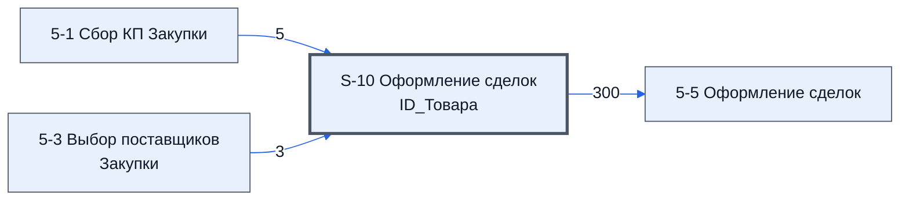

# Лист «S-10 Оформление сделок ID_Товара»

Таблица: таблица проекта · контур 2.

**Зачем** (со слов): товары листа 5-3 с «Да» в столбце A; по ним строится список.

Устройство листа — заголовки, вид столбцов, списки, формулы, связи с другими листами — собрано из таблицы ниже.

## Зачем лист — подробно

*Заполнить:* что на листе происходит, откуда приходят данные и куда уходят.

## Как заполнять

*Заполнить:* какие столбцы вводят руками, какие считаются сами. Что значит каждый столбец — в `stolbtsy.yaml` рядом (поля `chto` и `kak`).

## Что нельзя трогать

*Заполнить.*

## Инструкции и умения

*Заполнить:* какие инструкции и умения относятся к листу.

## Осталось сделать

- Заполнить разделы выше и `stolbtsy.yaml`.

## Устройство (из таблицы)

- **Таблица:** таблица проекта, лист «S-10 Оформление сделок ID_Товар»; контур 2
- **Размер:** `A1:J310`
- **Каркас:** общий — служебные строки, заголовки в строке 10 ([что значат служебные строки](../../zna/lis-sluzhebnye-stroki/index.md))
- **Формул:** 306; заполненных ячеек без формул в данных: 0; списков: 0; условного форматирования: 0; объединённых ячеек: 0

## Связи с другими листами

- **Берёт данные с листов:** [5-1 Сбор КП Закупки](../k2-5-1-sbor-kp/index.md) (5), [5-3 Выбор поставщиков Закупки](../k2-5-3-vybor-postavshchikov/index.md) (3)
- **Его данные используют:** [5-5 Оформление сделок](../k2-5-5-sdelki/index.md) (300)

В скобках и на стрелках — сколько формул ссылаются.

## Столбцы

Устройство — из таблицы; «Что это» и «Как заполняют» — из `stolbtsy.yaml` (заполняем руками).

| Столбец | Заголовок | Служебное имя | Вид | Заполняется | Список | Что это | Как заполняют |
|---|---|---|---|---|---|---|---|
| A *(скрыт)* |  | err | formulaColl | формула |  |  |  |
| B *(скрыт)* |  | РазличиеМужду | formulaColl | формула |  |  |  |
| C | ID_Товара |  | formulaCell | формула |  |  |  |
| D | № | Номер | formulaCell | формула |  |  |  |
| E | Номенклатура | Номенклатура | formulaCell | формула |  |  |  |
| F | Название товара по договору | НазваниеТовараПоДоговору |  | формула |  |  |  |
| G | Изготовитель товара по договору | ИзготовительТовараПоДоговору |  | формула |  |  |  |
| H | Характеристики | Характеристики | formulaCell | формула |  |  |  |

Формулы столбцов (6)

| Столбец | Строка | Формула |
|---|---|---|
| C | 10 | <code>={'5-3 Выбор поставщиков Закупки'!C10; FILTER('5-3 Выбор поставщиков Закупки'!C11:C310,'5-3 Выбор поставщиков Закупки'!A11:A310="Да") }</code> |
| D | 10 | <code>='5-1 Сбор КП Закупки'!D10</code> |
| E | 10 | <code>='5-1 Сбор КП Закупки'!E10</code> |
| F | 10 | <code>='5-1 Сбор КП Закупки'!F10</code> |
| G | 10 | <code>='5-1 Сбор КП Закупки'!G10</code> |
| H | 10 | <code>='5-1 Сбор КП Закупки'!H10</code> |

