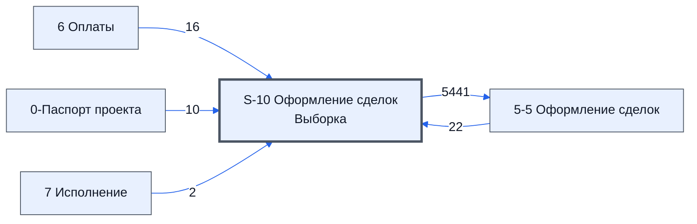

# Лист «S-10 Оформление сделок Выборка»

Таблица: таблица проекта · контур 2.

**Зачем** (со слов директора): данные для листа 5-5 по сохранённым комментариям.

Устройство листа — заголовки, вид столбцов, списки, формулы, связи с другими листами — собрано из таблицы ниже.

## Зачем лист — подробно

*Заполнить:* что на листе происходит, откуда приходят данные и куда уходят.

## Как заполнять

*Заполнить:* какие столбцы вводят руками, какие считаются сами. Что значит каждый столбец — в `stolbtsy.yaml` рядом (поля `chto` и `kak`).

## Что нельзя трогать

*Заполнить.*

## Инструкции и умения

*Заполнить:* какие инструкции и умения относятся к листу.

## Осталось сделать

- Заполнить разделы выше и `stolbtsy.yaml`.

## Устройство (из таблицы)

- **Таблица:** таблица проекта, лист «S-10 Оформление сделок Выборка»; контур 2
- **Размер:** `A1:CK319`
- **Каркас:** общий — служебные строки, заголовки в строке 10 ([что значат служебные строки](../../zna/lis-sluzhebnye-stroki/index.md))
- **Формул:** 335; заполненных ячеек без формул в данных: 314; списков: 0; условного форматирования: 0; объединённых ячеек: 0

## Связи с другими листами

- **Берёт данные с листов:** [5-5 Оформление сделок](../k2-5-5-sdelki/index.md) (22), [6 Оплаты](../k3-6-oplaty/index.md) (16), [0-Паспорт проекта](../k0-0-pasport-proekta/index.md) (10), [7 Исполнение](../k3-7-ispolnenie/index.md) (2)
- **Его данные используют:** [5-5 Оформление сделок](../k2-5-5-sdelki/index.md) (5441)

В скобках и на стрелках — сколько формул ссылаются.

## Столбцы

Устройство — из таблицы; «Что это» и «Как заполняют» — из `stolbtsy.yaml` (заполняем руками).

| Столбец | Заголовок | Служебное имя | Вид | Заполняется | Список | Что это | Как заполняют |
|---|---|---|---|---|---|---|---|
| A |  | err |  | руками? |  |  |  |
| B |  | err2 |  | руками? |  |  |  |
| C | ID_Товара |  | formulaColl | формула |  |  |  |
| D |  | Номер |  | руками? |  |  |  |
| E |  | Номенклатура |  | руками? |  |  |  |
| F |  | НазваниеТовараПоДоговору |  | руками? |  |  |  |
| G |  | ИзготовительТовараПоДоговору |  | руками? |  |  |  |
| H |  | Характеристики |  | руками? |  |  |  |
| I |  | СоставТехническойДокументации |  | руками? |  |  |  |
| J |  | ЕдИзм |  | руками? |  |  |  |
| K |  | Количевство |  | руками? |  |  |  |
| L |  | Группа |  | руками? |  |  |  |
| M |  | Цена |  | руками? |  |  |  |
| N |  | Сумма |  | руками? |  |  |  |
| O |  | Срок поставки |  | руками? |  |  |  |
| P |  | Срок поставки по договору |  | руками? |  |  |  |
| U | Кто контактирует с заказчиком по вопросу исполнения | КонтактируетСЗаказчикомПоВопросуИсполнения | formulaColl | формула |  |  |  |
| V | Особые условия | ОсобыеУсловия | formulaColl | формула |  |  |  |
| W | Дата подписания договора | ДатаПодписанияДоговора | formulaColl | формула |  |  |  |
| X | Место поставки товара | МестоПоставкиТовара | formulaColl | формула |  |  |  |
| Y | Контакты покупателя | КонтактыПокупателя | formulaColl | формула |  |  |  |
| Z | Экспортный контракт | ЭкспортныйКонтракт | formulaColl | формула |  |  |  |
| AA |  | ПоставщикВыбор |  | руками? |  |  |  |
| AB | Поставщик | Поставщик | formulaColl | формула |  |  |  |
| AC |  | ЛистИПредложение |  | руками? |  |  |  |
| AD |  | Комментарий |  | руками? |  |  |  |
| AE |  | Статус.Ф |  | руками? |  |  |  |
| AF | Статус | Статус | formulaColl | формула |  |  |  |
| AG |  | РезультатПроверкиКонтаргента |  | руками? |  |  |  |
| AH |  | ЗавершенныхСделок |  | руками? |  |  |  |
| AI |  | Кинул |  | руками? |  |  |  |
| AJ |  | СделокВРаботе |  | руками? |  |  |  |
| AK |  | КомментарийКСделке.Ф |  | руками? |  |  |  |
| AL | Комментарий закупщика к сделке | КомментарийКСделке | formulaColl | формула |  |  |  |
| AM |  | ДатаСледКонтакта.Ф |  | руками? |  |  |  |
| AN | Дата след контакта | ДатаСледКонтакта | formulaColl | формула |  |  |  |
| AO |  | РеальнаяЦена.Ф |  | руками? |  |  |  |
| AP | Реальная цена | РеальнаяЦена | formulaColl | формула |  |  |  |
| AQ |  | РеальнаяЦенаИтого |  | руками? |  |  |  |
| AR |  | РеальныйСрок.Ф |  | руками? |  |  |  |
| AS | Реальный срок | РеальныйСрок | formulaColl | формула |  |  |  |
| AT |  | НДС.Ф |  | руками? |  |  |  |
| AU | НДС | НДС | formulaColl | формула |  |  |  |
| AV |  | ВидОплаты.Ф |  | руками? |  |  |  |
| AW | Вид оплаты | ВидОплаты | formulaColl | формула |  |  |  |
| AX |  | РазницаЗаШтуку |  | руками? |  |  |  |
| AY |  | РазницаИтого |  | руками? |  |  |  |
| AZ |  | ИннПоставщика.Ф |  | руками? |  |  |  |
| BA | ИНН Постав-ка | ИннПоставщика | formulaColl | формула |  |  |  |
| BB |  | ПроцентПервоначальнойОплаты.Ф |  | руками? |  |  |  |
| BC | Процент перв-ной оп-ты | ПроцентПервоначальнойОплаты | formulaColl | формула |  |  |  |
| BD |  | УсловияОплаты.Ф |  | руками? |  |  |  |
| BE | Условия оплаты | УсловияОплаты | formulaColl | формула |  |  |  |
| BF |  | ИныеУсловияОплаты.Ф |  | руками? |  |  |  |
| BG | Иные условия оплаты | ИныеУсловияОплаты |  | формула |  |  |  |
| BH |  | ОтсрочкаКалендарныхДней.Ф |  | руками? |  |  |  |
| BI | Отсрочка календарных дней | ОтсрочкаКалендарныхДней |  | формула |  |  |  |
| BJ |  | КудаДоставитьГруз.Ф |  | руками? |  |  |  |
| BK | Куда доставить груз (промежучточное место комплектации) | КудаДоставитьГруз | formulaColl | формула |  |  |  |
| BL |  | ОбязательстваПоставщикаПоДоставке.Ф |  | руками? |  |  |  |
| BM | Обязательства поставщика по доставке | ОбязательстваПоставщикаПоДоставке | formulaColl | формула |  |  |  |
| BN |  | СтатусОплаты.Ф |  | руками? |  |  |  |
| BO | Статус оплаты | СтатусОплаты | formulaColl | формула |  |  |  |
| BP |  | ПроцентОплаты.Ф |  | руками? |  |  |  |
| BQ | Процент оплаты | ПроцентОплаты | formulaColl | формула |  |  |  |
| BR |  | ДатаПолученияФинальногоСчетДоговора.Ф |  | руками? |  |  |  |
| BS | Дата получения финального счет договора | ДатаПолученияФинальногоСчетДоговора | formulaColl | формула |  |  |  |
| BT |  | ДатаОтправкиПодписанногоСНашейСтороныСчетДоговора.Ф |  | руками? |  |  |  |
| BU | Дата отправки подписанного нами счет договора | ДатаОтправкиПодписанногоСНашейСтороныСчетДоговора | formulaColl | формула |  |  |  |
| BV |  | ПроверкаОшибок.Ф |  | руками? |  |  |  |
| BW | Проверка ошибок | ПроверкаОшибок | formulaColl | формула |  |  |  |
| BX |  | свободно76 |  | руками? |  |  |  |
| BY |  | свободно77 |  | руками? |  |  |  |
| BZ | Проверка ошибок постатсу | ПроверкаОшибокПоСтатсу | formulaColl | формула |  |  |  |
| CA | Проверка Верная сумма | ПроверкаОшибокВернаяСумма | formulaColl | формула |  |  |  |
| CB | Проверка НДС | ПроверкаОшибокНДС | formulaColl | формула |  |  |  |
| CC | Проверка переплаты | ПроверкаОшибокПереплаты | formulaColl | формула |  |  |  |
| CD | ПроверкаОшибокОплаты | ПроверкаОшибокОплаты | formulaColl | формула |  |  |  |
| CE | Проверка Дата отправки подписанного нами счет договора | ПроверкаОшибокОплаты | formulaColl | формула |  |  |  |

Формулы столбцов (33)

| Столбец | Строка | Формула |
|---|---|---|
| C | 10 | <code>='5-5 Оформление сделок'!C10:C319</code> |
| U | 10 | <code>={'S-10 Оформление сделок Выборка'!U$9; LAMBDA(calc_project_export_ce_mp, project_passport_mp, product_id_ar, product_export_ce_ar, LET( project_export_ce, calc_project_export_ce_mp(project_passport_mp), MAP(product_id_ar, product_export_ce_ar, LAMBDA(product_id, product_export_ce, IF(AND(product_id &lt;&gt; "", product_export_ce &lt;&gt; ""), project_export_ce, "") ) ) ) )( LAMBDA(project_passport_mp, LET( v …</code> |
| V | 10 | <code>={'S-10 Оформление сделок Выборка'!V$9; LAMBDA(calc_project_export_ce_mp, project_passport_mp, product_id_ar, product_export_ce_ar, LET( project_export_ce, calc_project_export_ce_mp(project_passport_mp), MAP(product_id_ar, product_export_ce_ar, LAMBDA(product_id, product_export_ce, IF(AND(product_id &lt;&gt; "", product_export_ce &lt;&gt; ""), project_export_ce, "") ) ) ) )( LAMBDA(project_passport_mp, LET( v …</code> |
| W | 10 | <code>={'S-10 Оформление сделок Выборка'!W$9; LAMBDA(data_isp_v, data_zac_v, product_id_ar, product_ce_ar, LET( max_data_v, LAMBDA(data, IF(data&lt;40000,,data))( MAX(data_isp_v, data_zac_v,0,)), MAP(product_id_ar, product_ce_ar, LAMBDA(product_id, product_ce, IF(AND(product_id &lt;&gt; "", product_ce &lt;&gt; ""), max_data_v, ) ) ) ) )( LAMBDA(doFind,theData,theName, BYROW(theData,LAMBDA(td,Dofind(td,theName))))(LAMB …</code> |
| X | 10 | <code>={'S-10 Оформление сделок Выборка'!X$9; LAMBDA(get_mesto_v, project_passport_mp, product_id_ar, product_ce_ar, LET( mesto_v, get_mesto_v(project_passport_mp), MAP(product_id_ar, product_ce_ar, LAMBDA(product_id, product_ce, IF(AND(product_id &lt;&gt; "", product_ce &lt;&gt; ""), mesto_v, "") ) ) ) )( LAMBDA(passport_mp, LET( export_status_v, IFERROR(VLOOKUP("Место поставки товара", passport_mp, 2, FALSE), ),e …</code> |
| Y | 10 | <code>={'S-10 Оформление сделок Выборка'!Y$9; LAMBDA(get_contact_resp_v, get_contact_oter_v, project_passport_mp, product_id_ar, product_ce_ar, LET( project_contact_v, TEXTJOIN(CHAR(10),TRUE,get_contact_resp_v(project_passport_mp), get_contact_oter_v(project_passport_mp)), MAP(product_id_ar, product_ce_ar, LAMBDA(product_id, product_ce, IF(AND(product_id &lt;&gt; "", product_ce &lt;&gt; ""), project_contact_v, "")  …</code> |
| Z | 10 | <code>={'S-10 Оформление сделок Выборка'!Z$9; LAMBDA(calc_project_export_ce_mp, project_passport_mp, product_id_ar, product_export_ce_ar, LET( project_export_ce, calc_project_export_ce_mp(project_passport_mp), MAP(product_id_ar, product_export_ce_ar, LAMBDA(product_id, product_export_ce, IF(AND(product_id &lt;&gt; "", product_export_ce &lt;&gt; ""), project_export_ce, "") ) ) ) )( LAMBDA(project_passport_mp, LET( e …</code> |
| AB | 10 | <code>='5-5 Оформление сделок'!AB10:AB319</code> |
| AF | 10 | <code>={'S-10 Оформление сделок Выборка'!AF$9 ;LAMBDA(doSelect, doFind, doMakeData,theRows, theDKey,theDДобавлен,theDПоставщик,theDТовар,theDВписано, theDFild,theВписано, doFind(doSelect,theRows,doMakeData(theВписано,theDKey,theDДобавлен,theDВписано,theDПоставщи,"Статус")</code> |
| AL | 10 | <code>={'S-10 Оформление сделок Выборка'!AL$9 ;LAMBDA(doSelect, doFind, doMakeData,theRows, theDKey,theDДобавлен,theDПоставщик,theDТовар,theDВписано, theDFild,theВписано, doFind(doSelect,theRows,doMakeData(theВписано,theDKey,theDДобавлен,theDВписано,theDПоставщи,"Комментарий закупщика к сделке")</code> |
| AN | 10 | <code>={'S-10 Оформление сделок Выборка'!AN$9 ;LAMBDA(doSelect, doFind, doMakeData,theRows, theDKey,theDДобавлен,theDПоставщик,theDТовар,theDВписано, theDFild,theВписано, doFind(doSelect,theRows,doMakeData(theВписано,theDKey,theDДобавлен,theDВписано,theDПоставщи,"Дата след контакта")</code> |
| AP | 10 | <code>={'S-10 Оформление сделок Выборка'!AP$9 ;LAMBDA(doSelect, doFind, doMakeData,theRows, theDKey,theDДобавлен,theDПоставщик,theDТовар,theDВписано, theDFild,theВписано, doFind(doSelect,theRows,doMakeData(theВписано,theDKey,theDДобавлен,theDВписано,theDПоставщи,"Реальная цена")</code> |
| AS | 10 | <code>={'S-10 Оформление сделок Выборка'!AS$9 ;LAMBDA(doSelect, doFind, doMakeData,theRows, theDKey,theDДобавлен,theDПоставщик,theDТовар,theDВписано, theDFild,theВписано, doFind(doSelect,theRows,doMakeData(theВписано,theDKey,theDДобавлен,theDВписано,theDПоставщи,"Реальный срок")</code> |
| AU | 10 | <code>={'S-10 Оформление сделок Выборка'!AU$9 ;LAMBDA(doSelect, doFind, doMakeData,theRows, theDKey,theDДобавлен,theDПоставщик,theDТовар,theDВписано, theDFild,theВписано, doFind(doSelect,theRows,doMakeData(theВписано,theDKey,theDДобавлен,theDВписано,theDПоставщи,"НДС")</code> |
| AW | 10 | <code>={'S-10 Оформление сделок Выборка'!AW$9 ;LAMBDA(doSelect, doFind, doMakeData,theRows, theDKey,theDДобавлен,theDПоставщик,theDТовар,theDВписано, theDFild,theВписано, doFind(doSelect,theRows,doMakeData(theВписано,theDKey,theDДобавлен,theDВписано,theDПоставщи,"Вид оплаты")</code> |
| BA | 10 | <code>={'S-10 Оформление сделок Выборка'!BA$9 ;LAMBDA(doSelect, doFind, doMakeData,theRows, theDKey,theDДобавлен,theDПоставщик,theDТовар,theDВписано, theDFild,theВписано, doFind(doSelect,theRows,doMakeData(theВписано,theDKey,theDДобавлен,theDВписано,theDПоставщи,"ИНН Постав-ка")</code> |
| BC | 10 | <code>={'S-10 Оформление сделок Выборка'!BC$9 ;LAMBDA(doSelect, doFind, doMakeData,theRows, theDKey,theDДобавлен,theDПоставщик,theDТовар,theDВписано, theDFild,theВписано, doFind(doSelect,theRows,doMakeData(theВписано,theDKey,theDДобавлен,theDВписано,theDПоставщи,"Процент перв-ной оп-ты")</code> |
| BE | 10 | <code>={'S-10 Оформление сделок Выборка'!BE$9 ;LAMBDA(doSelect, doFind, doMakeData,theRows, theDKey,theDДобавлен,theDПоставщик,theDТовар,theDВписано, theDFild,theВписано, doFind(doSelect,theRows,doMakeData(theВписано,theDKey,theDДобавлен,theDВписано,theDПоставщи,"Условия оплаты")</code> |
| BG | 10 | <code>={'S-10 Оформление сделок Выборка'!BG$9 ;LAMBDA(doSelect, doFind, doMakeData,theRows, theDKey,theDДобавлен,theDПоставщик,theDТовар,theDВписано, theDFild,theВписано, doFind(doSelect,theRows,doMakeData(theВписано,theDKey,theDДобавлен,theDВписано,theDПоставщи,"Иные условия оплаты")</code> |
| BI | 10 | <code>={'S-10 Оформление сделок Выборка'!BI$9 ;LAMBDA(doSelect, doFind, doMakeData,theRows, theDKey,theDДобавлен,theDПоставщик,theDТовар,theDВписано, theDFild,theВписано, doFind(doSelect,theRows,doMakeData(theВписано,theDKey,theDДобавлен,theDВписано,theDПоставщи,"Отсрочка календарных дней")</code> |
| BK | 10 | <code>={'S-10 Оформление сделок Выборка'!BK$9 ;LAMBDA(doSelect, doFind, doMakeData,theRows, theDKey,theDДобавлен,theDПоставщик,theDТовар,theDВписано, theDFild,theВписано, doFind(doSelect,theRows,doMakeData(theВписано,theDKey,theDДобавлен,theDВписано,theDПоставщи,"Куда доставить груз (промежучточное место комплектации)")</code> |
| BM | 10 | <code>={'S-10 Оформление сделок Выборка'!BM$9 ;LAMBDA(doSelect, doFind, doMakeData,theRows, theDKey,theDДобавлен,theDПоставщик,theDТовар,theDВписано, theDFild,theВписано, doFind(doSelect,theRows,doMakeData(theВписано,theDKey,theDДобавлен,theDВписано,theDПоставщи,"Обязательства поставщика по доставке")</code> |
| BO | 10 | <code>={'S-10 Оформление сделок Выборка'!BO$9 ;LAMBDA(doVPR, doFind, theRows,theData, doFind(doVPR,theRows,theData) )( LAMBDA(tr, theData, IFERROR(VLOOKUP(tr,theData,2,FALSE),)), LAMBDA(doVPR,theRows, theData, BYROW(theRows,LAMBDA(tr, IF(tr&lt;&gt;"",doVPR(tr,theData),)) )), 'S-10 Оформление сделок Выборка'!$C$11:$C319, {'6 Оплаты'!I10:I319, IF('6 Оплаты'!AQ10:AQ319&amp;'6 Оплаты'!AR10:AR319&lt;&gt;"",""&amp;'6 Оплаты'!AQ1 …</code> |
| BQ | 10 | <code>={'S-10 Оформление сделок Выборка'!BQ$9 ;LAMBDA(doVPR, doFind, theRows,theData, doFind(doVPR,theRows,theData) )( LAMBDA(tr, theData, IFERROR(VLOOKUP(tr,theData,2,FALSE),)), LAMBDA(doVPR,theRows, theData, BYROW(theRows,LAMBDA(tr, IF(tr&lt;&gt;"",doVPR(tr,theData),)) )), 'S-10 Оформление сделок Выборка'!$C$11:$C319, {'6 Оплаты'!I10:I319, IF('6 Оплаты'!AT10:AT319&lt;&gt;"",'6 Оплаты'!AT10:AT319,)} )}</code> |
| BS | 10 | <code>={'S-10 Оформление сделок Выборка'!BS$9 ;LAMBDA(doSelect, doFind, doMakeData,theRows, theDKey,theDДобавлен,theDПоставщик,theDТовар,theDВписано, theDFild,theВписано, doFind(doSelect,theRows,doMakeData(theВписано,theDKey,theDДобавлен,theDВписано,theDПоставщи,"Дата получения финального счет договора")</code> |
| BU | 10 | <code>={'S-10 Оформление сделок Выборка'!BU$9 ;LAMBDA(doSelect, doFind, doMakeData,theRows, theDKey,theDДобавлен,theDПоставщик,theDТовар,theDВписано, theDFild,theВписано, doFind(doSelect,theRows,doMakeData(theВписано,theDKey,theDДобавлен,theDВписано,theDПоставщи,"Дата отправки подписанного нами счет договора")</code> |
| BW | 10 | <code>={"Проверка ошибок";LAMBDA(theData,ByRow(theData,LAMBDA(td,TEXTJOIN(CHAR(10),TRUE,td))))( {BZ11:BZ319,CA11:CA319,CB11:CB319,CC11:CC319,CD11:CD319,CE11:CE319,CF11:CK319})}</code> |
| BZ | 10 | <code>={"Проверка ошибок постатсу";LAMBDA(doResCel,doResCelA,doResCelB,doResCelC, doFindStatuses, doResCol,doVpr,doIndexCols, theRuls,theHStatuses,theStatuses,theHeders,theData, byRow(ByCol(doIndexCols(theHeders), LAMBDA( theInd,doResCol( doResCel(doResCelA,do,"Проверка ошибок постатсу")</code> |
| CA | 10 | <code>={"Проверка Верная сумма";LAMBDA(doFind,doCheckRow,theSdeki,theOplati, BYROW( INDEX( theSdeki,,1),LAMBDA(theId,IF(theId&lt;&gt;"",doCheckRow(doFind(theId,theSdeki),doFind(theId,theOplati)),))) )( LAMBDA(theId,theData,IFERROR(VLOOKUP(theId,theData,2,FALSE),)), LAMBDA(theItog,theOkSum, ifs(theOkSum="",,theItog=theOkSum,,TRUE,"'Реальная цена Итого' Ошибка указанная стоимость товара "&amp;theItog&amp;" не совпадает …</code> |
| CB | 10 | <code>={"Проверка НДС";LAMBDA(doFind,doCheckRow,theSdeki,theOplati,theOplatiNDS, BYROW( INDEX( theSdeki,,1),LAMBDA(theId,IF(theId&lt;&gt;"",doCheckRow(doFind,doFind(theId,theSdeki), doFind(theId,theOplati),theOplatiNDS),))) )( LAMBDA(theId,theData,IF(theId&lt;&gt;"", IFERROR(VLOOKUP(theId,theData,2,FALSE),),)), LAMBDA(doFind,theSdelkiNds,thePlat,theOplatiNds, ifs(thePlat="", ,ISNA(VLOOKUP(thePlat,theOplatiNds,2,FAL …</code> |
| CC | 10 | <code>={"Проверка переплаты"; LAMBDA(doChErr,doNorm,doFilter,doSum,thePlan,theFakt,theInnS, doChErr(theInnS, IFERROR( doFilter( doNorm( doSum({thePlan;theFakt}))),{"Инн","Сумм"})))( LAMBDA(theInnS,theData, BYROW(theInnS,LAMBDA(tInn,IF(tInn&lt;&gt;"",IFERROR(","Проверка переплаты")</code> |
| CD | 10 | <code>={"ПроверкаОшибокОплаты";LAMBDA(doFind,doMsg,theIds,theErrS,ByRow( theIds, LAMBDA(theId,doMsg(doFind(theId,theErrS))) ))( LAMBDA(theId,theErrS,IF(theId&lt;&gt;"",IFERROR(VLOOKUP(theId,theErrS,2,FALSE),),)), LAMBDA(theErr,IF(theErr&lt;&gt;"","На листе '6 Оплаты' есть ошибка: "&amp; theErr &amp;" . 'Статус оплаты', 'Процент оплаты' - помечены красным",)), 'S-10 Оформление сделок Выборка'!$C$11:$C319, {'6 Оплаты'!$I$11: …</code> |
| CE | 10 | <code>=Let( head, " Проверка Дата отправки подписанного нами счет договора", ststus_mp, { "Скан подписанного договора получен" ; "Договор передан в оплату Наша версия договора" ; "Договор передан в оплату Версия поставщика" }, tovar_ar , '5-5 Оформление сделок'!F11:F319, status_ar , '5-5 Оформление сделок'!AF11:AF319, oplati_ar , '5-5 Оформление сделок'!BO11:BO319, data_ar , '5-5 Оформление сделок'!BU11 …</code> |

