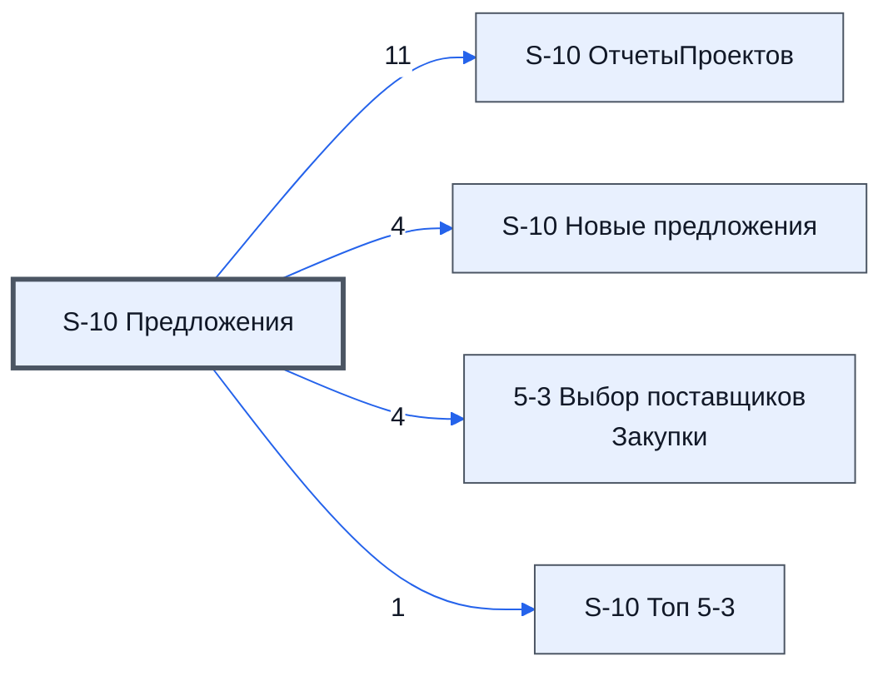

# Лист «S-10 Предложения»

Таблица: таблица проекта · контур 2.

**Зачем** (со слов директора): собирает предложения с листов 1-1 и 5-1.

Устройство листа — заголовки, вид столбцов, списки, формулы, связи с другими листами — собрано из таблицы ниже.

## Зачем лист — подробно

*Заполнить:* что на листе происходит, откуда приходят данные и куда уходят.

## Как заполнять

*Заполнить:* какие столбцы вводят руками, какие считаются сами. Что значит каждый столбец — в `stolbtsy.yaml` рядом (поля `chto` и `kak`).

## Что нельзя трогать

*Заполнить.*

## Инструкции и умения

*Заполнить:* какие инструкции и умения относятся к листу.

## Осталось сделать

- Заполнить разделы выше и `stolbtsy.yaml`.

## Устройство (из таблицы)

- **Таблица:** таблица проекта, лист «S-10 Предложения»; контур 2
- **Размер:** `A1:BZ99`
- **Каркас:** общий — служебные строки, заголовки в строке 10 ([что значат служебные строки](../../zna/lis-sluzhebnye-stroki/index.md))
- **Формул:** 330; заполненных ячеек без формул в данных: 25; списков: 0; условного форматирования: 0; объединённых ячеек: 0

## Связи с другими листами

- **Берёт данные с листов:** «ERROR» *(листа нет в реестре)* (1)
- **Его данные используют:** [S-10 ОтчетыПроектов](../k0-s-10-otchetyproektov/index.md) (11), [S-10 Новые предложения](../k1-s-10-novye-predlozheniya/index.md) (4), [5-3 Выбор поставщиков Закупки](../k2-5-3-vybor-postavshchikov/index.md) (4), [S-10 Топ 5-3](../k2-s-10-top-5-3/index.md) (1)

В скобках и на стрелках — сколько формул ссылаются.

## Столбцы

Устройство — из таблицы; «Что это» и «Как заполняют» — из `stolbtsy.yaml` (заполняем руками).

| Столбец | Заголовок | Служебное имя | Вид | Заполняется | Список | Что это | Как заполняют |
|---|---|---|---|---|---|---|---|
| A |  | err1 |  | руками? |  |  |  |
| B |  | err2 |  | руками? |  |  |  |
| C |  |  | formulaColl | формула |  |  |  |
| D |  | ЛистПредложениеТовар | formulaColl | формула |  |  |  |
| E |  | Лист | formulaFree | руками, потом формула |  |  |  |
| F |  | Предложение | formulaFree | руками, потом формула |  |  |  |
| G |  | Емайл | formulaFree | руками, потом формула |  |  |  |
| H |  | ID_Товара | formulaFree | руками, потом формула |  |  |  |
| I |  | Цена | formulaFree | руками, потом формула |  |  |  |
| J |  | Срок | formulaFree | руками, потом формула |  |  |  |
| K |  | Модель | formulaFree | руками, потом формула |  |  |  |
| L |  | свободно_12 | formulaFree | руками, потом формула |  |  |  |
| M |  | свободно_13 | formulaFree | руками, потом формула |  |  |  |
| N |  | свободно_14 | formulaFree | руками, потом формула |  |  |  |
| O |  | свободно_15 | formulaFree | руками, потом формула |  |  |  |
| P |  | свободно_16 | formulaFree | руками, потом формула |  |  |  |
| Q |  | свободно_17 | formulaFree | руками, потом формула |  |  |  |
| R |  | свободно_18 | formulaFree | руками, потом формула |  |  |  |
| S |  | свободно_19 | formulaFree | руками, потом формула |  |  |  |
| T |  | свободно_20 | formulaFree | руками, потом формула |  |  |  |
| U |  | свободно_21 | formulaFree | руками, потом формула |  |  |  |
| V |  | свободно_22 | formulaFree | руками, потом формула |  |  |  |
| W |  | свободно_23 | formulaFree | руками, потом формула |  |  |  |
| X |  | свободно_24 | formulaFree | руками, потом формула |  |  |  |
| Y |  | свободно_25 | formulaFree | руками, потом формула |  |  |  |
| Z |  | свободно_26 | formulaFree | руками, потом формула |  |  |  |
| AA | #ERROR! | свободно_27 | formulaColl | формула |  |  |  |
| AB |  | свободно_28 | formulaFree | руками, потом формула |  |  |  |
| AC |  | свободно_29 | formulaFree | руками, потом формула |  |  |  |
| AD |  | свободно_30 | formulaFree | руками, потом формула |  |  |  |
| AE |  | свободно_31 | formulaFree | руками, потом формула |  |  |  |
| AF |  | свободно_32 | formulaFree | руками, потом формула |  |  |  |
| AG |  | свободно_33 | formulaFree | руками, потом формула |  |  |  |
| AH |  | свободно_34 | formulaFree | руками, потом формула |  |  |  |
| AI |  | свободно_35 | formulaFree | руками, потом формула |  |  |  |
| AJ |  | свободно_36 | formulaFree | руками, потом формула |  |  |  |
| AK |  | свободно_37 | formulaFree | руками, потом формула |  |  |  |
| AL |  | свободно_38 | formulaFree | руками, потом формула |  |  |  |
| AM |  | свободно_39 | formulaFree | руками, потом формула |  |  |  |
| AN |  | свободно_40 | formulaFree | руками, потом формула |  |  |  |
| AO |  | свободно_41 | formulaFree | руками, потом формула |  |  |  |
| AP |  | свободно_42 | formulaFree | руками, потом формула |  |  |  |
| AQ |  | свободно_43 | formulaFree | руками, потом формула |  |  |  |
| AR |  | свободно_44 | formulaFree | руками, потом формула |  |  |  |
| AS |  | свободно_45 | formulaFree | руками, потом формула |  |  |  |
| AT |  | свободно_46 | formulaFree | руками, потом формула |  |  |  |
| AU |  | свободно_47 | formulaFree | руками, потом формула |  |  |  |
| AV |  | свободно_48 | formulaFree | руками, потом формула |  |  |  |
| AW |  | свободно_49 | formulaFree | руками, потом формула |  |  |  |
| AX |  | свободно_50 | formulaFree | руками, потом формула |  |  |  |
| AY |  | свободно_51 | formulaFree | руками, потом формула |  |  |  |
| AZ |  | свободно_52 | formulaFree | руками, потом формула |  |  |  |
| BA | AA | свободно_53 | formulaColl | формула |  |  |  |
| BB | [почта] | свободно_54 | formulaFree | руками, потом формула |  |  |  |
| BC | ID_T001 | свободно_55 | formulaFree | руками, потом формула |  |  |  |
| BD | 276500 | свободно_56 | formulaFree | руками, потом формула |  |  |  |
| BE | 20 рд | свободно_57 | formulaFree | руками, потом формула |  |  |  |
| BF | Камера горения Eco 3 Ø33/Ø41,5-MT-SiSiC 22100592 | свободно_58 | formulaFree | руками, потом формула |  |  |  |
| BG |  | свободно_59 | formulaFree | руками, потом формула |  |  |  |
| BH |  | свободно_60 | formulaFree | руками, потом формула |  |  |  |
| BI |  | свободно_61 | formulaFree | руками, потом формула |  |  |  |
| BJ |  | свободно_62 | formulaFree | руками, потом формула |  |  |  |
| BK |  | свободно_63 | formulaFree | руками, потом формула |  |  |  |
| BL |  | свободно_64 | formulaFree | руками, потом формула |  |  |  |
| BM |  | свободно_65 | formulaFree | руками, потом формула |  |  |  |
| BN |  | свободно_66 | formulaFree | руками, потом формула |  |  |  |
| BO |  | свободно_67 | formulaFree | руками, потом формула |  |  |  |
| BP |  | свободно_68 | formulaFree | руками, потом формула |  |  |  |
| BQ |  | свободно_69 | formulaFree | руками, потом формула |  |  |  |
| BR |  | свободно_70 | formulaFree | руками, потом формула |  |  |  |
| BS |  | свободно_71 | formulaFree | руками, потом формула |  |  |  |
| BT |  | свободно_72 | formulaFree | руками, потом формула |  |  |  |
| BU |  | свободно_73 | formulaFree | руками, потом формула |  |  |  |
| BV |  | свободно_74 | formulaFree | руками, потом формула |  |  |  |
| BW |  | свободно_75 | formulaFree | руками, потом формула |  |  |  |
| BX |  | свободно_76 | formulaFree | руками, потом формула |  |  |  |
| BY |  | свободно_77 | formulaFree | руками, потом формула |  |  |  |
| BZ |  | свободно_78 | formulaFree | руками, потом формула |  |  |  |

Формулы столбцов (17)

| Столбец | Строка | Формула |
|---|---|---|
| C | 10 | <code>=LAMBDA(doJoin,theData,doJoin(theData) )( LAMBDA(theData,BYROW(theData,lambda(tr,TEXTJOIN(" ",TRUE,tr)))), {'S-10 Предложения'!E10:E99,'S-10 Предложения'!F10:F99,'S-10 Предложения'!H10:H99} )</code> |
| D | 10 | <code>=LAMBDA(doMakeHeder,theDate, {doMakeHeder(theDate);theDate} ) ( LAMBDA(theDate,ByCol( INDEX(theDate,1,0),LAMBDA(theCell,""))), BYROW( QUERY( { BYROW( {AA10:AG99},LAMBDA(theR,{"1-1 Сбор КП",theR}) ); BYROW( {BA10:BG99},LAMBDA(theR,{,"")</code> |
| E | 10 | <code>="COMPUTED_VALUE"</code> |
| F | 10 | <code>="COMPUTED_VALUE"</code> |
| G | 10 | <code>="COMPUTED_VALUE"</code> |
| H | 10 | <code>="COMPUTED_VALUE"</code> |
| I | 10 | <code>="COMPUTED_VALUE"</code> |
| J | 10 | <code>="COMPUTED_VALUE"</code> |
| K | 10 | <code>="COMPUTED_VALUE"</code> |
| L | 10 | <code>="COMPUTED_VALUE"</code> |
| AA | 10 | <code>=IFERROR( LAMBDA(doCountRow,doCountCol,theCRow,theCCol,doMakeArr,doPullAgent,doPullProd,doPullOfer,doMakeRez,theOfers,theAgents,a,{ LAMBDA(f,v,v)( doMakeArr(doCountRow(theOfers,theCRow),doCountCol(theOfers,theCCol)), doMakeRez(doPullAgent,doPullProd,doPul,"#ERROR!")</code> |
| BA | 10 | <code>=IFERROR( LAMBDA(doCountRow,doCountCol,theCRow,theCCol,doMakeArr,doPullAgent,doPullProd,doPullOfer,doMakeRez,theOfers,theAgents,a,{ LAMBDA(f,v,v)( doMakeArr(doCountRow(theOfers,theCRow),doCountCol(theOfers,theCCol)), doMakeRez(doPullAgent,doPullProd,doPul,"AA")</code> |
| BB | 10 | <code>="COMPUTED_VALUE"</code> |
| BC | 10 | <code>="COMPUTED_VALUE"</code> |
| BD | 10 | <code>="COMPUTED_VALUE"</code> |
| BE | 10 | <code>="COMPUTED_VALUE"</code> |
| BF | 10 | <code>="COMPUTED_VALUE"</code> |

