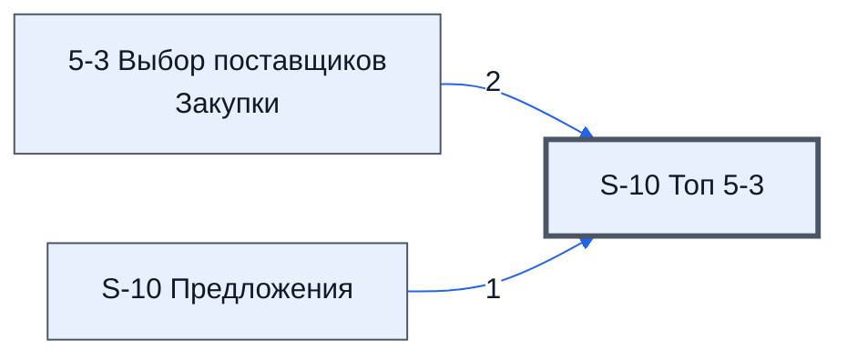

# Лист «S-10 Топ 5-3»

Таблица: таблица проекта · контур 2.

**Зачем** (со слов директора): топ-7 для листа 5-3.

Устройство листа — заголовки, вид столбцов, списки, формулы, связи с другими листами — собрано из таблицы ниже.

## Зачем лист — подробно

*Заполнить:* что на листе происходит, откуда приходят данные и куда уходят.

## Как заполнять

*Заполнить:* какие столбцы вводят руками, какие считаются сами. Что значит каждый столбец — в `stolbtsy.yaml` рядом (поля `chto` и `kak`).

## Что нельзя трогать

*Заполнить.*

## Инструкции и умения

*Заполнить:* какие инструкции и умения относятся к листу.

## Осталось сделать

- Заполнить разделы выше и `stolbtsy.yaml`.

## Устройство (из таблицы)

- **Таблица:** таблица проекта, лист «S-10 Топ 5-3»; контур 2
- **Размер:** `A1:Q1000`
- **Каркас:** общий — служебные строки, заголовки в строке 10 ([что значат служебные строки](../../zna/lis-sluzhebnye-stroki/index.md))
- **Формул:** 33; заполненных ячеек без формул в данных: 203; списков: 0; условного форматирования: 0; объединённых ячеек: 0

## Связи с другими листами

- **Берёт данные с листов:** [5-3 Выбор поставщиков Закупки](../k2-5-3-vybor-postavshchikov/index.md) (2), [S-10 Предложения](../k2-s-10-predlozheniya/index.md) (1)

В скобках и на стрелках — сколько формул ссылаются.

## Столбцы

Устройство — из таблицы; «Что это» и «Как заполняют» — из `stolbtsy.yaml` (заполняем руками).

| Столбец | Заголовок | Служебное имя | Вид | Заполняется | Список | Что это | Как заполняют |
|---|---|---|---|---|---|---|---|
| C | Таблица |  | formulaColl | формула |  |  |  |
| D | Лист^Предложение^Товар | Лист_Предложение_Товар | formulaColl | формула |  |  |  |
| E | ЛистИПредложение | Цена | formulaColl | формула |  |  |  |
| F | Лист | Лист | formulaColl | формула |  |  |  |
| G | Предложение | Предложение | formulaFree | руками, потом формула |  |  |  |
| H | Постовшик | Постовшик | formulaFree | руками, потом формула |  |  |  |
| I | Товар | Товар | formulaFree | руками, потом формула |  |  |  |
| J | Цена | Цена | formulaFree | руками, потом формула |  |  |  |
| K | Срок | Срок | formulaFree | руками, потом формула |  |  |  |
| L | Модель | Модель | formulaFree | руками, потом формула |  |  |  |
| M | Манаджер | Манаджер | formulaColl | формула |  |  |  |
| N | Эксперт | Эксперт | formulaFree | руками, потом формула |  |  |  |
| O | Сделка | Сделка | formulaFree | руками, потом формула |  |  |  |
| P | Сборный Коммент | СборныйКомент | formulaColl | формула |  |  |  |

## Переменные листа

Строки 5–6 каркаса (`var_name`, `var_value`): имя переменной и её значения — скорее всего, списки для скриптов и выпадающих списков.

| Ячейка | Имя | Значения |
|---|---|---|
| D | ВписанНаЛисте | 5-1 Сбор КП Закупки, 1-1 Сбор КП |
| E |  | And ( Col2='5-1 Сбор КП Закупки' or Col2='1-1 Сбор КП' ) |

Формулы столбцов (7)

| Столбец | Строка | Формула |
|---|---|---|
| D | 10 | <code>={"Лист^Предложение^Товар";LAMBDA( doFilterProducts, doForEachProducts, doGetProductOffers,doSplitByLines, theProducts, theOffers, theNumTop, theWhereAnd, doSplitByLines(doForEachProducts(doFilterProducts (theProducts),theNumTop,theWhereAnd,theOffers,doG,"Лист^Предложение^Товар")</code> |
| E | 10 | <code>={"ЛистИПредложение";LAMBDA(doRez,theData,doRez(theData)) ( LAMBDA(theData,BYROW(theData,LAMBDA(theR,IF(INDEX(theR,,1)&lt;&gt;"",textJoin(" ",FALSE,theR),)))) ,{F11:F1000 , G11:G1000} )}</code> |
| F | 10 | <code>={F2:L2;LAMBDA( doComplereOffer, doTreatOffers, theOffersKey, theOffers, doComplereOffer(theOffersKey,doTreatOffers(theOffers))) ( LAMBDA(theOffersKey,theOffers, IFERROR( VLOOKUP(theOffersKey,theOffers,{2,3,4,5,6,7,8},FALSE),) ), LAMBDA(theOffers,theOffers), 'S-10 Топ 5-3'!D11:D1000, 'S-10 Предложения'!D11:K1000 )}</code> |
| M | 10 | <code>={{'S-10 Топ 5-3'!$M$2:$O$2};LAMBDA( doFind, doOrderMax, doMakeData, doFindByKey, theFilter, theKeys, theDFilter,theDKey, theDMng, theDExp, theDFsh, theDTim, { doFind(doFindByKey,theKeys,doOrderMax(doMakeData(theDKey, theDMng, theDTim, theDFilter),theFi,"Манаджер")</code> |
| N | 10 | <code>="COMPUTED_VALUE"</code> |
| O | 10 | <code>="COMPUTED_VALUE"</code> |
| P | 10 | <code>={"Сборный Коммент"; L11:L1000&amp; IF(N11:N1000&lt;&gt;"", CHAR(10)&amp;N11:N1000,)}</code> |

