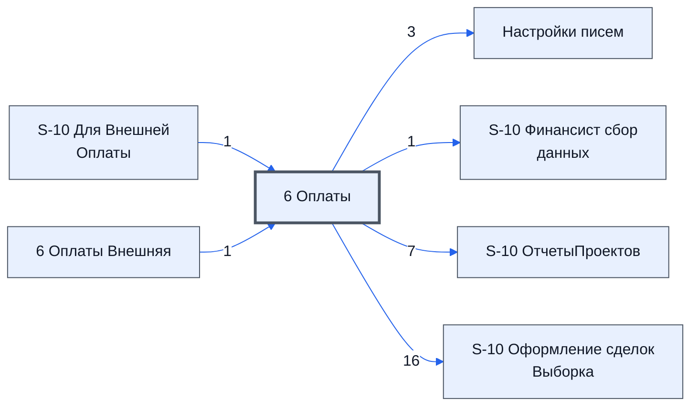

> Черновик: текст не проверен.

# Лист «6 Оплаты»

**Назначение**

*Не описано — см. вопросы ниже.*

Устройство листа — размер, столбцы, формулы, связи с другими листами — собрано из таблицы в конце страницы.

## Осталось сделать

**Вопросы**

1. Для чего этот лист и кто в нём работает?
2. Какие столбцы заполняет человек, а какие считаются сами?
3. Что на листе нельзя трогать?
4. Верен ли список столбцов выше — выгрузка была неполной?

## Устройство (из таблицы)

- **Таблица:** таблица проекта, лист «6 Оплаты»; контур 3
- **Размер:** `A1:CC310`
- **Каркас:** свой, не общий; строка заголовков — 1, угадана по закреплённой области — проверить
- **Формул:** 7; заполненных ячеек без формул в данных: 0; списков: 0; условного форматирования: 12; объединённых ячеек: 0
- **Данные из других таблиц (IMPORTRANGE):** 1

## Связи с другими листами

- **Берёт данные с листов:** [S-10 Для Внешней Оплаты](../k2-s-10-dlya-vneshney-oplaty/index.md) (1), [6 Оплаты Внешняя](../k3-vo-6-oplaty-vneshnyaya/index.md) (1)
- **Его данные используют:** [Настройки писем](../k0-nastroyki-pisem/index.md) (3), [S-10 Финансист сбор данных](../k0-s-10-finansist-sbor-dannykh/index.md) (1), [S-10 ОтчетыПроектов](../k0-s-10-otchetyproektov/index.md) (7), [S-10 Оформление сделок Выборка](../k2-s-10-oformlenie-sdelok-vyborka/index.md) (16)

В скобках и на стрелках — сколько формул ссылаются.

## Кто здесь работает (по процессам)

Обязанности, у которых место работы — этот лист (из разбора регламента); должность — в карточке обязанности.

[Ведущий таблицу оплат](../../reg/oby/tablitsa-oplat.md)

## Столбцы

Устройство — из таблицы; «Что это» и «Как заполняют» — из `stolbtsy.yaml` (заполняем руками).

| Столбец | Заголовок | Служебное имя | Вид | Заполняется | Список | Что это | Как заполняют |
|---|---|---|---|---|---|---|---|
| A | #N/A |  |  | формула |  |  |  |
| G |  |  |  | формула |  |  |  |
| H |  |  |  | формула |  |  |  |
| I |  |  |  | формула |  |  |  |
| J |  |  |  | формула |  |  |  |
| K |  |  |  | формула |  |  |  |

Формулы столбцов (6)

| Столбец | Строка | Формула |
|---|---|---|
| A | 1 | <code>=IMPORTRANGE( 'S-10 Для Внешней Оплаты'!$F$6, "'6 Оплаты Внешняя'!A1:D")</code> |
| G | 1 | <code>=LAMBDA(theData,theUrl,theEmpty, IF(theUrl="", {theEmpty;{"","","","","Нет внешней таблицы оплат. ошибка"}},IF( ISERR(theData), {theEmpty;{"","","",theData,"&lt;&lt; Откройте доступ ошибка"};{"","","",theUrl,"&lt;&lt; Внешняя таблица оплат","")</code> |
| H | 10 | <code>="COMPUTED_VALUE"</code> |
| I | 10 | <code>="COMPUTED_VALUE"</code> |
| J | 10 | <code>="COMPUTED_VALUE"</code> |
| K | 10 | <code>="COMPUTED_VALUE"</code> |

