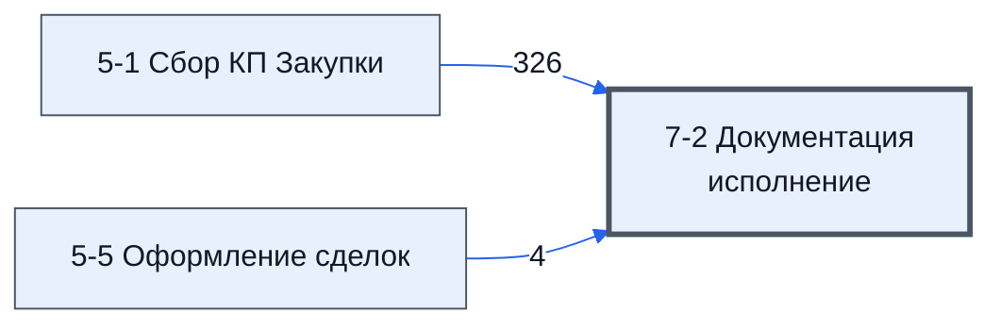

# Лист «7-2 Документация исполнение»

Таблица: таблица проекта · контур 3.

**Зачем** (со слов директора): контроль и обратная связь.

Устройство листа — заголовки, вид столбцов, списки, формулы, связи с другими листами — собрано из таблицы ниже.

## Зачем лист — подробно

*Заполнить:* что на листе происходит, откуда приходят данные и куда уходят.

## Как заполнять

*Заполнить:* какие столбцы вводят руками, какие считаются сами. Что значит каждый столбец — в `stolbtsy.yaml` рядом (поля `chto` и `kak`).

## Что нельзя трогать

*Заполнить.*

## Инструкции и умения

*Заполнить:* какие инструкции и умения относятся к листу.

## Осталось сделать

- Заполнить разделы выше и `stolbtsy.yaml`.

## Устройство (из таблицы)

- **Таблица:** таблица проекта, лист «7-2 Документация исполнение»; контур 3
- **Размер:** `A1:AB319`, закреплено до `J11`
- **Каркас:** общий — служебные строки, заголовки в строке 10 ([что значат служебные строки](../../zna/lis-sluzhebnye-stroki/index.md))
- **Формул:** 321; заполненных ячеек без формул в данных: 320; списков: 0; условного форматирования: 0; объединённых ячеек: 7

## Связи с другими листами

- **Берёт данные с листов:** [5-1 Сбор КП Закупки](../k2-5-1-sbor-kp/index.md) (326), [5-5 Оформление сделок](../k2-5-5-sdelki/index.md) (4)

В скобках и на стрелках — сколько формул ссылаются.

## Столбцы

Устройство — из таблицы; «Что это» и «Как заполняют» — из `stolbtsy.yaml` (заполняем руками).

| Столбец | Заголовок | Служебное имя | Вид | Заполняется | Список | Что это | Как заполняют |
|---|---|---|---|---|---|---|---|
| A | Уникальные ссылки по проекту |  |  | формула |  |  |  |
| C | ID_Товара |  | formulaCell | формула |  |  |  |
| D | № | Номер | formulaColl | формула |  |  |  |
| E *(скрыт)* | Номенклатура | Номенклатура | formulaColl | формула |  |  |  |
| F | Название товара по договору | НазваниеТовараПоДоговору | formulaColl | формула |  |  |  |
| G *(скрыт)* | Изготовитель товара по договору | ИзготовительТовараПоДоговору | formulaColl | формула |  |  |  |
| H *(скрыт)* | Характеристики | Характеристики |  | формула |  |  |  |
| I | Состав поставляемой с продукцией технической документации | СоставТехническойДокументации |  | формула |  |  |  |
| J | Ед. Изм | ЕдИзм | formulaColl | формула |  |  |  |
| K | Кол-во | Количевство | formulaColl | формула |  |  |  |
| L | Поставщик | Поставщик | formulaColl | формула |  |  |  |
| M | ИНН Постав-ка | ИннПоставщика | formulaColl | формула |  |  |  |
| N *(скрыт)* |  | свободно01 |  | руками? |  |  |  |
| O | на Русском | СсылкаНаПаспортНаРусском |  | руками? |  |  |  |
| P | на Английском | СсылкаНаПаспортНаАнглийском |  | руками? |  |  |  |
| Q | на Русском | СсылкаНаРуководствоНаРусском |  | руками? |  |  |  |
| R | на Английском | СсылкаНаРуководствоНаАнглийском |  | руками? |  |  |  |
| S | на Русском | СсылкаНаСоответствиеНаРусском |  | руками? |  |  |  |
| T | на Английском | СсылкаНаСоответствиеНаАнглийском |  | руками? |  |  |  |
| U | на Русском | СсылкаНаСертификатНаРусском |  | руками? |  |  |  |
| V | на Английском | СсылкаНаСертификатНаАнглийском |  | руками? |  |  |  |
| W | на Русском | СсылкаНаДокументАНаРусском |  | руками? |  |  |  |
| X | на Английском | СсылкаНаДокументАНаАнглийском |  | руками? |  |  |  |
| Y | на Русском | СсылкаНаДокументБНаРусском |  | руками? |  |  |  |
| Z | на Английском | СсылкаНаДокументБНаАнглийском |  | руками? |  |  |  |
| AA | на Русском | СсылкаНаДокументВНаРусском |  | руками? |  |  |  |
| AB | на Английском | СсылкаНаДокументВНаАнглийском |  | руками? |  |  |  |

Формулы столбцов (12)

| Столбец | Строка | Формула |
|---|---|---|
| A | 10 | <code>={"Уникальные ссылки по проекту";Sort(UNIQUE({N11:N310;P11:P310;Q11:Q310;R11:R310;S11:S310;T11:T310;U11:U310;V11:V310;W11:W310;X11:X310;Y11:Y310;Z11:Z310;AA11:AA310;AB11:AB310}),1,TRUE)}</code> |
| C | 10 | <code>='5-1 Сбор КП Закупки'!C10</code> |
| D | 10 | <code>=LAMBDA(doNothing,doFind,doRezolve,theIds,theData, byrow(doRezolve(doNothing,doFind,theIds,theData),LAMBDA(t,t)) )( LAMBDA(theIds,theData,), LAMBDA(theId,theData, VLOOKUP(theId,theData,2,FALSE) ), LAMBDA(doNothing,doFind,theIds,theData, ByRow(theIds,LAMBDA(theId,IF(theId&lt;&gt;"",doFind,doNothing)(theId,theData) ))), '7-2 Документация исполнение'!$C$10:$C319,{'5-1 Сбор КП Закупки'!$C$10:$C319,'5-1 Сбор …</code> |
| E | 10 | <code>=LAMBDA(doNothing,doFind,doRezolve,theIds,theData, byrow(doRezolve(doNothing,doFind,theIds,theData),LAMBDA(t,t)) )( LAMBDA(theIds,theData,), LAMBDA(theId,theData, VLOOKUP(theId,theData,2,FALSE) ), LAMBDA(doNothing,doFind,theIds,theData, ByRow(theIds,LAMBDA(theId,IF(theId&lt;&gt;"",doFind,doNothing)(theId,theData) ))), '7-2 Документация исполнение'!$C$10:$C319,{'5-1 Сбор КП Закупки'!$C$10:$C319,'5-1 Сбор …</code> |
| F | 10 | <code>=LAMBDA(doNothing,doFind,doRezolve,theIds,theData, byrow(doRezolve(doNothing,doFind,theIds,theData),LAMBDA(t,t)) )( LAMBDA(theIds,theData,), LAMBDA(theId,theData, VLOOKUP(theId,theData,2,FALSE) ), LAMBDA(doNothing,doFind,theIds,theData, ByRow(theIds,LAMBDA(theId,IF(theId&lt;&gt;"",doFind,doNothing)(theId,theData) ))), '7-2 Документация исполнение'!$C$10:$C319,{'5-1 Сбор КП Закупки'!$C$10:$C319,'5-1 Сбор …</code> |
| G | 10 | <code>=LAMBDA(doNothing,doFind,doRezolve,theIds,theData, byrow(doRezolve(doNothing,doFind,theIds,theData),LAMBDA(t,t)) )( LAMBDA(theIds,theData,), LAMBDA(theId,theData, VLOOKUP(theId,theData,2,FALSE) ), LAMBDA(doNothing,doFind,theIds,theData, ByRow(theIds,LAMBDA(theId,IF(theId&lt;&gt;"",doFind,doNothing)(theId,theData) ))), '7-2 Документация исполнение'!$C$10:$C319,{'5-1 Сбор КП Закупки'!$C$10:$C319,'5-1 Сбор …</code> |
| H | 10 | <code>=LAMBDA(doNothing,doFind,doRezolve,theIds,theData, byrow(doRezolve(doNothing,doFind,theIds,theData),LAMBDA(t,t)) )( LAMBDA(theIds,theData,), LAMBDA(theId,theData, VLOOKUP(theId,theData,2,FALSE) ), LAMBDA(doNothing,doFind,theIds,theData, ByRow(theIds,LAMBDA(theId,IF(theId&lt;&gt;"",doFind,doNothing)(theId,theData) ))), '7-2 Документация исполнение'!$C$10:$C319,{'5-1 Сбор КП Закупки'!$C$10:$C319,'5-1 Сбор …</code> |
| I | 10 | <code>=LAMBDA(doNothing,doFind,doRezolve,theIds,theData, byrow(doRezolve(doNothing,doFind,theIds,theData),LAMBDA(t,t)) )( LAMBDA(theIds,theData,), LAMBDA(theId,theData, VLOOKUP(theId,theData,2,FALSE) ), LAMBDA(doNothing,doFind,theIds,theData, ByRow(theIds,LAMBDA(theId,IF(theId&lt;&gt;"",doFind,doNothing)(theId,theData) ))), '7-2 Документация исполнение'!$C$10:$C319,{'5-1 Сбор КП Закупки'!$C$10:$C319,'5-1 Сбор …</code> |
| J | 10 | <code>=LAMBDA(doNothing,doFind,doRezolve,theIds,theData, byrow(doRezolve(doNothing,doFind,theIds,theData),LAMBDA(t,t)) )( LAMBDA(theIds,theData,), LAMBDA(theId,theData, VLOOKUP(theId,theData,2,FALSE) ), LAMBDA(doNothing,doFind,theIds,theData, ByRow(theIds,LAMBDA(theId,IF(theId&lt;&gt;"",doFind,doNothing)(theId,theData) ))), '7-2 Документация исполнение'!$C$10:$C319,{'5-1 Сбор КП Закупки'!$C$10:$C319,'5-1 Сбор …</code> |
| K | 10 | <code>=LAMBDA(doNothing,doFind,doRezolve,theIds,theData, byrow(doRezolve(doNothing,doFind,theIds,theData),LAMBDA(t,t)) )( LAMBDA(theIds,theData,), LAMBDA(theId,theData, VLOOKUP(theId,theData,2,FALSE) ), LAMBDA(doNothing,doFind,theIds,theData, ByRow(theIds,LAMBDA(theId,IF(theId&lt;&gt;"",doFind,doNothing)(theId,theData) ))), '7-2 Документация исполнение'!$C$10:$C319,{'5-1 Сбор КП Закупки'!$C$10:$C319,'5-1 Сбор …</code> |
| L | 10 | <code>=LAMBDA(doNothing,doFind,doRezolve,theIds,theData, byrow(doRezolve(doNothing,doFind,theIds,theData),LAMBDA(t,t)) )( LAMBDA(theIds,theData,), LAMBDA(theId,theData, VLOOKUP(theId,theData,2,FALSE) ), LAMBDA(doNothing,doFind,theIds,theData, ByRow(theIds,LAMBDA(theId,IF(theId&lt;&gt;"",doFind,doNothing)(theId,theData) ))), '7-2 Документация исполнение'!$C$10:$C319,{'5-5 Оформление сделок'!$C$10:$C319,'5-5 Оф …</code> |
| M | 10 | <code>=LAMBDA(doNothing,doFind,doRezolve,theIds,theData, byrow(doRezolve(doNothing,doFind,theIds,theData),LAMBDA(t,t)) )( LAMBDA(theIds,theData,), LAMBDA(theId,theData, VLOOKUP(theId,theData,2,FALSE) ), LAMBDA(doNothing,doFind,theIds,theData, ByRow(theIds,LAMBDA(theId,IF(theId&lt;&gt;"",doFind,doNothing)(theId,theData) ))), '7-2 Документация исполнение'!$C$10:$C319,{'5-5 Оформление сделок'!$C$10:$C319,'5-5 Оф …</code> |

