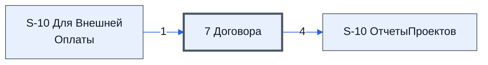

# Лист «7 Договора»

Таблица: таблица проекта · контур 3.

**Зачем** (со слов директора): контроль и обратная связь.

Устройство листа — заголовки, вид столбцов, списки, формулы, связи с другими листами — собрано из таблицы ниже. Строка заголовков на этом листе угадана по закреплённой области — проверить.

## Зачем лист — подробно

*Заполнить:* что на листе происходит, откуда приходят данные и куда уходят.

## Как заполнять

*Заполнить:* какие столбцы вводят руками, какие считаются сами. Что значит каждый столбец — в `stolbtsy.yaml` рядом (поля `chto` и `kak`).

## Что нельзя трогать

*Заполнить.*

## Инструкции и умения

*Заполнить:* какие инструкции и умения относятся к листу.

## Осталось сделать

- Заполнить разделы выше и `stolbtsy.yaml`.

## Устройство (из таблицы)

- **Таблица:** таблица проекта, лист «7 Договора»; контур 3
- **Размер:** `A1:BA15`, закреплено до `A11`
- **Каркас:** свой, не общий; строка заголовков — 10, угадана по закреплённой области — проверить
- **Формул:** 1; заполненных ячеек без формул в данных: 0; списков: 1; условного форматирования: 4; объединённых ячеек: 0
- **Данные из других таблиц (IMPORTRANGE):** 1

## Связи с другими листами

- **Берёт данные с листов:** [S-10 Для Внешней Оплаты](../k2-s-10-dlya-vneshney-oplaty/index.md) (1)
- **Его данные используют:** [S-10 ОтчетыПроектов](../k0-s-10-otchetyproektov/index.md) (4)

В скобках и на стрелках — сколько формул ссылаются.

## Столбцы

Устройство — из таблицы; «Что это» и «Как заполняют» — из `stolbtsy.yaml` (заполняем руками).

| Столбец | Заголовок | Служебное имя | Вид | Заполняется | Список | Что это | Как заполняют |
|---|---|---|---|---|---|---|---|
| R |  |  |  | руками, из списка | 'Технический лист'!$B$2:$B$10 |  |  |
