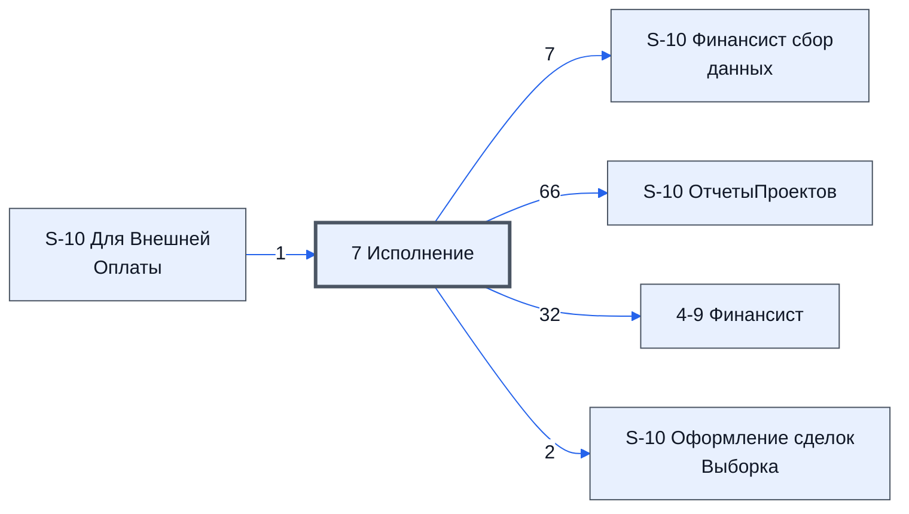

# Лист «7 Исполнение»

Таблица: таблица проекта · контур 3.

**Зачем** (со слов): контроль и обратная связь.

Устройство листа — заголовки, вид столбцов, списки, формулы, связи с другими листами — собрано из таблицы ниже. Строка заголовков на этом листе угадана по закреплённой области — проверить.

## Зачем лист — подробно

*Заполнить:* что на листе происходит, откуда приходят данные и куда уходят.

## Как заполнять

*Заполнить:* какие столбцы вводят руками, какие считаются сами. Что значит каждый столбец — в `stolbtsy.yaml` рядом (поля `chto` и `kak`).

## Что нельзя трогать

*Заполнить.*

## Инструкции и умения

*Заполнить:* какие инструкции и умения относятся к листу.

## Осталось сделать

- Заполнить разделы выше и `stolbtsy.yaml`.

## Устройство (из таблицы)

- **Таблица:** таблица проекта, лист «7 Исполнение»; контур 3
- **Размер:** `A1:AM349`, закреплено до `A9`
- **Каркас:** свой, не общий; строка заголовков — 8, угадана по закреплённой области — проверить
- **Формул:** 1; заполненных ячеек без формул в данных: 0; списков: 0; условного форматирования: 13; объединённых ячеек: 5
- **Данные из других таблиц (IMPORTRANGE):** 1

## Связи с другими листами

- **Берёт данные с листов:** [S-10 Для Внешней Оплаты](../k2-s-10-dlya-vneshney-oplaty/index.md) (1), «S-10 7 Исполнение Внешние (отчет)» *(листа нет в реестре)* (1)
- **Его данные используют:** [S-10 Финансист сбор данных](../k0-s-10-finansist-sbor-dannykh/index.md) (7), [S-10 ОтчетыПроектов](../k0-s-10-otchetyproektov/index.md) (66), [4-9 Финансист](../k1-4-9-finansist/index.md) (32), [S-10 Оформление сделок Выборка](../k2-s-10-oformlenie-sdelok-vyborka/index.md) (2)

В скобках и на стрелках — сколько формул ссылаются.

## Кто здесь работает (по процессам)

Обязанности, у которых место работы — этот лист (из разбора регламента); должность — в карточке обязанности.

[Отслеживающий исполнение договора](../../reg/oby/kontrol-ispolneniya.md)
