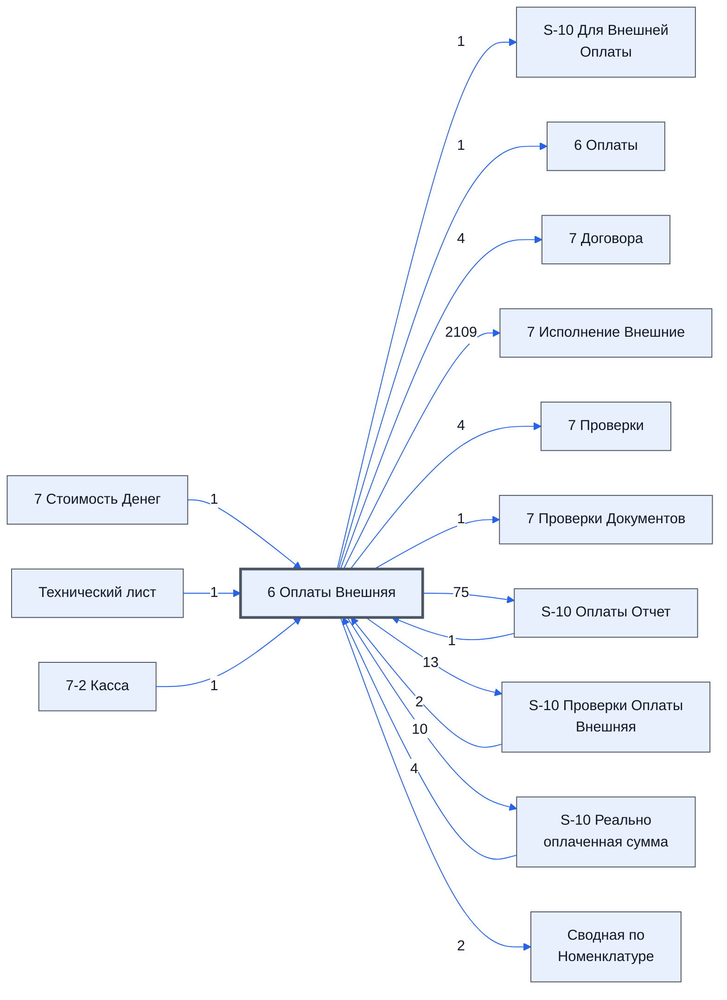

# Лист «6 Оплаты Внешняя»

Таблица: внешняя таблица оплат · контур 3.

**Зачем** (со слов): данные готовит второй контур (лист «S-10 Для Внешней Оплаты»), сюда — импортом.

Устройство листа — заголовки, вид столбцов, списки, формулы, связи с другими листами — собрано из таблицы ниже. Строка заголовков на этом листе угадана по закреплённой области — проверить.

## Зачем лист — подробно

*Заполнить:* что на листе происходит, откуда приходят данные и куда уходят.

## Как заполнять

*Заполнить:* какие столбцы вводят руками, какие считаются сами. Что значит каждый столбец — в `stolbtsy.yaml` рядом (поля `chto` и `kak`).

## Что нельзя трогать

*Заполнить.*

## Инструкции и умения

*Заполнить:* какие инструкции и умения относятся к листу.

## Осталось сделать

- Заполнить разделы выше и `stolbtsy.yaml`.

## Устройство (из таблицы)

- **Таблица:** внешняя таблица оплат, лист «6 Оплаты Внешняя»; контур 3
- **Размер:** `A1:CC310`, закреплено до `A11`
- **Каркас:** свой, не общий; строка заголовков — 10, угадана по закреплённой области — проверить
- **Формул:** 19; заполненных ячеек без формул в данных: 85; списков: 3; условного форматирования: 1; объединённых ячеек: 4

## Связи с другими листами

- **Берёт данные с листов:** [S-10 Реально оплаченная сумма](../k3-vo-s-10-realno-oplachennaya-summa/index.md) (4), [S-10 Проверки Оплаты Внешняя](../k3-vo-s-10-proverki-oplaty-vneshnyaya/index.md) (2), [S-10 Оплаты Отчет](../k3-vo-s-10-oplaty-otchet/index.md) (1), [7 Стоимость Денег](../k3-vo-7-stoimost-deneg/index.md) (1), [Технический лист](../k3-vo-tekhnicheskiy-list/index.md) (1), [7-2 Касса](../k4-vo-7-2-kassa/index.md) (1)
- **Его данные используют:** [S-10 Для Внешней Оплаты](../k2-s-10-dlya-vneshney-oplaty/index.md) (1), [6 Оплаты](../k3-6-oplaty/index.md) (1), [7 Договора](../k3-vo-7-dogovora/index.md) (4), [7 Исполнение Внешние](../k3-vo-7-ispolnenie-vneshnie/index.md) (2109), [7 Проверки](../k3-vo-7-proverki/index.md) (4), [7 Проверки Документов](../k3-vo-7-proverki-dokumentov/index.md) (1), [S-10 Оплаты Отчет](../k3-vo-s-10-oplaty-otchet/index.md) (75), [S-10 Проверки Оплаты Внешняя](../k3-vo-s-10-proverki-oplaty-vneshnyaya/index.md) (13), [S-10 Реально оплаченная сумма](../k3-vo-s-10-realno-oplachennaya-summa/index.md) (10), [Сводная по Номенклатуре](../k3-vo-svodnaya-po-nomenklature/index.md) (2)

В скобках и на стрелках — сколько формул ссылаются.

## Столбцы

Устройство — из таблицы; «Что это» и «Как заполняют» — из `stolbtsy.yaml` (заполняем руками).

| Столбец | Заголовок | Служебное имя | Вид | Заполняется | Список | Что это | Как заполняют |
|---|---|---|---|---|---|---|---|
| A | № |  |  | руками? |  |  |  |
| B | Описание |  |  | руками? |  |  |  |
| C | Значение |  |  | руками? |  |  |  |
| G |  |  |  | формула |  |  |  |
| H |  |  |  | формула |  |  |  |
| I |  |  |  | формула |  |  |  |
| J |  |  |  | формула |  |  |  |
| K | Нет таблицы Проекта |  |  | формула |  |  |  |
| AN | Юр лицо поставщика |  |  | руками? |  |  |  |
| AO | № счета |  |  | руками? |  |  |  |
| AP | Плательщик |  |  | руками? |  |  |  |
| AQ | Статус оплаты |  |  | формула |  |  |  |
| AR | Дата оплаты |  |  | формула |  |  |  |
| AS | Реально оплаченная сумма |  |  | формула |  |  |  |
| AT | % оплаты |  |  | формула |  |  |  |
| AU | Верная сумма |  |  | руками? |  |  |  |
| AV | Проверка |  |  | формула |  |  |  |
| AX | ссылка на папку со счетами |  |  | руками? |  |  |  |
| AY |  |  |  | формула |  |  |  |
| BB | № проекта |  |  | руками? |  |  |  |
| BC | Дата |  |  | руками? |  |  |  |
| BD | Тип |  |  | руками, из списка | "По спецификации,Дополнительный платеж" |  |  |
| BE | Плательщик |  |  | руками? |  |  |  |
| BF | ИНН Плательщика |  |  | формула |  |  |  |
| BG | Кому |  |  | руками? |  |  |  |
| BH | ИНН Поставщика |  |  | руками? |  |  |  |
| BI | Сумма |  |  | руками? |  |  |  |
| BJ | НДС |  |  | руками, из списка | 'Технический лист'!$C$2:$C$10 |  |  |
| BK | Вид оплаты |  |  | руками, из списка | "Без нал,Нал" |  |  |
| BL | № счета |  |  | руками? |  |  |  |
| BM | Назначение платежа |  |  | руками? |  |  |  |
| BN | Проверка |  |  | формула |  |  |  |
| BP |  |  |  | формула |  |  |  |
| BQ | Вид оплаты |  |  | руками? |  |  |  |
| BR | ID |  |  | руками? |  |  |  |
| BS | Дата |  |  | руками? |  |  |  |
| BT | Выбытие |  |  | руками? |  |  |  |
| BU | Поступление |  |  | руками? |  |  |  |
| BV | Проект |  |  | руками? |  |  |  |
| BW | Контрагент |  |  | руками? |  |  |  |
| BX | Назначение платежа |  |  | руками? |  |  |  |
| BY | Статья |  |  | руками? |  |  |  |
| BZ | Кто внес запись |  |  | руками? |  |  |  |
| CA | Касса |  |  | руками? |  |  |  |
| CB | НДС |  |  | руками? |  |  |  |

Формулы столбцов (14)

| Столбец | Строка | Формула |
|---|---|---|
| G | 10 | <code>="COMPUTED_VALUE"</code> |
| H | 10 | <code>="COMPUTED_VALUE"</code> |
| I | 10 | <code>="COMPUTED_VALUE"</code> |
| J | 10 | <code>="COMPUTED_VALUE"</code> |
| K | 10 | <code>="COMPUTED_VALUE"</code> |
| AQ | 10 | <code>={"Статус оплаты"; LAMBDA(Pey_Stat_inf_do, Stat_v_do,Oplata_v_do, Tov_Name_ar,Tov_Stat_ar,Tov_Cond_ar,Tov_Procent_ar, MAP(Tov_Name_ar,Tov_Stat_ar,Tov_Cond_ar,Tov_Procent_ar,LAMBDA(Tov_Name_v,Tov_Stat_v,Tov_Cond_v,Tov_Procent_v, IF( Tov_Name_v&lt;&gt;"" , Pey_Stat_inf_do( Stat_v_do(Tov_Stat_v,Tov_Cond_v) , Oplata_v_do(Tov_Procent_v) ) ,) ) ) )( LAMBDA(Stat_ce,Oplata_v, TEXTJOIN(" ",TRUE,Stat_ce,Oplata_v) …</code> |
| AR | 10 | <code>={"Дата оплаты";LAMBDA(doToDate,doCheck,doFind,doFind2,thePlateS,theOplS,BYROW(theOplS,LAMBDA(theOpl ,IF(doCheck(theOpl), TEXTJOIN(CHAR(10),TRUE, doToDate(doFind(thePlateS,INDEX(theOpl,,1),INDEX(theOpl,,2)))),))) )( LAMBDA(theVs,BYROW(theVs,LAMBDA(t,"Дата оплаты")</code> |
| AS | 10 | <code>={"Реально оплаченная сумма";LAMBDA(theIdS,theProblemS, BYROW(theIdS, LAMBDA(theId, IF(theId&lt;&gt;"",IFERROR(VLOOKUP(theId,theProblemS,2,FALSE),),) )) )('6 Оплаты Внешняя'!I11:I310,{'S-10 Реально оплаченная сумма'!A1:A310,'S-10 Реально оплаченная сумма'!B1:B310})}</code> |
| AT | 10 | <code>={"% оплаты";LAMBDA(theIdS,theProblemS, BYROW(theIdS, LAMBDA(theId, IF(theId&lt;&gt;"",IFERROR(VLOOKUP(theId,theProblemS,2,FALSE),),) )) )('6 Оплаты Внешняя'!I11:I310,{'S-10 Реально оплаченная сумма'!A1:A310,'S-10 Реально оплаченная сумма'!C1:C310})}</code> |
| AV | 10 | <code>={"Проверка";LAMBDA(theIdS,theProblemS, BYROW(theIdS, LAMBDA(theId, IF(theId&lt;&gt;"",IFERROR(VLOOKUP(theId,theProblemS,2,FALSE),),) )) )('6 Оплаты Внешняя'!I11:I310,{'S-10 Проверки Оплаты Внешняя'!A1:A310,'S-10 Проверки Оплаты Внешняя'!B1:B310})}</code> |
| AY | 10 | <code>=K6</code> |
| BF | 11 | <code>=IFERROR(VLOOKUP($BE11,'Технический лист'!$D$1:$E310,2,FALSE),)</code> |
| BN | 10 | <code>={"Проверка";IF(LEN(BI11:BI310)&gt;0, IF(BD11:BD310&lt;&gt;"По спецификации" , IFS( ISBLANK(BD11:BD310),"Не указан 'Тип' платежа, выберите один из", LEN(BL11:BL310&amp;BM11:BM310)=0,"Ошибка необходимо заполнить 'Назначение платежа'", NOT(ISNUMBER(BI11:BI310)),"Ошибка 'Сумма' - не число, удалить пробелы", ISBLANK(BE11:BE310),"Ошибка. Не указан 'Плательщик'", ISBLANK(BG11:BG310),"Ошибка. Не указан 'Кому'", ISBLA …</code> |
| BP | 10 | <code>='7-2 Касса'!A10:O310</code> |

