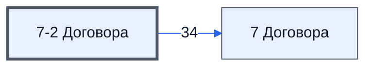

# Лист «7-2 Договора»

Таблица: внешняя таблица оплат · контур 3.

**Зачем** (со слов): отчёт по договорам из контура 4.

Устройство листа — заголовки, вид столбцов, списки, формулы, связи с другими листами — собрано из таблицы ниже. Строка заголовков на этом листе угадана по закреплённой области — проверить.

## Зачем лист — подробно

*Заполнить:* что на листе происходит, откуда приходят данные и куда уходят.

## Как заполнять

*Заполнить:* какие столбцы вводят руками, какие считаются сами. Что значит каждый столбец — в `stolbtsy.yaml` рядом (поля `chto` и `kak`).

## Что нельзя трогать

*Заполнить.*

## Инструкции и умения

*Заполнить:* какие инструкции и умения относятся к листу.

## Осталось сделать

- Заполнить разделы выше и `stolbtsy.yaml`.

## Устройство (из таблицы)

- **Таблица:** внешняя таблица оплат, лист «7-2 Договора»; контур 3
- **Размер:** `A1:AN11`
- **Каркас:** свой, не общий; строка заголовков — 1, угадана по закреплённой области — проверить
- **Формул:** 1; заполненных ячеек без формул в данных: 83; списков: 0; условного форматирования: 0; объединённых ячеек: 0

## Связи с другими листами

- **Его данные используют:** [7 Договора](../k3-vo-7-dogovora/index.md) (34)

В скобках и на стрелках — сколько формул ссылаются.

## Столбцы

Устройство — из таблицы; «Что это» и «Как заполняют» — из `stolbtsy.yaml` (заполняем руками).

| Столбец | Заголовок | Служебное имя | Вид | Заполняется | Список | Что это | Как заполняют |
|---|---|---|---|---|---|---|---|
| A |  |  |  | формула |  |  |  |

Формулы столбцов (1)

| Столбец | Строка | Формула |
|---|---|---|
| A | 8 | <code>={ { "" ; "№" ; "№" } , { "" ; "Проект №" ; "Проект №" } , { "" ; "Юр лицо Продавец" ; "Юр лицо Продавец" } , { "" ; "Юр лицо Покупатель" ; "Юр лицо Покупатель" } , { "" ; "Номер Договора" ; "Номер Договора" } , { "date" ; "Дата договора от" ; "Дата договора от" } , { "" ; "Сумма договора" ; "Сумма договора" } , { "date" ; "Дата подписи продавцом" ; "Дата подписи продавцом" } , { "date" ; "Дата по …</code> |

