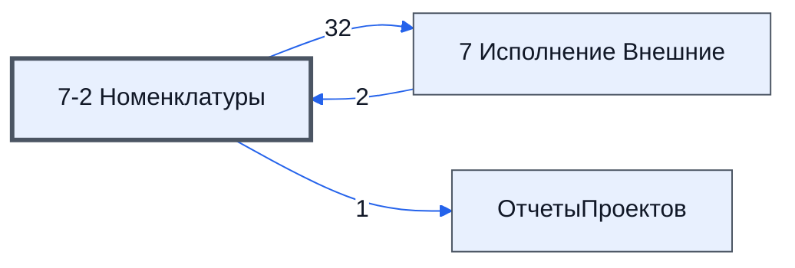

# Лист «7-2 Номенклатуры»

Таблица: внешняя таблица оплат · контур 3.

**Зачем** (со слов директора): отчёт по номенклатурам из контура 4.

Устройство листа — заголовки, вид столбцов, списки, формулы, связи с другими листами — собрано из таблицы ниже. Строка заголовков на этом листе угадана по закреплённой области — проверить.

## Зачем лист — подробно

*Заполнить:* что на листе происходит, откуда приходят данные и куда уходят.

## Как заполнять

*Заполнить:* какие столбцы вводят руками, какие считаются сами. Что значит каждый столбец — в `stolbtsy.yaml` рядом (поля `chto` и `kak`).

## Что нельзя трогать

*Заполнить.*

## Инструкции и умения

*Заполнить:* какие инструкции и умения относятся к листу.

## Осталось сделать

- Заполнить разделы выше и `stolbtsy.yaml`.

## Устройство (из таблицы)

- **Таблица:** внешняя таблица оплат, лист «7-2 Номенклатуры»; контур 3
- **Размер:** `A1:CI22`
- **Каркас:** свой, не общий; строка заголовков — 1, угадана по закреплённой области — проверить
- **Формул:** 105; заполненных ячеек без формул в данных: 61; списков: 0; условного форматирования: 0; объединённых ячеек: 0

## Связи с другими листами

- **Берёт данные с листов:** [7 Исполнение Внешние](../k3-vo-7-ispolnenie-vneshnie/index.md) (2)
- **Его данные используют:** [7 Исполнение Внешние](../k3-vo-7-ispolnenie-vneshnie/index.md) (32), [ОтчетыПроектов](../k3-vo-otchetyproektov/index.md) (1)

В скобках и на стрелках — сколько формул ссылаются.

## Столбцы

Устройство — из таблицы; «Что это» и «Как заполняют» — из `stolbtsy.yaml` (заполняем руками).

| Столбец | Заголовок | Служебное имя | Вид | Заполняется | Список | Что это | Как заполняют |
|---|---|---|---|---|---|---|---|
| A |  |  |  | формула |  |  |  |
| B |  |  |  | формула |  |  |  |
| C |  |  |  | формула |  |  |  |
| D |  |  |  | формула |  |  |  |
| E |  |  |  | формула |  |  |  |
| F |  |  |  | формула |  |  |  |
| G |  |  |  | формула |  |  |  |
| H |  |  |  | формула |  |  |  |
| I |  |  |  | формула |  |  |  |
| J |  |  |  | формула |  |  |  |
| K |  |  |  | формула |  |  |  |
| L |  |  |  | формула |  |  |  |
| M |  |  |  | формула |  |  |  |
| N |  |  |  | формула |  |  |  |
| O |  |  |  | формула |  |  |  |
| P |  |  |  | формула |  |  |  |
| Q |  |  |  | формула |  |  |  |
| R |  |  |  | формула |  |  |  |
| S |  |  |  | формула |  |  |  |
| T |  |  |  | формула |  |  |  |
| U |  |  |  | формула |  |  |  |
| V |  |  |  | формула |  |  |  |
| W |  |  |  | формула |  |  |  |
| X |  |  |  | формула |  |  |  |
| Y |  |  |  | формула |  |  |  |
| Z |  |  |  | формула |  |  |  |
| AA |  |  |  | формула |  |  |  |
| AB |  |  |  | формула |  |  |  |
| AC |  |  |  | формула |  |  |  |
| AD |  |  |  | формула |  |  |  |
| AE |  |  |  | формула |  |  |  |
| AF |  |  |  | формула |  |  |  |
| AG |  |  |  | формула |  |  |  |
| AH |  |  |  | формула |  |  |  |
| AI |  |  |  | формула |  |  |  |
| AJ |  |  |  | формула |  |  |  |
| AK |  |  |  | формула |  |  |  |
| AL |  |  |  | формула |  |  |  |
| AM |  |  |  | формула |  |  |  |
| AN |  |  |  | формула |  |  |  |
| AO |  |  |  | формула |  |  |  |
| AP |  |  |  | формула |  |  |  |
| AQ |  |  |  | формула |  |  |  |
| AR |  |  |  | формула |  |  |  |
| AS |  |  |  | формула |  |  |  |
| AT |  |  |  | формула |  |  |  |
| AU |  |  |  | формула |  |  |  |
| AV |  |  |  | формула |  |  |  |
| AW |  |  |  | формула |  |  |  |
| AX |  |  |  | формула |  |  |  |
| AY |  |  |  | формула |  |  |  |
| AZ |  |  |  | формула |  |  |  |
| BA |  |  |  | формула |  |  |  |
| BB |  |  |  | формула |  |  |  |
| BC |  |  |  | формула |  |  |  |
| BD |  |  |  | формула |  |  |  |
| BE |  |  |  | формула |  |  |  |
| BF |  |  |  | формула |  |  |  |
| BG |  |  |  | формула |  |  |  |
| BH |  |  |  | формула |  |  |  |
| BJ |  |  |  | формула |  |  |  |
| CA |  |  |  | формула |  |  |  |
| CB |  |  |  | формула |  |  |  |
| CC |  |  |  | формула |  |  |  |
| CD |  |  |  | формула |  |  |  |
| CE |  |  |  | формула |  |  |  |
| CF |  |  |  | формула |  |  |  |
| CG |  |  |  | формула |  |  |  |
| CH |  |  |  | формула |  |  |  |
| CI |  |  |  | формула |  |  |  |

Формулы столбцов (70)

| Столбец | Строка | Формула |
|---|---|---|
| A | 9 | <code>="Проект"</code> |
| B | 9 | <code>="№"</code> |
| C | 9 | <code>="Номенклатура"</code> |
| D | 9 | <code>="Название товара по договору"</code> |
| E | 9 | <code>="ЕдИзм"</code> |
| F | 9 | <code>="Кол-во"</code> |
| G | 9 | <code>="Цена"</code> |
| H | 9 | <code>="Итого"</code> |
| I | 9 | <code>="Срок поставки"</code> |
| J | 9 | <code>="Поставщик"</code> |
| K | 9 | <code>="Статус счета"</code> |
| L | 8 | <code>="date"</code> |
| M | 9 | <code>="Ожидаемая дата готовности"</code> |
| N | 9 | <code>="Поставка заказчику по договору до"</code> |
| O | 9 | <code>="Комментарий"</code> |
| P | 8 | <code>="date"</code> |
| Q | 9 | <code>="Текущий статус"</code> |
| R | 9 | <code>="Название компании поставщика"</code> |
| S | 9 | <code>="№ счета"</code> |
| T | 9 | <code>="Оплата от"</code> |
| U | 9 | <code>="Контактное лицо поставщика"</code> |
| V | 9 | <code>="Условия поставки"</code> |
| W | 9 | <code>="Транспортная компания"</code> |
| X | 9 | <code>="№ документа о покупке"</code> |
| Y | 8 | <code>="date"</code> |
| Z | 9 | <code>="Скан с печатью в папке"</code> |
| AA | 9 | <code>="Состояние полученного товара"</code> |
| AB | 9 | <code>="Заказчик"</code> |
| AC | 9 | <code>="Название проекта"</code> |
| AD | 9 | <code>="Адрес доставки"</code> |
| AE | 9 | <code>="Контакты покупателя"</code> |
| AF | 9 | <code>="Способ связи"</code> |
| AG | 9 | <code>="Частичная оплата за товар"</code> |
| AH | 9 | <code>="Частичная поставка товара"</code> |
| AI | 9 | <code>="Посредник"</code> |
| AJ | 9 | <code>="Отгрузка от"</code> |
| AK | 9 | <code>="Состав поставляемой с продукцией технической документации"</code> |
| AL | 9 | <code>="№ отгрузочных документов"</code> |
| AM | 8 | <code>="date"</code> |
| AN | 9 | <code>="Срок приемки по договору"</code> |
| AO | 8 | <code>="date"</code> |
| AP | 9 | <code>="Номер машины"</code> |
| AQ | 9 | <code>="Фио водителя"</code> |
| AR | 9 | <code>="Пропуск"</code> |
| AS | 9 | <code>="Процент оплаты"</code> |
| AT | 8 | <code>="date"</code> |
| AU | 9 | <code>="Статус доплаты"</code> |
| AV | 9 | <code>="Папка проекта"</code> |
| AW | 9 | <code>="Проверка обязательного заполнения полей"</code> |
| AX | 9 | <code>="Результат проверки"</code> |
| AY | 8 | <code>="date"</code> |
| AZ | 9 | <code>="Окончание по дог-ру"</code> |
| BA | 9 | <code>="Поставка заказчику по договору до"</code> |
| BB | 9 | <code>="key"</code> |
| BC | 8 | <code>="date"</code> |
| BD | 9 | <code>="mem"</code> |
| BE | 8 | <code>="date"</code> |
| BF | 9 | <code>="Комментарий [сотрудник контура 2]"</code> |
| BG | 8 | <code>="date"</code> |
| BH | 9 | <code>="Проверка обязательного заполнения полей"</code> |
| BJ | 9 | <code>="last"</code> |
| CA | 9 | <code>="Ош."</code> |
| CB | 9 | <code>="0. Товар доставлен"</code> |
| CC | 9 | <code>="1. Поставлен в срок"</code> |
| CD | 9 | <code>="2. Просрочен на"</code> |
| CE | 9 | <code>="3. Просрочки поставки не ожиадем"</code> |
| CF | 9 | <code>="4. Ожидаем просрочку поставки"</code> |
| CG | 9 | <code>="№🔗Номенклатура"</code> |
| CH | 9 | <code>="Итого для Заказчика"</code> |
| CI | 9 | <code>={"5.ЗакупкаТоварИсполняется";"5.ЗакупкаТоварИсполняетсяЕстьСтатусЗакупки";IF( '7-2 Номенклатуры'!C11:C22&lt;&gt;"",IF( '7-2 Номенклатуры'!Q11:Q22&lt;&gt;"",1,0 ),)}</code> |

