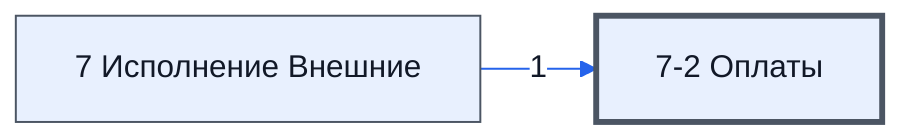

# Лист «7-2 Оплаты»

Таблица: внешняя таблица оплат · контур 3.

**Зачем** (со слов): отчёт по оплатам из контура 4.

Устройство листа — заголовки, вид столбцов, списки, формулы, связи с другими листами — собрано из таблицы ниже. Строка заголовков на этом листе угадана по закреплённой области — проверить.

## Зачем лист — подробно

*Заполнить:* что на листе происходит, откуда приходят данные и куда уходят.

## Как заполнять

*Заполнить:* какие столбцы вводят руками, какие считаются сами. Что значит каждый столбец — в `stolbtsy.yaml` рядом (поля `chto` и `kak`).

## Что нельзя трогать

*Заполнить.*

## Инструкции и умения

*Заполнить:* какие инструкции и умения относятся к листу.

## Осталось сделать

- Заполнить разделы выше и `stolbtsy.yaml`.

## Устройство (из таблицы)

- **Таблица:** внешняя таблица оплат, лист «7-2 Оплаты»; контур 3
- **Размер:** `A1:AZ20`, закреплено до `E1`
- **Каркас:** свой, не общий; строка заголовков — 1, угадана по закреплённой области — проверить
- **Формул:** 134; заполненных ячеек без формул в данных: 2; списков: 0; условного форматирования: 4; объединённых ячеек: 0

## Связи с другими листами

- **Берёт данные с листов:** [7 Исполнение Внешние](../k3-vo-7-ispolnenie-vneshnie/index.md) (1)

В скобках и на стрелках — сколько формул ссылаются.

## Столбцы

Устройство — из таблицы; «Что это» и «Как заполняют» — из `stolbtsy.yaml` (заполняем руками).

| Столбец | Заголовок | Служебное имя | Вид | Заполняется | Список | Что это | Как заполняют |
|---|---|---|---|---|---|---|---|
| A |  |  |  | формула |  |  |  |
| B |  |  |  | формула |  |  |  |
| C |  |  |  | формула |  |  |  |
| D |  |  |  | формула |  |  |  |
| E |  |  |  | формула |  |  |  |
| F |  |  |  | формула |  |  |  |
| G |  |  |  | формула |  |  |  |
| H |  |  |  | формула |  |  |  |
| I |  |  |  | формула |  |  |  |
| J |  |  |  | формула |  |  |  |
| K |  |  |  | формула |  |  |  |
| L |  |  |  | формула |  |  |  |
| M |  |  |  | формула |  |  |  |
| N |  |  |  | формула |  |  |  |
| O |  |  |  | формула |  |  |  |
| P |  |  |  | формула |  |  |  |
| Q |  |  |  | формула |  |  |  |
| R |  |  |  | формула |  |  |  |
| S |  |  |  | формула |  |  |  |
| T |  |  |  | формула |  |  |  |
| U |  |  |  | формула |  |  |  |
| V |  |  |  | формула |  |  |  |
| W |  |  |  | формула |  |  |  |
| X |  |  |  | формула |  |  |  |
| Y |  |  |  | формула |  |  |  |
| AB |  |  |  | формула |  |  |  |
| AC |  |  |  | формула |  |  |  |
| AD |  |  |  | формула |  |  |  |
| AE |  |  |  | формула |  |  |  |
| AF |  |  |  | формула |  |  |  |
| AG |  |  |  | формула |  |  |  |
| AK |  |  |  | формула |  |  |  |
| AL |  |  |  | формула |  |  |  |
| AM |  |  |  | формула |  |  |  |
| AN |  |  |  | формула |  |  |  |
| AP | Сводка Оплаты |  |  | формула |  |  |  |
| AQ |  |  |  | формула |  |  |  |
| AR |  |  |  | формула |  |  |  |
| AS |  |  |  | формула |  |  |  |
| AT |  |  |  | формула |  |  |  |
| AU |  |  |  | формула |  |  |  |
| AV |  |  |  | формула |  |  |  |
| AW |  |  |  | формула |  |  |  |
| AX |  |  |  | формула |  |  |  |
| AY |  |  |  | формула |  |  |  |
| AZ |  |  |  | формула |  |  |  |

Формулы столбцов (46)

| Столбец | Строка | Формула |
|---|---|---|
| A | 2 | <code>="ПартнерскаяУПД"</code> |
| B | 2 | <code>="key"</code> |
| C | 2 | <code>="НомерУПД"</code> |
| D | 2 | <code>="Проект"</code> |
| E | 2 | <code>="НазваниеПроекта"</code> |
| F | 2 | <code>="Продавец"</code> |
| G | 2 | <code>="Покупатель"</code> |
| H | 2 | <code>="№Документа"</code> |
| I | 2 | <code>="Дата"</code> |
| J | 2 | <code>="СуммаУПД"</code> |
| K | 2 | <code>="ОкончаниеПриемки"</code> |
| L | 2 | <code>="ПодписанПокупателем"</code> |
| M | 2 | <code>="СканВПапке"</code> |
| N | 2 | <code>="ЭкземплярПродавца"</code> |
| O | 2 | <code>="ЭкземплярПокупателя"</code> |
| P | 2 | <code>="СтрокаУПДзакупки"</code> |
| Q | 2 | <code>="УПДзакупки"</code> |
| R | 2 | <code>="ПланОплаты"</code> |
| S | 2 | <code>="Статус"</code> |
| T | 2 | <code>="ФактОплата"</code> |
| U | 2 | <code>="СуммаОплаты"</code> |
| V | 2 | <code>="ДолгПартнера"</code> |
| W | 2 | <code>="ДатаПоставкиПоДогворуДо"</code> |
| X | 2 | <code>="ПросрочкаПоставкиДней"</code> |
| Y | 2 | <code>="ПросрочкаОплатыДней"</code> |
| AB | 2 | <code>="Срок в кд"</code> |
| AC | 2 | <code>="ЧастичнаяОплата"</code> |
| AD | 2 | <code>="ДатаПоследнейУПД"</code> |
| AE | 2 | <code>="Поступление Нам или партнеру"</code> |
| AF | 2 | <code>="Папка"</code> |
| AG | 2 | <code>="Исполнение"</code> |
| AK | 2 | <code>="ТутФормулаКотораяОбединяетВсеОплатыЭтогоПроекта"</code> |
| AL | 2 | <code>="ПланОплаты"</code> |
| AM | 2 | <code>="ДолгПартнера"</code> |
| AN | 2 | <code>="ПросрочкаОплатыДней"</code> |
| AP | 1 | <code>="Сводка Оплаты"</code> |
| AQ | 2 | <code>="Ошибки"</code> |
| AR | 2 | <code>="План Оплаты"</code> |
| AS | 2 | <code>="Субъект"</code> |
| AT | 2 | <code>="Документы"</code> |
| AU | 2 | <code>="Условия"</code> |
| AV | 2 | <code>="Поставка"</code> |
| AW | 2 | <code>="Оплата"</code> |
| AX | 2 | <code>="Сверка (Факт/План)"</code> |
| AY | 2 | <code>="Срок"</code> |
| AZ | 2 | <code>="Откл (дни)"</code> |

